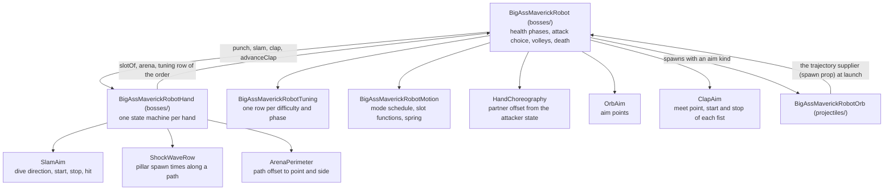

# BigAssMaverickRobot

This package holds the parts of the `INTRO_STAGE` boss fight. The entities stay one level up, in `bosses/`, because the boss spawner resolves a Tiled name through the `bosses` package: `BigAssMaverickRobot` is the head (the conductor), `BigAssMaverickRobotHand` is one hand, and `BigAssMaverickRobotBody` is the body that stays drawn after the death. The orb (`projectiles/BigAssMaverickRobotOrb`) and the shock wave pillar (`explosions/BigAssMaverickRobotOrbExplosion`) are in their own packages.

The design record (the state tables, the tuning rows, the owner decisions) is in `docs/mega-refactor/items/077-robot-master-attacks/branches/mega-refactor-077a-intro-boss/docs/NOTES.md`.

## Why this shape

- The boss is the conductor. It chooses the target, the attack and the hand, and each frame it tells the other hand how to react. The hands never reference each other, so there is no update order between the hands, and the choreography is in one table that a test can call.
- The hands move by mode slots. The boss runs one motion mode for both hands (`ORBIT`, `HOVER`, `BLEND`), and an idle hand follows the slot of its mode. An attack leaves the slot and comes back to the slot where it is at that time.
- The values are in one tuning row per difficulty and health phase, so a play-test tweak is one field.
- Every hand motion is by velocity, applied in the body pre-process, so the platform on the hand and the draw interpolation stay smooth.

## The parts

| Type | Job |
|---|---|
| `BigAssMaverickRobotTuning` | The rows `NORMAL`, `NORMAL_PHASE_2`, `HARD`, `HARD_PHASE_2`; `of(hard, phase)` picks one; `attackFor` is the weighted attack choice |
| `BigAssMaverickRobotMotion` | The mode and its clock; `slot` gives the moving target point of a hand; `spring` is the eased motion |
| `HandState`, `HandAttack` | The hand states, with the damager and platform flags of each state, and the attack kinds |
| `HandChoreography` | A pure function: attacker state, time in state, punch direction, rider, phase scale to the partner offset |
| `OrbAim` | A pure function: aim kind, player center and velocity, arena to the aim point |
| `SlamAim` | A pure function: fist position, target, arena to the dive direction (down, the 2 down diagonals, left, right), the start point, the stop point and the hit point on the floor or a wall |
| `ClapAim` | A pure function: target, arena, fist size to the meet point of the pincer clap and the start and stop point of each fist |
| `ArenaPerimeter` | The open perimeter of the arena as one path (left wall top to bottom, floor, right wall bottom to top); a pure function maps a path offset to a point and a side |
| `ShockWaveRow` | The waves of one slam: one pillar per tile along the path, one each 0.08 s, until the wave life of the tuning row ends or a path end (a wall top) |

## The order in a frame

1. The boss updates the motion mode (only in `FIGHT`). Then, if it is not stunned: the volley, and either the attack wait or the conductor step of the running attack (the partner offset, or the next clap step of both hands). The conductor step runs also while the head is stunned.
2. Each hand runs its state: it sets a motion target and a motion kind, and moves to its next state when the state ends.
3. The body pre-process of each hand turns the motion target into a velocity, moves its platform block, and turns the damager and the platform on or off from the state flags.

## How to tweak a value

- A duration, a speed, a weight, a count or a scale that differs by difficulty or phase: `BigAssMaverickRobotTuning`.
- A motion shape (radius, amplitudes, periods, spring): the companion of `BigAssMaverickRobotMotion`.
- A partner reaction: the constants and the rows of `HandChoreography`.
- A distance or a time of one hand state that is the same in every row: the companion of `BigAssMaverickRobotHand`.
- The arena (floor, walls, ceiling): the map objects that the boss spawn object names in its `ground`, `left_wall`,
  `right_wall` and `ceiling` properties (`BigAssMaverickRobot.onSpawn`). Move the blocks in the map, not a constant.

## Rules a change must keep

- No attack with a hand that a player stands on. The boss filters the free hands; a ridden partner reacts at 0.25 scale.
- A hand does not read another hand. A new pair reaction goes in `HandChoreography`, and the boss sets it.
- A pincer clap step changes for both hands at the same time: the boss calls `advanceClap` only when each hand reports `clapStepDone`. A hand never goes to the next clap step by itself.
- A slam never goes up, and a wave never runs on the ceiling. A wave turns at a corner because the path does; the corner belongs to the floor.
- A tuning value is a field read. Do not add an `if (hard)` or a phase branch; add a field to the rows.
- A running attack ends with the tuning row of its order; the next order reads the new row.
- A mode changes only at a cycle end.
- The tests drive the public flow through `BossRig` (`core/src/test/.../entities/bosses/`).
