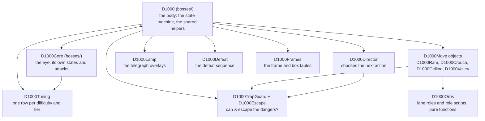
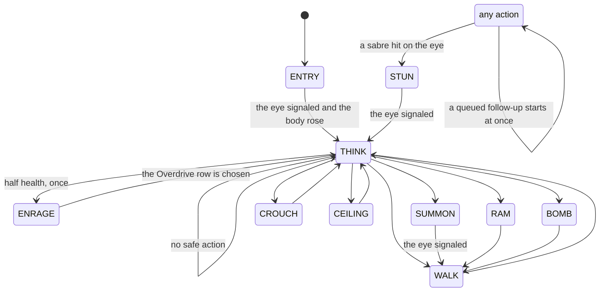

# D-1000

This package holds the parts of the D-1000 boss fight (the X6 intro stage). The two entities stay one level up, in `bosses/`, because the boss spawner resolves a Tiled name through the `bosses` package: `D1000` is the body and `D1000Core` is the eye. Everything else about the fight is here.

The fight was AI-generated from owner play tests and needs more scrutiny (the `TODO` note over each class). The design record, with every value and the reason for it, is in `docs/mega-refactor/items/081-playable-x/branches/mega-refactor-081f-x6-intro-fixes/docs/NOTES.md`. The round that gave the code this shape is "Round 11b" there. The whole fight, state by state, is drawn in `../D1000.md`.

## Why this shape

The body chooses an action, runs it, and must know ahead of time whether X can escape it. So every action exists twice: once as the move that runs, and once as a forecast of its dangers for the trap guard. The design puts both in one object per action, so a tweak to a speed or a count changes the run and the forecast together.

The values live in one table per difficulty row, so a tweak is one field, and the code reads the field.

## The parts

| Type | Job |
|---|---|
| `D1000Tuning` | One value object per row (Normal, Hard, Overdrive, Overdrive Hard). The body picks a row at spawn and again at the end of ENRAGE. The eye reads the body's row |
| `D1000Director` | A pure function of a `D1000Context` to a `D1000Plan`: the base weights are on `D1000Action`, the context bonuses and exclusions are in one cue table, the combos are in `comboOf` |
| `D1000Move` | One object per action that has a timeline: `update` runs it, `forecast` adds its dangers to the guard, `allowed` says whether X escapes it, `forecastNow` adds the rest of the running move |
| `D1000Orbs` | The lane roles of a volley (hunt, cut, feint, sweep, herd), the role scripts, the Fence grid and the aim lead. No entity state |
| `D1000TrapGuard`, `D1000Escape` | The danger model of X: live hazards plus forecast dangers, and a reachability test over a short horizon |
| `D1000Lamp` | The head lamp, face, mouth, screw, charge and puff overlays; `D1000Action.family` picks the color |
| `D1000Defeat` | The shake, the break, the chain of explosions and the pile |
| `D1000Frames` | The traced art: frame orders, ticks per frame, and the fixture boxes of each frame |

The entities that the fight spawns (the orb, the pillar, the debris warning, the ceiling debris, the shockwave, the markers and the pile) are in `decorations/`, `hazards/` and `projectiles/`, under their own `D1000*` names.

## The life of the body

The body states ENTRY, THINK, WALK, SUMMON, ENRAGE and STUN run in the body, each with its own step enum. The action states RAM, CROUCH, CEILING and BOMB each delegate to a `D1000Move` object that owns its steps and its clock. `D1000.kt` holds the real list of states and the dispatch.

A follow-up (a combo) starts from inside the running action through `finishAction`, so the arrows to WALK and THINK above hold only when no follow-up is queued.

## The order in a frame

1. The body adds the frame time, lets the lamp and the pending slam shockwaves tick, then updates the current state or move.
2. A move that reaches a decision point (a throw, a follow-up tell) asks the guard: `beginGuard` loads the live hazards, the move adds its own forecast, and the guard answers.
3. The eye updates on its own component. It asks the body `eyeMayShoot` before each shot; the body answers from the running move's `holdsEyeShots` and a forecast of the rest of that move.
4. The sprite pre-processes read the drawn frame and place the body, the overlays and the charge.

The eye and the body talk through a few calls: the body starts the eye's attacks (`summon`, `guide`, `daze`); the eye tells the body `onCoreSignal` when an attack is over, `takeEyeDamage` and `stun` on a hit, and `onCoreExploded` at the end.

In a volley the volley owns the clock. For each orb it runs a signal, a flight and a lock, and it moves a guide point along the rail. The eye reads the running volley each frame through the body's `guide()` and draws itself at the guide point: the bounce in the signal, the flared thruster in the flight, the beam in the lock. So the forecast and the run use one timeline, and a hidden or stunned eye cannot stall a volley.

## How to tweak a value

- A speed, a duration, a count or an interval that differs by difficulty or by tier: `D1000Tuning`. Change the named constant in its companion, or change which constant a row reads.
- A value that is the same in every row: the companion of the class that uses it (`D1000Ram` for the ram, `D1000Slam` and `D1000Ceiling` for the slams, `D1000Orbs` for the orb schedule, `D1000Defeat`, `D1000Lamp`, `D1000Core` for the eye, `D1000` for the body sizes and the shared timings).
- Which action the boss picks and how often: `D1000Director`. The base weights are the two numbers on each `D1000Action`; the context bonuses and exclusions are the cue table `CUES`; the combos are `comboOf` and `comboGap`.
- The X model that the anti-trap guard assumes (walk speed, reaction time): `D1000Moves` in `D1000Escape.kt`, picked by the `xMoves` field of the tuning row.

## Rules a change must keep

- A move's `update` and its `forecast` describe the same timeline. A new step, a new speed or a new count goes into both, in the same object. The trap tests (`D1000TrapTest`, `D1000SlamTest`, `D1000AttacksTest`) read the guard's dangers against the real run.
- The boxes follow the art. The body's fixtures and the forecast boxes come from `D1000Frames`, placed by the drawn frame. Do not place a box by hand.
- The guard sees every damager. A new hazard that the fight spawns gets a reader in `D1000TrapGuard.addLive` and, if a move spawns it later in its timeline, a line in that move's `forecast`.
- A tuning value is a field read. Do not add an `if (hard)` or a tier branch in the body or the eye; add a column to `D1000Tuning` and fill the four rows.
- The tests drive the public flow through `D1000Rig` (`core/src/test/.../entities/bosses/`). No reflection, no private state.
