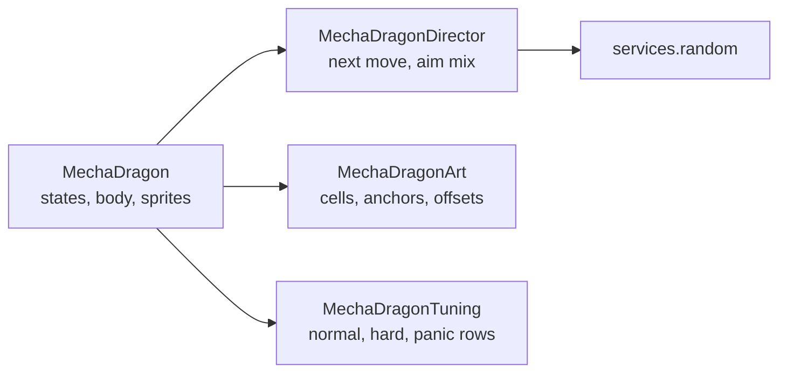
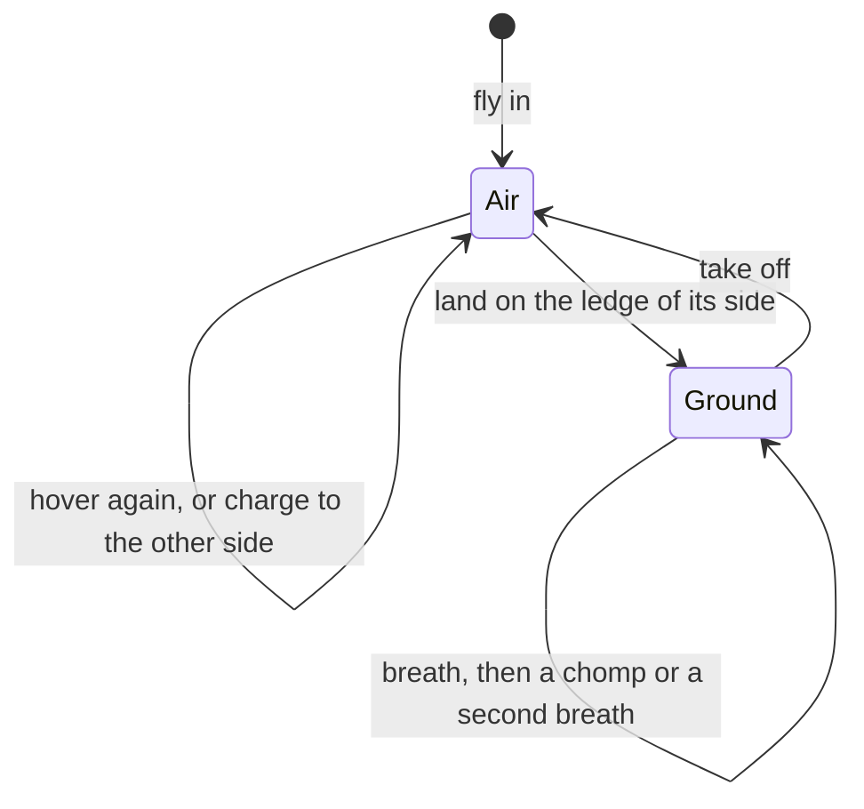

# MechaDragon

The parts of the `MechaDragon` mini-boss fight that hold no engine state: the art layout, the move choice and the
tuning rows. `MechaDragon` (one package up) owns the states, the body and the sprites, and calls these parts. The
research and the decisions are in `docs/mega-refactor/items/188-dragon-mini-boss-upgrade/`.

## Why it is split

The fight has two halves, in the air and on a ledge, and its art comes in two cell sizes. The numbers that tie the
art to the body (anchors, head boxes, sprite offsets) and the rules that choose the next move are pure, so tests check
them without an engine. The entity only applies them.

## The parts

## The cycle

The director caps the air half (it lands after a fixed number of hovers) and the ground half (a fixed number of
breaths), so the fight always alternates. Every roll goes through `services.random`.

## The art layout

- Airborne cells and grounded cells have their own height. Each layout has a center row: the art row that sits at
  the body center. The two center rows are chosen so that the upper body stays in place when the pose changes
  between the layouts at the same body center.
- Every art point (mouth, head box, feet) becomes an offset from the body center with `artToOffset`; facing left
  mirrors x about the cell middle (art x to `127 - x`).
- A draw offset is a whole number of NES pixels (2 game px per art px).

## Rules a change must keep

- An anchor or a head box changes with its art: take the new numbers from the art branch's `ANCHORS.json`.
- A new strip needs its layout in `MechaDragonAtlasTest` and a region in the `MechaDragon` atlas.
- No direct random call (rule `O2-R2`); pass `services.random` in.
