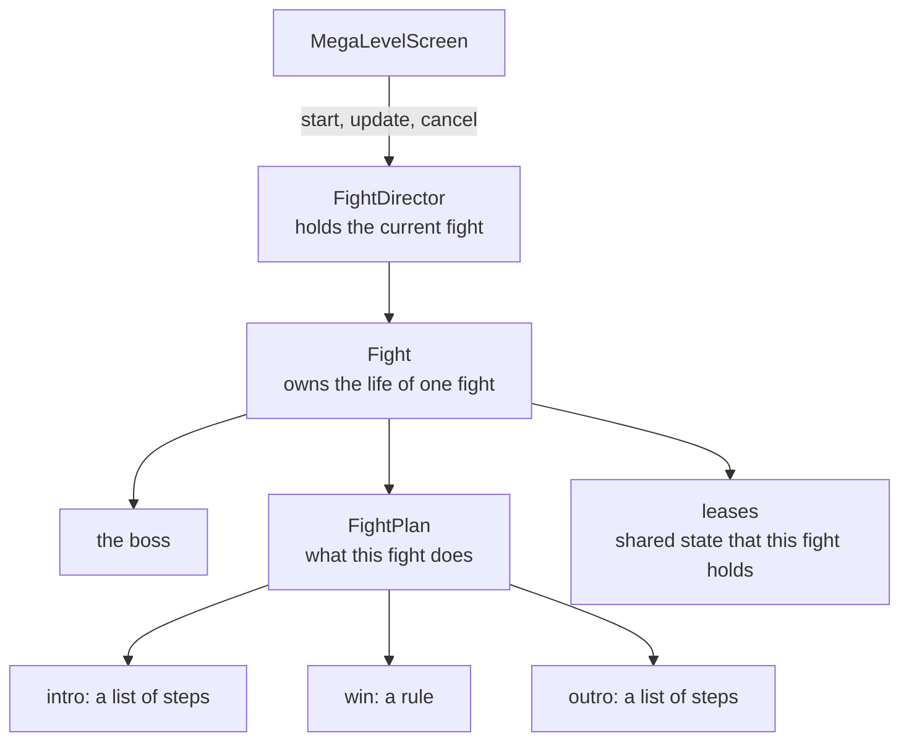
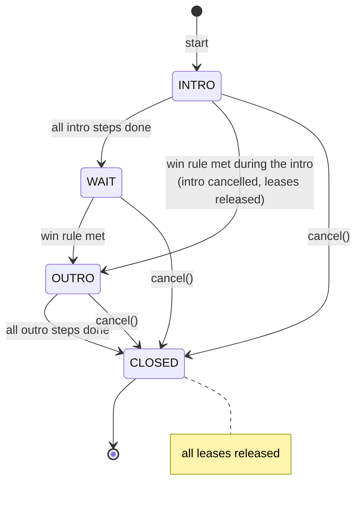
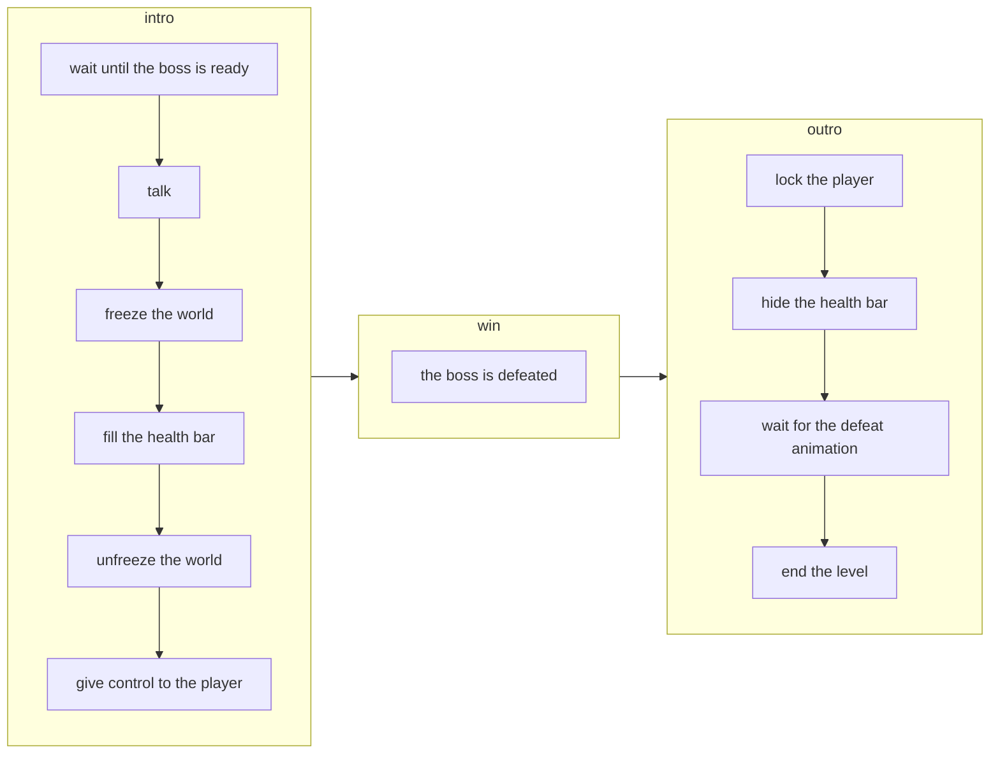
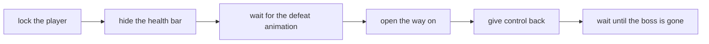
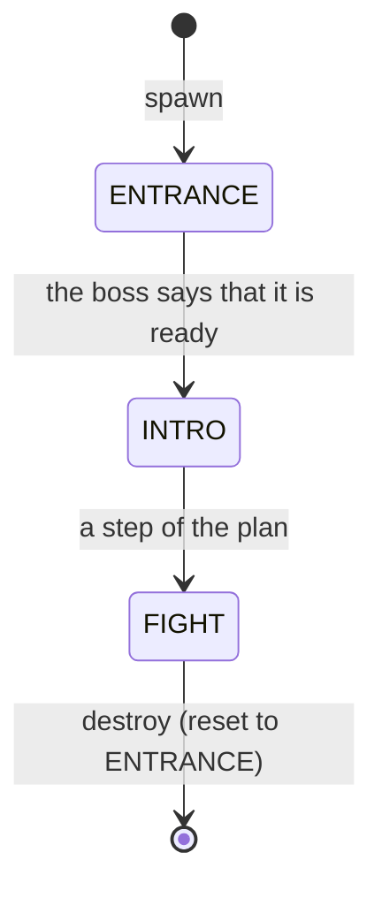
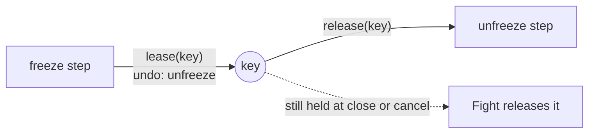
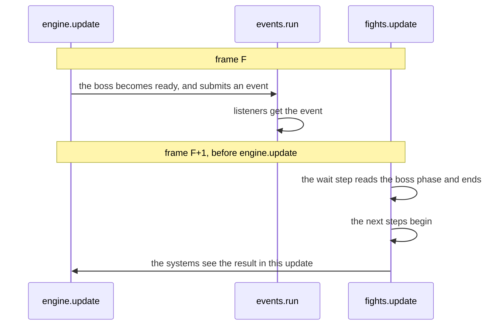

# Fights

This package runs a boss fight. A fight is a value that you compose from small parts. It is not a fixed chain of events.

In the old flow, one boolean (`mini`) decides many behaviors, and the level screen holds the fight logic. So a new kind of fight needs a screen edit and a new hook on `AbstractBoss`. In this package, a plan lists what a fight does. To change a fight, you change its plan.

The research and the full design are in `docs/mega-refactor/items/118-boss-fight-routines/`.

The examples in this file are hypothetical. They show the design, not the current steps. The real plans and steps are in `FightPlans.kt` and `FightSteps.kt`.

## Status

Every boss fight runs in this package. `FightPlans.find` is the one list of bosses that can fight. Each boss room needs a boss that it finds: for any other boss it throws `MissingFightPlanException` when the player enters the room.

The boss hooks (`isReady`, `preReady`, `onReady`, `onEndBossSpawnEvent`) are still on `AbstractBoss`. Item `048` step 6 moves them into `BossComponent`.

## The parts

| Type | Job |
|---|---|
| `Step<C>` (`engine/.../state/`) | One unit of work: `begin`, `isFinished`, `end` |
| `Routine<C>` (`engine/.../state/`) | Runs a list of steps in order |
| `FightPlan` | The steps and the rules of one kind of fight |
| `FightRule` | A value that says when the wait ends |
| `Fight` | Runs a plan, and holds its leases |
| `Lease` | A change to shared state, and how to undo it |
| `FightDirector` | The screen's entry point |
| `FightPlans` | Finds the plan of a boss, and holds the presets |

Warning: `FightDirector` holds 1 fight. `start` replaces an open fight with no `cancel`, so the leases of that fight are not released. See the open-fight rule in "Rules".

## The life of a fight

`cancel()` ends the running step as interrupted, releases all leases, and goes to `CLOSED`.

`Routine` moves through each step that finishes in the same tick. So a wait step and the steps after it can all run in one tick.

## An example plan

A hypothetical boss that talks before the fight, freezes the world while its health bar fills, and ends the level when it is defeated:

A mini boss with no bar and no freeze uses a shorter intro. To leave out a behavior, leave out its step. No boolean is needed.

The same boss can fight in the middle of a level. Then only the end of the outro changes: it opens the way on, gives control back, plays the level music again, and waits until the boss is gone.

`FightPlans.find` reads the boss's map props to choose between such plans. A value that the screen owns, such as the level music, goes to `Fight` as a supplier, so that a step reads it when it runs.

## The boss phase

Each boss has a `BossComponent` with a phase. The boss and the plan each move it 1 step:

The boss runs its entrance in `ENTRANCE`, holds its AI in `INTRO`, and fights in `FIGHT`. So the plan, not an event, decides when the boss AI starts. A plan can put that step after a bar fill, after a talk, or at once.

The fight reads the phase before the boss spawns, because `spawn` only queues. So the boss makes its component when it is built, not in `init()`.

## Leases

A step that changes shared state takes a lease. The lease holds the undo. A later step can release it by its key, and `Fight` releases each lease that remains when it closes, in reverse order.

So no exit route can leave the world frozen or a bar on the screen: a normal end, a win during the intro, a player death (the level reset of the respawn routine, `screens/levels/respawn/`) or a screen reset (`MegaLevelScreen.reset()`).

## How it runs in a frame

`MegaLevelScreen.render` calls `fights.update(delta)` before `engine.update`. It does not run in a pause.

A tick runs the steps first. Then, if the fight's health bar is filling, the tick runs the fill with the same `delta`. So a step that waits for the fill sees the fill end in the next tick, and the screen only draws the bar.

No system runs between `events.run` of frame F and the tick of frame F+1. So a step in that tick has the same effect as an old screen handler in that `events.run`. A submit from a step reaches the `run` of the same frame.

`Fight` is not an entity. A step can turn off `UpdatablesSystem`, so an entity could not end its own freeze.

## Events

A routine gets no event for its order. It reads state, for example the boss phase or `boss.defeated`. Events stay as output for listeners, such as `AbstractBoss` and hazards that react to a defeat.

A fight closes in the same tick as its last step, before `events.run` delivers what that step submitted. So a plan whose exit sends an event can end with a wait step, for example "wait until the boss is gone", that keeps the fight open while that event is delivered.

## How to change this package

**Move a boss.** Add it to `FightPlans.find` with a preset. Remove its forced map props from its `onSpawn`, and give the values to the plan. A plan with no music leaves the music to the map and the boss.

**Add a step.** Add an object to `FightSteps.kt` and put it in a plan. If it changes shared state, use a lease. A step must have a production caller when you add it.

**Add a win or lose rule.** Add a value to `FightRule`.

## Rules

- A step does not poll the win. A rule ends the wait, so that win, lose and a timer stay parallel values and the order stays linear.
- A step has no loop and no branch in the type. A loop is a state machine in a step, and a branch is a plain `if` in a step. This stops a plan from turning into a scripting language.
- A step changes shared state only through a lease.
- `FightPlans.resolve` is the one source for fight facts. It runs before the spawn, because `spawn` only queues and `onSpawn` runs later.
- Add a type or a field only with a production caller. Item `118` lists the parts that wait.
- A fight starts only when no fight is open. No code enforces this. It is true because a gate or a block that spawns at the room entry shuts each fight room, and the way on opens only on the exit event of the fight, after the plan released its leases. A plan with no exit event closes when its boss is gone, so its room must lead to no other fight. A fight room with no such shut, or a new way to start a fight, must keep this rule, or cancel the open fight first. The `118` `ITEM.md` has the decision.
