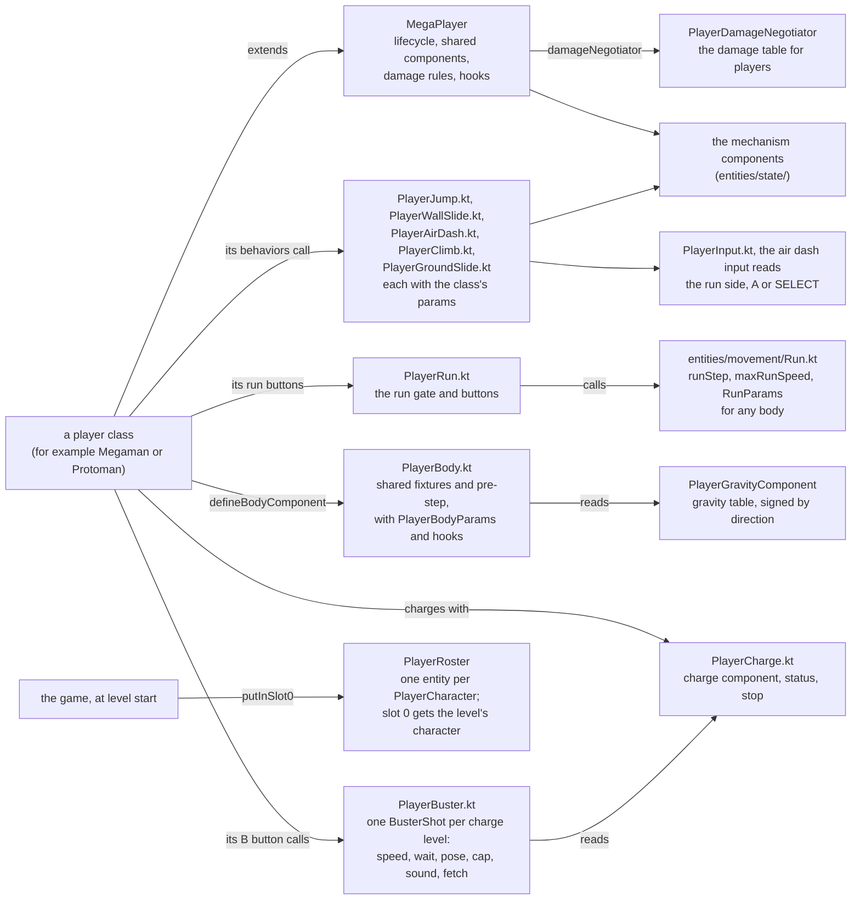
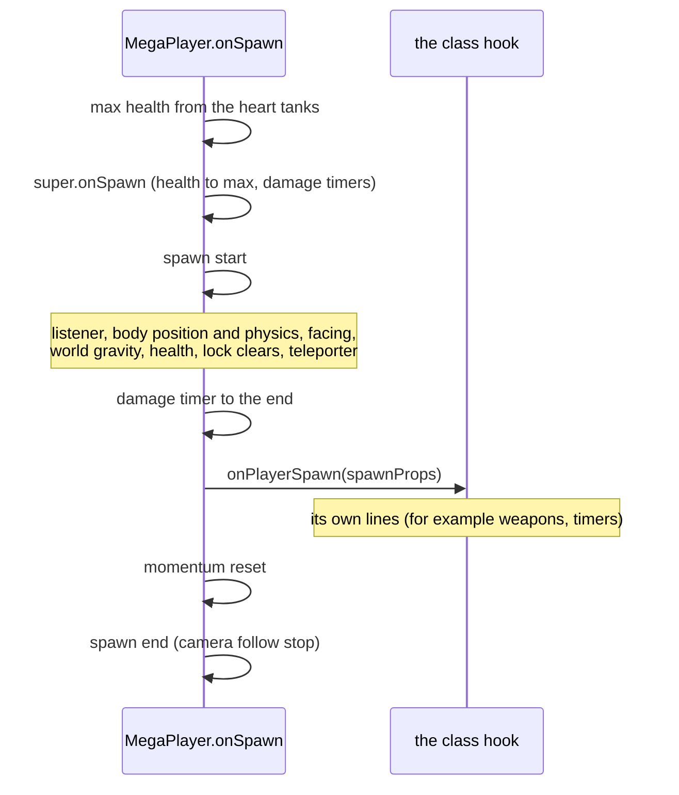

# Players

This package holds the players service (`MegaPlayers`) and the rules that every player class shares: how a player
spawns, dies, moves through a room transition, takes damage and is blocked.

A second playable character must not copy `Megaman.kt`. Each player class extends the abstract base class
`MegaPlayer` (`O8-R1` allows a thin base). `MegaPlayer` owns the lifecycle that every player runs: the final
`onSpawn`, `onDestroy`, `onEvent` and `takeDamageFrom`, the shared components and the shared damage rules. A class
gives its own parts through abstract members (body, momentum, knockback, stun, behaviors, controller, sprites,
animations, the camera focus height) and puts its own lines in open hooks (`onPlayerSpawn`, `onPlayerDestroy`,
`onPlayerEvent`, `afterPlayerDamage`, `onLevelCompleted`, `teleportableComponent`). The moves that only some characters
use are plain functions in this package, and a class opts in by calling them.

The research and the decisions are in `docs/mega-refactor/items/081-playable-x/` (branch `081a`) and
`docs/mega-refactor/items/060-proto-man/` (branch `060j`, the base class; branch `060b`, the first class that only
calls the shared moves).

The examples in this file are hypothetical. The real code is in `MegaPlayer.kt`.

## Status

`Megaman`, `MegamanX` (`081b`) and `Protoman` (`060b`) are the player classes, all on `MegaPlayer` (`060j`). The
classes show the two forms of a class: X has its own body and run (the X6 feet and walk); `Protoman` moves like Megaman,
so it has no move code of its own. It calls `playerBody`, `playerRunButton`, `playerJumpBehavior`,
`playerGroundSlideBehavior` and `playerClimbBehavior` with its own values file, and gives only its values, its sprites
and its list of moves. `MegaPlayer` reads the
shared values (damage time, start health, freeze) from `MegamanValues` until a character needs other values. Some rules still have another owner, and a `TODO` at the
function names it: the difficulty change of the damage (`023`), the owner chain of a shot (`030`), the death event
(`119`), the health base class (`048`), and the locks for stun, freeze and damage (`126`). Only slot 0 can change its character, at the level start (`047` for co-op, `113` for a select screen).

## The parts



## The order of a spawn

`MegaPlayer.onSpawn` is final. The class lines go in the `onPlayerSpawn` hook, between the shared spawn start and
the shared spawn end.



A spawn sends no level event. The respawn routine sends `LEVEL_RESET` when it resets the level (see `screens/levels/respawn/README.md`).

The other final methods follow the same form: `onDestroy` runs the shared destroy and then `onPlayerDestroy`;
`onEvent` runs the shared case for each key and then `onPlayerEvent`; `takeDamageFrom` runs the shared damage tail,
then `afterPlayerDamage`, then the damage sound.

A hypothetical player class:

```kotlin
class Dasher(services: MegaServices) : MegaPlayer(services) {

    override val cameraFocusHeight = 1.5f

    override fun onPlayerSpawn(spawnProps: Properties) {
        dashTimer.reset()
    }

    override fun afterPlayerDamage(damager: IDamagerEntity) {
        dashTimer.setToEnd()
    }

    // ... the abstract define...Component members
}
```

## Rules a change must keep

- **`MegaPlayer` holds only what every player class shares.** A part that one class has, or that has different
  values in two classes, stays in the class (an abstract member or a hook). Examples that stay out: the charge, the
  weapons, the gravity scalar (`IScalableGravityEntity`), `direction`.
- **A function that every player runs as part of the lifecycle is a private member of `MegaPlayer`.** A move that
  only some characters use is a plain function in `players/` or a generic helper, and a class opts in by calling it.
- **A class line goes in its hook at the same point.** The hooks run where the class lines ran before the base
  class. A new hook needs a caller in a player class.
- **Compute, do not store.** `MegaPlayer.invincible` and `playerCanMove` read their state at each call. A timer that ends
  writes nothing, so a stored value goes stale.
- **Fail fast.** The rules read their components with `require(...)`, not with the queries that return a silent
  default. A player class that lacks a component throws at once. The components that each function needs are the
  ones it reads with `require`.
- **The gravity set comes before the lock clears** in the spawn start of `MegaPlayer`. The gravity set can start a camera turn
  that locks `MOVEMENT`, and the lock clear must remove it.
- **One copy.** A rule that two player classes need goes here, not into each class. A difference between the
  classes is a parameter (for example `JumpParams`, `WallSlideParams`, `AirDashParams`, `ClimbParams`,
  `GroundSlideParams`), not a type check in the
  shared code. A shared behavior keeps the gate and the physics that every class has; the params give the class's own start
  rules, speeds, timers and side effects.
- **The body keeps its fixture order.** The order of the fixtures sets the order of the contacts. `playerBody` adds
  the shared fixtures first; a class adds its own fixtures after the call, and its own pre-step lines in the
  `onPreStep` hook, which runs where Megaman's old pre-step ran them (before the body size and the out-of-play
  velocity zero). `MegamanBodyFixturesTest` and its reference file `megaman-body-fixtures.txt` hold Megaman's
  order, sizes and gravity.
- **A class with its own move set keeps its own body.** X has its own body and run (X6 feet and walk). The shared
  player run gate and body are for a class that moves like Megaman: such a class (for example `Protoman`) calls
  them with its own params. `runStep` in `entities/movement/` has no player rules, so any entity with a body and a
  `RunComponent` can run like Megaman.
- **A rule with 3 callers lives here.** Each class calls the shared sprite hide and flash rule
  (`applyHideAndFlash` in `PlayerSprite.kt`) and the direction sign (`Direction.upSign()` in `PlayerGravity.kt`). Some
  parts are still per class: the updatables list (its frame order differs per class), the land sound and the
  `GutsTank` side-stick rule (2 callers), each with a `TODO` that names item `060`; and the sprite size and place
  and the animation key. Share such a part when a third class needs the same rule.
- **The buster gives the shot; the class gives the button.** `PlayerBuster` spawns the shot of a charge level from
  its `BusterParams` (the shot class, the cap or none, the wait and pose times, the speed, the spawn offset). A
  `null` half- or full-charge shot falls back to the shot below it, so a class with no charge passes only the
  uncharged shot. A class that shoots from a crouch, a ladder or a slide passes a crouch, climb or slide offset and
  asks for it per shot (`shoot(status, crouched = true)`, `shoot(status, climbing = true)`,
  `shoot(status, sliding = true)`); such a shot with no offset for it is a mistake and throws. A class reads each
  offset from the muzzle point of its shot art, relative to the body center of that pose (Proto Man:
  `ProtomanValues`). The fire rule
  (on the press or on the release)
  stays in each class's `B` actuator, because X's actuator also drives the sabre. A class reads the charge with
  `playerChargeStatus` and stops it with `stopCharging()`; Megaman adds his weapon gate on top. Megaman's own shots
  still go through his weapon handler (item `024`). Research and decisions: `docs/mega-refactor/items/060-proto-man/`.
- **The sabre is data; the class gives the button.** `PlayerSabre` runs a slash from its `SabreParams`: one move
  list for each `SabreState` (floor, crouch, air, wall), the atlas, the start rule and the state rule. The class
  can name the state of a new slash (`start(state = ...)`), for a state that its state rule only keeps (Proto Man's
  crouch slash: the state rule keeps `CROUCH` while that slash runs on the ground). A press during a move
  chains the next move of the same list, so a combo is a longer list, and a list of 1 has no combo. A state change in
  the middle of a move ends the slash, or turns it into the first move of the new state at the same swing phase, by
  the character's `endOnStateChange`. A landing move (`landingMoves`) can take over an air move that lands before
  its swing ends, at the same time and with no new sound. One damager class,
  `PlayerSabreSlash` (`entities/players/`), draws the arc over the body and places the hit box of each frame for
  every character, so a damage table needs one sabre entry. Each move is full or half strength
  (`SabreMove.fullStrength`), and a table entry reads the strength from the slash, as a `ChargedShot` entry reads
  `fullyCharged`. A class can start a slash that does not chain (`start(chains = false)`), for a single slash next to
  another weapon. A state with no list is a mistake and throws.
- **Weapon slots and a guard are class parts.** A class with more than one weapon keeps its own slot list and its
  own `SELECT` actuator; it switches only when the shared `selectButtonAction` of its slot is `NEXT_WEAPON`, as
  Megaman does, and its `B` actuator reads the slot. A shield is a `SHIELD` fixture that the class adds after
  `playerBody` and places in its own pre-step; the shared `SHIELD` contact rule gives each projectile its own
  `hitShield` reaction. The fixture is placed in the body's own frame: the engine turns it with the body direction,
  so the class does not turn it again. A `HIT_BY_PROJECTILE` receiver runs before `hitShield`, so it only records
  the contact; the class shows its feedback after the contact pass, and only when the projectile reacted (it turned
  back or died). The guard is computed: it is up while its button is held and no break holds (an attack, a hit, a
  stun, a freeze, a teleport, a room transition, a slide, a ladder), after a pull-out time; the button and the breaks are read live, so
  a release drops it at once. The class reads the shield box from its art in one place (Proto Man: `ArtBox` values
  in `ProtomanValues`), so new art changes one value. A class that crouches in its guard owns its crouch box: it
  resizes the shared `BODY` and `DAMAGEABLE` fixtures in its own pre-step, which must run after the `playerBody`
  `DEFAULT` pre-step, because that step resets both fixtures on each step. An attack from the crouch breaks the
  guard like any attack; the class keeps its crouch box for the whole attack, and the guard starts again from its
  pull-out when the attack ends with the button still held.
  A HUD hook draws the slot of the class (item `153` makes it a rule for every player). Proto Man is the first such
  class (`entities/protoman/`).
- **Swap only out of the engine.** `PlayerRoster.putInSlot0` throws when the outgoing player is in the engine. Call it
  before the level screen starts, and set the camera focus after it.
