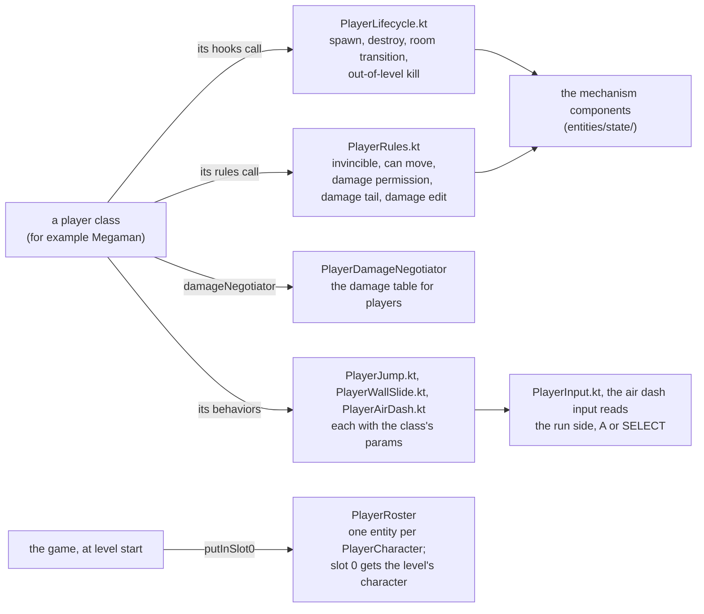
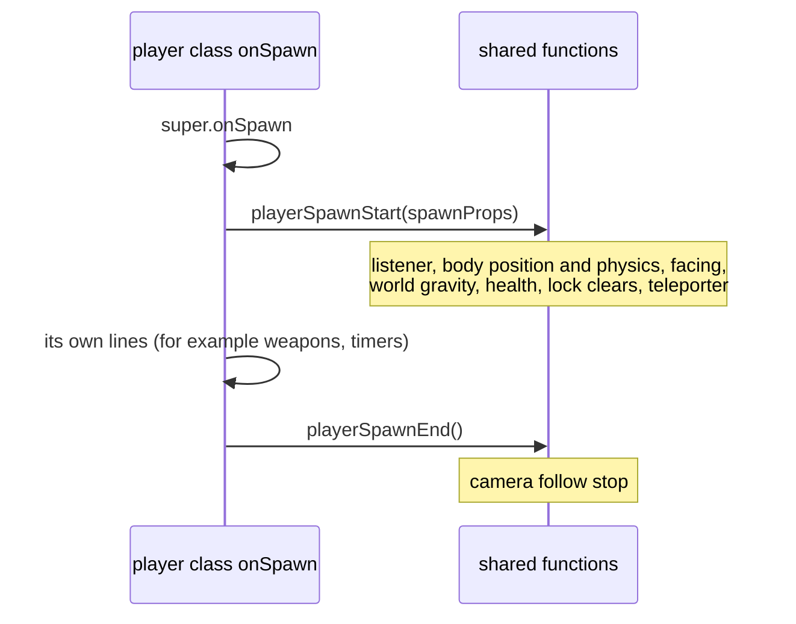

# Players

This package holds the players service (`MegaPlayers`) and the rules that every player class shares: how a player
spawns, dies, moves through a room transition, takes damage and is blocked.

A second playable character must not copy `Megaman.kt` and must not extend a player base class (`O8-R1`, `O1-R2`).
So the shared player rules are free functions over the entity. Each player class keeps its own Kotlin class and its
own hooks (`onSpawn`, `onDestroy`, `onEvent`, `takeDamageFrom`), and each hook calls the shared function for its
part. The class adds only what is its own, for example its sounds, its weapons and its values.

The research and the decisions are in `docs/mega-refactor/items/081-playable-x/` (branch `081a`).

The examples in this file are hypothetical. The real functions are in `PlayerLifecycle.kt` and `PlayerRules.kt`.

## Status

`Megaman` and `MegamanX` (`081b`) are the player classes. Some rules still have another owner, and a `TODO` at the
function names it: the difficulty change of the damage (`023`), the owner chain of a shot (`030`), the death event
(`119`), the health base class (`048`), and the locks for stun, freeze and damage (`126`). Only slot 0 can change its character, at the level start (`047` for co-op, `113` for a select screen).

## The parts



## The order of a spawn

The shared spawn work is 2 calls, so that the class can put its own lines between them.



A spawn sends no level event. The respawn routine sends `LEVEL_RESET` when it resets the level (see `screens/levels/respawn/README.md`).

A hypothetical player class:

```kotlin
override fun onSpawn(spawnProps: Properties) {
    super.onSpawn(spawnProps)
    playerSpawnStart(spawnProps)
    dashTimer.reset()
    playerSpawnEnd()
}

override val invincible get() = playerInvincible
```

## Rules a change must keep

- **Compute, do not store.** `playerInvincible` and `playerCanMove` read their state at each call. A timer that ends
  writes nothing, so a stored value goes stale.
- **Fail fast.** The rules read their components with `require(...)`, not with the queries that return a silent
  default. A player class that lacks a component throws at once. The components that each function needs are the
  ones it reads with `require`.
- **The gravity set comes before the lock clears** in `playerSpawnStart`. The gravity set can start a camera turn
  that locks `MOVEMENT`, and the lock clear must remove it.
- **One copy.** A rule that two player classes need goes here, not into each class. A difference between the
  classes is a parameter (for example `JumpParams`, `WallSlideParams`, `AirDashParams`), not a type check in the shared
  code. A shared behavior keeps the gate and the physics that every class has; the params give the class's own start
  rules, speeds, timers and side effects.
- **Swap only out of the engine.** `PlayerRoster.putInSlot0` throws when the outgoing player is in the engine. Call it
  before the level screen starts, and set the camera focus after it.
