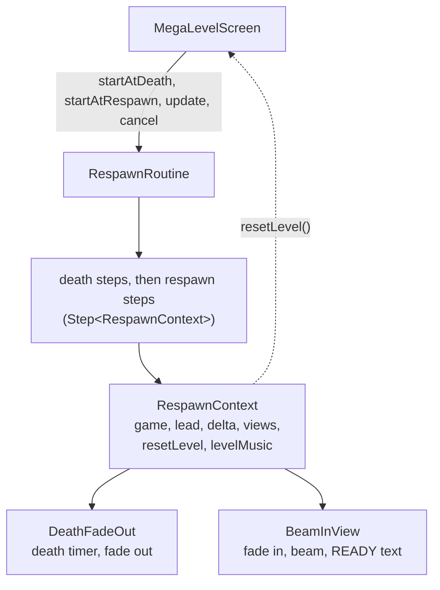

# Respawn

This package runs the death of the lead player and the respawn of all players, as one routine of steps in a fixed order.

In the old flow, 5 events handed control from one part to the next: the screen started a death handler, the handler sent an event back to the screen, the screen started a spawn handler, and so on. The order lived in the event timing across frames, and a comment in the screen warned not to change it. In this package, one list of steps holds that order. To change the respawn, you change the list.

The research and the decisions are in `docs/mega-refactor/items/038-respawn-routine/`.

The examples in this file are hypothetical. The real steps are in `RespawnSteps.kt`, and the two lists are in `RespawnRoutine.kt`.

## Status

The routine acts on the lead player in slot 0, as the old handlers did. `SlotRespawn` respawns one slot alone, by the `SlotRespawnRule` of the session mode (`state/SessionRules.kt`): `NEAR_PARTNER` (co-op, item `047`) spawns the slot next to a live partner, costs a life, and gives the routine the death of the last player; `AT_SPAWN` (PvP, item `109`) spawns the slot at its own spawn point, costs no life, starts the damage recovery at the beam end, and never starts the routine. The public events (`PLAYER_JUST_DIED`, `PLAYER_DONE_DYIN`, `PLAYER_READY`) stay, because entities listen to them. The routine sends `LEVEL_RESET` when it resets the level; many entity classes destroy, cull or reset themselves on it. A player spawn sends no event. A spawn event for each slot comes with co-op (`047`), when a listener needs it.

## The parts



| Type | Job |
|---|---|
| `Step<C>`, `Routine<C>` (`engine/.../state/`) | The step type and the runner, shared with `fights/` |
| `RespawnRoutine` | Starts a list of steps at the death or at the level start, and updates it |
| `RespawnContext` | What the steps read and write; the screen gives it the level reset and the level music |
| `DeathFadeOut`, `BeamInView` | Timers, fades and draws only. They send no events and change no players |

The views stay owned by the screen for drawing: the screen draws the beam while it is not finished, and the black fade while the lead is not live.

## The order in frames

`EventsManager` delivers an event in `events.run()` at the end of the frame. An event that a listener submits during `run()` arrives in the next run. So each hand-off of the old chain did its next part in the next `events.run()`, and other code depends on the frames that this gave. The routine keeps the same rule: a step that must come "after the hand-off" waits until `EventsManager.runCount` goes up.

The screen calls `update` at the top of the unpaused part of `render`, before the spawners and the fight update. Only the `runQueue` drain and the pause checks run between the end of one frame and that point, and pause is blocked while the lead is dead or not in play. So work that waits for a run lands where the old `run()` work did.

```mermaid
sequenceDiagram
    participant S as MegaLevelScreen
    participant R as RespawnRoutine
    participant E as engine and events
    Note over S,E: frame N
    E->>S: PLAYER_JUST_DIED (run)
    S->>R: startAtDeath: defeat at once
    Note over S,E: frames N+1 to M
    R->>R: death timer, fade out
    R->>E: PLAYER_DONE_DYIN (frame M)
    R->>R: lives check; game over goes through runQueue
    Note over S,E: next run, then frame M+1
    R->>R: begin respawn: locks, TURN_CONTROLLER_OFF; beam until the next run
    Note over S,E: next run, then frame M+2
    R->>S: resetLevel(): camera, fights, enemies, spawn players
    R->>E: LEVEL_RESET
    E->>E: engine.update spawns the players; the run delivers LEVEL_RESET
    Note over S,E: frames M+2 to R
    R->>R: beam in
    R->>E: TURN_CONTROLLER_ON, PLAYER_READY (frame R)
```

The level start begins the respawn at once, where the screen starts. A start from a menu has an `events.run()` right after it, and a start from the launcher does not; the run counter gives each case the frames of the old code. A death during the beam-in waits for ready, as the old handlers did.

`RespawnRoutineTest` models the render and the run of each frame, and checks the frame of each event and of the level reset.

## How to change this package

- To add work to the death or the respawn, add a step to the list, at the point in the order where it belongs. Keep a step small: one job.
- To move work between frames, change the steps and the frame test together. Then check each entity that listens to the events, because some of them depend on the frames.
- Do not make the steps send events to drive each other. A step that must happen after another is the next step in the list.

## Rules

- The views send no events and change no player. The steps do that.
- `cancel` (a screen reset or a game over) ends the routine with no event.
- On game over, no respawn step begins.
- The level start enters the routine at the respawn steps; only a death runs the death steps.
- A death during the respawn steps waits until the routine is done. A death during the death steps starts them again.
