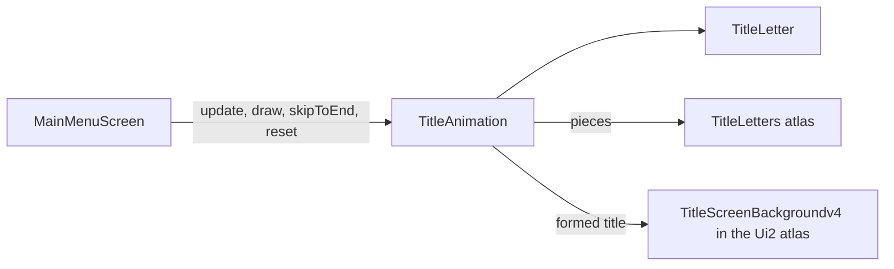
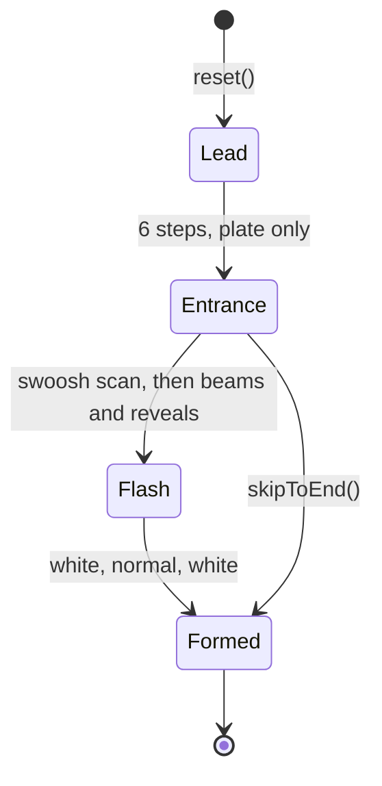

# Title entrance

The main menu title is not one picture that appears: it is built from pieces by a short scripted animation, then
swaps to the single original image. The animation runs in whole steps of 50 ms (3 frames of a 60 Hz NES), so the
motion looks the same at any frame rate.

## Parts

- `TitleAnimation` owns the step clock and draws every step. The step tables (starts, reveal widths, flash steps) are
  constants in its companion object.
- `TitleLetter` is one cut-out letter: its home place in the 256x256 title image, its start step, its beam color and
  its two regions (normal and white).
- The atlas `TitleLetters` holds `title_plate` (the image without the title), `swoosh`, `swoosh_white`, the 15 letters
  `top_N_X` and `bot_N_X` with a `_white` copy of each, and `pixel` (a 1x1 white texel that the beam stretches).
  `assets/sprites/texture_packer/TitleLetters.tps` is the project to repack it.

## Order in time

`formed` turns true at the end. The menu draws its text and accepts input only then.

## Rules a change must keep

- The last frame is `TitleScreenBackgroundv4` itself: the pieces must composite back to it pixel for pixel. Draw the
  original region for the formed title and for the normal frame of the flash.
- Every move is a whole NES pixel (2 units). Pieces are clipped with `TextureRegion.setRegion` on scratch regions
  made at construction. Nothing is allocated in `update` or `draw`.
- The title is drawn in UI coordinates, so it moves with the settings slide like the old background did.
- The cut has a guessed swoosh behind the letters and made-up outlines (they show only while a piece is away from
  home). See `docs/mega-refactor/items/187-intro-story-and-menu/branches/mega-refactor-187a-intro-story-art/docs/TITLE_OPTIONS.md`.
