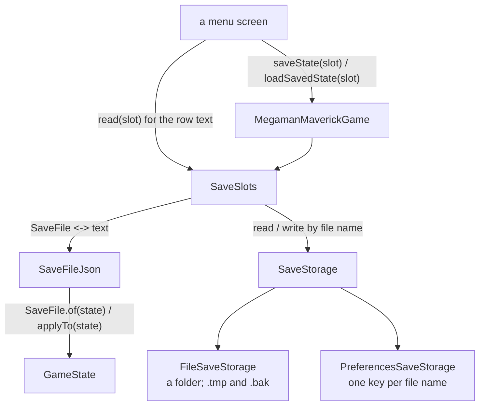

# Saves

The player's progress (`GameState`) is saved in a fixed number of JSON save slots. The research and the decisions are
in `docs/mega-refactor/items/007-json-save-slots/`.

## Status

First pass (`007a`): the slots, one JSON schema version and a slot list in the menus. No old save format is read
(owner decision, 2026-11-26).

## The parts

- `SaveStorage` knows only names and text. The game picks the backend from the platform when it starts, and the
  game title gives the folder.
- `SaveSlots` maps a slot number to a file name and gives a typed `SaveSlotContent`: empty, used, newer version or
  unreadable.
- `SaveFileJson` holds the schema and its `version`. `SaveFile` is the data of one slot, copied from and into
  `GameState`.

## Rules

- A file with a `version` newer than `SaveFileJson.VERSION` is never loaded and never overwritten.
- A change to the schema raises `VERSION` and adds a read of the old version, so that saves stay loadable (`O9-R2`).
- A name that the game does not know (a removed level, tank or enhancement) is logged and skipped; it does not stop
  the load.
- The file backend never writes a slot file in place: it writes `.tmp`, keeps the old file as `.bak`, and then
  renames.
- Tests use an in-memory `SaveStorage` (`core/src/test/.../state/saves/`).
