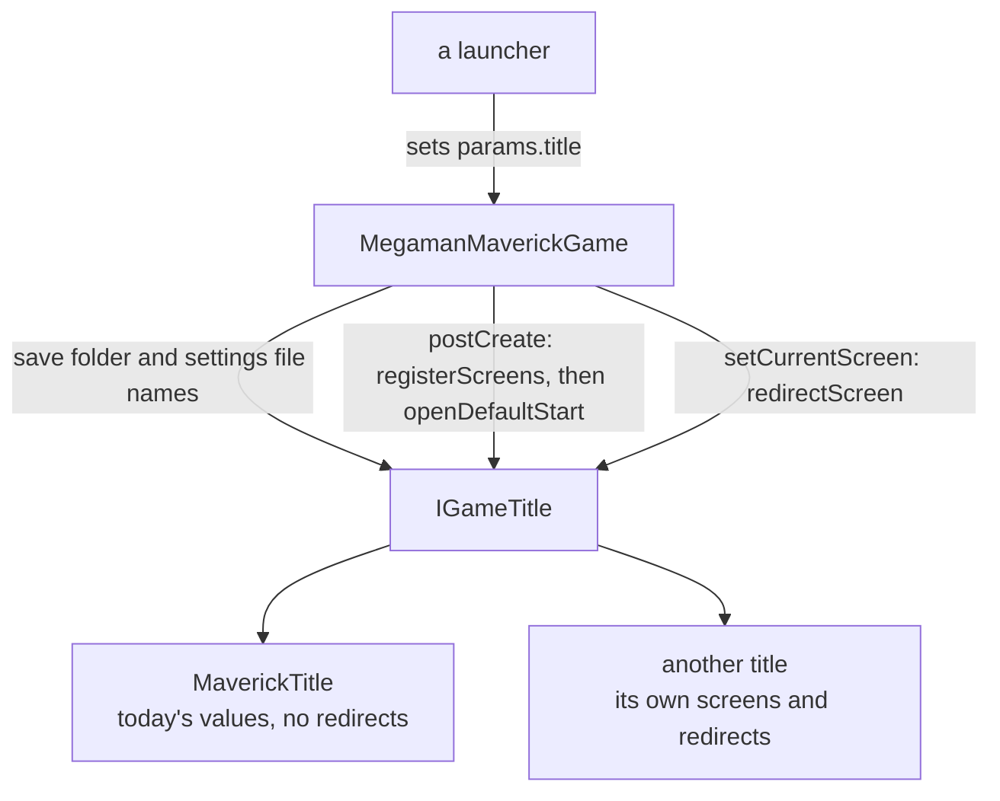

# Titles

This package lets more than one game run on the same host class, `MegamanMaverickGame`. A game title is an object
that supplies what differs between the games. The host reads it from `MegamanMaverickGameParams.title`, and each
launcher sets it.

The research and the decisions are in `docs/mega-refactor/items/185-second-title/`.

## Status

This is a stopgap. The host contract (item `001b`) and a level registry replace it later, so that each title has its
own screen flow. Until then, a title changes the Maverick flow only through screen redirects.

## The parts

| Member | When the host reads it |
|---|---|
| `saveFolderName` | `create()`, as the root of the save slots folder (`<saveFolderName>/saves/`, or `<saveFolderName>/saves/<name>/` with `--saveFile <name>`) |
| `playerSettingsFileName` | `create()`, as the prefix of each slot's settings file |
| `registerScreens` | `postCreate()`, after the host registers its own screens |
| `openDefaultStart` | `postCreate()`, when the launch gives no `--level` and no `--screen` |
| `redirectScreen` | each `setCurrentScreen` call, once, before the screen changes |

## Rules

- `MaverickTitle` keeps the Maverick behavior exactly: its settings file names do not change, and it has no redirects.
  Its saves moved to JSON slots in `.megaman-maverick/saves/` (item `007`).
- A title gives its own save folder and settings file names, so that two games never share a save.
- A redirect maps one screen key to one other key. The host applies it once, so a redirect target is not redirected
  again.
- A launch option (`--level`, `--screen`, `--saveFile`) wins over the title's default.
