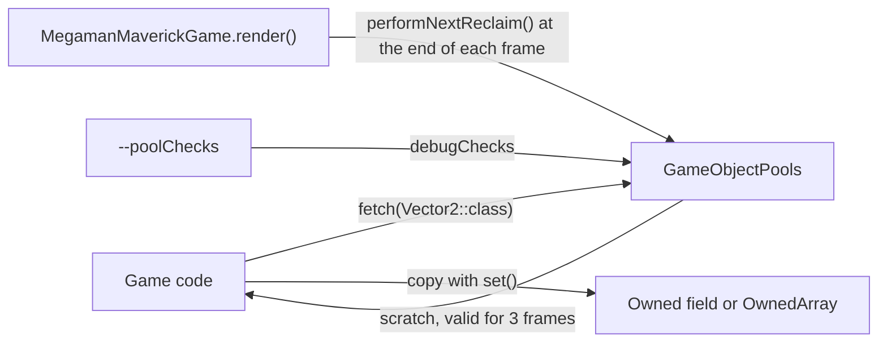
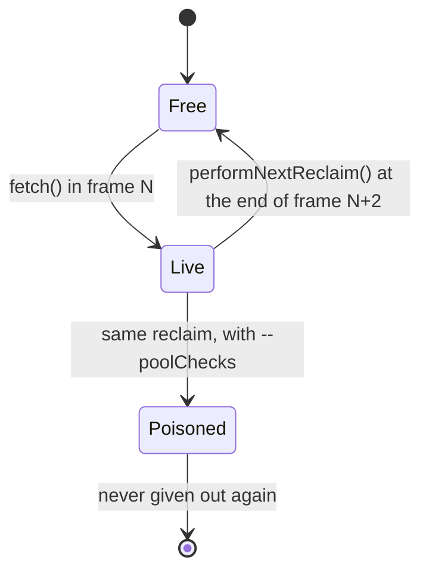

# Pooled scratch objects and owned values

This README covers `GameObjectPools.kt` and `OwnedArray.kt`. The other files in this package are unrelated helpers.

## Purpose

Game code needs many short-lived math objects every frame: a body center, a bounds rectangle, a direction. A `new`
for each of them makes garbage every frame, and on weak hardware the garbage collector then causes frame spikes
(objective `O5`). So the game gives these objects from pools, and it takes them back on its own, with no `free()`
call.

That only works if each object has one clear owner and one clear life. The ownership contract below is that rule.
The research and the decisions are in `docs/mega-refactor/items/045-pool-ownership/` (branch `045a`).

## The parts



- `GameObjectPools`: one pool per pooled type (`Vector2`, `GameRectangle`, and the other types in its `init`). Each
  `fetch` gives a **scratch** object. There is no `free()`: the pool takes every scratch back by itself.
- `OwnedArray<T>`: a list that owns its elements. `add()` gives the next element, made once and reused after
  `clear()`; a reused element keeps its old values, so set it at once. Use it for data that an entity keeps for its
  whole spawn, for example the points of a map object. Do not put its elements in another owner's list.

## Life of a scratch object



`performNextReclaim()` keeps 3 buckets (`SCRATCH_LIFETIME_FRAMES`). Each call frees the oldest bucket. So a scratch
is valid in its own frame and the next 2 frames. The value is a safety margin for a spawn prop or a `runQueue`
entry, which waits for the next frame. It is not a license to keep a scratch.

## The ownership contract

1. **A scratch is never stored.** Do not put it in a field, a list, a map, a delayed runnable or a lambda that runs
   later. Use it in the current frame and let it go.
2. **Stored data is copied.** An entity copies a value it must keep into an owned field (`bounds.set(...)`), or into
   an `OwnedArray` (`points.add().set(...)`). A value made once per spawn or per event can also be a plain `new`.
3. **Spawn props never pass ownership.** The sender may put a scratch in the props. The entity reads the props in
   `onSpawn` (the next engine update) and copies what it keeps. It never keeps a reference from the props.
4. **A function with no `out` parameter that returns a pooled type returns a scratch**, for example
   `body.getCenter()`. A pool fetch never goes in a default parameter value (`PoolOwnershipGuardTest` checks this).
   To keep the result, pass your own `out`: `body.getCenter(myCenter)`.
5. **A value handed to another thread is copied first.** The pool is not thread-safe, and a worker can outlive the 3
   frames (for example the pathfinder, which copies its start and target).

Example:

```kotlin
class Hypothetical(services: MegaServices) : MegaGameEntity(services) {

    private val home = Vector2()
    private val waypoints = OwnedArray { Vector2() }

    override fun onSpawn(spawnProps: Properties) {
        super.onSpawn(spawnProps)
        home.set(spawnProps.get(ConstKeys.POSITION, Vector2::class)!!)
        waypoints.clear()
        spawnProps.forEach { key, value ->
            if (key.toString().contains(ConstKeys.TARGET)) (value as RectangleMapObject).rectangle.getCenter(waypoints.add())
        }
    }

    private fun update(delta: Float) {
        val toHome = GameObjectPools.fetch(Vector2::class).set(home).sub(body.getCenter())
        body.physics.velocity.set(toHome.nor().scl(SPEED))
    }
}
```

## Debug checks

`--poolChecks` (launcher flag, off by default) sets `GameObjectPools.debugChecks`. At each reclaim it sets every
reclaimed scratch to NaN (an `IntPair` to `Int.MIN_VALUE`) and drops it, so the pool never gives it out again. A
stored scratch then stays NaN, and the entity that holds it shows the fault at once: it jumps, vanishes or stops. With
the flag on, memory grows by every scratch of every frame, so use it for short dev runs only. The checks cost nothing
when the flag is off.

## How to change this package

- A new pooled type: add one `put(...)` in `GameObjectPools.init` with a reset (`onFetch`) and a poison.
- Do not add a `free()` or a "keep" flag back. A value that must live longer is owned by its user.
- Item `010` (one fixed tick) can move the reclaim from frames to ticks. The contract does not change.
