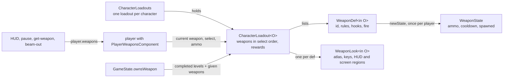
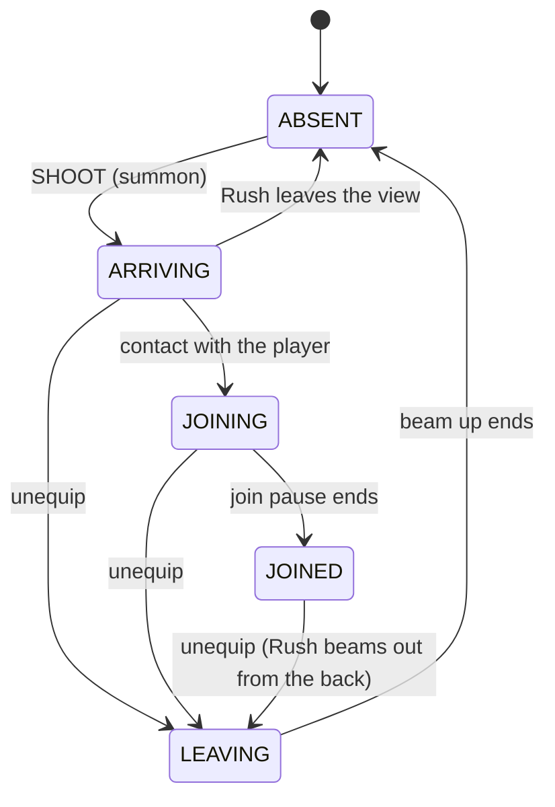

# Weapons

A weapon is one `WeaponDef` object. The def holds the rules of the weapon: its id, its cooldown and cost, its fire
function, and the hooks that change the moves of the player who holds it. Each character has a loadout: its weapons in
select order, the look of each weapon for that character, and the weapon that each level gives it. Code that needs a
fact about a weapon reads a field of the def or of the look. It does not compare the weapon with a list of weapons,
and it does not check the class of the player.

The research and the decisions are in `docs/mega-refactor/items/024-weapon-defs/`.

## Status

- Only Megaman has weapons. His defs are in `entities/megaman/weapons/MegamanWeapons.kt`, and his loadout is in
  `MegamanLoadout.kt`. X and Proto Man have empty loadouts.
- The pause screen has one layout, Megaman's, for every character (`TODO`, item `060h`).

## Parts



- `WeaponDef` is shared and pure: it holds no state that changes during play. All play state is in the
  `WeaponState` that the player's handler makes with `newState`. A state subclass can override `canFire` and `update`.
- The owner type `O` is the player class that a def can fire for. A def typed with one player class (for example
  `WeaponDef<SomePlayer>`) reads members of that class. A def typed `WeaponDef<MegaPlayer>` reads only shared members,
  so it is a shared def: it fits the loadout of any character, and the compiler checks that it is portable.
- `WeaponLook` is the art of a weapon for one character. Two characters that share a def can have different looks.
- A player with weapons has a `PlayerWeaponsComponent`. Screens read it with `player.weapons`, which is `null` for a
  player with no weapons.
- Owned weapons are not stored. A character owns a weapon of its loadout when the weapon is `alwaysOwned`, when a
  completed level gives it to that character, or when a launch option or a level override gives it. Completed levels
  are shared by all characters, so the save file holds no weapons.

## Example: a shared weapon

```kotlin
val SPARK_SHOT = WeaponDef<MegaPlayer>(id = "spark_shot", cooldown = 0.25f, fire = ::fireSparkShot, cost = { 2 })

val SOME_LOADOUT = CharacterLoadout<SomePlayer>(
    character = PlayerCharacter.SOME_PLAYER,
    looksInSelectOrder = orderedMapOf(SPARK_SHOT pairTo sparkShotLookOfSomePlayer),
    rewards = objectMapOf(LevelDefinition.SOME_LEVEL pairTo gdxArrayOf(SPARK_SHOT))
)
```

## Rules

- The id is lower case with underscores. Some strings are still made from it (Megaman's animation keys and trail
  regions, the `--weapons` values and the display name). A changed id breaks these lookups at run time.
- The order of a loadout is the `SELECT` cycle order and the energy fill order of that character.
- A rule that only some weapons have goes in a field or a hook of the def, or in the look, with a default that means
  "no change". Do not add a check for one weapon, or for one player class, in the code that reads it.
- A reward of a loadout must be a weapon of that loadout; the loadout fails fast otherwise.

## Rush abilities

A def with `summonsRush` is a Rush ability. Its moves (`enablesJetpack`, `airDash`) and its look work only while Rush is
joined with the player; until then the player moves and looks as with the buster. `SHOOT` with no Rush out calls Rush;
with Rush out it fires the weapon.

- `MegamanRushHandler` (one per Megaman) holds the phase and the current Rush. It is the only code that calls Rush down
  or sends him away.
- `Rush` (`entities/special/`) is the dog: he beams down, lands, sits, joins, and beams out. He tells the handler when a
  join starts, when it ends and when he is gone.
- The join pauses play: Rush sends himself to the level screen as a `LevelFreezeRoutine`, and the screen updates him
  with the other systems off until he is done.



A player death resets the handler to `ABSENT`. A new Rush ability that does not join (for example a spring) needs its
own path after the landing; the research and the decisions are in `docs/mega-refactor/items/190-rush/`.
