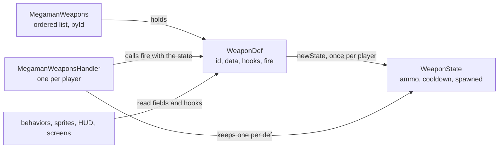

# Weapons

A weapon is one `WeaponDef` object. The def holds all the data and the rules of the weapon: its id, its atlas, its
cooldown and cost, its fire function, and the hooks that change the moves and the look of the player who holds it. Code
that needs a fact about a weapon reads a field of the def. It does not compare the weapon with a list of weapons.

The research and the decisions are in `docs/mega-refactor/items/024-weapon-defs/`.

## Status

- Only Megaman has weapons. His 10 defs are in `entities/megaman/weapons/MegamanWeapons.kt`, in select order.
- The hooks and the fire function take `Megaman`. Item `024b` widens them to the owner of a loadout, and gives each
  character a loadout. Until then, some screens still check `is Megaman` (`TODO`s name item `024`).

## Parts



- `WeaponDef` is shared and holds no state that changes during play.
- `WeaponState` is the per-player state of one weapon. A weapon with more state (extra timers, a combo index) has a
  subclass, made by its `newState`. A state subclass can override `canFire` and `update`.
- The handler of each player makes one state per def, and keeps the steps of a shot in this order: the checks
  (in play, owned, not frozen, cooldown, `canFire`, cost), the cooldown reset, `fire`, and the ammo cost.

## Example: a new weapon

```kotlin
val SPARK_SHOT: WeaponDef = WeaponDef(
    id = "spark_shot",
    atlas = TextureAsset.MEGAMAN_SPARK_SHOT,
    cooldown = 0.25f,
    fire = ::fireSparkShot,
    cost = { 2 },
    hudBitRegion = "spark"
)
```

Add it to the ordered list, at the place it takes in the select cycle.

## Rules

- The id is lower case with underscores. Strings are made from it: animation keys, trail regions, pause and get-weapon
  regions, the display name and the `--weapons` values. A changed id breaks these lookups at run time.
- The order of the list is the `SELECT` cycle order and the energy fill order.
- A rule that only some weapons have goes in a field or a hook of the def, with a default that means "no change".
  Do not add a check for one weapon in the code that reads it.
