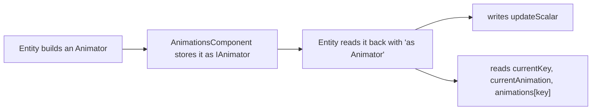
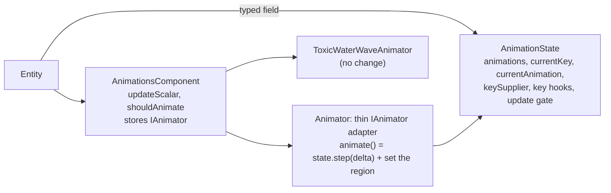
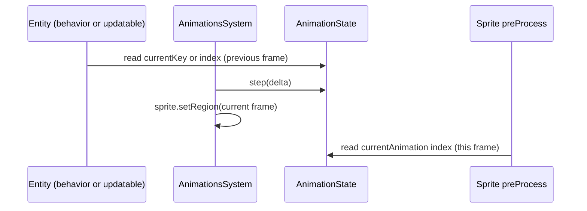

# Code casts `IAnimator` to `Animator` to read animator state, and `Animator` mixes several concerns

This is a design issue, not a bug. The owner asked to file it here and do the work later. All the
context from the design session is in this file. The research notes in `temp/animator-design/`
are not committed.

## Where

- `engine/src/main/kotlin/com/maverick/game/engine/animations/IAnimator.kt`
- `engine/src/main/kotlin/com/maverick/game/engine/animations/Animator.kt` (with `AnimatorBuilder`)
- `engine/src/main/kotlin/com/maverick/game/engine/animations/AnimationsComponent.kt`
- `engine/src/main/kotlin/com/maverick/game/engine/animations/AnimationsSystem.kt`
- The cast sites in the table below.

## What happens

`IAnimator` is lean: `shouldAnimate(delta)`, `animate(sprite, delta)` and `Resettable`.
`AnimationsComponent` stores animators as `OrderedMap<Any, IAnimator>`. An entity builds an
`Animator` and puts it in the component, so the static type is lost. When the entity must read
the state again, it casts `as Animator`.



### The 12 casts in `core/src/main`

| Site | What it needs | Live |
|---|---|---|
| `entities/bosses/TimberWoman.kt:975` | `currentAnimation.getIndex()`: turns the axe damager on or off (gameplay) | yes |
| `entities/bosses/TimberWoman.kt:1080`, `:1105`, `:1129`, `:1154` | `animations[key]` or `currentAnimation`, then `getIndex()` | no: inside the comment block `:1068`–`:1168` |
| `entities/enemies/LumberJoe.kt:374` | `currentKey` and `animations[key].getIndex()`: turns the shield on or off (gameplay) | yes |
| `entities/bosses/RodentMan.kt:267` | `animations["stand_slash_combo"].reset()` | yes |
| `entities/explosions/MagmaExplosion.kt:87` | `animations.values()`, then `setFrameDuration` on each, per spawn (single `Animator(animation)`) | yes |
| `entities/megaman/components/SpritesComponent.kt:195` | `currentAnimation.getIndex()`: hides the burst sprite | yes |
| `entities/megaman/Megaman.kt:203` | writes `updateScalar` on every animator (`movementScalar` setter) | yes |
| `entities/enemies/SpikeBot.kt:137` | getter `animators[TAG] as Animator`, used only to write `updateScalar` at `:194` | yes |
| `screens/other/GetWeaponScreen.kt:270` | `animations.values()`, then `reset()` on each. The map is the screen's own `OrderedMap<String, IAnimator>` (`:83`), not a component | yes |

Facts:

- Every cast reads an animator that the same class built. No cast reads the animator of another
  entity.
- No cast needs the key selection or the key-change hooks. Each cast needs only the animation
  store (`currentKey`, `currentAnimation`, `animations`) or `updateScalar`.
- The 4 `as Animation` casts after the `as Animator` casts in `TimberWoman` are not needed:
  `getIndex()` is on `IAnimation` (`IAnimation.kt:30`).
- 6 files already keep a typed field and need no cast: `D1000`, `D1000Core`, `D1000Pillar`,
  `GlacierMan`, `QuickSand` and `SpikeBot_OLD` (for example `private lateinit var animator: Animator`).
  The new X6 ports use this form.
- `SpikeBot_OLD.kt:184` also writes `updateScalar`, through its typed field.

### What `Animator` holds

`Animator` is `open`, but nothing subclasses it (0 hits for `: Animator(`). Its behavior comes
from constructor lambdas, not from inheritance. The problem is that one class holds several
concerns:

| Concern | Members | Use in `core/src/main` |
|---|---|---|
| Key selection | `keySupplier`, `currentKey` | 125 keyed constructor calls, 97 `setKeySupplier` calls |
| Animation store | `animations`, `currentAnimation` | the casts above, and the typed fields |
| Key-change hooks | `onChangeKey`, `postProcessKey`, `shouldEqualKeysTriggerChange` | `onChangeKey`: 9 sites. The other two: `Megaman` only (`megaman/components/AnimationsComponent.kt:37`–`:43`) |
| Animate gate | `shouldAnimatePredicate` (the `IAnimator.shouldAnimate`) | 2 sites set it after the build (`RisingLavaRiver`, `InfernoOven`) |
| Update gate | `shouldUpdateAnimationPredicate` | 2 sites (`WilyFinalBoss`, `MetaWheelF`) |
| Speed | `updateScalar` | 3 writers (`Megaman`, `SpikeBot`, `SpikeBot_OLD`) |
| Frame apply | `sprite.setRegion(...)` in `animate` | every animator |

Construction sites in `core/src/main`: 232 `Animator(` calls (107 with one animation, 125 with a
key supplier) and 100 `AnimatorBuilder()` calls, in 314 files. `AnimatorTest.kt` (139 lines) in
`engine/src/test/` reads `keySupplier`, `animations`, `currentKey` and `currentAnimation`.

Of the 10 hook sites that get the `Animator` parameter (`(Animator, String?, String?)`), only
`WilyFinalBoss.kt:767` reads it, and only for `animations`.

### The second `IAnimator` implementer

`ToxicWaterWaveAnimator` (`entities/special/ToxicWater.kt:40`) is a shared static animator in a
companion (`ToxicWater.kt:76`). Its animation updates once per frame through
`services.updatables`. `animate()` only sets the region, so many sprites can share it with no
double update. It has no keys, no map and no hooks.

## What should happen

- No `as Animator` casts.
- `IAnimator` stays lean. The owner rejected adding `currentKey`, `currentAnimation` and
  `animations` to it, because that makes the contract opinionated: each implementer must then use
  a map of keyed animations.
- `Animator` is split by composition. A separate object holds the concerns that are outside the
  scope of the interface.
- No gameplay change. The frame timing of every read stays the same.

## How to reproduce

```bash
grep -rn "as Animator" --include=*.kt core/src/main
```

## Notes

### Options that were rejected

| Option | Why it was rejected |
|---|---|
| Delete `IAnimator`, keep only `Animator` | `ToxicWaterWaveAnimator` would need predicate hacks so that it does not update once per sprite. |
| Add `currentKey`, `currentAnimation`, `animations` to `IAnimator` | It makes the contract opinionated, and it puts gameplay reads on the render contract, which works against `O2-R7`. `ToxicWaterWaveAnimator` would carry a one-key map only to fill the contract. |
| Move all `Animator` fields to `AnimationsComponent` | One component can hold several animators: at least 24 files build more than one, for example `PolygonWater`, `DesertMan`, `PortalHopper` and `Lava`. The component would need a map per field, which is `Animator` again. |
| A generic `AnimationsComponent<T : IAnimator>` | Some components mix animator types (`ToxicWater`), and `getComponent(AnimationsComponent::class)` erases `T`. |
| A typed key `AnimatorKey<T>` | It adds engine API to the component, to the builder (its separate `key()` and `animator()` calls cannot be typed together) and to `IAnimatedEntity`. It is safe at compile time only if the raw `animators` map and the untyped `putAnimator` become private. 3 sites write the raw map (`PolygonWater:132`, `TubeBeamerV2:373`, `:393`). No caller today reads an animator that it did not build (`O1-R5`). |
| A getter `getAnimatorAs<T>(key)` that throws `AnimatorTypeException` | It is a cast at run time with a clearer error. Keep it in reserve until a caller must read an animator that it did not build. |

The test for a field that moves to the component: the field applies to all animators of the
entity. `updateScalar` passes (Megaman wants "all my animators at this speed"). The key state,
the hooks and the gates describe how one animator picks its frame, so they stay with the animator.

### Proposed design



Step 1: move `updateScalar` to the component.

```kotlin
// AnimationsComponent
var updateScalar = 1f            // reset() sets it back to 1f, as Animator.reset() does today

// AnimationsSystem
if (!animator.shouldAnimate(delta)) return@forEach   // the predicate keeps the raw delta
animator.animate(sprite, delta * component.updateScalar)

// Megaman.movementScalar setter
animationsComponent.updateScalar = value              // no loop, no cast
```

- Remove `Animator.updateScalar` and `AnimatorBuilder.setUpdateScalar`. Change the 3 writers.
- This removes 2 casts (`Megaman.kt:203`, `SpikeBot.kt:137`).
- Reset order (checked): `Megaman.onSpawn` sets `movementScalar` again at `Megaman.kt:306`, after
  the components reset, so the reset behavior does not change.

Step 2: take the keyed state out of `Animator`, and keep `Animator` as a facade.

```kotlin
fun interface KeyChangeListener {
    fun onChange(oldKey: String?, newKey: String?, animations: ObjectMap<String, IAnimation>)
}

class AnimationState(
    val animations: ObjectMap<String, IAnimation>,
    private val keySupplier: (String?) -> String?,
    var onChangeKey: KeyChangeListener? = null,
    var postProcessKey: ((oldKey: String?, newKey: String?) -> String?)? = null,
    var forceChangeOnEqualKey: (String?) -> Boolean = { false },
    var shouldUpdate: (String, IAnimation, Float) -> Boolean = { _, _, _ -> true },
) : Resettable {
    var currentKey: String? = null
        private set
    val currentAnimation: IAnimation? get() = currentKey?.let { animations[it] }

    fun step(delta: Float) { /* key selection, hooks, gated update: the body of Animator.animate today */ }

    override fun reset() {
        currentKey = null
        animations.values().forEach { it.reset() }
    }
}
```

- `Animator(...)` and `AnimatorBuilder` keep their signatures. They build an `AnimationState`
  inside and expose it as `val state`. So none of the 332 construction sites changes, and
  `AnimatorTest` stays.
- `Animator.animate()` calls `state.step(delta)` and then sets the region. The step stays inside
  `animate()`, so the frame timing does not change.
- Keep the `postProcessKey` rule of today: a `null` result sets the key to `null`. The Megaman
  needle-spin case depends on it.
- The hooks lose the `Animator` parameter. `WilyFinalBoss.kt:767` reads the map from the
  listener's third parameter. This touches 9 `onChangeKey` sites and 1 `postProcessKey` site.
- Make `Animator` final, and remove the unused `open` on `currentAnimation` and the
  `protected set` on `currentKey`.

Step 3: the remaining cast sites keep a typed field.

```kotlin
class LumberJoe(services: MegaServices) : AbstractEnemy(services) {
    private lateinit var animState: AnimationState   // set in init(); pooled entities keep it

    private fun isShielded(): Boolean {
        if (animState.currentKey != key) return false
        return animState.animations[key].getIndex() != THROW_SHIELDED_BUT_EXPOSED_INDEX
    }
}
```

- `TimberWoman`, `LumberJoe`, `RodentMan` and `Megaman` (for `SpritesComponent.kt:195`) keep the
  `AnimationState` in a field.
- `MagmaExplosion` can keep the one `Animation` in a field.
- `GetWeaponScreen` types its map as `OrderedMap<String, Animator>`, or calls `IAnimator.reset()`
  on each animator. For a single-animation `Animator`, `reset()` also sets `currentKey` to `null`,
  and the next `animate()` sets it to `DEFAULT_KEY` again. Check this with a test before you use it.
- Pooling (checked): the remaining cast sites build their animator once, in `init()`.
  `AnimationsComponent.reset()` resets the animator but keeps the same object. So a field set in
  `init()` stays valid across respawns. 11 other entities put new animators on each spawn
  (`AirConditioner`, `Smoke`, `QuickSand`, `PreciousBlock`, `LavaFall`, `SpringBouncer`,
  `PreciousSpike`, `RisingLavaRiver`, `AnimatedBlock`, `WindyGrass` and `GrowingVine`), but none
  of them reads an animator back.
- Delete the 4 dead casts in the `TimberWoman` comment block, or delete the block.

Order: one branch for each step. Step 1 and step 3 remove all the casts with no redesign. Step 3
can go before step 2 with typed `Animator` fields, and change to `AnimationState` fields later.

### Frame order of the reads

`createGameEngine()` runs `Behaviors`, then `Updatables`, then `Animations`, then `Sprites`.



- `TimberWoman.kt:975` and `LumberJoe` read before `AnimationsSystem`, so they see the index of
  the previous frame. Keep this.
- `SpritesComponent.kt:195` reads in a sprite `preProcess`, so it sees this frame's index.
- `GetWeaponScreen.kt:198` and `:224` call `animate(sprite, delta)` directly, outside the engine.

### Animation-state reads that affect gameplay

| Site | Effect |
|---|---|
| `TimberWoman.kt:975` | frame index turns the axe damager on or off, and sets its bounds |
| `LumberJoe.kt:377`–`:379` | key and frame index turn the shield fixture on or off |
| `D1000.kt:267` (caller `:517`) | the animation end starts the next stun step |
| `D1000Core.kt:165` | the animation end changes `APPEAR` to `IDLE` |
| `D1000Core.kt:184` | the animation end changes `HIT` to `AWAY` |
| `D1000Pillar.kt:91` (callers `:96`, `:106`) | the animation end changes the state and destroys the hazard |

Also, `Megaman.postProcessAnimationKey` (`megaman/components/AnimationsComponent.kt:94`) calls
`shootAnimTimer.setToEnd()` from the animation path, which ends `shooting`.

12 other live reads are visual only, for example `SmokePuff.kt:93`, the Megaman burst sprite, and
sprite placement by key in `D1000Core.kt:223` and `D1000Pillar.kt:127`.

### Fit with the objectives

| Rule or item | How the proposed design relates |
|---|---|
| `O2-R7` (gameplay does not depend on rendering) | The 6 gameplay reads above read animation state. An `AnimationState` that has no sprite can later step on the gameplay tick, and the adapter can set the region at present time. Item `010` notes plan this split. Item `095` notes say that gameplay animation reads must also run on the server. |
| `O7`, items `028` and `050` (content from data) | `028` plans an `AnimationDef` that entities ask for by key. Lambdas cannot come from data, but a definition can build an `AnimationState`. |
| `O1-R2` (components, not new inheritance) | `Animator` is `open` with 0 subclasses. Make it final. |
| `O1-R5` (code only with a production caller) | Every new member must have a caller from the cast list or the gameplay list. |
| `O5-R1`, `O5-R2` (no per-frame allocation; measure hot paths) | `AnimationsSystem` runs for each animated entity on each frame. Measure before and after a change. By reading only (not measured): `Animator.animate` allocates no objects, but the calls to the `(Float) -> Boolean` and `(String, IAnimation, Float) -> Boolean` lambdas can box `delta`, and `Animation.update` sums a boxed `Array<Float>` of durations on each call. Default lambdas set to `null` (meaning "always") would remove the boxing for the animators that use the defaults. |
| `O6` (safe change) | The `AnimationState` can be tested with a fake key supplier and no mocked `GameSprite`. |
| Item `096` | `ToxicWater` keeps its wave animator in a companion (a static). |

### Follow-ups, out of scope for the first fix

- **One shared "keep the frame across a key change" option:** 6 `onChangeKey` hooks copy the same
  code that moves the time or frame index from the old key to a variant key (`_shoot`, `_up`,
  `axe_throw`). The copies are in `megaman/components/AnimationsComponent.kt:75`,
  `ReactorMonkey.kt:315`, `WilyFinalBoss.kt:770`, `GlacierMan.kt:452`, `MetaWheelF.kt:269`, and X
  on branch `081c` (`MegamanXSprites.kt:136`–`:139`).
- **A kind split:** a `SingleAnimator` for the 107 single-animation calls, with no key machinery.
  `ToxicWaterWaveAnimator` could then become a named engine type for a shared animator. This needs
  a rename in 103 files, which can conflict with other branches.
- **Step gameplay animations on the tick (`O2-R7`, item `010`):** this moves the step out of
  `animate()` and changes the read order above, so it is a gameplay-timing change with its own
  contract.
- **`AnimatedBlock`** makes a new `Animator` on each spawn.
- **`IAnimatedEntity.animators`** exposes the mutable map in public.
