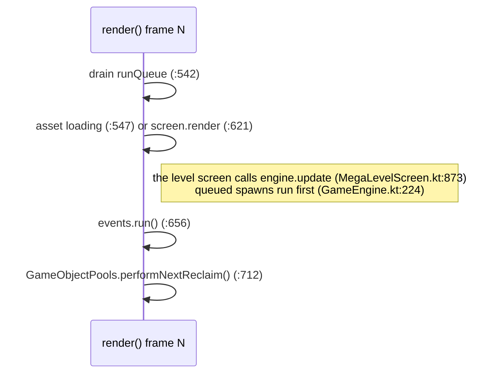

# Notes: mega-refactor-045a-pool-ownership

## Decisions

All decisions are Claude's choice, pending owner confirmation (the owner asked for the branch end to end with no stops
for questions, 2026-11-16). `SCOPE.md` lists them with the options.

## Research: is a scratch lifetime of 3 frames enough?

Question from the owner: is `GameObjectPool.DEFAULT_CALLS_TO_WAIT = 3` (now `GameObjectPools.SCRATCH_LIFETIME_FRAMES`)
adequate, or must it be higher (4 or 5) for safety?

Line numbers are on this branch.

### What 3 means

`performNextReclaim()` keeps a queue of 3 buckets. A fetch goes into the newest bucket. Each call frees the oldest
bucket and puts it back as the newest. So a scratch fetched in frame N is valid in frames N, N+1 and N+2, and goes back
to the pool at the end of frame N+2. It survives 2 frame boundaries.

### Where the reclaim runs

`MegamanMaverickGame.render()` (`MegamanMaverickGame.kt`):

The reclaim runs once at the end of every `render()`, in every state: loading, menus, pause, room transitions and play.

### Lifetimes in the code

| Path | Longest lifetime of a scratch | Covered by 3? | Evidence |
|---|---|---|---|
| Local use in one function | same frame | yes | — |
| Spawn props | queued in frame N, `onSpawn` at the start of the next `engine.update`, frame N+1 | yes | `GameEngine.kt:224`; `MegaLevelScreen.kt:873` calls `engine.update` in every level frame, also when paused |
| `runQueue` | added in frame N, runs at the start of frame N+1 | yes | `MegamanMaverickGame.kt:542` |
| Events | submitted in frame N, run at the end of frame N; a submit during `events.run()` waits to frame N+1 | yes | `MegamanMaverickGame.kt:656`, `EventsManager.kt:32` |
| A chain of deferrals (event, then spawn, then `runQueue`) | one frame per step | 2 steps only | inference from the rows above |
| Several physics steps in a frame | the same frame | yes | `WorldSystem.kt:169`; the lifetime counts frames, not steps |
| A screen change with spawns in the queue | the queue is cleared | yes | `MegaLevelScreen.kt:1053` (`engine.reset()` clears the queues) |
| Pause, room transition, loading | the reclaim still runs each frame | no limit | a scratch held over a pause is a stored scratch; no N covers it |
| Delayed runnables (`MegaUtilMethods.delayRun`, `Timer` runnables) | seconds | no | `MegaUtilMethods.kt:15` |
| Async pathfinding | up to the 500 ms timeout (30 frames at 60 FPS) on a worker thread | no | the suppliers give scratch `IntPair`s (`Bat.kt:372-373`); the worker read the target in each iteration (`Pathfinder.kt:83,89`); `AsyncPathfindingSystem.kt:25,46` |
| A scratch kept in a field | the life of the entity | no | found and fixed: `Lift.kt:63`, `CeilingCrusher.kt:95`, `ElectrocutieChild.kt:85` (fed by `Electrocutie.kt:100`), and others in `SCOPE.md` |

Every legal lifetime crosses at most 1 frame boundary (2 for a chain of 2 deferrals), and 3 covers 2. Every unsafe
lifetime in the code (a field, a delayed runnable, the pathfinding worker, a pause) lasts seconds or the life of an
entity. A value of 4 or 5 adds 1 or 2 frames (17 to 33 ms at 60 FPS), so it would not make any of them safe. It would
only hide them for a little longer and make them rarer and harder to find.

### Cost of a larger value

The pool never shrinks: its size is the peak of live scratch objects. Each extra frame of lifetime adds one frame of
fetches to that peak (inference from `GameObjectPools.kt`). Sizes measured on JDK 17 (Corretto 17.0.13, 64-bit,
compressed pointers; 200,000 instances each, `temp/mega-refactor-045a-pool-ownership/sizes/Sizes.java`):

| Type | Bytes each |
|---|---|
| `Vector2` | 24 |
| `GameCircle` | 168 |
| `GameLine` | 336 |
| `GameRectangle` | 2,668 |

The fetch count per frame was not measured (no game launch on this branch). As an example only: with 500 `Vector2` and
100 `GameRectangle` fetches per frame, each extra frame keeps about 279 KB more in the pools. The cost is small, but
it buys no safety.

### Recommendation

Keep 3. Make the safety come from the contract and the debug checks:

- the contract: a scratch is never stored, and data that must live longer is copied into an owned field or an
  `OwnedArray`;
- the fixes in this branch for each stored scratch that the scan found (including the pathfinder, which now copies
  its start and target);
- `--poolChecks`, which poisons each reclaimed scratch with NaN and never reuses it, so a stored scratch shows at once
  in a dev run.

The value is not changed in this branch. Item `010` (one fixed tick) may move the reclaim to ticks; the contract stays
the same.

## Finding: the free set of the engine `Pool` is slow at scale

`GameObjectPools` used the engine `Pool` inside, and `Pool.free()` checks a double free with a LibGDX `IdentityMap`
(`Pool.kt:47`). On this branch the first `core:test` run hung in `IdentityMap.locateKey` inside
`performNextReclaim()`: the entity tests fetch many scratch objects with no reclaim, and the new pool test then freed
them all. A JVM measure of `IdentityMap` with `Vector2` keys (gdx 1.14.2, JDK 17,
`temp/mega-refactor-045a-pool-ownership/sizes/PoolFree.java`):

| Keys | `containsKey` + `put` | `remove` |
|---|---|---|
| 1,000 | 1 ms | 0 ms |
| 10,000 | 34 ms | 36 ms |
| 30,000 | 274 ms | 2 ms |
| 100,000 | 3,848 ms | 13,988 ms |

The growth is far worse than linear. The scratch pool no longer needs a double-free check (only the reclaim frees, and
once), so `GameObjectPool` now keeps a plain `Array` free list. The engine `Pool` still uses the `IdentityMap` for the
entity pools and for the small pools inside `GameRectangle`; those stay small. Backlog candidate in `TODO.md`.

## X6 sources

None used.

## Overlap with other branches

- `mega-refactor-161a-random-call-lint` (active): it may add detekt. `PoolOwnershipGuardTest` follows the source-scan
  pattern of `RandomSourceGuardTest`; if detekt lands, the pool rule can move there. No shared files.
- `mega-refactor-024b-character-loadouts`, `mega-refactor-077b-desert-man`, `fix/*`, `compactor-level`: this branch
  touches many entity files (see `SCOPE.md`). A merge can give simple conflicts in entity files that those branches
  also change (for example `DesertMan.kt` is not changed here; `GlacierMan.kt`, `TimberWoman.kt`, `RodentMan.kt` are).
