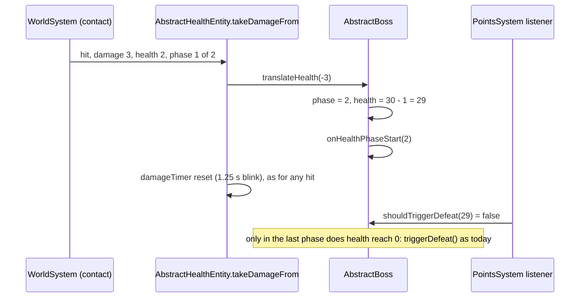
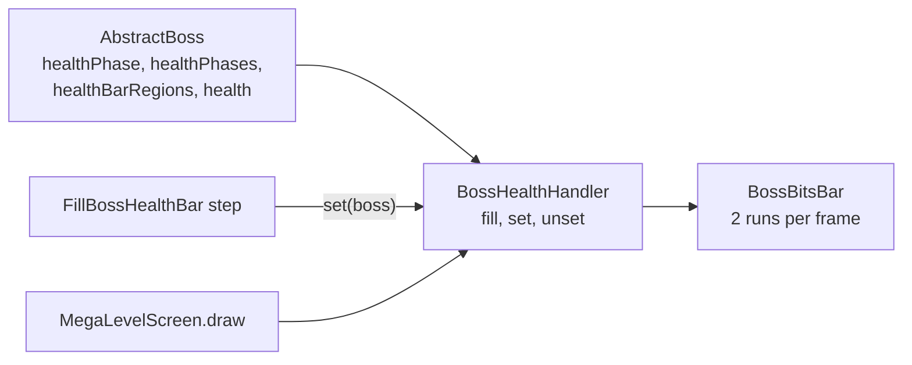
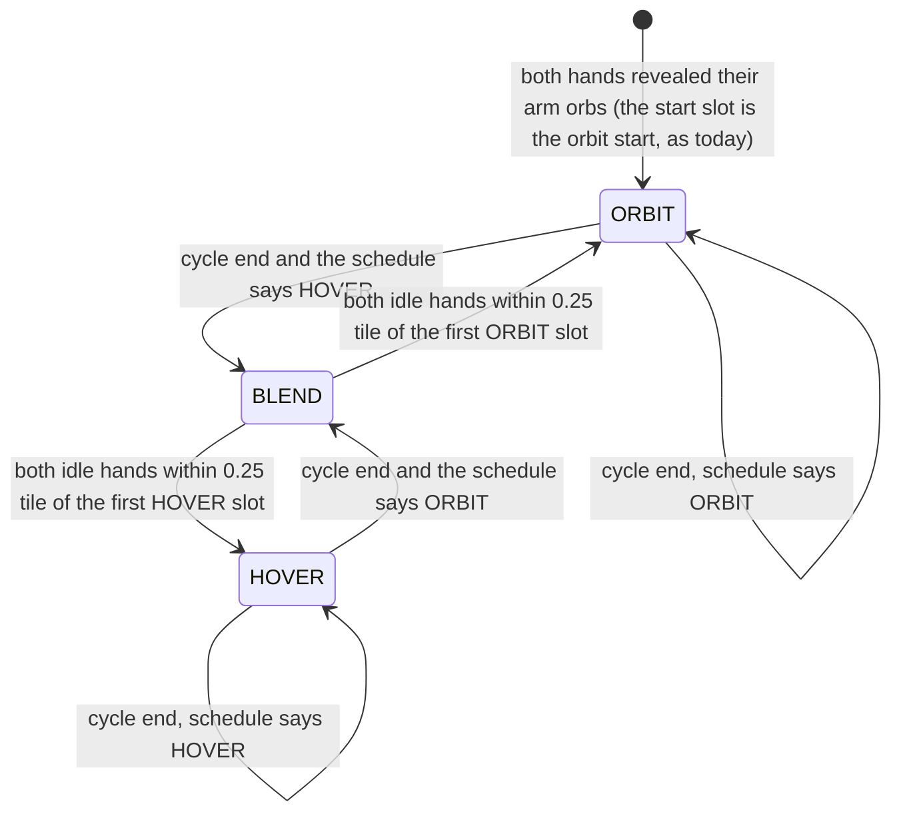
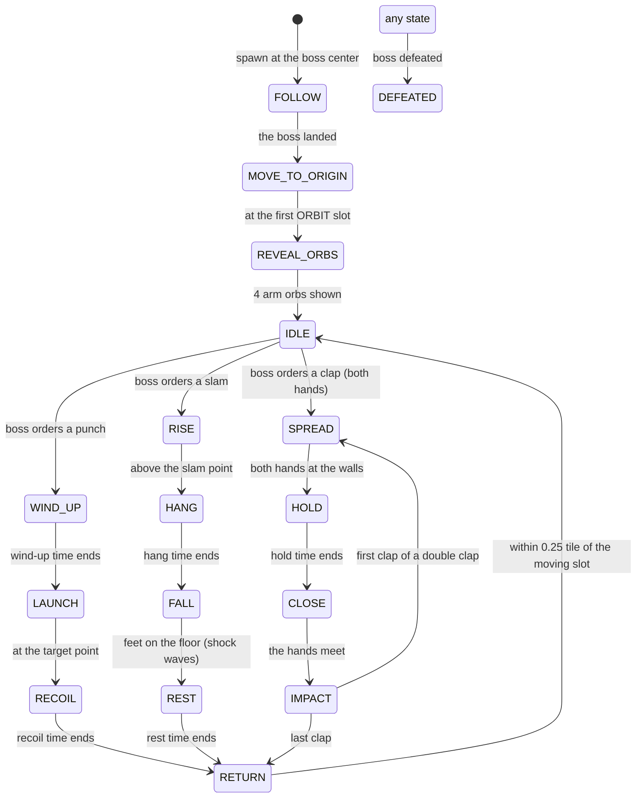

# Notes: mega-refactor-077a-intro-boss

Scan of 2026-11-13, branch base `035e5dbec` (`master`). Paths are relative to
`core/src/main/kotlin/com/megaman/maverick/game/` unless they start with `assets/`, `docs/`, `engine/` or `core/`.
Research before the branch: `temp/077-intro-boss/boss-review.md` and `overdrive-health.md` in the main checkout.

## Decisions

- 2026-11-15 (owner, replaces D2): the intro fill of a boss with more than one health phase loops through each
  phase: first the last phase's color fills from empty, then each earlier phase fills over it, ending with phase 1
  full (`BossHealthHandler`). Each pass takes `max x DUR_PER_BIT`, so 2 phases take 2 x 2.25 s.
- 2026-11-15 (owner): the death face has no X eyes. The `Head/defeated` frames (frame file and `Bosses3` atlas) are
  redrawn as an aghast face: wide white eyes with small pupils that tremble 1 px (2 frames, 0.1 s), open mouth. The
  old X-eyes frame is kept in `temp/077a-slam/defeated_xeyes_backup.png`.
- 2026-11-15 (Claude, owner gave the choice): NORMAL and HARD tuned on their own; see `process-log.md` 2026-11-15.
- 2026-11-13 (owner, brief): D1 shared red-orange phase-2 bits; D2 phase-2 color shown, phase 1 fills over it; D3 special weapons 2, Axe 3, big Reactor 4, explosions 1 to 2; D4 one branch.

- 2026-11-13 (owner, before the branch): the scope list in `SCOPE.md` "In scope" items 1 to 6. Damage: pellet 2,
  half charge 3, full charge 4. Proto Man buster 3 on this boss. Keep the circular orbit, but not as the only motion.
  The headless body that stays after the death is on purpose. Phase 2 replaces the panic attack for a phased boss.
- 2026-11-13 (Claude, planning): the hand state machine is a plain enum with one `goTo(state)` entry function and
  one state clock per hand, not the engine `StateMachine` (see "State machine tool" below).
- 2026-11-13 (Claude, planning): the boss values go in one tuning row per difficulty and health phase (the
  `D1000Tuning` pattern, `entities/bosses/d1000/README.md` "Rules a change must keep"), not in `if (hard)` branches.
- Open for the brief: see `SCOPE.md` "Open questions".
- 2026-11-14 (owner, play test of `d5fdab1a9`): the slam aims at the player along a 0, 45 or 90 degree line, and the
  shock waves run around the room perimeter. Recommendations taken: the fist moves into alignment (the tell), the
  aim locks with a flash, the waves turn at the corners and stop at the ceiling, and a fist that hits a wall rests
  there as a step. See "Aimed slam and perimeter shock waves". This replaces the straight-down slam and the floor-only
  waves above.

## Corrections to the research

| Research claim | Fact at the code | Effect |
|---|---|---|
| `ElectricPulse` has 3 frames (`boss-review.md` 1.9) | `ElectricPulse.png` is 64x32: 2 frames of 32x32 (a vertical spark pillar). The code slices it `1 x 3` (`explosions/BigAssMaverickRobotOrbExplosion.kt:137-141`), which gives 21.3 px frames that cut the pillar. `ElectricDissipate.png` is 48x16: 3 frames of 16x16, drawn into a 1-tile sprite (2x) | The shock wave must slice the pulse `1 x 2`. A latent code fault; the class has no caller, so no player sees it today |
| The `060c` diff touches `BigAssMaverickRobot.kt` and `AbstractBoss.kt` only (`boss-review.md` 5, `overdrive-health.md` 5) | `060c` also adds `ProtoBuster` (3 / 10 / 15) and `PlayerSabreSlash` (5/3, 15/10, 30/15) to the 3 size tables of `damage/StandardDamageNegotiator.kt` | No effect on this boss while its own map lists both classes. See "Overlap with other branches" |
| Overdrive: keep the panic attack at 25% inside the overdrive phase (`boss-review.md` 3c) | Superseded by the owner decision of 2026-11-13: phase 2 replaces the panic attack for a phased boss | No panic attack in this branch |
| Intro fill option b takes 4.5 s (`overdrive-health.md` "Intro fill") | True, and the plan holds the world for the whole fill (`HoldWorld` before `FillBossHealthBar`, `fights/FightPlans.kt:84-90`). So each retry after a death waits 2.25 s more in a frozen room | Input to the fill decision |
| Not in the research | `BigAssMaverickRobotHandTest` spawns a hand with the rotation and launch supplier props (`core/src/test/.../bosses/BigAssMaverickRobotHandTest.kt:85-93`) | The test changes when the hand reads its values from the boss |
| Not in the research | `NotifyListenersOfBossDefeat` (`fights/FightSteps.kt:118-128`) calls `onBossDefeated` on every `IBossListener` at once, so the 8 arm orbs pop in the same frame (`BigAssMaverickRobotOrb.kt:139-142`) | A chain that pops one orb at a time needs the arm orbs to skip that call and the hand to pop them |
| Not in the research | `MagmaFlame`, `MagmaExplosion`, `ReactorExplosion` and `IceBombExplosion` are not `ISizable`, so they do 0 on this boss today; `BOSS_DMG_NEG` gives 1 to 3 of them | Input to the weapon table |

All other checked claims hold: the values of 1.4 to 1.8 of `boss-review.md` (orbit 160 to 256 degrees/s,
`RotatingLine.speed` is degrees/s; the 76/101 closest-hand chance; block and damager active rules; damage map),
the 23 `getHealthRatio` call sites in 8 live boss classes, the 3 production `translateHealth` call sites
(`AbstractHealthEntity.kt:91`, `D1000.kt:434`, `D1000.kt:844`), the `depleteHealth` paths (`CartV2.kt:150-170`,
`CrusherComponent.kt:31`), the boss room geometry, and the sounds named in the research (all exist in
`assets/SoundAsset.kt`).

## Overlap with other branches

Active branches on 2026-11-13: `060c` (`.worktrees/mega-refactor-060c-protoman-buster`, next: plan step 31, review
and play test 6). The `compactor-level` worktree touches none of the files below.

| File | `060c` change | `077a` change | Conflict and resolution |
|---|---|---|---|
| `entities/bosses/BigAssMaverickRobot.kt` | +2 imports (`PlayerSabreSlash`, `ProtoBuster`, lines 63, 67); `ProtoBuster` 2 and `PlayerSabreSlash` 3/2 in the boss map (after line 150) | the whole damage map is rewritten; most of the class changes | Text conflict in the import block and the map. Resolution for the second branch to merge: keep both sides' entries, and set `ProtoBuster` to 3 (owner, 2026-11-13). Proposal for the sabre on this boss: half 3, full 4 (one over the pellet, as `060c` set it one over the old pellet). Not a design conflict |
| `entities/contracts/AbstractBoss.kt` | +1 import (line 38); `ProtoBuster` 1 and `PlayerSabreSlash` 2/1 in `BOSS_DMG_NEG` (after line 66) | new phase fields, `onSpawn` reset, `translateHealth` and `getHealthRatio` overrides, the hook, the bar regions | Text conflict only if `077a` edits the import block or `BOSS_DMG_NEG`. Put the new code below the companion. If `077a` builds the boss map on `BOSS_DMG_NEG`, the `060c` rows become the base for any class that the boss map does not list |
| `damage/StandardDamageNegotiator.kt` | new rows in the 3 size tables | none | No conflict. If the boss keeps `StandardDamageNegotiator`, an unlisted `060c` class falls to the MEDIUM table (10 / 15). The boss map must list both `060c` classes, or move to the `BOSS_DMG_NEG` base |
| `core/src/smokeTest/resources/entity-tags.txt` | renames 1 line, adds 1 | none planned (the shock wave keeps its class name) | No conflict |
| `assets/sprites/sprite_sheets/Hud.*` (new in `060c`) | new atlas | none: the phase bits go in `Bits` | No conflict. Do not put the phase bits in `Hud`: two branches would change one binary atlas |
| `core/src/test/.../damage/ProtoShotDamageTest.kt` (new in `060c`) | reads the size tables | none | No conflict |

Related, not a branch yet: item `153` will give the HUD bars an alpha when a player overlaps them. `BossBitsBar`
must take the same alpha then.

## State machine tool

| Tool | Fit for the hand |
|---|---|
| `engine/.../state/StateMachine` + `EnumStateMachineBuilder` (40 + 51 lines) | Transitions are guards that `next(params)` checks; one `onChangeState(current, previous)`; no enter, update or exit per state; no state timers. Most hand transitions are commands from the boss (punch, slam, clap, defeat) or the end of a timer, so the hand would call `setState` past the guards for most of them |
| `entities/utils/StateMachineHandler` | Adds one timer per state and calls `next()` when it ends. No commands, no per-state update |
| Plain enum, `goTo(state)` that runs the exit and enter work and resets one state clock, and a `when` for the update | Matches the target model of item `015` (`Fsm<S>`: enter, update, exit, state-owned timer; `items/015-entity-fsm/NOTES.md` "Recommendation"), so the `015` migration is one state at a time with no change of timing. `D1000` (`entities/bosses/D1000.kt:95`, the newest boss) uses the same shape |

Choice: the plain enum. `O4-R3` ("patterns as states") waits for `015`; until then a branch may repeat the current
pattern. Each hand state owns its exit condition in one place, with no sequential `if` chain and no hand-run timer
outside the state clock.

## Health phases

### Model

`Points` stays 0..30. `AbstractBoss` holds the phase. All damage reaches `translateHealth`, so one override covers
every damage path.

| API (on `AbstractBoss`) | Type | First caller |
|---|---|---|
| `healthPhases` | `open val Int`, default 1 | `BigAssMaverickRobot` (2) |
| `healthPhase` | `Int`, 1-based, read-only outside; set to 1 in `onSpawn` before `super.onSpawn` | `BossBitsBar` (via `BossHealthHandler`), `BigAssMaverickRobot` tuning row |
| `healthBarRegions` | `open val Array<String>`, default `[standard]`; size must equal `healthPhases` (fail fast in `init`) | `BossHealthHandler.set` |
| `onHealthPhaseStart(phase: Int)` | `protected open fun`, called once per new phase | `BigAssMaverickRobot` |
| `translateHealth(delta)` | override: a loss that reaches 0 with a phase left moves to the next phase with `MAX_HEALTH - overshoot` | every damage path |
| `getHealthRatio()` | override: whole-fight ratio `((phases - phase) * max + current) / (phases * max)` | 23 sites in 8 boss classes (same value with 1 phase) |



Rules:

- Overshoot carries over (the "2 x `MAX_HEALTH` bits" decision). The largest hit on this boss is 4.
- No rest: the normal hit lock (1.25 s) is the only safe time at the roll-over.
- A roll-over does not set `defeated`, does not submit `BOSS_DEFEATED`, and does not call `onBossDefeated`.
- `depleteHealth` (cart, crusher) goes through `setHealth`, not `translateHealth`, so it kills through all phases
  (today's result). Accepted edge case with a `TODO` at the override (no live boss room has a cart or a crusher).
- `LEVEL_RESET` destroys the boss; the next spawn starts in phase 1 with full health.
- `isHealthDepleted` stays per phase; with the roll-over it is true only at 0 in the last phase.

### The bar

```text
phase 1 of 2, 12 lost        phase 2 of 2, 21 lost        phase 2 of 2, 0 left
  top                          top                          top
 [ next color ] 12 bits       [ black      ] 21 bits       [ black ] 30 bits
 [ phase-1    ] 18 bits       [ phase-2    ]  9 bits
  bottom                       bottom
```

- Bits `0 until current`: the region of the current phase. Bits `current until 30`: the region of the next phase,
  or none (black background) in the last phase. 30 sprites per region at most.
- `BossBitsBar` (new, `drawables/ui/`): 1 sprite list per region, made at `init`; `draw` reads the phase and the
  health each frame and draws 2 runs. The run math is a pure function, unit-tested with no sprites. `BitsBar` and
  the player bars do not change.
- `BossHealthHandler.set` takes `AbstractBoss` in place of `IHealthEntity` (1 caller, `FightSteps.kt:48`, passes
  `context.boss: AbstractBoss` already, so its text does not change; `FightStepsTest` mocks `set(any(), any(), any())`
  and still compiles).
- Intro fill: see `SCOPE.md` "Open questions" Q2.
- Art: 1 new 8x2 region in `assets/sprites/frames/Bits/`, packed into `Bits.png` and `Bits.txt` (the art rule in
  `docs/WAYS_OF_WORKING.md`). The color: `SCOPE.md` Q1.



## Hand motion and the hand state machine

### Two levels

- **Boss level (motion mode):** one mode for both hands. It gives each hand a moving target point, the "slot".
- **Hand level (hand state):** each hand is in its own state. An idle hand follows its slot; an attacking hand
  ignores it; a returning hand springs to its slot, which still moves.

### Boss motion mode



| Mode | Slot of a hand at mode time `t` | Cycle |
|---|---|---|
| `ORBIT` | `center + r * (cos a, sin a)`, `a = start +/- w * t`; `r` 2 tiles; `w` 160 to 256 degrees/s by the whole-fight ratio (today's ramp), x1.2 in phase 2. Left hand from 180 degrees with negative `w`, right hand from 0 degrees with positive `w` (today's mirror) | 1 full turn |
| `HOVER` | `anchor + (Ax * sin(2 pi t / Tx + px), Ay * sin(2 pi t / Ty + py))`; anchor = the orbit center; `Ax` 1 tile, `Ay` 0.75 tile; `Tx` 3 s, `Ty` 2 s; the right hand is a quarter cycle out of step with the left. Phase 2: time x1.4, amplitude x1.3. Eased: the hand springs to the slot, it is not set on it | 6 s (the common period of `Tx` and `Ty`), 4.3 s in phase 2 |
| `BLEND` | the first slot (`t = 0`) of the next mode; each idle hand springs to it (critically damped, `w0` 8 rad/s, top speed 8 tiles/s) | ends when both idle hands arrive, or after 1 s |

- The schedule (the boss chooses at each cycle end): phase 1: 2 `ORBIT` cycles, then 1 `HOVER` cycle, and again.
  Phase 2: 1 `ORBIT` cycle, then 2 `HOVER` cycles, and again (less orbit time). No random value.
- A mode switch happens only at a cycle end. A phase change waits for the next cycle end.
- Mode time stops while the boss is not in `FIGHT` (as `ROTATE` does today, `BigAssMaverickRobotHand.kt:313`).
- A hand that attacks keeps no slot of its own: it returns to the slot of the current mode at the time it arrives.
- All motion is by velocity (`velocity = (target - position) / step` for a slot that the hand sits on), so the
  platform, the rider and the draw interpolation (item `134`) stay smooth. Today `ROTATE` sets the position
  (`:317`).

### Hand state



| State | Motion | Ends | Damager | Platform | Sprite |
|---|---|---|---|---|---|
| `FOLLOW` | at the boss center | boss landed (`moveToOrigin`, as today) | on (today) | no | `still` |
| `MOVE_TO_ORIGIN` | 8 tiles/s to the first `ORBIT` slot (today) | within 0.1 tile | on (today) | no | `still` |
| `REVEAL_ORBS` | still | 4 orbs x 0.15 s (today) | on (today) | no | `still` |
| `IDLE` | follows the slot of the mode | an order from the boss | off | on | `still` |
| `WIND_UP` | pulls back 1 tile away from the target point, 2 px shake | wind-up time | on | no | `still`, then `rocket` in the last 0.2 s |
| `LAUNCH` | straight to the target point at the launch speed (today's values) | within 0.1 tile | on | no | `rocket` |
| `RECOIL` | overshoots 0.5 tile, springs back | 0.3 s, then holds 0.4 s | on | no | `rocket` |
| `RISE` | eases to (slam x, floor + 6 tiles) | arrived | on | no | `still` |
| `HANG` | still, 2 px shake (the tell) | hang time | on | no | `still` |
| `FALL` | 18 tiles/s down | feet on the floor: camera shake 0.3 s, `POUND_SOUND`, shock waves | on | no | `rocket` |
| `REST` | still on the floor: a step | rest time | off | on | `still` |
| `SPREAD` | to 1.5 tiles from its wall, at the clap height | both hands arrived | on | no | `still` |
| `HOLD` | still, shake (the tell) | hold time | on | no | `still` |
| `CLOSE` | toward the other hand at 14 tiles/s | 1.5 tiles apart: flash (orange orb `hit` frames), `SMB3_BUMP_SOUND` | on | no | `rocket` |
| `IMPACT` | still | 0.3 s | on | no | `still` |
| `RETURN` | springs to the moving slot, top speed 7 tiles/s (today 4, after a 1 s wait) | within 0.25 tile | off | on | `still` |
| `DEFEATED` | gravity, one bounce | on the floor | off | no | `still`, blinks |

Changes against today, named in `CONTRACT.md`: an idle hand moves by mode, not only by orbit; `RETURN` is harmless
and carries a rider (today it hurts and has no platform); the slam's `REST` is a step.

### Who chooses (the boss)

At each attack slot (no hand attack runs and the attack wait has ended):

1. Target player: the next live player in slot order after the last target (1 player: always that player).
2. Free hands: hands in `IDLE` that no player stands on (`isBeingStoodUpon`, today's rule). No free hand: reset the
   wait, no attack.
3. Attack: a weighted choice from the row of the tuning (below); `DOUBLE_CLAP` only with 2 free hands.
4. Hand: for `PUNCH` and `SLAM`, the free hand nearest to the target player (today: 76/101 nearest, else random;
   the random part goes, so that the tell is readable).
5. The boss passes the target point (punch: the player center at the order; slam: the player x, clamped to the floor
   x 319.5..330.5; clap: the player center y, clamped to floor + 1..floor + 5) to the hand. The hand does not read
   `targetPlayer` itself.
6. The attack wait starts when the last hand of the attack is back in `IDLE`.

The orb volleys run on their own timer, as today, except that they pause during a clap.

### Tuning rows

Superseded: these are the first drafts. The values of the play-test rounds of 2026-11-14 and 2026-11-15 are in
`process-log.md` and in `BigAssMaverickRobotTuning.kt`.

| Value | Normal ph. 1 | Normal ph. 2 | Hard ph. 1 | Hard ph. 2 | Today (normal / hard) |
|---|---|---|---|---|---|
| Attack wait | 3 s | 1.75 s | 1 s | 0.75 s | 3 s / 1 s |
| Weights punch / slam / double clap | 2 / 1 / 0 | 2 / 2 / 1 | 2 / 1 / 0 | 2 / 2 / 2 | punch only |
| Wind-up | 0.75 s | 0.5 s | 0.5 s | 0.35 s | 1 s still |
| Launch speed (by the whole-fight ratio) | 8 to 12 tiles/s | same ramp | 10 to 15 | same ramp | same |
| Hang | 0.6 s | 0.4 s | 0.4 s | 0.3 s | none |
| Rest on the floor | 1.2 s | 0.8 s | 0.8 s | 0.6 s | none |
| Shock waves per slam | 1 pair | 2 pairs, 0.5 s apart | 1 pair | 2 pairs | none |
| Clap hold (first / second) | none | 0.75 / 0.5 s | none | 0.6 / 0.4 s | none |
| Orbs per volley and aims | 2: current, lead | 3: lead, current, near | 4: lead, current, near, wide | 4, 0.4 s apart | 2 / 4, all at spawn position |
| Volley cycle | 7 s | 5 s | 4 s | 3.2 s | 7 s / 4 s |
| Orb hold before flight | 1 to 0.25 s (ramp) | 0.5 s | 0.5 to 0.1 s | 0.25 s | ramp |
| Orbit speed scale | x1 | x1.2 | x1 | x1.2 | x1 |

These are first values for the play test.

### Phase 2 start (`onHealthPhaseStart(2)`)

- At once: the bar rolls over (from the boss state); camera shake 0.5 s (`SHAKE_CAM`), `QUAKE_SOUND`; the head flashes
  the `stunned` frames for 0.6 s with no invincibility (a draw timer, not `stunnedTimer`); the arm orbs turn from
  purple to orange (`OrbColor` exists).
- At the next decision: the tuning row of phase 2. A running attack ends with its phase-1 values.
- At the next cycle end: the phase-2 mode schedule.

## Mixed-aim orbs

- The aim is set when the orb starts to move (after its hold), not at spawn. The boss passes an aim kind and the
  target player; the orb asks its owner for the trajectory at that moment through a typed interface on the owner.
  An orb with a `TRAJECTORY` prop and no aim kind keeps today's path (`GutsTank.kt:409`, 5 sites in
  `WilyFinalBoss.kt`, the arm orbs).
- Aim kinds, all clamped to the room:

| Kind | Aim point |
|---|---|
| `LEAD` | player center + x velocity x 1.25 s (x only: no lead on the jump arc), y = the player's y, clamped to floor .. floor + 3 tiles |
| `CURRENT` | player center at launch |
| `NEAR` | player center at launch, x + a random offset in -1.5..1.5 tiles |
| `WIDE` | player x + a random offset of 3..5 tiles to a random side, floor + 1 |

- Random values: `UtilMethods.getRandom`, as the boss uses today (`BigAssMaverickRobot.kt:493`). `O2-R2` (seeded
  source) waits for item `011`, which is `planned`; the source is clock-seeded today (`engine/.../UtilMethods.kt:22`).
  This branch adds 3 random call lines (near offset, wide offset, wide side) and removes 2 (`getRandom(0, 100)` and
  `hands.random()` in the hand choice). Item `011` converts them.
- Fire sound: `BLAST_2_SOUND` at spawn (commented out today, `:646`), `BLAST_1_SOUND` at launch (today).

## Slam shock waves

- `BigAssMaverickRobotOrbExplosion` (no caller today; `DAMAGER`, `IHazard`, `EntityType.EXPLOSION`) is the pillar.
  Fix its pulse slicing to `1 x 2` and its dissipate draw size to 0.5 tile.
- A wave is a row of pillars on the floor top: the first at 1 tile from the slam point, then one more every 0.08 s
  (12.5 tiles/s) until the wall. Each pillar lives 0.5 s (pulse) + 0.3 s (dissipate); only the pulse damages.
  A jump clears it. The spawner is the hand (`FALL -> REST`).
- Damage to a player: 2 (`getDamageToMegaman` override; the `IHazard` default is 3).
- Sound: `MM3_ELECTRIC_PULSE_SOUND` at each wave start.
- Keep the class name and package: no rename, so `entity-tags.txt` does not change.

## Death

Superseded: this is the first design. The death of the play-test rounds (the aghast face, the head blink,
explosions for the whole 4 s) is in `process-log.md` (2026-11-14 and 2026-11-15) and in `BigAssMaverickRobot.kt`.

`defeatDur` 3 s -> 4 s (constructor argument). Timeline from `triggerDefeat` (`BOSS_DEFEATED` as today):

| Time | Head | Hands and chains |
|---|---|---|
| 0 to 1.5 s | shakes 2 px, `stunned` flash frames; explosions every 0.25 s in the head circle (today) | hands: gravity on, fall, one bounce (up 6 tiles/s) with `SMB3_THWOMP_SOUND`, then rest and blink (today: fall and blink) |
| 0 to 0.6 s | | each arm: 4 orbs pop one by one from the hand to the shoulder, 0.15 s apart (today: all 8 at once) |
| 1.5 to 3.5 s | sinks 1 tile into the body (draw offset from the defeat clock), `down` frame with closed eyes | rest, blink |
| 3.5 s | one large explosion, `BASSY_BLAST_SOUND` | |
| 4 s | destroy: the orb ring and `DEFEAT_SOUND` (today) | destroyed with the boss (today) |

- The `defeated` (X eyes) animation is no longer used. Its region stays in `Bosses3`.
- The body stays drawn after the death (owner, 2026-11-13: on purpose). No change to `BigAssMaverickRobotBody`.
- The arm orbs skip `onBossDefeated` when their owner is a hand; the hand pops them.
- The head sink and shake are draw offsets from game state (the defeat clock), not art faults, so the rule in
  `docs/WAYS_OF_WORKING.md` allows them.

## Co-op (2 players)

| Part | Today | This branch |
|---|---|---|
| Head look, facing | nearest live player to the boss center (`MegaPlayers.targetFor`, `players/MegaPlayers.kt:43`) | same |
| Orb aim | nearest player to the boss, at spawn | each orb of a volley takes the next live player in slot order (1 player: all orbs on that player) |
| Punch | hand nearest to the boss's target; the hand aims at the player nearest to the hand | the boss picks the target player (alternate in slot order), then the free hand nearest to that player |
| Slam, clap | none | the same target choice |
| A hand under a player | never launched | never used for any attack. Both hands ridden: no hand attack, the orbs go on (today's result) |
| Health, phase, bar | one value | one value; both players' hits go through the same `translateHealth` |

## Hard mode

Values in the tuning table above. Hard mode keeps the same damage table (owner: pellet 2, no mode split).

## Hand pair choreography

Owner, 2026-11-13 (after the brief): the state machine must show how the two hands act together and react to each
other. Example from the owner: in the punch wind-up, the other hand moves down while the winding-up hand moves up, so
that the whole boss looks ready to punch. This section adds to the hand state machine above; it does not replace it.

### Roles and the conductor

- The boss is the conductor. At an attack order it gives each hand a role: `ATTACKER`, `PARTNER`, or (clap) `LEADER`
  and `MIRROR`.
- The hands do not reference each other. Each frame the boss reads the attacker's state and the time in that state,
  and sets the partner's reaction. One table in the boss package holds the choreography (the rows below), so a later
  boss can copy the pattern.
- A partner reaction is an offset added to the partner's mode slot (`ORBIT` or `HOVER`), eased by the same spring. So
  the partner never leaves its mode logic, and when the reaction ends it is already on its moving slot.
- The partner stays harmless (damager off) and keeps its platform on, as in `IDLE`.

```mermaid
stateDiagram-v2
    [*] --> PAIR_IDLE
    PAIR_IDLE --> PUNCH: boss orders a punch
    PAIR_IDLE --> SLAM: boss orders a slam
    PAIR_IDLE --> CLAP: boss orders a clap (phase 2)

    state PUNCH {
        direction LR
        state "ATTACKER WIND_UP / PARTNER BRACE" as P1
        state "ATTACKER LAUNCH / PARTNER COUNTER" as P2
        state "ATTACKER RECOIL / PARTNER SETTLE" as P3
        state "ATTACKER RETURN / PARTNER slot" as P4
        [*] --> P1
        P1 --> P2: wind-up time ends
        P2 --> P3: attacker at the target
        P3 --> P4: recoil time ends
        P4 --> [*]: attacker at its slot
    }

    state SLAM {
        direction LR
        state "ATTACKER RISE / PARTNER LIFT" as S1
        state "ATTACKER HANG / PARTNER COIL" as S2
        state "ATTACKER FALL / PARTNER DIP" as S3
        state "ATTACKER REST / PARTNER JOLT" as S4
        state "ATTACKER RETURN / PARTNER slot" as S5
        [*] --> S1
        S1 --> S2: attacker above the slam point
        S2 --> S3: hang time ends
        S3 --> S4: attacker on the floor
        S4 --> S5: rest time ends
        S5 --> [*]: attacker at its slot
    }

    state CLAP {
        direction LR
        state "LEADER and MIRROR in lockstep: SPREAD, HOLD, CLOSE, IMPACT, RETURN" as C1
        [*] --> C1
        C1 --> [*]: both hands at their slots
    }

    PUNCH --> PAIR_IDLE
    SLAM --> PAIR_IDLE
    CLAP --> PAIR_IDLE
    PAIR_IDLE --> DEFEATED: boss defeated
    PUNCH --> DEFEATED
    SLAM --> DEFEATED
    CLAP --> DEFEATED
```



### Pair rows

`up` is away from gravity, `back` is away from the target. The offsets are first values for the play test.

| Attacker state | Attacker motion (see the hand table) | Partner reaction | Partner offset from its slot |
|---|---|---|---|
| `WIND_UP` | pulls up and back, shakes | `BRACE`: drops and moves toward the head, as a counterweight | down 1 tile, 0.5 tile toward the head, eased over the wind-up time |
| `LAUNCH` | rockets to the target | `COUNTER`: a short jerk opposite to the punch direction | 0.75 tile along `-punch direction`, peak at 0.15 s |
| `RECOIL` | overshoots, springs back | `SETTLE`: eases back toward its slot | offset to 0 over the recoil time |
| `RETURN` | springs to its slot | none: its slot | 0 |
| `RISE` | rises above the slam point | `LIFT`: rises a little with it, as both arms go up | up 0.75 tile |
| `HANG` | holds, shakes | `COIL`: small shake in step with the attacker | up 0.75 tile, the same 2 px shake |
| `FALL` | drops at 18 tiles/s | `DIP`: drops with the slam, as the whole body heaves down | down 1 tile, fast (0.1 s) |
| `REST` | rests on the floor | `JOLT`: one small bounce from the impact | up 0.25 tile and back, 0.2 s |
| `RETURN` (after a slam) | springs to its slot | none | 0 |

Clap: no partner. The boss drives the `LEADER`; the `MIRROR` takes the leader's position mirrored about the head's
x, each frame, so the two hands always move as one.

### Rules

- In `ORBIT` mode the two slots are coupled (mirrored angles, as today). A reaction offset moves the partner off the
  circle for the attack; the orbit angle keeps running, so the partner rejoins the circle at the right place.
- A partner with a rider (a player stands on it): the reaction offsets scale to 0.25, so the reaction shows but the
  rider is not thrown off. The rule "never attack with a ridden hand" stays.
- The phase-2 roll-over during an attack: the attack ends with its phase-1 rows, as for the hand values.
- Defeat during an attack: both hands go to `DEFEATED` at once.
- Phase 2 can scale the partner offsets (for example x1.25) with the other phase-2 values.

### Design choice

The conductor in the boss, not hands that listen to each other: a hand that reads the other hand's state needs a
reference both ways and an order of update between the hands; one table in the boss keeps the choreography in one
place and testable as a pure function (attacker state, time in state, direction, rider) → partner offset.

## Implementation notes (2026-11-14, plan steps 1 to 10)

Where the code differs from the designs above, and why. None of these changes what the player sees beyond the
approved scope.

| Design | Code | Why |
|---|---|---|
| "floor", "room" and "wall" in the hand table and the aims | `BigAssMaverickRobot.arena` from map object references on the boss spawn object (owner, 2026-11-14, the `TimberWoman` pattern): x from the right edge of `left_wall` (object 328) to the left edge of `right_wall` (331); bottom = the top of `ground` (329); top = the bottom of `ceiling` (332). Read with `!!`. `target` stays for the fall | The boss had no floor or room value. The map values give the same arena as the old constants (x 10176 to 10624, floor at world y 1760, height 11.75 tiles), so the slam x 319.5 to 330.5 = arena +/- 1.5 tiles is the same. `ceiling` (new key `ConstKeys.CEILING`) replaces the height constant, so no arena value is in code |
| `FALL` ends at "feet on the floor" | ends when the feet (0.5 tile over the body bottom) reach the arena floor; the hand is set to that height | A deterministic stop. The defeated hand still uses `FEET_ON_GROUND` |
| Death at 3.5 s: "one large explosion" | 5 harmless `Explosion`s in a cross (0.75 tile apart) on the head, and `BASSY_BLAST_SOUND` | There is no large explosion entity or art |
| Death 1.5 to 3.5 s: "`down` frame with closed eyes" | the `down` animation (its own blink) | No closed-eye frame exists; new head art is out of scope (`TODO.md` backlog) |
| Death explosions | every 0.25 s from 0 to 1.5 s only, as the death table says | Today they run for the whole defeat |
| Clap `MIRROR` "takes the leader's position mirrored" | the mirror springs (top speed 16 tiles/s) to the mirrored point each frame | A direct copy would jump at the clap start, where the two slots are not mirrored in `HOVER` |
| Clap flash "orange orb `hit` frames" | an inactive orange `BigAssMaverickRobotOrb` spawned with `ConstKeys.HIT` = `true`: its `onSpawn` enters the hit state (hit body size, `hit` animation, 0.2 s life), with no hit sound | Reuses the art and its life; no damage. A field set after `spawn` is lost, because the engine runs `onSpawn` on the next update |
| `COUNTER`: "peak at 0.15 s" | rises to the peak at 0.15 s and holds until `RECOIL`, where `SETTLE` takes it to 0 over 0.3 s | `SETTLE` starts from the counter offset |
| Random call lines: +3 | +4: the weighted attack choice (`getRandom(0, total - 1)`) is the fourth | The weighted choice needs a roll. Item `011` converts all of them |
| Motion during a head stun | the motion mode and the conductor (`conductAttack`) run on during the 0.5 s stun of a full charge (as `ROTATE` did); only the volley and the attack wait pause, as today | Keeps today's look, and a stun in a clap does not stop the mirror hand |
| Volley rows | orb gap / volley / delay: normal 1 / 4 / 3 s, normal phase 2 0.75 / 3 / 2 s, hard 0.5 / 2 / 2 s, hard phase 2 0.4 / 2 / 1.2 s | The notes give the cycle (7, 5, 4, 3.2 s); these split it as today's timers do |
| Hand values from the boss | the hand gets the tuning row with each order (`punch`, `slam`, `clap`); it reads `arena`, `slotOf` and `motionMode` from the boss | "A running attack ends with its phase-1 values" |
| Test access | `tuning`, `arena`, `motionMode`, `slotOf`, `flashAt`, the hand commands and `slotTarget` are `internal`; the fight test calls the hand commands and reads `boss.tuning` | The hand needs them (same module); the tests use the same calls as the boss |
| Bar region check | the smoke test reads every boss's `healthBarRegions` from the real `Bits` atlas | Covers the new region and every later phased boss |
| Arm orbs on the boss defeat | the hand spawns its arm orbs with `BigAssMaverickRobotOrb.POP_ON_BOSS_DEFEAT` = `false`; the hand pops them one by one in its death | The orb does not import the hand. `IOrbLauncher` is in `bigassmaverickrobot/` next to `OrbAim`. `GutsTank` and `WilyFinalBoss` orbs keep the default (`true`) |
| Hand target in co-op | the conductor moves `handTarget` to the next player only when it orders an attack | An order with no free hand does not use up a player's turn |
| A hit larger than the rest of a phase and a full bar | the next phase starts with at least 1 health | A phase that is not the last cannot end at 0 from the roll-over, so one hit cannot start phase 2 and defeat the boss |

## Aimed slam and perimeter shock waves (owner, 2026-11-14)

This section replaces the slam rows (`RISE`, `HANG`, `FALL`, `REST`) of "Hand state" and the wave path of "Slam shock
waves". The pillar entity, its damage, its life and its sound stay as in "Slam shock waves".

### Why

In the first slam, the fist hung above the player x and fell straight down. The only tell was the hang point, and the
slam could not hit a wall. The owner asked for a slam toward the player that can hit the floor or a wall, with waves
over the whole perimeter (`SuctionRoller` turns from the floor to a wall and back).

### Art

Both hand frames (`Hand/still`, `Hand/rocket`) are a front view of the fist: the knuckles face the camera, and the
rocket frames add a jet glow on all sides. A punch at any angle uses them today with no rotation. So the dive needs no
rotated or new fist art at any angle. The 45 degree steps are for readability: the player can see the line.
Optional, only if the play test shows that the direction is unclear: one round exhaust puff behind the fist along
`-d` (a round sprite needs no rotation).

### The dive

```text
 ALIGN: slide to a start point          LOCK: flash, 0.4 s         DIVE along d, past the player
 with the player on a 0/45/90 line      (aim fixed)                to the first floor or wall
```

- Directions `d`: down, down-left, down-right, left, right (5; a slam never goes up).
- For each `d`: start point `s = target - d * 4 tiles`, held inside the arena with a margin of 1.5 tiles (the
  fist half size plus space). Take the `s` nearest to the fist now. Ties: down first, then the diagonals, then the
  sides.
- `target` is the player center at the order (the same target choice as today).
- The hit point is the first intersection of the ray from `s` along `d` with the arena edges (a ray to rectangle
  test on `arena`). At an exact corner, the floor wins. The fist stops with its face on the surface.
- One pure function: (fist position, target, arena) -> (`d`, start point, hit point, surface). Unit test with a
  mutation check.

### Hand states (slam rows)

| State | Motion | Ends | Damager | Platform | Sprite |
|---|---|---|---|---|---|
| `RISE` (align) | eases to the start point | arrived | on | no | `still` |
| `HANG` (lock) | still, 2 px shake; flash at the start of the lock | lock time 0.4 s (hard 0.3 s, phase 2 0.3 s) | on | no | `still` |
| `FALL` (dive) | 18 tiles/s along `d` | at the hit point: camera shake 0.3 s, `POUND_SOUND`, shock waves | on | no | `rocket` |
| `REST` | still on the floor or the wall: a step | rest time | off | on | `still` |
| `RETURN` | as today | | | | |

- A wall rest is a platform on the side of the wall: the top of the fist is a step. The platform follows the hand,
  as in every state.
- The pair rows (`LIFT`, `COIL`, `DIP`, `JOLT`) stay. `DIP` uses `-d`'s vertical part only, so a side dive does not
  pull the partner down.
- The "never with a ridden hand" rule stays.

### Shock waves on the perimeter

```text
   stop ->|  ceiling          |<- stop
          ^                   ^
          |                   |
          |    <-- X -->      |      a floor hit: one wave each way; each turns up its wall
          |___________________|      a wall hit: one wave up (stops at the ceiling), one down (turns onto the floor)
```

- The path is the open perimeter of `arena`: left wall (top to bottom), floor (left to right), right wall (bottom
  to top). A wave is a position on this path and a direction (+1 or -1).
- A wave spawns a pillar every 0.08 s, 1 tile apart along the path, starting 1 tile from the hit point. At a corner
  it goes on along the next side (the `SuctionRoller` idea). It stops at a path end (where a wall meets the ceiling).
  A wave that goes down a wall and along the floor runs on to the far wall and up it.
- A pillar on a wall stands out from the wall, turned 90 degrees: the pulse strip is a vertical spark, so on a wall it
  is drawn as a horizontal spark. This is a turn of 90 degrees, which the owner allows (no pixel rotation of other
  angles). Its damager box turns with it.
- `ShockWaveRow` becomes the path walker: (path length, start offset, direction) -> pillar positions and the side
  of each one. One pure function maps a path offset to (point, side). Unit test with a mutation check.
- Tuning: waves per slam as in the tuning rows (1 pair in phase 1; 2 pairs in phase 2; the same in hard mode).

### Implementation notes (2026-11-14, plan step 12)

| Design | Code | Why |
|---|---|---|
| Start point "held inside the arena with a 1.5 tile margin" | `SlamAim` shortens the 4 tile lead along the line until the start is inside the margin. Only when the target itself is outside the margin (a player on the floor is lower than floor + 1.5) is the start clamped across the line. A direction whose start is less than the fist half size plus 1 tile (2 tiles) from the target along `d` is skipped, also when the target is behind the start (for example a down-right dive at a player in the left corner). In an arena of the boss room size, at least one side dive always passes, because one side of the target has more than 2 tiles inside the margin. If all 5 are skipped, the arena is too small for the slam (bad map data), and `SlamAim.plan` throws `IllegalStateException` | A clamp across the line can point the dive away from the player. The fist hurts in `RISE`, so a start a fraction of a tile from the player hits before the lock flash |
| Ties | two starts within 0.001 tile² (about 1 px²) of each other count as a tie | The diagonals are float vectors, so an exact tie comes out a little uneven |
| Hit point "first intersection of the ray from `s` with the arena edges"; "the face on the surface" | the ray is cast for the fist center against the arena inset by the fist reach: 1 tile on the walls (half the body width), 0.5 tile on the floor (half the body height minus `FEET_OVER_BOTTOM`, today's floor rest). The hit point is that stop point moved onto the surface | So a diagonal dive near a corner stops when the fist side meets the wall, not when its center does. The floor rest height is as before |
| Lock flash | the clap flash (`flashAt`: an orange orb in its `hit` frames and `SMB3_BUMP_SOUND`) at the fist center at the start of `HANG` | Reuses the clap tell; the play test can ask for a different sound |
| Lock time | the tuning field `hangDur` is now `lockDur`: normal 0.4 s, normal phase 2 0.3 s, hard 0.3 s, hard phase 2 0.3 s | As the owner asked |
| Waves per slam | the rows stay: normal 1 pair, normal phase 2 2 pairs, hard 1 pair, hard phase 2 2 pairs | "as in the tuning rows" |
| `ShockWaveRow` "becomes the path walker" | it does not change: it already walks a 1-D range. The hand walks it over `0 .. ArenaPerimeter.length(arena)`, and `ArenaPerimeter.pointAt` maps each offset to a point and a side. Both waves of a slam start at the hit offset, one with direction -1 and one with +1; on a floor hit they run to both walls, on a wall hit one runs up and one runs down | The pure function is `ArenaPerimeter.pointAt`; one more walker type is not necessary |
| Pillar places at the corners and the wall tops | `ArenaPerimeter.pointAt` keeps a pillar point 0.5 tile from each corner and from each wall top (`CORNER_GAP`). The corner itself belongs to the floor | So no pillar is drawn half inside a wall or the ceiling |
| Wall pillar turned 90 degrees | the pillar sets `Body.direction` (`RIGHT` on the left wall, `LEFT` on the right wall); the body bounds and the damager turn with it. The sprite base is on the wall | The engine turns the body and its fixtures by `direction` |
| `DIP` "uses `-d`'s vertical part only" | `DIP` uses the vertical part of `d`: a down dive drops the partner 1 tile, a diagonal 0.71 tile, a side dive 0 | With `-d` a down dive would lift the partner, against the `DIP` row |
| Hand field | `punchDirection` is now `attackDirection`; it holds the punch direction or the dive direction | The conductor reads it for both attacks |

### Open risks for the play test

- A wall hit low on the wall leaves a short down wave; a hit at the top of a wall gives only a down wave.
- A wave on a wall, at the height of a player who stands on a resting fist, can be hard to avoid. The play test sets
  the speed.
- A wall stop low on the wall puts the resting step block at about the head height of a player who stands against
  the wall. Not fixed in step 12; the play test decides if the stop needs a minimum height.
- A wall hit from a floor player comes only when the player touches the wall (center within about 1.25 tiles of it),
  or is in the air beside the wall at the fist height (side dive). One step away gives a floor hit
  (`SlamAimTest` "hits the wall when a floor player stands against it").

## Pincer clap (owner, 2026-11-14)

Replaces the double clap (the `SPREAD`, `HOLD`, `CLOSE`, `IMPACT` rows of "Hand state", the clap rows of "Tuning
rows", and the clap `LEADER` / `MIRROR` roles of "Hand pair choreography").

### Why

Play test of `8ee7abc7d`: the double clap was a full-width sweep at the player height that met below the head with a
1.5-tile gap. It aimed only in height, and the gap was a safe spot, so it was no danger. The owner chose a clap that
closes on the player position.

### The attack

```text
 ALIGN at your x and y      LOCK (flash)         CLOSE on the locked point
 |  [F]  M  [F]     |     |  [F]* M *[F]  |     |     [F][F]      |
 |                  |     |                |     |    M moved ->   |
 |__________________|     |________________|     |________________|
```

- Phase 2 only, both hands free (the order rule and the weights stay as for the double clap).
- Meet point `m` = the target player center at the order. `m.x` is held so that each fist face has at least 1 tile to
  its wall (`arena` x +/- (fist half width + 1 tile)); `m.y` is held between the floor rest height and 1.5 tiles under
  the ceiling.
- `ALIGN`: each hand springs to `m.x -/+ 4 tiles` at `m.y` (left hand left of `m`, right hand right), held inside the
  arena margin, so a hand near a wall has a shorter gap. Damager on.
- `LOCK`: both hands still with the 2 px shake, one flash per hand at the start (the slam lock flash). Time = the
  row's `lockDur` (0.3 s in phase 2).
- `CLOSE`: both hands move toward `m` at the close speed (16 tiles/s) until the fist faces touch at `m`. Damager on.
- `IMPACT`: flash at `m`, `SMB3_BUMP_SOUND`, a camera shake of 0.2 s, hold 0.3 s.
- The second clap: `ALIGN` again at the player center at that time, then `LOCK`, `CLOSE`, `IMPACT`. Then both hands
  `RETURN`.
- Each hand is driven on its own toward its own point; there is no mirror hand and no partner offset in this attack.
- The orb volleys pause during the attack, as they did for the clap.
- Tuning row values that change: the clap hold (0.75 / 0.5 s) is removed; the close speed is a row value (16 tiles/s
  in each phase-2 row).
- One pure function: (target, arena, fist size) -> (meet point, left start, right start). Unit test with a mutation
  check.

### Implementation notes (2026-11-14, plan step 13)

| Design | Code | Why |
|---|---|---|
| State names | `CLAP_ALIGN`, `CLAP_LOCK`, `CLAP_CLOSE`, `CLAP_IMPACT` replace `SPREAD`, `HOLD`, `CLOSE`, `IMPACT`; `HandAttack.DOUBLE_CLAP` is now `PINCER_CLAP` | The prefix keeps them apart from the slam align and lock (`RISE`, `HANG`) |
| Who changes the step | the boss (`conductClap`): when both hands report `clapStepDone`, it calls `advanceClap` on both (`ALIGN` -> `LOCK` -> `CLOSE` -> `IMPACT`); after `IMPACT` it starts the second clap or sends both to `RETURN`. A hand only moves | Both hands lock, close and hit at the same time, also when one hand has a shorter way (a hand near a wall) |
| `m.x` "1 tile to its wall (`arena` x +/- (fist half width + 1 tile))" | the formula: `m.x` in `arena.x + 2 .. arena.maxX - 2` tiles. At the limit, the outer face of the near fist touches the wall at the meet; its center is 1 tile from the wall | The words and the formula do not give the same gap; the code takes the formula. The play test can ask for 1 tile of gap at the outer face (`ClapAim.WALL_GAP` + the fist half width) |
| `m.y` "between the floor rest height and 1.5 tiles under the ceiling" | `arena.y + 0.5` tile (the slam floor rest of the fist center) to `arena.maxY - 1.5` tiles | The floor rest height of the slam |
| Start "held inside the arena margin" | x held in the slam margin (`SlamAim.MARGIN`, 1.5 tiles from each wall); y = `m.y`, not held. A start that the margin puts past its stop is set to the stop: that hand does not move in `CLAP_CLOSE` | So no fist moves away from `m` to close, and each hand closes on a level line |
| The function output | `ClapPlan` also holds the stop of each fist (`m.x -/+ fist half width`) | The boss passes the start and the stop to each hand |
| `CLOSE` ends "until the fist faces touch at `m`" | each fist moves to its stop at `clapSpeed`, and the hand is set on the stop at arrival (0.1 tile) | A deterministic meet |
| Close speed "a tuning row value" | `clapSpeed` = 16 tiles/s in each of the 4 rows (`CLAP_SPEED`); phase 1 rows have a clap weight of 0 | One row shape for every row |
| Number of claps | `BigAssMaverickRobot.CLAPS` = 2 | The same in every row |
| Impact | `flashAt(m)` (the orange orb `hit` frames and `SMB3_BUMP_SOUND`) and `SHAKE_CAM` 0.2 s; `shakeRoom` now calls the same `shakeCamera` and adds `QUAKE_SOUND` | No quake sound at a clap |
| Lock flash | `flashAt` at each fist center when it enters `CLAP_LOCK`, as at the slam `HANG` (so 2 bump sounds in the same frame) | As the design says |
| Removed | `followMirror`, the mirror flag, `spreadX`, `clapIndex`, `clapHolds`, `CLAP_WALL_GAP`, `CLAP_SPEED` (hand), `CLAP_MEET`, `MIRROR_MAX_SPEED`, `CLAP_MIN_HEIGHT`, `CLAP_MAX_HEIGHT` | No caller is left |
| Tests | deferred until the moveset is final (owner, 2026-11-14). `ClapAimTest` and the 3 new fight tests are written and not run; the old double clap tests are removed | Fast iteration on the moveset |

## Proto Man rows on this boss (final pass, 2026-11-15)

`060c` merged into `master` first, so `077a` sets the rows (merge commit `87bbd87d0`). The `TODO` at the map is
removed.

| Damager | `master` (060c) | Earlier proposal (2026-11-13) | `077a` now |
|---|---|---|---|
| `Bullet` / half / full `ChargedShot` | 1 / 2 / 3 | 2 / 3 / 4 | 3 / 4 / 6 |
| `ProtoBuster` | 2 | 3 | 4 |
| `PlayerSabreSlash` half / full | 2 / 3 | 3 / 4 | 4 / 6 |

Reason: on every boss table of `master`, the Proto Man rows follow the half and the full charge, not the pellet:
`ProtoBuster` = the half `ChargedShot` (`BOSS_DMG_NEG` 1 = 1, `master` `BigAssMaverickRobot` 2 = 2), the half sabre
= the half charge and the full sabre = the full charge (`BOSS_DMG_NEG` 1 / 2, `master` `BigAssMaverickRobot` 2 / 3).
The `060c` contract also says "`ProtoBuster` does the half-charge damage". The earlier proposal (3; 3 / 4) used the
same rule on the 2 / 3 / 4 buster. With the 3 / 4 / 6 buster of the 2026-11-14 round, the rule gives 4 and 4 / 6.
The half sabre at 5 (the `StandardDamageNegotiator` rule, half charge + 1) is the other choice; it is open for the
owner. A full sabre does not stun the head (only a full `ChargedShot` does, as on `master`).

`060c` added `ProtoBuster` and `PlayerSabreSlash` rows to `StandardDamageNegotiator` and to `BOSS_DMG_NEG`. This boss
reads its own map first and `BOSS_DMG_NEG` only for a class that the map does not list, so with both classes in its
map those rows do not change it. `ProtoBuster` extends `Bullet`, but the map is keyed by the exact class, so without
its own row it would take the `BOSS_DMG_NEG` value 1.
