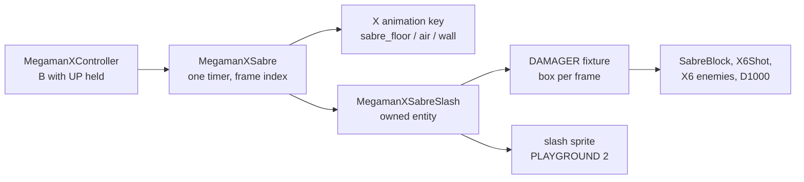

# Scope: mega-refactor-081e-x-sabre

- Status: approved
- Approved: 2026-11-09 (brief decisions B1 to B3)

## Goal

Phase 4 of X: the Z-sabre slash on `UP` + `B`, an approximation of the X6 sabre. X has a floor slash, an air slash and
a wall slash. The slash cuts the X6 enemy shots, breaks `SabreBlock`, damages the X6 enemies and `D1000`, and stuns
`D1000Core`.

## Item

`081` (playable X), phase 4 (`ITEM.md`, "Phases"): "The Z-sabre slash, on `UP` + `B` (branch `081e`)." Open question
11 is closed: `UP` + `B`, no new button (D2 of `081d`). The art design is in the `081` `NOTES.md`, "Sabre slash: body
and slash overlay": X's body in the normal 48x48 frame, and the slash as a separate sprite in front of it.

## Current state

The full scan is in `temp/081e/scan.md` (main checkout), with `file:line` references. Summary:

- X6 (`mmx-x6` `SabreSlash.java`, `Player.java:1452-1564`):
  - The slash is its own entity. It follows X, and its box is the drawn bounds of each slash frame.
  - Times from the press: the floor box is on from 0.083 to 0.333 s and the slash ends at 0.400 s. The air box is on
    from 0.083 to 0.267 s, and the wall box from 0.083 to 0.250 s (the wall slash ends at 0.383 s).
  - Floor: X stops and cannot turn; a jump or `DOWN` cancels after 0.117 s. Air: air control and turn; a landing or a
    wall move switches it to the floor or wall slash (owner, 2026-11-09; X6 ends it); no air dash. Wall: X holds still; a jump gives a wall kick at any time. Damage ends every
    slash.
  - No buster during the slash, and the sabre press drops the charge. No cooldown, no dash slash, no reflect. Enemy
    shots are destroyed.
  - `SabreBlock` and `MetaWheelF` deflect the buster in X6 (table `SABRE_ONLY`).
- Maverick X: `B` shoots on the press, charges while held, and fires the charged shot on the release
  (`MegamanXController.kt:38-48`). X reads no `UP` input. X has 4 behaviors (`WALL_SLIDING`, `GROUND_DASHING`,
  `JUMPING`, `AIR_DASHING`).
- Targets: `SabreBlock` and `X6Shot` accept any damager that is `IOwnable` with a player owner, so they need no new
  gate. Damage comes from `X6Damage.negotiator` (4 callers), `D1000`'s own negotiator and `D1000Core.canBeDamagedBy`.
  An unknown damager class does 0 damage, so the slash hurts nothing outside the entries that this branch adds.
- The `DAMAGER`/`DAMAGEABLE` contact rule is enough. No new fixture type and no change to
  `contact-rule-selection.txt`.
- Art: the 6 strips (`sabre_floor`, `sabre_air`, `sabre_wall` and their `_arc` strips) are in the packed atlas, with
  the same pixels as the strips (the floor redraw too). No art change.
- The Maverick art reaches about 0.6 of the X6 reach (floor 3.19 tiles in front, X6 5.25).
- Maps: `X6_INTRO` `room1` has 5 `SabreBlock`s. `RefactorTest081` `targets` has 2 `SabreBlock`s and a `Junkroid`.

## In scope

- `UP` + `B`: `UP` held on the frame of the `B` press starts the slash, and no shot. While that press is held, X does
  not charge, and its release fires nothing (X6 drops the charge). `UP` pressed while `B` is held does nothing.
- The 3 kinds, picked at the start: wall on a wall slide, floor on the ground, air in the other cases. The start is
  blocked during the ground dash, the air dash, the wall grab, the kick lock and damage (X6). One slash at a time.
- The X6 times, as values in `MegamanXValues` (tuned by feel at the play test). The floor plays art frames 1 to 7
  (frames 0 and 8 are the stand pose with an empty arc; dropped in code, no art change).
- The movement rules (B3, owner 2026-11-09: all as X6, without the `DOWN` cancel).
- The hit box (B1, owner 2026-11-09): the alpha bounds of each arc frame of the Maverick art, active only on the
  frames with slash art.
- The hit rule: the targets' own damage timers (enemies 0.1 s, `D1000` 0.5 s). No X6 hit cap. About 3 hits per slash
  on one target, which gives the X6 kills per slash for the intro targets.
- Damage: `X6Damage` gets the slash, with a static X6 value of 9 for every target and slash (owner, 2026-11-09; a
  `TODO` for the X6 values by target and slash).
  `D1000` takes 2. `D1000Core` is stunned by the slash.
- Sabre-only (B2, owner 2026-11-09: both, the X6 rule): the buster does not damage `SabreBlock` or `MetaWheelF`. Only
  the slash does. Both classes are only in X maps.
- Scope change (owner, 2026-11-09, at the diff review): hard-coded damage per target in place of `X6Damage`, and the
  "X6" prefix removed from the code names, with merge `TODO`s (see `NOTES.md`, "Decisions").
- Sound: `WHIP_V2_SOUND` (Megaman's claws) on the slash, until there is a sabre sound.
- A new test room `sabre` in `RefactorTest081.tmx`, after `ground_dash`.

## Out of scope

- A dash slash, the falcon dash, a reflect of shots.
- The `DOWN` cancel of the floor slash: X has no crouch (`081` open question 10).
- The slash on a ladder (X has no climb).
- A sabre `WeaponDef` (waits for `024`, `O8-R4`).
- New art or a repack.

## Structure

- `MegamanXSabre` (an X part, as `MegamanXBuster`) holds the one clock. X's body key and the slash frame read the
  same frame index, so the 2 sprites cannot drift (scan risk 3). The part places the slash entity each frame and
  destroys it on every end.
- `MegamanXSabreSlash`: `IOwnable`, an `ABSTRACT` body with one `DAMAGER` fixture, and its own sprite, so the slot-1
  tint and the damage flash do not touch it.
- No `BehaviorType.SABRE`: no code outside X needs `isBehaviorActive(SABRE)`. X's moves read `sabre.active`.

New APIs and their first callers:

| API | First production caller |
|---|---|
| `MegamanXSabre` | `MegamanXController` (`B` with `UP`), `MegamanXSprites.animationKey()`, X's updatables |
| `MegamanXSabreSlash` | `MegamanXSabre.start()` |
| `X6Damage.negotiator` sabre values (a parameter) | its 4 callers (`Junkroid`, `HoverGunner`, `MetaWheelF`, `SabreBlock`) |
| the slash case in `D1000` and `D1000Core` | `DamageRule` |

## Affected areas and risks

- X files: 5 or 6 of the 7 in `entities/megamanx/`, plus 2 new files. Target files: `X6Damage.kt`, `D1000.kt`,
  `D1000Core.kt`, `SabreBlock.kt`, `MetaWheelF.kt`, and 1 line in each of `Junkroid.kt`, `HoverGunner.kt`.
- Gameplay risk of B2: the 9 `MetaWheelF` in `X6_INTRO` (5 hard mode only) need the sabre.
- Map: `RefactorTest081.tmx` (a new room).
- Megaman: 0 files. Megaman cannot make the slash, so the target changes do not change Megaman's play, and the
  sabre-only rule (B2) touches 2 classes that are only in X maps (`X6Intro_16x14_v1.tmx`, `RefactorTest081.tmx`).
- Risks:
  - `UP` + `B` fires a shot or a charged shot (all 3 handlers of the `B` actuator change; tests for each).
  - A slash left in the world after an end (damage, death, room transition, level reset); pooled state must reset in
    `onSpawn`.
  - The floor body frames 3 to 6 are transparent under the slash, so the body must not show without the arc.

## Overlap with other branches

- `127a` (active): `RefactorTest127.tmx`, `LevelDefinition.kt`, camera and view edge files. No shared file.
- `compactor-level` (not mega-refactor): no shared file.

## Objective check

| Rule | Effect | Note |
|------|--------|------|
| `O8-R1` no copy of `Megaman.kt` | no effect | X-only code. |
| `O8-R2` capabilities, not character checks | no effect | No `is Megaman` or `is MegamanX` line. Sabre-only is a rule on the damager class, in classes that only X maps use. |
| `O8-R4` one definition for each weapon | waiting | The slash is not a `WeaponDef` until `024`. It adds one more class key to the damage tables (the current pattern). |
| `O6` safe change | helps | Tests for the input rule, the charge, the cancels, the end on damage and the damage entries. |
| Always-on: keep behavior not named | no effect | Megaman and the buster do not change. |

## Open questions

- None. B1 to B3 answered 2026-11-09.
