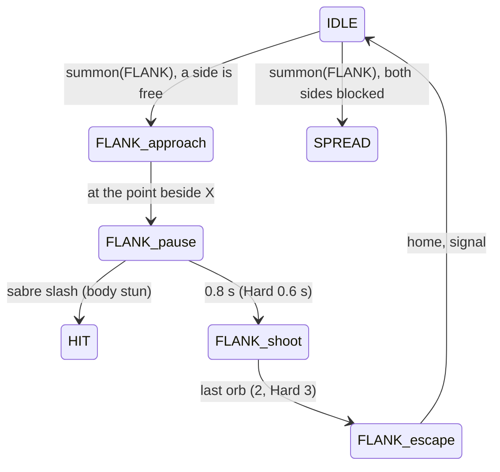
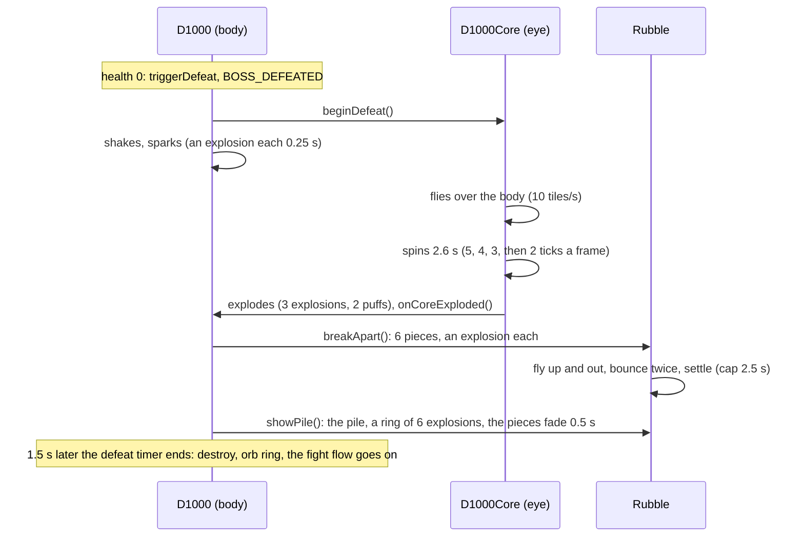
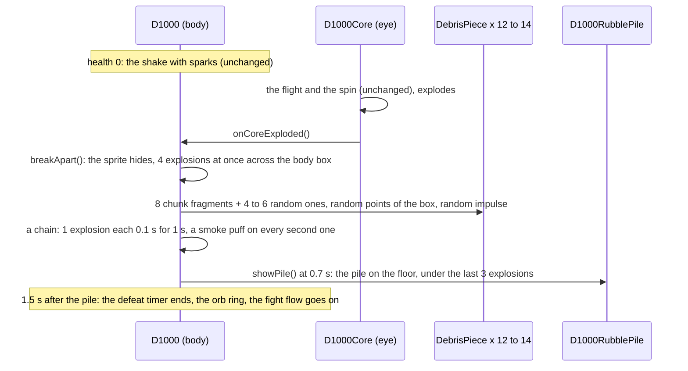

# Notes: mega-refactor-081f-x6-intro-fixes

## AI-generated fight (TODO)

Owner (2026-11-10): the behaviors and mechanics of the D-1000 fight in this branch (the body's actions and the
director's weights, the eye's attacks, the telegraphs, the anti-trap guard and its escape model, the damage tables,
the back-off rules and all the tuning values) were AI-generated across the rounds below, from owner play tests.
They are play-tested, not reviewed line by line, so they need more scrutiny and refinement: a design pass over the
fight as a whole, a check of each rule against what the player sees, and a review of the tests (they were written
with the code, by the same process). The classes carry a `TODO` with this note: `D1000`, `D1000Core`,
`D1000Director`, `D1000TrapGuard`, `D1000Escape`.

## Decisions

- Owner (2026-11-09, after the review): the lowest hover keeps the ground-pose art over the floor (floor + 68 px,
  the largest art depth of `stand`, `walk`, `throw` and `ram`, read from `D1000Frames`); a stun at a low hover
  skips the stagger and falls at once (X6 falls at once: the research of the `081e` play test, `D1000.java:377-392`
  in `~/IdeaProjects/mmx-x6`).

- Owner (2026-11-09, during the work): the D-1000 vertical rule. It falls until it hits the ground, and it rises at
  most to 0.5 tile under the ceiling; any height between that and floor + 0.5 tile is allowed. Answers: the height
  follows X (as the ram wind-up did); the range uses the hit box; the spawn rectangle grows to the ceiling; the ram
  wind-up uses the same range.
- The transition key in `MegamanXSprites` reads only `levelState.roomTransition`: `LevelRoomHandler` sets it in the
  same `onBegin` that sends `BEGIN_ROOM_TRANS`, and the pause starts from that event, so the pause always runs inside
  the flag (a mutation check that removed the pause test changed nothing).

## Music

- The D-1000 fight plays `MusicAsset.MMX6_D1000_MUSIC` (`assets/music/MMX6_D1000.ogg`), in place of
  `MMX6_BOSS_FIGHT_MUSIC` (which stays for `AbstractBoss` and the tests). Source: the owner's `MMX6_d1000.mp3`
  (48 kHz stereo, 123.05 s; the source URL is not known). The mp3 stays untracked in the main checkout.
- The track is one 23.464 s phrase that repeats 5 times from the music start (0.082 s), then fades out from
  about 118.75 s. The spectral match at a lag of 23.46 s is 0.977 over the whole track. The waveforms do not
  repeat sample for sample (correlation about 0.7), so the seam is a musical match, not a bit match.
- Loop scheme: one file, `loop = true`, no intro. The file is source samples `1112495` to `5617462`
  (23.17698 s to 117.03046 s, 93.85348 s, 4 phrases). It starts at phrase 2, so the first note has the
  reverb tail of phrase 1 already in it. The cut is just before a beat onset, at the same place in both
  phrases.
- Seam (2 copies back to back, decoded from the `.ogg`): sample step 0.0099 at the seam (median step 0.0063,
  99.9th percentile 0.0995). RMS 50 ms before the seam -27.4 dB, after -16.7 dB; the source has the same rise
  at that point (-27.2 dB to -17.2 dB), because a beat starts there. Encode: Vorbis `-q:a 6`, 1.88 MB.
  Work files and scripts: `temp/081f-music/` in the main checkout.

## Overlap with other branches

- `060c` (Proto Man buster, 2026-11-12): renames `MegamanXSabreSlash` to `PlayerSabreSlash`, also in `D1000.kt` and
  `D1000Core.kt`. Rounds 12 to 15c add new uses of the old name in the D-1000 code and tests. Owner decision: merge
  `081f` first; `060c` renames the new uses when it takes in `master` (mechanical, no gameplay change).

## CUSTOM changes (deviations from X6)

Owner request (2026-11-09): the D-1000 fight is too slow. Deviations from X6 are allowed; each one is listed here.

Why the X6 values feel slow here:

- The arena has the X6 width and is taller: 368 x 320 TMX px (11.5 x 10 tiles) against the X6 368 x 208 px
  (walls 6080 to 6448, wall top y 208, floor y 416). Ratio 1.0 wide, 1.54 high. The view is 512 x 448 px against
  320 x 240 px (1.6 x 1.87), so the boss fills less of the screen.
- X is faster than in X6: walk 6 tiles/s against 2 px/frame (3.75 tiles/s), 1.6 times. The ported boss values are
  the X6 values, so D-1000 is slow against X.
- The X6 waits (60-frame THINK, 180-frame wind-up, 180 frames at the wall, 124-frame summon, about 5 s of stun with
  the body closed) leave most of a cycle with no threat and no target.

All values are in `D1000.kt` and `D1000Core.kt` (companion constants), except where named.

| What | X6 value | New value | Why |
|---|---|---|---|
| THINK wait (`THINK_DUR`) | 60 frames (1 s) | 0.5 s | Less idle time between actions |
| Walk speed (`WALK_SPEED`) | 1 px/frame (1.875 tiles/s) | 3 tiles/s | X is 1.6 times faster than in X6; the same factor |
| Walk time (`WALK_DUR`) | 120 frames (2 s) | 1.5 s | 4.5 tiles per walk; more decisions per minute |
| Crouch shake (`CROUCH_SHAKE_DUR`) | 60 frames (1 s) | 0.5 s | Shorter slam |
| Crouch hold (`CROUCH_HOLD_DUR`) | 90 frames (1.5 s) | 0.75 s | Shorter slam |
| Rise to the hover height (`RISE_SPEED`) | 1 px/frame (1.875 tiles/s) | 3.75 tiles/s (the wind-up speed) | The rise after a crouch, a ram and a stun was dead time |
| Ram wind-up (`RAM_WIND_UP_DUR`) | 180 frames (3 s) | 1.5 s | The wind-up is still a clear warning |
| Ram top speed (`RAM_MAX_SPEED`) | 4 px/frame (7.5 tiles/s) | 9.375 tiles/s (5 px/frame) | A faster threat; X dashes at 11 tiles/s |
| Ram time at the wall (`RAM_STUCK_DUR`) | 180 frames (3 s) | 1.5 s | Still one free full charge |
| Summon signal (`D1000Core.SUMMON_SIGNAL_DELAY`) | frame 124 (2.05 s) | 1 s | The body stood still for 1.65 s after the last shot |
| Core shot speed (`D1000Core.SHOT_SPEED`) | 2 px/frame (3.75 tiles/s) | 5.625 tiles/s (3 px/frame) | The shots were easy to walk away from |
| Bomb end (`BOMB_END_DUR`, Hard `BOMB_END_DUR_HARD`) | frame 160 (2.7 s), Hard 220 (3.7 s) | 1.5 s, Hard 2.1 s | The pillar is still up when the walk starts |
| Second bomb on Hard (`BOMB_TIMES_HARD`) | frame 84 (1.4 s) | 1 s | Fits the shorter BOMB |
| Entry core delay (`ENTRY_CORE_DELAY`) | update 120 after the landing (2 s) | 1 s | Shorter entry |
| Core signal after appear (`D1000Core.SIGNAL_DELAY`) | 100 frames (1.65 s) | 1 s | Shorter stun and entry |
| Core move after a hit (`D1000Core.MOVE_DELAY`) | 60 frames (1 s) | 0.5 s | Shorter stun |
| Stun damage delay (`STUN_DAMAGE_DELAY`) | 65 frames (1.1 s) | 0.6 s | Shorter stun |
| Stand-up hold (`STAND_UP_HOLD_DUR`) | 45 updates to the hold frame (0.75 s) | 0.5 s | Shorter stun and entry |
| Slam when X is near (`chooseAction`, `playerNear`) | THINK picks from the table only | When X is within 60 px (`NEAR_PLAYER`) at the end of THINK, and the last action was not a crouch, it crouches at once | Punishes a player who stands under or next to the body (the sabre spot); just after a crouch the X6 table applies, so it cannot slam twice in a row from THINK |
| Body open while down (`canBeDamagedBy`, `STUN_DOWN_STEPS`) | The body uses the deflect table for the whole stun | From the landing until the rise starts (stun steps 2 to 4), full charges (5) and the sabre (2) hit the body. During the stagger, the fall and the rise it stays closed. The contact damage stays off for the whole stun | A core hit gives a short window for a follow-up, so the stun is not dead time |
| Eyeball height (`CORE_HEIGHT`) | 5 tiles over the floor | 8 tiles over the floor (owner, 2026-11-09) | The room is 10 tiles high; X reaches the eyeball from a wall kick |
| Body art (`assets/sprites/frames/Bosses3/D1000/`, `D1000Frames.BODY`) | The X6 sprites at the port scale | 1.25 times larger, hand-cleaned, traced from the X6 shapes (restyle only); the original red and X6's dark eyes on `land` and `stand_up` kept (owner, 2026-11-09). `BODY_WIDTH`, `BODY_HEIGHT`, `BODY_CENTER_ABOVE_ORIGIN`, `HALF_WIDTH`, `NEAR_PLAYER`, `BOMB_FORWARD`, `BOMB_UP` scale 1.25 times; `CROUCH_HEIGHT` is 1.75 tiles, the feet of the new `land` art. Work files: `temp/081f-d1000-art/` in the main checkout | "The machine needs to be drawn slightly larger with a bit more detail" |
| Hit boxes (`D1000Frames.BODY_BOXES`, `CORE_BOXES`, `EYE_BOXES`; `TickFrameFixtures`) | The port: one box of the abstract body size (4.375 x 3.59 tiles) for BODY, DAMAGER and DAMAGEABLE; one 0.625-tile box for the eye | Per drawn frame, up to 6 boxes on the body silhouette (BODY, DAMAGER and DAMAGEABLE use the same boxes) and 3 on the eyeball (DAMAGER). The eye DAMAGEABLE is one 7 x 7 art px box on the iris in the `core` frame, and the 3 ball boxes in the `core_appear` and `core_vanish` frames (the glow, also the Spread tell). Boxes are traced from the opaque pixels of the art (`temp/081f-fixtures/measure.py` in the main checkout): at least 95 % of the opaque pixels are in a box, and at least 85 % of the box area is opaque. They mirror with the facing. The abstract body, the hover limits and `HALF_WIDTH` do not change. The on/off rules do not change (owner, 2026-11-09) | "The damager, damageable and body fixtures are detailed and specific on the body and eyeball". The art is 7.75 tiles wide at most, so the touch area and the shot area are now larger than the old box, and a gap in the silhouette is safe |

Kept from X6: health 30, the damage values, the stun damage 8, the core position and its side swap, the pillar.

### New attacks, Overdrive and the director (owner, 2026-11-09)

The owner chose these from the 3 design reports (`temp/081f-attacks/` in the main checkout). Values are in
`D1000.kt`, `D1000Core.kt`, `D1000Director.kt` and `D1000Shockwave.kt` (companion constants). Each new position and
size comes from the named body constants (`HALF_WIDTH` and the hover limits) or the arena, so the later 1.25x art
swap changes only those constants.

| What | X6 | New | Why |
|---|---|---|---|
| Action choice (`D1000Director.chooseAction`) | The 16-roll table of 2 HP bands | A pure function of `D1000Context` (roll 0 to 999, tier, last 2 actions, distance band, X on a wall, X above the body, X near the eye, plans since the last combo) that gives a `D1000Plan` (action and follow-up). Base weights per tier are in `D1000Action`; the context adds to them | More variety; the boss answers where X is |
| Context weights | none | Far (> 5 tiles): RAM +10, WALK and BOMB +5. Near, just after a slam: no WALK, BRACKET +10. X on a wall (body within 0.25 tile of a wall, feet 0.5 tile over the floor): no WALK, FENCE, SWEEP or CEILING; RAM +15, SPOT +10. X above the body top: CEILING +15, SPREAD +10. X near the eye (4 tiles across, 1.5 tiles up or down): DIVE 40, else 0 | Each attack where it works best |
| Repeats | possible | No action 3 times in a row; FENCE, CEILING and SPOT never twice in a row | Variety |
| Slam when X is near | (CUSTOM above) | Kept as the first rule of the director | |
| Combos | none | RAM then CROUCH, SUMMON then RAM, CROUCH then BRACKET, FENCE then RAM, SWEEP then RAM. A combo is possible when 3 plans (Overdrive: 2) have passed since the last one; the fight starts with a combo ready. The follow-up starts at the end of the first action, in place of the walk or THINK. A stun drops it (the next THINK makes a new plan) | Short chains that punish one dodge |
| Bomb flight (`D1000Bomb`) | 32 frames to the target x | The bomb lands at its target x from any height (flight time from the drop height and the gravity). The aimed bomb now lands on X, not short of X | The lane patterns need exact lanes |
| Bracket (`BRACKET`) | none | 3 bombs at X - 2.5, X, X + 2.5 tiles at 0.4 s (throw pose as the warning); 1.5-tile gaps. Both tiers | Stand in a gap |
| Sweep (`SWEEP`, Overdrive) | none | 4 bombs 0.2 s apart from 0.4 s, at X - 1.75, X, X + 1.75, X + 3.5 tiles, plus is away from the body (the pillars march X into the wall behind X). Lanes stay 0.5 tile inside the walls | Climb the wall above the pillar (6.44 tiles) or dash-jump over toward the body |
| Pillar Fence (`FENCE`) | none | Rise to the middle top (the rise is the warning), then 5 bombs 0.25 s apart on the lanes 0.5 to 11 tiles (1.625-tile gaps), from the far wall to X's wall. Hard: 4 more bombs on the shifted lanes 0.5 s after. The body is still at the top for the whole fence | Stand in a gap; a free charge at the still body |
| Wall Crash (ram) | none (the X6 rock fall is out of scope) | At each wall hit, 4 junk pieces (`JunkShot` `JUNKROID`, 1 damage, shootable, gravity -20 tiles/s²) fall from 0.5 tile under the ceiling at 0.5, 2.25, 4, 5.75 tiles past the far edge of the body; each piece starts 0.5 tile lower than the one before | The free window at the wall is not free |
| Dazed Eye (ram) | none | At the last wall hit, the eye glides at 9 tiles/s to 0.75 tile past the far edge of the body, 3 tiles over the floor; it holds 1.5 s (open), then glides home at 4 tiles/s | X can reach the eye from the floor |
| Ricochet Ram (Overdrive) | none | After the first wall hit: 0.6 s re-aim (height tracking), then a ram to the other wall. 1 bounce. The time at the wall (1.5 s) and the dazed eye are only at the last wall | Wall kick or air dash over the second ram |
| Ceiling Crash (`CEILING`) | none | Rise at 9 tiles/s to the highest hover, a landing shake, junk on lanes X and X ± 2.5 tiles (Overdrive also X ± 5), track X at 4.5 tiles/s for 1 s, 0.3 s jitter (the warning), drop with the crouch gravity, then the crouch hold | A move that answers a player above or far from the body |
| Shockwave (`D1000Shockwave`, Overdrive) | none | At each slam landing (crouch and Ceiling Crash), 2 waves start at the feet (`origin.x` ± `HALF_WIDTH`), run along the floor at 7 tiles/s (1 x 0.75 tile box), then up the wall (0.75 x 1 tile) to the ceiling; 3 damage. Art: `pillar_base`, turned 90° on the wall | Jump it on the floor, kick off the wall |
| Peekaboo (the eye open rule) | The core is open from THINK until a hit | The eye is open only while the body commits (THINK, the bomb patterns, the eye attacks, SPOT, the ram at the wall, the Ceiling Crash from the track to the hold, the rage) or while the eye attacks or is dazed. A closed eye is dim (alpha 0.45); before it opens it flickers for 0.3 s, then it is open. Closed in WALK, CROUCH, the ram wind-up and charge, the stun and before the fight phase | The eye is a reward for reading the body |
| Eye home | The core is fixed at its anchor | The eye glides home at 4 tiles/s when it is idle | The dazed eye, Spotter and Dive move it |
| Spotter (`SPOT`) | none | The eye rises 0.5 tile to a rail (8.5 tiles), then 3 times: tracks X at 2.5 tiles/s for 0.9 s, stops and shakes for 0.4 s (the warning), and the body throws a bomb at the eye's x. The eye is open the whole time | The eye comes to X on a wall |
| Spread (`SPREAD`, eye attack) | none | 0.6 s glow (`core_appear` frames), then 5 shots aimed at X with offsets -40, -20, 0, 20, 40°. Overdrive: 4 more at -30, -10, 10, 30° after 0.35 s. Open the whole time | A fan that a dash goes through, not a wall |
| Dive (`DIVE`, eye attack) | none | Only when X is near the eye. 0.4 s shake (the warning), then a dive at X's place at 10 tiles/s (at most 3.5 tiles), 0.5 s hold, then home. Open the whole time | Punishes camping next to the eye; the dive brings the eye into sabre reach |
| Eye contact damage | The core does no contact damage | 2 (the same as its shot), while the eye is shown | The eye is a hazard too |
| Overdrive | Phase 2 at half HP (only the action table changes) | At the first THINK at half HP or less: a 1.2 s rage (the body stands and shakes, a camera shake, the eye open: a free hit window). Then: THINK 0.35 s, walk 3.75 tiles/s, ram wind-up 1 s, ram 10.5 tiles/s, combo gap 2, and the Overdrive attacks (aimed BOMB, SWEEP, Ricochet Ram, shockwaves, 5 Ceiling Crash lanes, the second Spread fan). A stun in the rage repeats the rage at the next THINK | A clear second phase |

### Room tuning (owner play test, 2026-11-09)

Owner: "Just one minute into the fight and I'm already getting my ass handed to me. This fight is too tough given the
small room. ... It's okay if the room goes beyond the standard 16x14 layout." and "the debris didn't fall from the
very top of the room but instead toward the center of the screen." Branch `mega-refactor-081f-room-tuning`.

Why the debris looked low: the arena top was already the bottom of the ceiling block, but the room had 1 black row
over a thin ceiling strip, so the visible ceiling was about 1.5 tiles under the screen top. The debris started 0.5
tile under it, and each Wall Crash piece started 0.5 tile lower than the one before (the 4th piece 2 tiles under the
ceiling, about 3.5 tiles under the screen top).

Room decision (Claude, for the owner to judge in the play test): grow the room horizontally past one screen, and fill
the screen vertically, but not past one screen in height. A taller room scrolls the camera and hides the ceiling and
the eyeball.

| What | Before | New | Why |
|---|---|---|---|
| `boss_room` (`X6Intro_16x14_v1.tmx`, `game_rooms` object 4) | 16 x 14 tiles (512 x 448 px) | 24 x 14 tiles (768 x 448 px), x 6272 to 7040; map 222 tiles wide (was 214) | More room to dodge. The camera follows X across the room (`CameraFollow` and `CameraRoomClamp`); the room is one view high, so the camera never moves up or down. No camera zone is needed |
| Arena (`D1000` object in `children`) | x 6304, y 224, 368 x 320 px (11.5 x 10 tiles) | x 6304, y 192, 688 x 384 px (21.5 x 12 tiles) | The ceiling strip moved up 1 row to the room top, the floor down 1 row (1 visible floor row). The right wall pillar is 2 tiles of art with the wall face in the middle of its first tile, as before, so the width is 21.5, not 22 |
| Blocks | ceiling 6304..6752 y 160..224; right wall x 6672; floor y 544 | ceiling 6304..7072 y 128..192; right wall 6992..7072 y 192..640; floor 6304..6992 y 576..640 | Match the arena |
| Tiles | | Ceiling strip in row 5 (cols 193 to 219); left gate pillar extended up 1 row (row 6); right pillar at cols 218 and 219; floor rows 17 to 19 (cols 197 to 219); all tiles that the map already uses. Script: `temp/081f-room/paint.py` (main checkout, not committed) | Paint the new size |
| Entry point (`ENTRY_X`) | 6.5 tiles from the left wall (center + 0.75) | The arena center (10.75 tiles) | In the first view (the room left end) with its art; the old value was center + 0.75 in the old arena, which puts the art past the view edge in the new one |
| Eyeball homes (`CORE_NEAR_X`, `CORE_FAR_X`, now `CORE_CENTER_GAP`) | 2.5 and 9 tiles from the left wall | Arena center ± 3.25 tiles (the same offset from the center as before), 8 tiles over the floor | Both homes stay on the screen at every camera position (the eye home must be visible for its open and close tells). The old values are the same rule in the old arena. A home 2.5 tiles from the far wall is off the screen when X is at the other end, and its shots are culled off the screen |
| Pillar Fence lanes (`FENCE_LANES`, now `FENCE_SPACING`) | 5 lanes, 0.5 tile from each wall, 2.625 tiles apart | The lane count is from the width: `round(span / 2.625) + 1` lanes, evenly spaced from 0.5 tile inside each wall. 21.5 tiles: 9 lanes, 2.5625 tiles apart. Hard: 8 more on the shifted lanes. `MAX_THROWS` 32 (fail fast when more) | The same gap rule across the full width |
| Debris start (`DEBRIS_TOP`, `WALL_CRASH_DROP_STEP`) | 0.5 tile under the arena top; each Wall Crash piece 0.5 tile lower than the one before | 0.25 tile under the arena top (the visible ceiling) for every piece; the step is removed | "Fall from the very top"; no reason found to keep the step |
| Debris off the screen | Never off the screen | Each piece starts with 0.25 tiles/s down and `CULL_OUT_OF_BOUNDS = false`; it ends when it hits the floor | An `ABSTRACT` body with zero speed does not update off the screen and was culled after 0.05 s, so a piece out of view never fell |
| `D1000` body update (`doUpdate`) | Default: only while it overlaps the camera or moves | Always | The body is placed in its pre-process from the origin. Off the screen (for example after a Ricochet Ram to the far wall), the default stopped the pre-process, and the body and its hit boxes stayed off the screen after the art came back |
| Other positions | | Unchanged: the Bracket, Sweep and Ceiling Crash lanes follow X; the Wall Crash, Dazed Eye and shockwave start follow the body; the Spotter rail, bomb lanes, shockwave path and hover limits follow the arena | Already relative |

Difficulty: lower on Normal; Hard keeps the values from before this change. The damage values to X do not change.

| What | Hard (as before) | Normal (new) | Why |
|---|---|---|---|
| THINK (`THINK_DUR`, `THINK_DUR_HARD`) | 0.5 s | 0.8 s | More time to read the next move |
| THINK in Overdrive (`THINK_DUR_OVERDRIVE`, `..._HARD`) | 0.35 s | 0.55 s | The same, in the second phase |
| Combo gap (`D1000Director.comboGap(tier, hard)`) | 3 plans, Overdrive 2 | 4 plans, Overdrive 3 | Fewer chains that punish one dodge |
| Sweep after a slam (`D1000Director.weight`) | Allowed | Weight 0 when the last action is a crouch or a Ceiling Crash | In Overdrive a slam sends 2 shockwaves; in the wide room they run for up to about 4.5 s, so a Sweep on top of them was the hardest overlap |
| Ram top speed (`RAM_MAX_SPEED`, `..._HARD`) | 9.375 tiles/s | 8 tiles/s | Easier to jump over |
| Ram top speed in Overdrive (`RAM_MAX_SPEED_OVERDRIVE`, `..._HARD`) | 10.5 tiles/s | 9.375 tiles/s | The same, in the second phase |
| Wall Crash pieces (`WALL_CRASH_PIECES`, `..._HARD`) | 4 | 3 | One less piece in the punish window at the wall |
| Ceiling Crash jitter (`CEILING_JITTER_DUR`, `..._HARD`) | 0.3 s | 0.5 s | A longer warning before the drop |
| Spotter lock (`D1000Core.SPOT_LOCK_DUR`, `..._HARD`) | 0.4 s | 0.6 s | A longer warning before each bomb |
| Dive tell (`D1000Core.DIVE_TELL_DUR`, `..._HARD`) | 0.4 s | 0.6 s | A longer warning before the dive |

The larger room also makes the fight easier on both difficulties. Not changed: health, damage, the Bracket, Sweep and
Spread timings, the bomb times and the Overdrive rage.

Overlap: the branch `mega-refactor-081f-telegraphs` works in parallel on the pillar art, the bomb landing markers,
the ceiling debris warnings and the attack tells. It adds hook calls in `D1000.kt` where bombs are thrown, debris
spawns and actions start. This branch changes in `D1000.kt` only constants, positions, the arena math, timings, the
debris spawn properties and the body `doUpdate`. Merge risk: `spawnDebris` and `wallCrash` (both branches touch
them). A debris warning must use the same start height (`arena.getMaxY() - DEBRIS_TOP`).
### Telegraphs (owner play test, 2026-11-09)

The owner asked for a pillar that fills the room height, and for warnings of where the bombs land, of which move
comes next, and of where the debris falls. Branch `mega-refactor-081f-telegraphs`. Each height comes from the arena
(the floor and `arena.getMaxY()`), so the telegraphs work in any room height. Work files (scripts, contact sheet,
mutation log): `temp/081f-telegraphs/` in the main checkout.

| What | X6 / before | New | Why |
|---|---|---|---|
| Pillar height (`D1000Pillar`) | The art and the hit box stopped at 6.44 tiles over the floor | The hit box spans the floor to the arena ceiling (`ConstKeys.MAX_Y`, which the bomb passes). The art is the top 32 rows of the current `pillar_start`, `pillar` or `pillar_end` frame (the art repeats every 16 or 32 rows), drawn in 2-tile segments from the floor up; the top segment is cut at the ceiling. At most 16 segments (32 tiles); a higher room throws. `pillar_base` does not change | "The energy pillars should repeat vertically so that they span the entirety of the room" |
| Bomb landing marker (`D1000BombMarker`, new decoration) | none | At each throw, a blinking floor reticle (24 x 8 art px, 4 frames of 3 ticks, the pillar blues) at the landing x of the bomb, from the throw until the bomb lands or is destroyed. Visual only | Where the orbs land |
| Debris warning (`D1000DebrisWarning`, new decoration) | The junk pieces of Wall Crash and Ceiling Crash fell at once | For 0.5 s (`LEAD_DUR`), falling dust under the ceiling at the piece's x and the junk piece shaking (1 art px) at its start point; then the piece falls from the same point. No piece falls when the boss is defeated in the lead. The attack times do not change: each piece falls 0.5 s later inside the same action (Wall Crash: inside the 1.5 s at the wall; Ceiling Crash: inside the 1 s track) | Where the debris falls |
| Next-move tell (the head lamp, `D1000Lamp`) | The lamp is always red | An overlay of the lamp pixels of each body frame (`D1000/lamp`, 18 x 16 px per frame, greyscale, traced from the art: restyle only), tinted per family: dim red (idle), red (RAM), yellow (BOMB, BRACKET, SWEEP, FENCE), blue (CROUCH, CEILING), green (SUMMON, SPOT, SPREAD, DIVE). Frames where the art has no lit lamp (the stagger, the fall, the landing) show no overlay | Which move comes next |
| THINK plan time (`D1000.updateThink`) | The plan was made at the end of THINK | The plan is made 0.4 s (`D1000Lamp.LEAD_DUR`) before the end of THINK, and the lamp blinks the family color (4-tick steps) until the action starts; then it holds the color until the action ends (dim again at the walk or THINK). The action still starts at the end of THINK. Overdrive THINK is 0.35 s, so there the plan is made at the THINK start (0.35 s lead). The context (X's place) is read at the plan time | A short warning before each move from THINK |
| Combo follow-ups (`D1000.tellFollowUp`) | — | When a combo follow-up is queued, the lamp blinks the follow-up's color in the last 0.4 s of the first action: from `bombEnd` - 0.4 s in the bomb patterns (FENCE, SWEEP), from 1.1 s into the 1.5 s at the wall in the ram, and from 0.35 s into the 0.75 s crouch hold (or at once when a touch ends the hold early), and it keeps blinking through the rise back to the hover height. Accepted gap: SUMMON then RAM shows the red color only when the ram starts, because SUMMON ends at the core signal, which the body cannot see ahead; the ram wind-up is the warning there (a `TODO` in `D1000.updateSummon`) | "Clear tells of the next move" (owner); the open question 1 of the telegraphs report |

### Second tuning (owner play test, 2026-11-10)

Owner: "The fight is much improved. Let's make the room slightly less long horizontally, and let's make the boss just
slightly faster. The eyeball's sprite should be brighter since its palette is too dark and grey. The eyeball should
shoot more often. There should be more pieces of debris that fall from the ceiling."

| What | Before | New | Why |
|---|---|---|---|
| `boss_room` | 24 x 14 tiles, x 6272 to 7040; map 222 tiles wide | 21 x 14 tiles (672 x 448 px), x 6272 to 6944; map 219 tiles wide. Tile columns 213 to 215 cut (ceiling and floor filler only); right wall block x 6896; ceiling 672 px wide; floor 592 px wide | "Slightly less long" |
| Arena (`D1000` object) | 21.5 x 12 tiles | 18.5 x 12 tiles (592 x 384 px). Pillar Fence: 8 lanes. The test rigs keep 21.5 tiles (a fixture, not the map) | Follows the room |
| Body speeds (Normal / Hard where split) | rise 3.75, walk 3, wind-up 3.75, ram 8 / 9.375, Overdrive walk 3.75, Overdrive ram 9.375 / 10.5, Ceiling Crash rise 9, track 4.5 (tiles/s) | rise 4.25, walk 3.5, wind-up 4.25, ram 9 / 10.5, Overdrive walk 4.25, Overdrive ram 10.5 / 11.75, Ceiling Crash rise 10, track 5 | "Slightly faster" (about 10 to 15 %) |
| Wall Crash pieces | 3 / 4 | 5 / 6 (1.75 tiles apart) | More debris |
| Ceiling Crash lanes | X ± 2.5 (3 pieces); Overdrive ± 5 (5) | X ± 5 (5 pieces); Overdrive ± 7.5 (7) | More debris |
| Eye pot shot (`D1000Core.updatePotShot`) | The eye shot only in its attacks | While the eye is idle and the fight runs (not in the intro, a stun or the defeat), 1 aimed core shot every 2 s (Hard 1.4 s) | "Shoot more often" |
| Eye art (`D1000Core/core.png`) | Black shell, dark red, mid grey; closed eye at 45 % alpha | Restyle only, same shapes: inner black shell to slate blue, outline black kept; brighter red, greens, gold and greys; closed eye at 70 % alpha. Script: `temp/081f-room2/scripts/brighten_eye.py` (main checkout) | "Too dark and grey" |

## X sprites round 3

Owner requests (2026-11-10): "X's current stand-shoot pose isn't correct per the artist; he's currently in the
'just landed and shooting' pose." and "Let's make sure X's sprites are aligned properly."
Work files (scripts, audits, contact sheets, GIFs): `temp/081f-round3/x-sprites/` in the main checkout.

| What | Before | New | Why |
|---|---|---|---|
| Stand-shoot pose ("isn't correct per the artist") | Key `land_shoot`: `land_shoot.png`, row 11 frame 6 of `1LMX.png` (the crouched landing frame) | Key `stand_shoot`: new `stand_shoot.png`, row 11 frame 0 of `1LMX.png` (X upright, legs straight, buster forward; the same frame starts the shoot jump) | The only upright buster-forward pose on the sheet. `r13_unknown` is a forward lunge, not a stand. Row 6 frame 0 faces the camera. Rows 1 and 7 are crouch and low health |
| Stand-shoot height | Head 2 px (sheet pixels) lower than the stand | Head 2 px higher than the stand; feet on the same line; eye on the same column | The artist drew this pose with straight legs. The feet do not move, so nothing is shifted |
| `land_shoot` in code | Played for a stand while shooting | Not played. The region stays in the atlas | X has no landing state (`land` is not played either), so no state needs it |
| Room-transition ground poses | `stand`, `land_shoot`, `run_trans`, `run_trans_shoot`, `dash_end`, `dash_end_shoot` | `stand_shoot` in place of `land_shoot` | Same behavior: a stand while shooting still shows the run loop in a transition |
| Stand-shoot time | `land_shoot` had no time link with `stand` | `stand` and `stand_shoot` share the time link that every `x` / `x_shoot` pair has (`onChangeKey`) | Comes from the key name. The blink of `stand` can come up to 1 s sooner after a shot; no other change |
| `jump_shoot` frames 1-5 and `jump_shoot_v2` frames 1-4 ("aligned properly") | 2, 2, 3, 4, 4 px to the left of the `jump` frames | On the `jump` frames: only the buster arm differs | The owner moved `jump.png` frames 1-5 by hand (`def3f36ea`); the shoot twin did not follow. A shot in the air moved X 2 to 4 px (4 to 8 world px) sideways |
| `MegamanX.yaml`, `jump` | No offsets | `offsets: {1: [2, 0], 3: [1, 0], 4: [1, 0]}` | The slicer now gives the hand-moved `jump.png` exactly, and `jump_shoot` follows as a twin. A YAML comment names `stand_shoot.png` as hand-made |
| `sabre_air` frames 0, 1 and 8 | 2 px to the left of `jump` frame 2 (frames 0 and 8 are a copy of it) | 2 px to the right: on `jump` frame 2 | They followed the old `jump_shoot` position. Frames 2-7, the arc strip and the hit boxes do not change, so the slash and the floor and wall sabre links stay the same. The jump-to-sabre step is now 1 px (was 3), the sabre-to-fall step 0 px (was 2) |
| Atlas `MegamanX` | 46 regions | 47 regions (`stand_shoot` added); all other bounds the same | Packed with the slicer settings from all strips in the frames folder |

Audit (script `temp/081f-round3/x-sprites/scripts/pairs.py`; results `audit_before.txt`, `audit_after.txt`). For
each pair of poses that change into each other, it compares the foot line, the eye pixel (a fixed body point) and
the best pixel match after the draw position of the code (cell bottom center on the body bottom center, one flip
axis at the cell center for every strip). Findings that did not need a fix:

- Foot line: every frame with feet ends on cell row 47, except `sabre_air` frames 3, 5-7 (air poses, from the
  sabre art). No floor pose lifts or sinks.
- All shoot twins other than the jump: `run`, `run_trans`, `dash`, `dash_end`, `wallslide`, `walljump` match their
  base frame at 0 px.
- `stand` to `run_trans`, `run_trans` to `run`, `dash_end` to `stand`, `stand` to `sabre_floor`, `sabre_floor`
  to `stand`, `fall` to `wallslide`: 0 or 1 px, from the pose change in the art.
- `wallslide` frame 1 to `sabre_wall`: 1 px. The wall sabre is drawn on `wallslide` frame 0 (the grab), and frame
  0 to 1 has the same step in the artist's strip. Not changed.
- Flip: every strip turns on the same axis (the cell center), and the wall strips that face left use the same
  axis, so a turn does not move the body between strips.
- `climb`, `crouch`, `land`, `victory` and the other unplayed strips were not audited.

### Body art round 3 (owner, 2026-11-10)

Owner: "Mech robot's sprite needs more cleanup and more detail, including but not limited to moving parts, glowing
eyes, glowing mouth, etc. to help telegraph attack patterns." Branch `mega-refactor-081f-mech-art`. Work files
(scripts, old and new contact sheets at 4x, tell GIFs): `temp/081f-round3/mech-art/` in the main checkout. The
script `scripts/build.py` makes all strips from the round 2 frames (`orig/`).

All new lights and parts use the lamp color code (`D1000Tell`) and the lamp lead (`D1000Lamp.LEAD_DUR`, 0.4 s).
The attack timings and the AI do not change. The silhouette of every body frame does not change (the alpha is the
same pixel for pixel), so `BODY_BOXES` do not change.

| What | Before | New | Why |
|---|---|---|---|
| Body cleanup (all 33 body frames) | Grey blotches in the yellow and green plates, single stray pixels, flat plate edges | Grey spots of 64 px or less inside a yellow or green plate take the plate ramp (light grey to the mid tone, dark grey to the shade); single stray pixels take their neighbor color; a plate pixel under the top outline is one ramp step lighter, a plate pixel over the bottom outline one step darker. Same palette, same silhouette, same part shapes | "More cleanup" |
| Hatch screw (`D1000Frames.SCREW_*`) | X6 screw head, hand-traced | Redrawn in place (same circle, same ring): a lit disc with a clean slot at 45 degrees | A clean base for the turning screw |
| Eyes (CUSTOM) | Red 2 x 2 eyes in the art; dark in the stun frames (owner, 2026-11-09: "keep X6's dark eyes") | The top row of each eye is the hot color. A face overlay (`D1000/face`, greyscale, the lamp place and size) lights the eyes, the side light and the mouth slits. Idle: red (0.85, 0.2, 0.12), brighter than the dim lamp. Tell: the family color, steady from the lead to the end of the action. The stun frames (stagger 1 and 2, fall, land, stand_up) keep X6's dark eyes, so dark eyes now mean "down and open". In `throw` 3 the eyes come back (copied from `throw` 4) | "Glowing eyes" (owner, 2026-11-10); this replaces "keep X6's dark eyes" outside the stun |
| Mouth (CUSTOM) | Yellow grille with black slits | The slits are lit (in the face overlay). BOMB family: the jaw opens 1 row (`D1000/mouth`): dark bars, white and yellow slits. In the lead it opens and closes with the lamp blink (4-tick steps); during the action it stays open | "Glowing mouth"; a mouth that opens before a bomb throw |
| Glow (`D1000/glow`, new) | — | A halo on the black visor pixels next to the eyes, the side light and the slits, tinted with the family color. Alpha: idle 0.3; in the lead 1 or 0.25 with the lamp blink; during the action a pulse from 0.55 to 1 at 1.5 Hz | "Glow brighter or pulse in the lead and while it runs" |
| Lamp overlay (`D1000/lamp`, `LAMP_*`) | 18 x 16 px at (18, 4) | 40 x 42 px at (8, 4) (one region for the lamp, the face and the glow). The lamp pixels and colors do not change | One face region |
| RAM: exhaust puffs (`D1000/puff`, `VENTS` nozzle) | — | Steam puffs rise from the top of the back drum (6 frames, 3 ticks each), from the lead to the end of the ram | Moving part that tells the ram |
| SLAM: hover jets (`VENTS` jets) | — | In the lead of a crouch or a Ceiling Crash, steam puffs push down under the front claw and the back arm (the same puff, flipped) | Moving part that tells the drop |
| EYE: turning screw (`D1000/screw`, 4 poses) | — | The hatch screw on the shoulder turns 45 degrees per step: every 2 ticks in the lead, every 4 ticks during the action. Frames where the arm hides the screw show no turn | Moving part that tells the eye attacks |
| Draw order | body 1, lamp 2 | body 1, lamp and face 2, glow, mouth and screw 3, puffs 4. All parts hide in the damage blink and after the defeat | |

Tests (`D1000TelegraphsTest`, "the glowing face and the moving parts"): for RAM, BRACKET, CEILING and SPREAD, only
the family part moves in the lead, the face holds the family color, the glow reaches full alpha, and the screw
changes pose; after BRACKET all parts stop and the glow is idle; the face, glow and part strips match the art and
the vents are inside their frames.

### Slam and orbs round 3 (owner, 2026-11-10)

Owner: "The mech robot shouldn't shoot so many of the 'blue pillar orbs' because right now that attack is impossible
to dodge." and "When mech robot rams wall or ground, room should shake: X is stunned, debris hangs in the air before
falling shortly thereafter." Branch `mega-refactor-081f-slam`. Work files: `temp/081f-round3/slam/` in the main
checkout.

#### The orbs

The safe rule: at each moment, X has a gap of 3 tiles or more between 2 active pillars, or 2 tiles or more between
a pillar and a wall, and X can walk into it after the floor marker shows. A pillar hits X when the centers are
closer than 1 tile (pillar 1 tile, X 1 tile wide), so a 3-tile gap gives a 1-tile zone for the X center. A wall
pocket needs less, because a wall does not move and no pillar comes from the wall side. The smallest wall pocket is a
Hard Fence shifted lane next to a wall: half the spacing, so 2 tiles or more.

The time from the marker to the damage. The marker shows at the throw. The pillar damages after the bomb flight
(gravity 28 tiles/s²) and `pillar_start` (5 ticks, 0.08 s):

- From the low hover (Bracket, Sweep, aimed Bomb, X on the floor): the bomb starts 3.56 tiles over the floor, the
  drop is 3.31 tiles, the flight 0.49 s, so 0.57 s. X walks 6 tiles/s: 3.4 tiles, 2.2 tiles after a 0.2 s reaction.
  X dashes 11 to 15 tiles/s after a 0.08 s start: 3.2 tiles or more after the reaction.
- From the top (Pillar Fence): the drop is 9.69 tiles, the flight 0.83 s, so 0.91 s. Walk: 5.5 tiles, 4.3 after
  the reaction.

| What | Before | New | Why |
|---|---|---|---|
| Bracket (`BRACKET_GAP`) | 3 orbs at X - 2.5, X, X + 2.5: 1.5-tile gaps, a 0.5-tile zone for the X center | 3 orbs at X - 4.25, X, X + 4.25: 3.25-tile gaps. X walks 1 to 3.25 tiles (0.17 to 0.54 s) into a gap | Quote 1. The old gap needed a pixel-exact step in 0.57 s |
| Bracket on Hard (`BRACKET_FOLLOW_HARD`) | As Normal | Plus 1 orb aimed at X at 1.6 s. The bracket pillars damage from 0.97 to 1.82 s; this one from 2.17 s, so X steps 1 tile out after the bracket is gone. End 2.7 s (Normal 1.5 s) | Hard keeps more orbs |
| Sweep, Overdrive (`SWEEP_STEP`, `SWEEP_COUNT_HARD`) | 4 orbs 1.75 tiles apart, X - 1.75 to X + 3.5 (+ away from the body): a 6.25-tile wall. With the full-height pillar, the only dodge was 2.75 tiles toward the body in 0.57 s, often into the body | 4 orbs (Hard 5) 0.2 s apart at X - 2.125, X + 2.125, X + 6.375, X + 10.625: 3.25-tile gaps, and X stands in a 2.25-tile zone around its place. "Hold your ground" while the pillars march to the wall behind X | Quote 1 |
| Lanes past a wall (`laneInArena`) | Clamped to 0.5 tile inside the wall, so a lane could land next to another lane and close a gap | A Bracket or Sweep lane past 0.5 tile inside a wall is not thrown | A clamp broke the gap rule near the walls |
| Pillar Fence (`FENCE_SPACING`) | `round(span / 2.625) + 1` lanes: 8 in the 18.5-tile arena (2.5-tile spacing, 1.5-tile gaps) | `floor(span / 4) + 1` lanes, so the spacing is 4 tiles or more: 5 lanes in 18.5 tiles (4.375 spacing, 3.375-tile gaps), 6 in 21.5 tiles (4.1, 3.1). X walks 1 tile at most, in 0.91 s | Quote 1 |
| Pillar Fence on Hard (`FENCE_SECOND_DELAY`) | 7 more orbs on the shifted lanes, 0.5 s after the last first-wave orb, while the first-wave pillars were still on: the lanes and the shifted lanes together left 0.2 tiles | 4 more (18.5 tiles) on the shifted lanes. Each one is thrown 1.9 s after the later of its 2 neighbor lanes, which is gone at 1.85 s; then X has 0.91 s to step 1 tile. 9 orbs (was 15) | Hard keeps more orbs |
| Aimed Bomb | 1 (Hard 2) at X | Not changed: one 1-tile pillar, X steps 1 tile in 0.57 s | Already safe |
| Director weights (`D1000Action`) | Normal: Bracket 12, Fence 12. Overdrive: Bomb 8, Bracket 8, Sweep 12, Fence 10 | Normal: Bracket 10, Fence 10. Overdrive: Bomb 5, Bracket 5, Sweep 8, Fence 7 | Fewer orb patterns. At MID distance the orb share (with Spotter) goes from 34 % to 31 % (Normal) and from 47 % to 39 % (Overdrive) |
| Orbs in a row (`D1000Director.weight`) | An orb pattern could follow an orb pattern (only Fence and Spotter could not repeat) | No Bomb, Bracket, Sweep, Fence or Spotter right after one of them. The combo Crouch then Bracket stays | Quote 1: no chain of orb walls |
| Fail fast (`addThrow`) | | The throw times of a pattern must not go down; a Fence needs an arena of 4 tiles + 2 margins | The throw loop throws in order |
| Proof (`D1000DodgeTest`) | | For Bracket, Fence, aimed Bomb and Sweep, Normal and Hard, arenas 18.5 and 21.5 tiles, X at 1 tile, at the middle - 3.5 and at the far wall - 1: an X that walks (6 tiles/s) and reads only the markers (0.2 s late) and the pillars is never hit, and at every tick its gap is 3 tiles or more (2 against a wall). Plus the orb counts | "Add tests that prove a safe gap" |

#### The slams

| What | Before | New | Why |
|---|---|---|---|
| Impact shake (`impact`, `IMPACT_SHAKE_INTERVAL`, `LAND_IMPACT_*`, `WALL_IMPACT_*`) | `SHAKE_CAM` with a 0.1 s interval and 0.16 tile up. The camera parts set the camera again each frame, so the offset showed on 1 frame of 6: hard to see | Interval 0: the offset changes sign on every frame. Slams (crouch landing, Ceiling Crash drop, the Ceiling Crash hit at the top): 0.33 s, 0.125 tile up and down, 0.03 tile across. Wall hit of the ram: 0.5 s, 0.19 tile across, 0.06 tile up and down. The entry landing, the stun fall and the rage keep the old shake | "Room should shake" |
| X stun (`STUN_PLAYER`, `StunComponent.start(duration)`, `Stuns.onStunPlayerEvent`) | X has the shared stun (0.25 s, a small bounce, only on the ground), with no pose | D-1000 sends `STUN_PLAYER` (`STUN_BOUNCE_IF_ON_SURFACE`) with `ConstKeys.DURATION` 0.5 s (Hard 0.75 s) at the crouch landing, the Ceiling Crash drop and the last wall hit of a ram. An X in the air is not stunned. No damage. A stun event with no duration keeps the 0.25 s, so Megaman does not change. X shows `damaged` (`air_damaged` in the bounce) while stunned (`MegamanX.animationKey`) | "X is stunned"; the jump is the dodge |
| Ricochet Ram first wall hit | | Shake and debris, no stun | A stun there took 0.6 s of the 0.6 s re-aim, and the second ram came at once: no dodge |
| Ceiling Crash hit at the top | | Shake, no stun | It is not a hit on the wall or the floor, and X must dodge the lanes and the drop after it |
| Overdrive shockwaves (`SHOCKWAVE_AFTER_STUN`) | At the slam landing | 0.4 s after the X stun ends: 0.9 s (Hard 1.15 s) after the landing, from the feet at the landing | A stunned X cannot jump, and the wave starts next to X |
| Crouch debris (`CROUCH_DEBRIS`, `_HARD`) | None | 3 pieces at X, X ± 2.5 (Hard 5: X, X ± 1.75, X ± 3.5), with the warning. The piece falls 0.6 s after the slam and reaches X's head about 1 s later, so X has about 1 s after a 0.5 s stun (0.85 s after 0.75 s) to step 1 tile. The Ceiling Crash drop has no extra debris (its lanes fall at the top) | "Debris also follows the ground slams" |
| Debris hang (`D1000DebrisWarning`, `LEAD_DUR`, `LOOSE_DUR`, `HANG_DROP`) | The piece shook (1 art px) at 0.25 tile under the ceiling for 0.5 s, then fell from there | The dust stays at the ceiling. The piece drops loose 0.5 tile in 0.15 s (ease out, 1 art px shake), then hangs and swings ±15° at 5 Hz, then falls from the hang point at 0.6 s | "Debris hangs in the air before falling shortly thereafter" |

Tests: `D1000SlamTest` (the shake changes sign on every frame with a camera that the movers reset, the stun on the
ground for 0.5 s and 0.75 s, no stun in the air, no stun at the first Ricochet hit, the crouch debris lanes, the
shockwave wait, the hang); `D1000DodgeTest` (above). Changed: the Bracket, Sweep and Fence lanes, the Wall Crash
fall time, the shockwave wait and the debris start point in `D1000AttacksTest` and `D1000TelegraphsTest`.
`D1000Rig` takes an arena width. Contact sheet of the hang (6x): `temp/081f-round3/slam/hang_contact_6x.png`.

### Eyeball round 3 (owner play test, 2026-11-10)

Owner: "Eyeball sprite should be bigger." "Eyeball sprite should blink (see Mega Man's and X's blink anim)."
"Eyeball sprite should appear 'angry' before he shoots." "Eyeball sprite should swerve and fly around a bit more in
an attempt to dodge X's moves/attacks, but not too much." Branch `mega-refactor-081f-eye`. Work files (scripts,
contact sheet, GIF): `temp/081f-round3/eye/` in the main checkout.

| What | Before | New | Why |
|---|---|---|---|
| Eye art size (`D1000Core/*.png`, `D1000Frames.CORE`) | 16 x 16 art px (32 x 32 screen px) | 24 x 24 art px (48 x 48 screen px), redrawn by hand at the new size: same layout (green dome at the top right, red iris at the left, white glint, red lower band, slate shell), same palette as the second tuning. Script: `temp/081f-round3/eye/scripts/draw_eye.py` | "Should be bigger" |
| `core_appear`, `core_vanish` | 5 frames of 16 x 16 | 5 frames of 24 x 24: the same flash, stripe and red-eye frames, redrawn; same order and ticks | Follows the size |
| Eye body and boxes (`SIZE`, `CORE_BOXES`, `EYE_BOXES`) | Body 0.625 tiles; ball 3 boxes; eye box 7 x 7 art px | Body 0.9375 tiles; ball 3 boxes on the 24 px circle; eye box 11 x 9 art px on the iris. The eye box stays the same in all open, blink and angry frames | Follows the size |
| Reach `NEAR_X`, `NEAR_Y` | 4 and 1.5 tiles | Not changed | The DIVE range is from the eye center; a bigger eye does not need it |
| Blink (`core`, new frames 1 and 2) | No blink | While the eye idles: open 90 ticks (1.5 s), half lid 3, shut 5, half lid 3 (0.18 s), then again. The green dome comes down as a lid with a black lash line. Full alpha; the open state and the eye box do not change. Each new idle starts with the full 1.5 s open. Other states (SPOT, DIVE, DAZED, a SUMMON or SPREAD after the tell) show the open eye with no blink (`core_stare`) | "Should blink"; X's stand is 1.5 s open, 0.15 s closed. A blink is short and keeps full alpha, so it does not look like the closed (dim) eye |
| Angry face (`core_angry`, new, 2 frames of 4 ticks, loop) | No angry face | The lid comes down in a slant with a black edge; the iris turns red-hot (the red to orange, the orange to gold, the gold to cream, the cream to white), and it pulses between hot and red | "Appear 'angry' before he shoots" |
| Pot shot tell | The shot came with no tell | The angry face for the last 0.3 s (Hard 0.2 s) before each pot shot. The interval does not change (2 s, Hard 1.4 s). When the eye leaves the idle state, the pot shot timer is capped at the tell start, so a shot right after an attack also gets the full tell | A shot must not be a surprise |
| BURST tell (`SHOT_TIMES`) | 4 shots at 0, 0.13, 0.27, 0.4 s | The angry face from the start, then the 4 shots 0.3 s later (Hard 0.2 s): 0.3, 0.43, 0.57, 0.7 s. The end signal stays at 1 s, so the combo timing does not change | The burst had no tell |
| SPREAD tell (`SPREAD_TELL_DUR` 0.6 s) | `core_appear` flashes for the full 0.6 s | `core_appear` for 0.3 s, then the angry face for 0.3 s, then the fan. In Overdrive the angry face stays until the second fan. Times do not change | The angry face is part of the existing tell |
| Idle drift | The idle eye held still at home | The idle eye floats around home: x ± 0.4 tiles over 3.2 s, y ± 0.25 tiles over 2.1 s (a sine in each axis), at the home speed (4 tiles/s) | "Fly around a bit more" |
| Dodge | No dodge | When an X shot (`Bullet`, `ChargedShot` with a player as root owner) moves toward the eye, at most 5 tiles ahead and at most 1 tile from its lane, or when an X sabre slash starts with X at most 3 tiles (x) and 2.5 tiles (y) from the eye, the eye rolls once for that shot or slash. Chance 50 % (Hard 65 %). A dodge moves 1.25 tiles at 12 tiles/s: across the shot lane (away from it; up when the shot is on the lane), or away from X and up for a slash. It holds for 0.4 s, then the eye floats back (in IDLE to its drift path, in SUMMON and SPREAD to home at 4 tiles/s). Then a cooldown of 1.5 s (Hard 1.1 s). The target stays 0.75 tiles inside the arena, and inside the view when the eye is on screen; when one side has no room, the eye takes the other side, and with no room on both sides it does not dodge | "Swerve ... to dodge X's moves/attacks, but not too much": the chance, the one roll per threat and the cooldown keep it hittable |
| Dodge windows | — | Only in IDLE, SUMMON and SPREAD, while the body fights. Never while DAZED, in SPOT (the lock), in DIVE (the hold), while the body is stunned, in the Overdrive rage (`D1000.enraging`, new), or while the eye is hidden | The punish windows stay sure |

`D1000.kt` change: only the new `enraging` read (the rage state). The threats are read through the existing
`MegaGameEntities` tag lookup and `rootPlayer`; there is no new global.

### Eye and shield round 4 (owner, 2026-11-10)

Owner requests:

1. "The eye needs a bit more of an "8-bit" look. Right now, the eye-blink and movement are a bit too smooth."
2. "The eye ball needs to be damaged by bullets and charged shots, with the sabre being its weakness that causes it to
   be "stunned" (same as in the X6 fight)."
3. "The mech body needs to be resistant to damage and be shielded, unlike the X6 fight."

Branch `mega-refactor-081f-r4-eye`. Work files (contact sheet, scripts, packed atlas): `temp/081f-round4/eye/` in the
main checkout.

#### 8-bit eye

| What | Before | New | Why |
|---|---|---|---|
| Drawn eye position (`D1000Core.drawX`, `drawY`) | The sprite and the eye boxes used the smooth position | The sprite and its boxes snap to whole art pixels (`TickFrames.SCALE`, 2 world px; 1/16 tile). The 1-art-px tell jitter stays on the grid. The body center (`body.getCenter()`) stays smooth, so the dodge and reach math do not change | Quote 1: an NES sprite moves on whole pixels |
| Idle drift (`updateDrift`) | A sine in each axis (x ± 0.4 tiles over 3.2 s, y ± 0.25 tiles over 2.1 s) | A loop of 4 corners around home (x ± 0.375, y ± 0.25 tiles; axis-aligned edges): constant 2 tiles/s, then a hold of 0.4 s at each corner. After a dodge or another state, the eye goes back to the current corner at the home speed (4 tiles/s) | Quote 1: no easing; holds between moves |
| Dodge, home, spot, dive, daze moves | Constant speed | Not changed (already constant speed, no easing) | |
| Blink (`core`, `D1000Frames.CORE`) | 4 steps: open 90 ticks, half lid 3, shut 5, half lid 3 | 2 steps, hard cut: open 90 ticks (1.5 s), shut 9 ticks (0.15 s). The half-lid frame is removed from `D1000Core/core.png` (now 2 frames); Bosses3 repacked | Quote 1; the same values as Mega Man's and X's stand blink (`1.5f, 0.15f`) |
| Angry tell (`core_angry`) | Hot and red frames, 4 ticks each | Hot and red frames, 8 ticks each | Quote 1: fewer changes per second |

#### Damage

| What | Before | New | Why |
|---|---|---|---|
| Eye damage (`D1000Core.damageOf`) | Only a full charge or the sabre; no damage, each hit stuns | The hit goes to the boss health (`D1000.takeEyeDamage`, with the damage enhancement scale): `Bullet` 1, half `ChargedShot` 2, full `ChargedShot` 4, sabre 2. A `ChargedShotExplosion` does 0 (no double hit) | Quote 2 |
| Stun | Every eye hit | Only the sabre (the existing stun flow: the eye vanishes, swaps home, the body falls, 8 stun damage) | Quote 2: the sabre is the weakness |
| Eye hit feedback (`HURT_DUR`) | The eye vanished on each hit | A shot hit: the damage sound, and the eye flickers (hidden every second 0.05 s step) for 0.5 s. In that time no shot hurts the eye; a shot passes through. The sabre is not blocked by this time | 0.5 s caps bullet spam at 2 damage/s, near the half charge (2 per 0.9 s) and the full charge (4 per about 1.75 s). The sabre stays sure after a shot |
| When the eye is open | | Not changed (Peekaboo, SUMMON, SPREAD, DIVE, SPOT, DAZED) | The bullet rule is fair with the 0.5 s cap |
| Body shield (`D1000Shield`, new) | Full charges 5 and the sabre 2 hit the body at all times (not in the stun stagger, fall and rise) | One `SHIELD` fixture over the union of the drawn frame's body boxes, on while the body is not downed. The `BODY` boxes have `NO_PROJECTILE_COLLISION`, with the exception "not shielded". A shot bounces off the shield with the existing `Bullet` and `ChargedShot` bounce and the dink sound. Shots do 0. The sabre does 1 (`SHIELDED_SABRE_DAMAGE`) | Quote 3. One union box, not one box per body box: a shot that touches 2 shield boxes in one frame bounces twice, which cancels the bounce |
| Downed body (`downed`, stun steps 2 to 4) | Full charge 5, sabre 2 | Shield off; `Bullet` 1, half charge 2, full charge 5, sabre 2 | The sabre stun stays the reward |

Hits to win on Normal (30 health; `D1000ShieldTest` drives the new counts through the rig):

| Plan | Before (from the code) | New |
|---|---|---|
| Sabre the eye, then 1 full charge on the downed body, repeat | 6 (8 + 5 per stun) | 4 (2 + 8 + 5 per stun) |
| Full charges at the eye only | 4 (each one a stun, 8) | 8 (4 each, no stun) |
| Full charges at the body only | 6 | Not possible (shield) |
| Bullets at the eye only | Not possible | 30 (at most 2 per second) |

Decision for the owner: the body takes the sabre for 1 while shielded. The other option is 0 at all times, so the
only way to hurt the body is the downed window. Recommendation: keep 1; a close-range sabre attack must not look
like a miss, and 30 sabre hits on the body is not a fast way to win.

`D1000.kt` changes: the damage table, `shielded`, `takeEyeDamage`, the shield fixture and the body-box label. No
change to the state machine or the director.

### Round 4: study and anti-trap (owner, 2026-11-10)

Owner: "I want to avoid scenarios where the player is "trapped", i.e. the eye, body, and attacks have the player
trapped in such a way so that evading damage is unavoidable. This means the boss orchestrator needs to keep track of
the placement of its damagers and the player." and "Dispatch at least one agent to do an overall study and cleanup of
the fight's state machine, possible scenarios, telegraphing, fun factor, etc., and make any changes that are
recommended." Branch `mega-refactor-081f-r4-study`. The study (state machine, attack and tell table, the scenarios
found, the model): `temp/081f-round4/study/STUDY.md` in the main checkout.

The anti-trap model (`D1000Escape.kt`, `D1000TrapGuard.kt`): X's place on the floor at X's height band, in cells of
0.1 tile (one walk step of 1/60 s), over the next 4 s. Each step the free cells grow by one cell (after the reaction
time, and not while X is stunned), and each active danger clears the cells it covers (X width plus a margin). A trap is
a step with no free cell. The dangers are the live pillars, bombs in flight, junk warnings and junk, eye shots,
shockwaves (jumpable unless X is stunned), the body boxes in the band, X's stun windows, and the forecast of the move
that D-1000 wants to start. X's values come from `MegamanXValues`.

| What | Before | New | Why |
|---|---|---|---|
| Plan check (`D1000.choosePlan`, `D1000Context.refused`, `D1000Director.choose`) | THINK picked from the weights | Each action with a weight (and the near crouch) is forecast; an action that leaves X no free cell is refused (weight 0). With no action left, THINK runs again. When the live hazards alone already leave no escape, every new move is refused | Quote 1 |
| Model values (`D1000Moves`) | — | Normal: walk 6 tiles/s, reaction 0.25 s, margin 0.0625 tile each side. Hard: reaction 0.15 s, margin 0 | "Normal must always leave an escape; Hard may leave a smaller one but never none" |
| Ram check (`D1000.forecastRam`) | Any distance | X must reach the wall in X's direction and climb to the drop height (`D1000XMoves.climbTime`) before the charge, and the run from the body's front to that wall must last 0.1 s (Hard 0.05 s) + X's fall under the body (`fallTime`); or X climbs over a low ram in the run. The 1.5-tile wall strip must be free from the climb to 0.5 s after the hit. Then the floor check runs from the wall with the stun and the Wall Crash junk | A ram at a wall-pinned X with a short run was a sure hit |
| Combo follow-up (`tellFollowUp`, `finishAction`) | Started with no check | Checked at its tell (or at its start for SUMMON then RAM); dropped when it traps X | For example the last Fence lane is at X's wall, where X climbs for the ram |
| Eye pot shot (`D1000Core.updatePotShot`, `D1000.eyeMayShoot`) | Every 2 s (Hard 1.4 s) while idle | Before the angry tell, the eye asks D-1000. It waits 0.25 s and asks again while the shot would trap X (for example X stunned when it lands), and from the ram wind-up to the wall hit and in the Ricochet re-aim | A stunned X cannot dodge; the ram dodge is the climb and the drop |
| Walk (`updateWalk`, `WALK_GAP`) | Walked until X was 2.34 tiles from the center, then crouched at once | Stops (to THINK) when the gap between the body boxes and X is 1.5 tiles. The walk crouch is removed; the near crouch comes from THINK with the 0.4 s lamp lead | The 7.5-tile body art touched X before the near test; at a wall X had no escape; the walk crouch had no tell |
| Ceiling Crash track (`ceilingTrackX`, `CEILING_POCKET`) | Tracked X to `minX` | Stops 3.32 tiles (the crouch art reach, `CROUCH_REACH`) + 1.25 tiles from each wall | The drop art reached the wall: no pocket for a cornered X |
| Rise after the wall, Ricochet re-aim (`moveToHover(hold)`, `trackHeight(hold)`) | Tracked X's height | The body does not move up or down toward X while X is in its column | The body came down (or up) onto X at the wall, where the art reaches the wall |
| Crouch from above (forecast) | — | When the body does not touch X, the crouch art at the landing is a danger | A crouch from a high body onto X under it had 0.7 s and a 6-tile way out |
| Eye shots and stuns (`D1000TrapGuard.shotsAirUntil`, `stunsBetween`) | — | No eye shot comes down to the floor while X is stunned: a move with a stun (crouch, Ceiling Crash, the ram) is refused while a live eye shot crosses the floor in that stun; a pot shot waits while it would land in a live or forecast stun. The eye asks again when it fires (it can drop the shot after the angry face); in THINK it sees the planned move, and it holds when the plan is a ram | A stunned X cannot dodge. Found: the Summon burst at X's wall lands in the ram's hit stun, so SUMMON then RAM is dropped there |
| Ceiling Crash junk lanes (`ceilingLane`) | X, X ± 2.5, X ± 5 (5 pieces; Overdrive also ± 7.5: 7) | X ± 1.25, ± 3.75, ± 6.25 (6 pieces; Overdrive also ± 8.75: 8); no lane closer than 1.25 + 0.75 tiles to a wall | A lane on X forced one move 0.4 s (Hard 0.2 s) before the drop forced a second one; at a wall the lane fell into the pocket. One more piece each ("more debris", second tuning) |
| Pillar Fence end (`scheduleThrows` FENCE) | Last throw + 1.1 s | Last throw + the time until its pillar is gone (flight + start + 0.85 s: 1.77 s in the 12-tile room) | The last lane is at X's wall. With the old end, the ram follow-up wound up while that pillar stood where X must climb; the body now stays at the top longer (a free charge) |
| Repeats (`D1000Director.weight`) | RAM then RAM about 1 plan in 4 | The last action's weight is halved. The 3-in-a-row and big-move rules stay | Variety |
| Stun (`stun()`) | Kept the follow-up until the next plan | Clears it | Clearer; no change in play |
| Cleanup | `playerNear()`, the walk crouch, field `coreFar`, 4 throw arrays and `addThrow` | Removed; `D1000Throws` (also used by the forecast); `spawnCore(far)` | Dead or duplicated code |
| Read access for the model | — | `D1000Pillar.baseX`, `dangerIn`, `dangerUntil`, `START_DUR`, `ACTIVE_DUR`, `WIDTH`; `D1000Bomb.targetX`, `landsIn()`, `flightTime()`; `D1000DebrisWarning.fallsIn`, `startSpeed`; `D1000Shockwave.center`, `direction`, `onFloor`, sizes and speed; `internal` on the eye shot, Spread and Spotter constants of `D1000Core` | The model reads the real values |
| Test rig (`D1000Rig`) | A destroyed entity stayed `LIVE`; bombs and shots did not move | It is `DESTROY_QUEUED`, as in the engine queue; bombs and junk fly by default (`flyBombs`, `flyShots`; `D1000AttacksTest` turns bombs off for its lane math); `tickWaves` moves shockwaves | The model reads `liveAfterUpdate` and the real flight; a hanging shot looked like a shot that never lands |
| Tests changed | | `D1000TelegraphsTest`: Fence then Ram with X in a Fence gap (2.55 tiles), 6 Ceiling Crash pieces; `D1000AttacksTest`: Summon then Ram with X at the far wall, the new Ceiling Crash lanes | X stood in the last Fence lane; the Summon burst trap above |

Accepted limits: the model is 1-D at X's height band; the Dive (X is high, near the eye) is not forecast; the eye
dodge can move the eye after a forecast; X's air moves are only in the ram check; a move that follows X (the Ceiling
Crash track, the Spotter eye, aimed lanes) is forecast at X's place at the check time.

Tests (`D1000EscapeTest`, `D1000TrapTest`): the floor model cases; a pinned ram is refused and a long one runs with
the eye quiet; the owner's case (X high at the wall, drops under the ram, then the stun, the Wall Crash junk and the
eye) with no hit; X in the wall pocket through an Overdrive Ceiling Crash with no hit; a Bracket that closes X's last
gap next to a live pillar is refused, and runs without the pillar; the walk gap; 4 fights of 30 s (Normal, Hard,
both tiers) with a walking test X: no eye shot hits X in a stun. Mutation run (each rule off): all caught.
Not proven: in the same 4 fights the test X (greedy, 0.25 s reaction, floor only) was still hit 1 to 3 times per
fight, by pillar lanes and Wall Crash junk near a wall (see the study).

### Eye motion round 5 (owner play test, 2026-11-10)

Owner: "The eye jitters in place sometimes; its moves are kind of weird". Branch `mega-refactor-081f-r5-eye-jitter`.
Work files (frame traces of 12 rig fights, the analysis, a before and after plot): `temp/081f-round5/eye-jitter/` in
the main checkout.

Method: the rig drove 12 fights (Normal and Hard; base and Overdrive; X that shoots at the eye, X that walks, X high
near the eye for the Dive, X that taps left and right) and wrote the drawn eye position for each frame. The traces
show these causes. The eye does not follow a point on the body: its home, the Spotter rail and the daze point are
fixed when the move starts, so a moving base is not a cause. No overshoot on arrival, and no hold that restarts.

| Cause | Evidence (before) |
|---|---|
| A new state target turns a slow move back at once | `hard-base-high` frame 1616: the drift moves the eye down (y 178, 177), and on the next frame SPREAD sends it up to home (178). The same with SUMMON (`normal-base-walk` frame 1097) |
| The tell jitter ends and the next move goes the other way on the next frame | `normal-overdrive-walk` frames 1720 to 1722: x 302 (jitter), 301, 302 (drift). The same at `normal-base-shoot` frame 1196 and in SPOT track after each lock (frame 1823) |
| A dodge is cut after 1 frame | `hard-base-shoot` frame 1408: the dodge starts (y 176 to 173); on the next frame the rage starts, `canDodge()` is false, the dodge stops and the eye goes back (174, 175, 176) |
| The Spotter track copies each turn of X | `normal-base-walk` frame 2287: x 268, then 267 on the next frame when X turns. An X that taps left and right makes the eye shake in place |
| The drift step rhythm has a hitch | At 2 tiles/s a step is 0.53 art px per frame: in the pure drift fights, 35 to 39 steps came 1 frame after the last step, against about 270 at 2 frames. At 4 tiles/s (home) a step is 1.07 art px per frame: 4 to 12 steps of 2 art px per fight |
| The tell jitter itself | 1 art px every 3 frames in the Spotter lock and the Dive tell. It shows only in those tells (as designed) |

| What | Before | New | Why |
|---|---|---|---|
| Turn back (`D1000Core.REVERSE_PAUSE`, `glide`, `trackSteps`) | A move could go the other way on the frame after a step | A slow move that goes against the last drawn step on an axis waits until 0.1 s after that step. The drawn step includes the tell jitter. A dodge and the Dive dash do not wait (they are reflex moves) | "Jitters in place": the eye now stops, then moves back |
| Dodge end (`dodgeState`, `canDodge`) | The dodge stopped at once when the body left the fight state (rage, stun, not fighting) | A started dodge finishes its move and its 0.4 s hold. It stops early only when the eye leaves IDLE, SUMMON and SPREAD, or hides. A new dodge still starts only by the old rules (not in the rage, not while the body is stunned) | A 1-frame dodge looks like a glitch |
| Spotter track (`SPOT_MIN_MOVE`) | Followed X's x each frame | Aims again only when X is 0.25 tiles or more from the current aim. The eye goes to the aim at 2.5 tiles/s (not changed) | X's small steps do not shake the eye. The mark can be up to 0.25 tiles from X (Normal and Hard) |
| Drift speed (`DRIFT_SPEED`) | 2 tiles/s | 1.875 tiles/s (30 art px/s: 1 art px every 2 frames at 60 FPS) | An even step rhythm |
| Home speed (`HOME_SPEED`) | 4 tiles/s | 3.75 tiles/s (1 art px each frame at 60 FPS). The Spotter rise forecast in `D1000` reads the same constant | An even step rhythm |

Not changed: the 8-bit snap, the corner loop and its 0.4 s holds, the dodge rule (chance, distance, speed, cooldown,
windows), the anti-trap pot shot rules, the tell jitter.

`D1000.kt`: no change.

Tests: `D1000EyeMotionTest` (new): 8 fights of 40 s (Normal, Hard; base, Overdrive; X shoots, X walks): no slow
move turns back within 0.1 s of its last step, and the drawn sprite has no 1-frame flip; the drift steps 1 art px
every 2 frames; the Spotter does not follow an X that taps by 0.2 tiles. `D1000EyeTest`: the drift speed value, and
the speed sample starts 1 frame later (it measured 2 frames as 1). `D1000AttacksTest`: the daze return reads
`HOME_SPEED`.

### Round 5: aimed orbs and the mouth charge (owner play test, 2026-11-10)

Owner: "The mech body shoots its blue pillar orb at random spots instead of attempting to target X, and I'm not sure
what exactly is telegraphing the shot; it'd be nice to see the orb charge up and glow in his mouth similar to Reactor
Man's telegraphing". Branch `mega-refactor-081f-r5-orb`. Work files (art script, contact sheets, atlas):
`temp/081f-round5/orb/` in the main checkout.

The aim rule: each orb aims at X's place at its own release (not at the plan time). Each orb has its own charge in the
mouth before it, so X can count the orbs and see when each one leaves. X cannot dodge before the release (the orb
follows X), and X has the same time after the release as before: the marker shows at the release, and the pillar
damages 0.57 s later from the low hover (0.91 s from the top). X walks 1 tile in 0.17 s.

Reactor Man (`ReactorMan.kt`, `ReactorManProjectile.kt`): the ball spawns small at the hand, grows to the big size
after 0.4 s (`GROW_DUR`, 2 hard steps), stays in the hand, and is thrown at the player's place at the throw. The
D-1000 charge uses the same approach (grow in hard steps, hold, aim at the release), with its own art.

| What | Before | New | Why |
|---|---|---|---|
| Aim (Bomb, Bracket, Sweep) | Bracket: X - 4.25, X, X + 4.25 at once (plan-time X); Sweep: X - 2.125, X + 2.125, X + 6.375, X + 10.625 (away from the body); aimed Bomb at X | Every orb aims at X's center at its own release, clamped 0.5 tile inside the walls | Quote: "attempting to target X" |
| Lead on Hard (`LEAD_TIME_HARD`, `LEAD_MAX`) | none | The first orb of each throw aims at X + X's speed x 0.25 s, at most 1.5 tiles. Later orbs have no lead | A walking X is not hit by an orb that aims at its release place; the lead only on the first orb keeps the later orbs from landing in front of X, against the pillar behind X |
| Aimed Bomb (`BOMB_COUNT`, `_HARD`, `BOMB_INTERVAL`) | 1 (Hard 2) at 0.4 s (and 1 s); end 1.5 s (Hard 2.1 s) | 1 (Hard 2); releases at the end of the first charge (0.5 s, Hard 0.4 s), then 0.6 s apart; end last release + 1.1 s (1.6 s, Hard 2.1 s) | Same count |
| Bracket (`BRACKET_COUNT`, `_HARD`, `BRACKET_INTERVAL`, `_HARD`) | 3 at once (Hard + 1 at 1.6 s) | 3 (Hard 4) orbs, 0.9 s (Hard 0.7 s) apart; end last release + 1.1 s (3.4 s, Hard 3.6 s) | Same count. Normal: an orb pillar is gone (1.42 s after its release) before the next one damages (0.9 + 0.57 = 1.47 s), so X has 1 pillar at a time and can step either way. Hard: the pillars overlap 0.15 s, so X steps on in the same direction |
| Sweep, Overdrive (`SWEEP_COUNT`, `_HARD`, `SWEEP_INTERVAL`, `_HARD`) | 4 (Hard 5) at fixed offsets, 0.2 s apart | 3 (Hard 4) orbs, 0.6 s (Hard 0.5 s) apart; a fast row that chases X | Fewer orbs ("fewer orbs", round 3). A chase of 3 orbs moves X about 3.5 tiles |
| Pillar Fence (`scheduleFence`, `FENCE_WALL_POCKET`) | Lanes at fixed places from wall to wall, ordered toward X's wall | Decision: the Fence stays the one arena-wide move, but its lane grid goes through X's place at the first release: the lane on X falls first, then the lanes outward (left, right, ...), 0.25 s apart. Same spacing (`floor(span / 4)` gaps; 4.375 tiles in 18.5, 4.1 in 21.5). A lane that leaves a wall pocket of 1 to 2 tiles (X fits, but with less than the round 3 minimum) is not thrown. Hard: the shifted lanes between 2 thrown lanes, each 1.9 s after the later of the 2, as before. 18.5 tiles with X 3.5 tiles left of the middle: 4 lanes (Hard 7), was 5 (9) | The Fence is still the different, big attack (it rises to the top, it covers the room), but it also clearly targets X, so no orb pattern lands at random |
| Charge before each orb (`CHARGE_DUR`, `_HARD`, `NEXT_CHARGE_DUR`, `FENCE_CHARGE_DUR`, `FENCE_LANE_CHARGE_DUR`) | No tell per orb (the yellow lamp and the open mouth for the whole move) | An orb grows in the open mouth at the bomb spawn point (`BOMB_FORWARD`, `BOMB_UP`) before each release. First orb: 0.5 s (Hard 0.4 s). Each later orb: 0.3 s. Fence: 0.6 s for the first lane (at the top), 0.2 s for each next lane (0.25 s apart); the first Hard shifted lane gets 0.6 s again | Quote: "see the orb charge up and glow in his mouth". 0.5 s is 2 x the Normal reaction of the model (0.25 s) and longer than the lamp lead (0.4 s), so X sees the orb before it flies. Hard keeps the lamp lead (0.4 s). 0.3 s per later orb is enough to see and count (more than 1 reaction time) and keeps the rows short. The dodge window comes after the release and does not depend on the charge |
| Charge art (`D1000/charge`, `D1000/charge_glow`, 24 x 24, 5 frames) | — | Traced from the `D1000Bomb` art (same 5 blues and white, same ring layout): 4 growth frames of 4, 8, 12 and 16 px (the 16 px frame is bomb frame 0) and 1 flash frame (bomb frame 2). The glow strip is a 2-ring halo around each size. In the first 60 % of the charge the frames grow (hard cuts) and the glow alpha goes from 0.35 to 0.7; then the orb holds and flashes every 3 ticks (frame 4, glow 1). Draw order: glow 3, orb 4. Hidden in the damage blink, after the defeat and outside the throw | Restyle of the existing orb, as the brief asks |
| Release check (`releaseAllowed`) | The plan check only (at THINK, with all orbs at X's plan-time place) | The plan check stays. At each release the guard runs again with the live hazards, the body and this orb's pillar at its real target. An orb that leaves X no escape is not thrown (the charge ends with no orb). When the live hazards alone already leave X no escape (for example an eye shot that lands on X), the orb is thrown only when X cannot reach its lane before it damages (walk speed x land time + 1.06 tiles); after that the pillar is a visible wall. The Fence anchor and lanes are also set again at the first release | The aim uses X's place at the release, so the plan-time forecast is only an estimate; the release check is exact for each orb |
| Fail fast (`D1000Throws.add`) | Throw times must not go down | Each orb's charge must start after the release before it | Each orb has its own charge |

Not changed: the yellow lamp lead, the open mouth, the marker, the pillar, the flight, the damage, the director
weights, the Spotter bombs (the eye marks are their tell).

Accepted limits: the plan forecast puts every aimed orb at X's place at the plan time (as in round 4); the release
check covers the real places. When the release check holds an orb, the charge ends with no throw (rare: a live pillar
next to X). The body faces X during the throw, so the charge can jump to the other side when X crosses under it.

Tests: `D1000AttacksTest` (each Bracket orb lands at X's place at its own release while X moves between them, the
intervals, the Sweep row, the Hard lead on the first orb only, the Fence grid through X with X's lane first, the wall
pocket rule); `D1000TelegraphsTest` (for Bracket Normal and Hard and the Fence: before each orb the charge shows for
its lead, grows over the hard-cut frames, flashes with the glow at full alpha, and the orb leaves from the charge
point; the strips use only the bomb blues); `D1000DodgeTest` (a walking X with X's real walk speed that reads only
the markers is never hit by any pattern, Normal and Hard, Normal and Overdrive Bracket; the Fence keeps the 3-tile gap
and the 2-tile wall pocket; the new orb counts); `D1000TrapTest` (an orb whose release would close X's last gap next
to a live pillar is held, and the next orb is thrown). Contact sheets: `temp/081f-round5/orb/charge_contact_6x.png`
(frames, glow, both) and `temp/081f-round5/orb/charge_in_mouth_4x.png` (the first charge in the mouth of `throw`
frame 3, every 4 ticks then every 2).
Mutation run (the release check off, later orbs not aimed, the charge never shown): 7 failures, each rule caught.
Checks: engine 639, core 1427, smoke 454, 0 failures; `lwjgl3:jar` built.

### Art round 6: eye redraw and body clean-up (owner play test, 2026-11-10)

Owner: "The animation for X standing and shooting is wrong. Please revert to the older one that's used on
`master`." and "Please review the existing frames for D-1000 and its part. Do a fresh round of cleanup, refinement,
addition, ideating, etc." then "Take the eye and body drafts forward". The review, the sheets and the scripts are in
`temp/081f-round6/art/` (`REVIEW.md`).

| What | Before | New | Why |
|---|---|---|---|
| X stand-shoot animation key | `stand_shoot` (1LMX row 11 frame 0) | `land_shoot` (the frame of `master`) | The row 11 frame is the first jump-shoot frame: knees bent, mid-air. Standing, X looked like he hung in the air. The true stand-shoot is in 1LMX row 0 (third sprite); it is drafted in `temp/081f-round6/art/drafts/x_row0_b-right.png` and not in the game yet. `stand_shoot.png` and its atlas region stay for now, unused |
| Eye art (`D1000Core/core`, `core_stare`, `core_angry`) | A 24x24 ball: green cap, a red blob for the eye, blue-grey bottom; no ring, no pupil | A 24x24 redraw of the X6 core shapes: green dome with a highlight, one big lens with a silver ring, orange iris, dark pupil and white highlight, a small gold lens, a brown underside and a nozzle. Same frame counts | The round 3 redraw had lost the X6 shapes; the eye read as a blob. The new art keeps the X6 parts (owner rule: trace, restyle only) |
| Blink (`core[1]`) | The green cap pulls down over the whole ball | The lens fills with the dome green and a 1 px dark seam; the ring stays | Reads as a shutter on the lens, not a cap |
| Angry tell (`core_angry`) | The blob shifts | Frame 0: gold iris; frame 1: pale iris with an orange pupil | The X6 tell is an iris flash (anim-13) |
| New frame `D1000Core/core_hit` | none | White iris, silver ring | For the shot hit flicker of round 4. In the atlas; not used by code yet |
| Body art (all 10 strips, 33 frames) | 1 to 3 px mottling on the hull, the plates and the head; flat white patches | 3 clean-up passes (isolated pixels; 3x3 and 5x5 majority inside one color family), then the inside of each white patch is light grey with a 1 px white rim. The alpha of every frame is identical, so `BODY_BOXES` keeps | The shrink from X6 turned gradients into salt-and-pepper; NES art uses flat fills |

Not done in this round (needs a hand redraw of parts, see `REVIEW.md`): the mouth in the throw frames (a black
hole; the charge orb sits in it), the two-prong claw with its gap, the tread mass under the hull, the eye sockets on
the base art, and the one-rule outline. The eye box `(1, 8, 11, 9)` still covers most of the new lens
(x 2 to 14, y 6 to 18); a box of `(2, 6, 13, 13)` would fit it; a code follow-up.

### Round 7: the eye is always open, and the intro damage table (owner play test, 2026-11-10)

Owner: "I don't think the eyeball should be invincible except when it's damaged or stunned (like in the OG X6
fight)" and "X doesn't have any heart tanks, so his health starts out very low. Let's make sure X takes low damage
while the boss takes slightly higher damage ... a slash take 1/5 of his health and stun him, a charged shot deal 4
bits of damage but no stun, and a single bullet deal 1 with no stun."

| What | Before | New | Why |
|---|---|---|---|
| Peekaboo (the eye open rule, `D1000Core`) | The eye was open only while the body committed (THINK, the bomb patterns, SPOT, the rage, the ram at the wall, the Ceiling Crash hold) or while the eye attacked; closed it was dim (alpha 0.7) and invincible; it flickered 0.3 s before it opened | Removed. `vulnerable` = the eye is shown (not hidden, not in APPEAR, HIT or AWAY) and the body is not stunned. No dim alpha. The 0.5 s hurt flicker after a shot stays (the sabre ignores it, as before) | The owner read the dim eye as "invincible" and wants the X6 rule: the eye is hit any time except while it is hurt or the body is stunned |
| Sabre on the eye | 2 at the hit + 8 when the body lands (`STUN_DAMAGE`) = 10 (1/3 of 30) | 2 at the hit + 4 at the landing = 6 (1/5 of 30) | Owner: 1/5 per slash, with the stun |
| Full charge on the eye | 4 | 4 (unchanged) | Owner: 4, no stun |
| Full charge on the downed body | 5 | 4 | The same number as at the eye |
| Bullet | 1, no stun | 1, no stun (unchanged) | |
| Hits to win, Normal | sabre + full charge on the downed body: 4; full charges at the eye: 8; bullets: 30 | sabre + full charge: 6 (3 cycles of 10); full charges at the eye: 8; sabre only: 5 | The fight is a little longer with the sabre plan, the same with the buster |
| Damage to X (`PlayerDamageNegotiator`, `D1000Pillar`, `D1000Shockwave`) | body contact 3, bomb 3, pillar 3, shockwave 3, eye contact 2, core shot 2 | body 2, bomb 2, pillar 2, shockwave 2, eye 2, core shot 2 | X starts at 14 (`MegamanValues.START_HEALTH`) with no heart tank: 7 hits to die in place of 5 |
| Eye boxes (`D1000Frames.BALL`, `EYE`) | `BALL` 3 boxes drawn for the round 3 ball; `EYE` (1, 8, 11, 9) | `BALL` (7, 0, 10, 24), (3, 2, 18, 20), (0, 7, 24, 10): one set that covers the round 6 ball and the older appear and vanish frames (both at least 95 % covered, 85 % filled); `EYE` (2, 6, 13, 13), the big lens of the round 6 art | The art round 6 ran only the smoke test; `D1000FixturesTest` found that the old boxes no longer fit |
| Body art under the overlays | The round 6 clean-up had changed 28 pixels under the lamp and face overlays (for example `throw` 3 at (14, 22) of the overlay) | Those 28 pixels are back to the round 5 values (copied from commit `8d86ecb91`); Bosses3 repacked, 153 regions | `D1000TelegraphsTest` checks that every lit overlay pixel sits on a lamp color of the art |

Tests: `D1000AttacksTest` ("is open while the body thinks and while it walks; shut only while hurt or while the
body is stunned" replaces the Peekaboo test), `D1000FixturesTest` ("take a full charge through the eye box, and
not while the body is stunned"), `D1000EyeTest` (not vulnerable in the stun), `D1000ShieldTest` (6 hits),
`D1000FightTest` (the damage to X). The rig's `hitEye(3)` takes the boss to half health with 3 hits of
`HALF_HEALTH / 3`, so the Overdrive tests keep their timing.
Checks: core 1526, smoke 454, 0 failures. Not launched.

### Round 7a: the orb mark before the charge, slower orbs, the eye outline (owner play test, 2026-11-10)

Owner: "There should be about 0.5s more delay between when the blue pillar orb appears in the mech's mouth and when
it gets shot out. The spot on the ground where the orb is about to land should be highlighted before the orb is shot
from its mouth" (precedent: the green energy pillar of the X6 Mecha Sigma fight), "The mech body should not shoot
the pillar orbs so fast sequentially", and "The eyeball sprite needs a bit more black outlining".

| What | Before | New | Why |
|---|---|---|---|
| Orb aim and mark (`D1000.markThrow`) | The orb was aimed at X at its release; the landing marker came from the bomb at the release | At the charge start the orb is aimed (Hard: with the 0.25 s lead on the first orb) and the landing marker is put on the floor at that lane. The orb then flies to the mark; the bomb takes the marker over (`ConstKeys.CHILD`) and removes it when it lands. A held orb (the guard refuses the release) removes its mark. A state change out of BOMB removes a live mark | The mark is the tell; the orb goes where the mark is |
| Fence re-aim | The first fence lane was re-anchored to X's lane at its release | The lanes are anchored once, at the charge start of the first orb | The mark must not move after it shows |
| First charge | 0.5 s (Hard 0.4) | 1.0 s (Hard 0.9) | Owner: about 0.5 s more between the orb in the mouth and the shot |
| Later charges | 0.3 s | 0.8 s | Same |
| Orb spacing: Bomb, Bracket, Sweep | 0.6; 0.9 (Hard 0.7); 0.6 (Hard 0.5) | 1.1; 1.4 (Hard 1.2); 1.1 (Hard 1.0) | Owner: "not so fast sequentially"; each orb still charges after the last release |
| Fence | first charge 0.6, lane charge 0.2, 0.25 s apart | first charge 1.1, lane charge 0.45, 0.5 s apart. The Hard second row starts after the last first-row release plus its charge | The fence lanes are far from X after the first; half the delay is enough |
| Forecast of the current Bomb action | The aimed lanes were read at X's current place | The marked lane is used for the orb that charges; later orbs as before | The guard sees the real lane |
| Eye art (`D1000Core/core`, `core_stare`, `core_angry`, `core_hit`) | 1 px black rim; no black between the dome and the lenses | A 1.4 px black rim, a black ring around each lens, a black seam between the dome and the brown underside, a black outline on the nozzle. The alpha and the iris pixels do not change, so the boxes keep | Owner: more black outlining. Script `temp/081f-round6/art/scripts/eye_final2.py`, sheet `temp/081f-round6/art/final2_eye_8x.png` |

Tests: `D1000TelegraphsTest` ("shows the landing lane from the charge start, 1.0 s before the release; the orb then
flies to it"); `D1000DodgeTest` starts its run at the first orb or pillar, not at the first mark (the mark now comes
first); `D1000TrapTest` waits longer for the slower Bracket. Bosses3 repacked (153 regions).
### Round 7b: the Flank attack (owner, 2026-11-10)

Owner: "A new attack: the eyeball attempts to get beside the player, pause, glow, and then shoot orbs at the player.
This is the perfect chance for the player to strike the eyeball with a slash attack if he's fast enough before the
eyeball shoots and escapes." Branch `081f-round7-flank` (from the parent at `1212eaa7c`). The attack is `FLANK`
(`D1000EyeAttack`, `D1000Action`, the core state `FLANK`). The body stands in its SUMMON state until the eye signals,
as for the Burst, the Spread and the Dive.

| What | Before | New | Why |
|---|---|---|---|
| The point beside X (`FLANK_SIDE`, `FLANK_UP`, `flankPoint`) | — | X's center + 2.5 tiles to the side, + 1.25 tiles up; clamped 0.75 tile inside the arena (`EDGE_MARGIN`, as the dodge) | 2.5 tiles is inside the sabre reach (`SABRE_REACH_X` 3 tiles). 1.25 tiles up puts the eye's bottom (0.78 tile over X's center) just over X's top (0.75 tile), so X can walk under the eye and the eye is not a wall in the trap model's height band |
| The side (`flankSide`) | — | The side away from the nearest wall. A side is blocked when its point is in the wall margin, or a live pillar (`D1000Pillar`, danger not over) stands between X and the point. A blocked side gives way to the other side; with both blocked the eye runs the Spread from home in its place | Quote: "get beside the player". The eye must not pin X against a wall or a pillar (round 4 rule) |
| Approach (`FLANK_SPEED`) | — | 7.5 tiles/s (2 art px per frame), the stepped `glide` with the 0.1 s turn-back pause; the point follows X when X moves 0.25 tile or more (`SPOT_MIN_MOVE`, as the Spotter) | Faster than the home speed (the eye comes from the far rail, about 9 tiles), slower than the Dive dash; an even step rhythm (round 5) |
| Pause (`FLANK_PAUSE`, `_HARD`) | — | 0.8 s (Hard 0.6 s), still. The eye is shown and the body is not stunned, so it is vulnerable (round 7 rule); the eye does not dodge in this state | Quote: "the perfect chance for the player to strike the eyeball with a slash attack if he's fast enough". 0.8 s is about 3 times the Normal reaction time of the model (0.25 s) and more than the dash to the eye |
| Glow tell (`angry()`) | — | `core_stare` in the first half of the pause, `core_angry` (hard cut) in the second half and through the shots | Quote: "pause, glow, and then shoot". The same hard cut as the Spread tell |
| Slash in the pause | — | The normal HIT flow: the eye vanishes, the body is stunned, no orb is fired, the eye comes back at the other home | No new rule needed; checked by a test |
| Shots (`FLANK_SHOTS`, `_HARD`, `FLANK_SHOT_GAP`) | — | 2 core orbs (Hard 3), 0.2 s apart, each aimed at X's center at its release, at `SHOT_SPEED` (5.625 tiles/s, as the Burst). Before each orb the eye asks `eyeMayShoot`; a refused orb is skipped | Quote: "shoot orbs at the player". Damage to X does not change (core shot 2) |
| Escape | — | Right after the last orb the eye dashes home at `DIVE_SPEED` (10 tiles/s, the reflex glide), then it is IDLE and signals the body | Quote: "before the eyeball shoots and escapes". Not invincible on the way (round 7 rule), but fast |
| Director (`D1000Action.FLANK`) | — | Weight 8 (Overdrive 10), as the Spread; 0 while X is on a wall; no combo follow-up; the lamp shows the eye color | An eye attack like the Spread. On a wall X cannot be flanked on the floor and the point would sit at the wall |
| Plan forecast (`D1000.forecast` FLANK) | — | The orbs from the flank point at X's plan-time place, at the approach time (distance / 7.5 tiles/s) + the pause + the gaps; the body footprint. With both sides blocked, the Spread forecast | The trap guard sees the real shot places; `eyeMayShoot` checks each orb again at its release |

`D1000.kt`: 3 edits (the action to state map, the eye attack map, the FLANK forecast). `D1000Lamp.kt`: 1 line.

Tests (`D1000FlankTest`): the side rule (X near the left wall: the right side; X near the right wall: the left side) and
the point; the approach speed; both sides blocked (a wall and a live pillar) gives the Spread from home; the pause
length on Normal and Hard, the eye still and vulnerable, the stare then the glow at the half; a slash in the pause
stuns the body and no orb comes; the orb count (2, Hard 3), the 0.2 s gap and the aim at X; the escape speed and the
return to home; the director weights, the wall rule, no combo, the lamp color.
`D1000TrapTest` (the 30 s fight, Normal, base tier): the seed goes from 7 to 5, because with the Flank in the weights
the seed 7 fight has no stun of X in 30 s, which the test needs; a scan of the seeds 1 to 16 gave stuns and no eye shot
in a stun for each other seed.

### Round 8b: the Flank height, the growing orb, the bigger mark, X's air dash (owner play test, 2026-11-10)

Owner: "The Flank attack feels good, but lower the eye to 1 tile", "Create a new animation where the orb spawns
small and grows inside the mech's mouth", "The orb-landing spot sprite looks good but could be made slightly bigger
and more pronounced since it blends in a bit too much into the floor", and "Let's make X's air dash stronger by
going a bit farther and faster. Right now, it feels too slow and sluggish."

| What | Before | New | Why |
|---|---|---|---|
| `FLANK_UP` | 1.25 tiles | 1 tile | Owner. The eye's bottom is now inside X's body band; the round 8a back-off work holds the low eye in the trap model |
| Orb charge art (`D1000/charge`, `charge_glow`) | 5 frames: a 4-step glow blob, then a flash | 7 frames: the pillar orb itself, drawn in the bomb's 5 blues, grows in 6 steps (3, 5, 8, 11, 14, 16 px) over the first 60 % of the charge, then the full orb and a pale flash frame alternate every 3 ticks. The glow is a 2 px ring 2.5 px outside the orb | Owner: the orb spawns small and grows in the mouth while the body tells. `CHARGE_FRAMES` 7, `CHARGE_GROW_FRAMES` 6, `CHARGE_FLASH` 6. Script `temp/081f-round8/art/orb_art.py`, sheet `temp/081f-round8/art/charge_6x.png` |
| Landing mark (`D1000BombMarker/marker`) | 24 x 8, 4 frames: thin brackets, a 4 px dot, the dim blue | 32 x 12, 4 frames: thick brackets with pale inner edges, a diamond that pulses 3 to 5 px (light, pale, white, pale), two side ticks, and a dashed floor bar that scrolls. Origin at the bottom center | Owner: bigger and more pronounced. Sheet `temp/081f-round8/art/marker_6x.png` |
| X air dash (`MegamanXValues`) | 10 tiles/s for 0.4 s (4 tiles); fast start 14 | 13 tiles/s for 0.5 s (6.5 tiles); fast start 16 | Owner: farther and faster |

Checks: core 1537, smoke 454, 0 failures; Bosses3 repacked. Not launched.
### Round 8a: body damage and the back-off (owner, 2026-11-10)

Owner: "X can damage the mech body. A bullet causes 1 bit of damage; a charged shot 2. Right now, X being able to
damage only the eyeball makes the fight much more difficult than it needs to be." and "Some attacks still feel too
difficult to dodge, especially when the mech body and eyeball have X cornered and then the mech body shoots a pillar
orb, leaving X with nowhere to go except to accept damage. The orchestrator logic needs to assess X's ability to
dodge and escape attacks. If it deems that X cannot fairly dodge an oncoming attack, then something needs to back
off, preferably in a manner that the player can learn." Branch `081f-round8-fair` (from the parent at `1b05f4ba1`).
The study (scenarios, what the model says, what a player gets, the gap): `temp/081f-round8/fair/STUDY.md` in the
main checkout.

What the study found: the trap model accepts one free cell of 0.1 tile as an escape. After a walk (gap 1.5 tiles) or
a Ceiling Crash drop at the wall pocket, the body's 7.5-tile damager stands so close to a cornered X that the pocket
between the wall and the body is 1.3 to 3 tiles; an aimed orb (Bracket, Bomb, Sweep, Spotter) then leaves X a sliver
of 0.44 tile next to the body's damager, which the model accepts and a player cannot use. The eye is not in the model;
it never enters X's floor band today, but with `FLANK_UP` at 1 tile the Flank eye's bottom is at 1.28 tiles, inside
the band.

#### Body damage

| What | Before | New | Why |
|---|---|---|---|
| Shielded body, buster (`damageNegotiator`, `SHIELDED_CHARGE_DAMAGE`) | `Bullet` 0, `ChargedShot` 0; the shot bounced off a `SHIELD` fixture with the dink | `Bullet` 1, half and full `ChargedShot` 2. The shot is consumed at the body (the `BODY` boxes no longer carry `NO_PROJECTILE_COLLISION`; the damageable boxes take the hit) and the body blinks as any damaged boss. No bounce, no dink: `D1000Shield.kt` is removed | Quote 1. A shot that does damage must not look like a miss |
| Shielded body, sabre | 1 | 1 (unchanged) | Round 4 decision |
| Downed body (after the sabre stun) | bullet 1, half 2, full 4, sabre 2 | Unchanged | The stun stays the reward |
| `shielded` | The shield fixture and the damage table | The damage table only | |

Hits to win on Normal (30 health; `D1000ShieldTest`):

| Plan | Before | New |
|---|---|---|
| Sabre the eye, then one full charge on the downed body, repeat | 6 | 6 (unchanged: 2 + 4 + 4 per cycle) |
| Full charges at the eye only | 8 | 8 (unchanged) |
| Full charges at the shielded body only | Not possible | 15 |
| Bullets at the shielded body only | Not possible | 30 (one per 0.5 s damage time) |

#### The back-off

A pocket is the free floor between the wall behind X and the nearest body damager box in X's height band
(`D1000.pocket()`); X is cornered when it is under 4.5 tiles (`cornered()`). An aimed pillar lands on X's center, so
in a pocket of P tiles the better side leaves X (P - 3.125) / 2 of room: nothing at P = 3 (the walk gap with X at
the wall), 0.69 tile at P = 4.5. The body at the arena center leaves 7-tile pockets, so the rule acts only after a
walk to an X within 2.5 tiles of a wall, or after a Ceiling Crash drop at the wall pocket.

| What | Before | New | Why |
|---|---|---|---|
| Retreat (`updateThink`, `THINK_RETREAT_STEP`, `FAIR_POCKET` 4.5 tiles, `RETREAT_MAX_DUR` 1 s) | THINK stood still where the last action ended | At the start of THINK, with X cornered, the body walks backward (the walk pose, the lamp off, facing X, `walkSpeed()`) until the pocket is 4.5 tiles, a wall, or 1 s. Then the THINK, its lamp lead and the plan run as before. Normal and Hard the same | Quote 2: the player sees the mech step back from a cornered X with a dim lamp, every time, before any tell. The pocket is measured on the walk frames, whose front reach (3.31 tiles) is the largest of the stand and walk frames, so the pocket does not shrink when the body stands |
| Orb actions at a cornered X (`allows`, `ORB_ACTIONS`) | Allowed when the model found one free cell | Bomb, Bracket, Sweep and the Spotter are refused at the plan and as a combo follow-up while X is cornered. After a retreat this only happens when the retreat met a wall or its cap (an arena under 10 tiles) | No orb into an unfair pocket; the director picks another action or thinks again |
| The eye in the model (`D1000TrapGuard.addLive`) | Not a danger | Its damager boxes inside X's height band are a danger for the horizon | With `FLANK_UP` 1 tile (parent) the Flank eye is a wall on X's open side; a pot shot or a body orb that lands in that pocket is now checked against it |
| Ram after a retreat (no code change) | A ram at a wall-pinned X was refused by the run check (the walk left a 2-tile run) | After the retreat the run is 3.5 tiles: 0.43 s against the 0.454 s that X's drop needs on Normal (still refused), 0.404 s on Hard (allowed) | The round 4 ram rule, unchanged; the pocket of 4.5 keeps the Normal ram refused with a margin of about 0.02 s. A pocket of 4.75 would allow it at a margin of 3 ms (open question for the lead) |
| Not changed | | The walk gap, the Ceiling pocket, the model's reaction and margin values, the director weights, the round 5 hold of an orb at its release (live hazards), the Flank point and height (the lead) | |

Tests: `D1000ShieldTest` (the new damage table, the blink, the shot passes the body box to the damageable box, no
shield fixture, the four hits-to-win counts); `D1000FightTest` (a full charge hits the body before the stun, not in
the stagger); `D1000CornerTest` (new: the retreat after a walk to an X 1 tile from the wall, with the walk pose, the
lamp off, no orb or mark, the pocket fair at the end; no retreat with X 4 tiles from the wall; in a 9.5-tile arena
the retreat ends at the far wall and the Bracket and the Spotter are refused; the eye in X's band is a danger in the
guard, not when X is on the floor); `D1000TrapTest` (the pinned-ram test waits for the plan, which now comes after
the retreat).

### Round 9a: the TODO note and the defeat and eye art (owner play test, 2026-11-10)

Owner: "A TODO (in the code, in the item, and wherever else that's appropriate) explaining that the behaviors and
mechanics in this boss fight are AI-generated and therefore might need more scrutiny and refinement", "When the boss
is beaten, the eyeball should spin around before exploding. The mech body should break apart and explode into a
pile of rubble", and "The eyeball needs to have its sprite's x flip so that it faces X when he is to the right of
it. Also, having the pupil follow X ... might be cool".

| What | Before | New | Why |
|---|---|---|---|
| TODO note | none | The section "AI-generated fight (TODO)" at the top of this file; a `TODO` line over `D1000`, `D1000Core`, `D1000Tier` (`D1000Director.kt`), `D1000TrapGuard` and `D1000Danger` (`D1000Escape.kt`); a line in the `081` `ITEM.md`; the notes column of the `081f` row in `ITEMS.md` | Owner |
| Eye base art (`core`, `core_stare`, `core_angry`, `core_hit`) | The pupil is drawn in the frames | The pupil pixels (x 9 to 10, y 13 to 14 of the 24 x 24 frame) are the iris color; a new 2 x 2 strip `D1000Core/pupil` holds the pupil in 3 colors (frame 0 dark red for open and angry A, 1 orange for angry B, 2 grey for hit). Code draws the pupil as an overlay and moves it toward X (round 9b) | The pupil follows X |
| `D1000Core/core_spin` | none | 20 frames, 24 x 24: a yaw turn of the ball (front, 16 px, 8 px, the back at 8, 16, 24 px, then back the other way through the mirrored front and so on). The back is the dome and the underside with no lens | The eye spins before it explodes (round 9b wires it) |
| `D1000Rubble/*` | none | 6 pieces cut from `stand` frame 0 (`head` 42 x 40, `dome` 44 x 38, `hull` 72 x 32, `claw` 28 x 36, `foot` 24 x 24, `tread` 48 x 20) and `pile` (124 x 58: the tread and the foot at the bottom, the hull on them, the head on its side at the left, the dome at the right, the claw up) | The body breaks apart into a pile (round 9b wires it). Script `temp/081f-round8/art/defeat_art.py`; sheets `spin_6x.png`, `rubble_4x.png`, `pile_5x.png` |

Bosses3 repacked (162 regions). Checks: core 1543, smoke 454, 0 failures.

Owner (2026-11-10, on the spin sheet): "it seems like the eyeball should be a perfect sphere, in which case the yaw
effect shouldn't ever occur no matter which way the eyeball faces" and "let's add a small cosmetic antennae to the
eyeball".

| What | Before | New | Why |
|---|---|---|---|
| `core_spin` | 20 frames; the ball squeezed to 16 and 8 px like a flat disc | 12 frames, 30° a frame, every frame the full circle: the two lenses slide across the sphere and foreshorten toward its edge (an orthographic turn about the vertical axis), the lighting of the dome and the underside stays | A sphere keeps its silhouette. Sheet `temp/081f-round8/art/spin2_6x.png`, script `defeat_art2.py` |
| Antenna (all eye frames) | none | A 2 px stalk at x 17, y 2 to 3 (black and silver) with a 2 x 2 red-orange tip at x 16 to 17, y 0 to 1, up-right of the dome; 4 new opaque pixels, inside the `BALL` coverage limits | Owner. Sheet `temp/081f-round8/art/antenna_8x.png` |
### Round 9b: the defeat sequence, the eye facing and the pupil (owner play test, 2026-11-10)

Owner: "When the boss is beaten, the eyeball should spin around before exploding. The mech body should break apart
and explode into a pile of rubble. Be creative with the animations, frames, and pieces here.", "The eyeball needs to
have its sprite's x flip so that it faces X when he is to the right of it." and "Also, having the pupil follow X ...
might be cool". Branch `081f-round9-defeat` (from the parent at `ca6d1e63f`). The art is from round 9a; the eye
strips of parent commit `d470a7d25` (a 12-frame sphere turn, the antenna) are copied in and Bosses3 is repacked.

#### The defeat

| What | Before | New | Why |
|---|---|---|---|
| At health 0 (`D1000.triggerDefeat`) | The eye was destroyed at once; the body stood and exploded at random corners for 3 s (`explodeOnDefeat`), then the orb ring | The eye gets `beginDefeat()`; the body drops its charge mark, its lamp and its speeds, and shakes (`SHAKE_STEP` each `SHAKE_FLIP`) with a spark explosion each 0.25 s at a random point in its box (`spawnDefeatExplosion`), with a camera shake. The update of the fight returns at once: no state runs, `fighting` is false, every damager fixture of the body and the eye is off, `canDamage` is false on both, the eye is not vulnerable. All explosions of the sequence spawn with `DAMAGER false` | Owner quote 1; "no more attacks, no damage to X from the body or the eye" |
| Eye flight (`D1000Core.DEFEAT` phase 0) | — | The eye glides at `DIVE_SPEED` (10 tiles/s, the reflex glide) to the body's box center, `DEFEAT_OVER` 1.25 tiles over the box top, clamped `EDGE_MARGIN` inside the arena; it shows `core_stare` on the way. A hidden eye (HIT or AWAY) is shown at once | The eye must be over the body before it spins |
| Eye spin (phase 1, `core_spin`, `SPIN_DUR` 2.6 s) | — | 12 frames per turn: the ramp is one turn at 5 ticks a frame, one at 4, one at 3 (`SPIN_RAMP_TICKS`, 2.4 s), then the `core_spin_loop` part at 2 ticks a frame (`SPIN_LOOP_TICKS`) until 2.6 s. `D1000Frames.CORE["core_spin"]` builds the order and the ticks from these values (`loopTo` at the ramp's end, as the body animations). The boxes are the plain `BALL` for every frame (the sphere frames are all full circles) | Quote 1: "spin around before exploding", faster and faster. The lead's spin timing: 5 ticks down to 2 |
| Eye explosion (`explode()`) | — | 3 `Explosion`s (center, -0.5/+0.25 and +0.5/-0.25 tiles) and 2 `SmokePuff`s (0.4 tile to each side, 0.5 tile down), `EXPLOSION_2_SOUND`, then `owner.onCoreExploded()` and the eye destroys itself | |
| Break (`breakApart()`, `defeatStep` 0 to 1) | — | When the eye has exploded and at least `DEFEAT_SHAKE_MIN` 1.5 s have passed (cap `DEFEAT_SHAKE_MAX` 4 s, for an eye that is gone): the body sprite and all its overlays hide (`broken`), one explosion at the body center, `EXPLOSION_1_SOUND`, a camera shake (`land(0.5)`), and the 6 rubble pieces spawn | Quote 1: "break apart and explode" |
| Rubble pieces (`D1000RubblePiece`, new, `entities/decorations/`) | — | One class, the region by `KEY` (`D1000Rubble/<key>`, `KEYS`). Each piece spawns at its place in `stand` frame 0 (the `RUBBLE` table in `D1000`: head (2, 8) 42 x 40, dome (62, 2) 44 x 38, hull (24, 40) 72 x 32, claw (96, 44) 28 x 36, foot (0, 48) 24 x 24, tread (24, 72) 48 x 20, art top-left corners; mirrored in x when the body faces right) with a small explosion. Velocities in tiles/s (x toward the front is negative; mirrored with the facing): head (-4, 9), dome (1.5, 11), hull (-1, 7), claw (5, 8), foot (-5.5, 6), tread (3, 7). Spin: head -540, dome 360, hull -180, claw 720, foot -720, tread 270 degrees/s (mirrored). The piece integrates its own motion in its updatable (as the body does): gravity 35 tiles/s², a wall of the arena reverses x, the floor bounce keeps 0.4 of the vertical speed and 0.6 of the horizontal; it settles after 2 bounces or a bounce under 1 tile/s: the speed is zero, the rotation snaps to the nearest 90 degrees, and it rests with its rotated box on the floor. `fade()` blinks it (0.05 s steps) for 0.5 s and destroys it; a piece also ends after 8 s | Quote 1: "pieces", "Be creative"; a tumble in the air that stops on the ground. Own integration so the test rig ticks it with no world system |
| Pile (`D1000RubblePile`, new; `showPile()`, step 1 to 2) | — | When every piece has settled, or `RUBBLE_SETTLE_CAP` 2.5 s after the break: the pile sprite (`D1000Rubble/pile`, 124 x 58, bottom center at the body's x on the arena floor, flipped with the facing), the pieces fade into it, a ring of 6 explosions at 2 tiles around the pile center (`PILE_RING`), `EXPLOSION_1_SOUND` and the landing camera shake. The pile stays after the boss is gone | Quote 1: "into a pile of rubble" |
| End (`PILE_HOLD` 1.5 s, `DEFEAT_DUR` 8 s) | `defeatDur` 3 s | 1.5 s after the pile the body ends its defeat timer (`defeatTimer.setToEnd()`), so `AbstractBoss` destroys it: the orb ring (`spawnExplosionOrbs` now at the pile center) and `DEFEAT_SOUND`; the fight flow (`AwaitBossDefeatEnd`) goes on as before. `DEFEAT_DUR` 8 s is the cap: it is at least the shake cap + the settle cap + the hold (4 + 2.5 + 1.5), so the level never ends before the pile is shown. A normal sequence ends at about 7 s (flight about 0.5 s + spin 2.6 + settle about 1.8 + hold 1.5) | "check `defeatDur` against the length of your sequence" |
| `BOSS_DEFEATED` | At `triggerDefeat` | Unchanged | The level's end flow stays |

#### The eye facing

| What | Before | New | Why |
|---|---|---|---|
| Sprite and boxes (`D1000Core.facingRight`) | The eye always faced left (the big lens on the left) | `TickFrames.place` and both `TickFrameFixtures` take `facingRight`, so the sprite and the eye and ball boxes mirror | Owner quote 2 |
| Turn rule (`updateFacing`, `FACE_HYSTERESIS` 0.5 tile) | — | Each tick, when the eye may turn: X's center more than 0.5 tile to the right of the eye turns it right; more than 0.5 tile to the left turns it left; in between it keeps its facing. At a spawn it faces X's side at once | "a hysteresis of 0.5 tile so it does not flicker when X stands under it" |
| When it may turn (`mayTurn`) | — | APPEAR, DAZED, IDLE while not dodging, SPOT phases 0 and 1 (the rail rise and the track), FLANK phase 0 (the approach). Held in SUMMON (the Burst), SPREAD, DIVE, the Flank pause, shots and escape, the SPOT lock, HIT, AWAY, a dodge and the DEFEAT flight and spin | "no flip in the middle of a Spread, a Dive, a Flank pause or the spin" |

#### The pupil

| What | Before | New | Why |
|---|---|---|---|
| Pupil sprite (`D1000Core.PUPIL`, `D1000Core/pupil`) | The pupil was drawn in the eye frames (round 9a took it out) | A second sprite (priority one over the eye) of 2 x 2 art pixels, its frame from the drawn eye frame: `core` open and `core_angry` A give frame 0 (dark red), `core_angry` B frame 1 (orange), `core_hit` frame 2 (grey) | Owner quote 3 |
| Rest place and reach (`D1000Frames.PUPIL_*`) | — | Rest at art (9, 13) of the 24 x 24 frame; moved toward X by `round(n.x * 2)` in x and `round(n.y * 1)` in y, where n is the unit vector from the eye's center to X's center (y down in art); in the mirrored frame when the eye faces right (the rest place mirrors, the move stays toward X) | "up to 2 art pixels in x and 1 in y" |
| Inside the iris (`IRIS_ROWS`, `inIris`, `pupilOffset`) | — | `IRIS_ROWS` lists the iris pixels of `core.png` per row (y 8 to 16; the test checks it against the art). An offset whose 2 x 2 is outside shrinks x toward 0 first, then y: for example toward the lower right (2, 1) gives (1, 1) | "Keep the pupil inside the iris" |
| Hidden | — | With the eye (hidden, the hurt flicker), in the blink-shut frame, in `core_appear`, `core_vanish` (HIT, AWAY) and `core_spin` | |
| `core_hit` (`D1000Frames.CORE`) | In the atlas, not drawn | Drawn on the visible steps of the 0.5 s hurt flicker after a shot hit (the `hurtTime` key wins over the angry and stare keys); `CORE_BOXES` `BALL`, `EYE_BOXES` `EYE` | The grey pupil of the strip needs the hit frame; round 6 drew the frame for this flicker |

Test rig: `D1000Rig` ticks `D1000RubblePiece` and `D1000RubblePile`. Tests (`D1000DefeatTest`, 15): the fight stops
(no damager, no damage to X, no new attack, every explosion harmless); the eye over the body, the spin run lengths
(5 ticks, then 2) and the explosion at 2.6 s; the shake with sparks, the 6 pieces that fly up, stay in the arena,
bounce and settle on the floor at 90-degree rests, to both sides; the pile at the body's x on the floor with 6
explosions and the fading pieces; the end 1.5 s after the pile inside `DEFEAT_DUR`; the mirrored pieces; the facing
flip with the hysteresis and the mirrored eye box; the hold through a Flank pause and the spin; the pupil's offset
toward X (left, below, and in the mirrored frame), hidden in the blink, APPEAR, the vanish and the spin, grey in the
hurt flicker and orange in angry B; the iris rows against the art and the clamp at every offset.
`D1000FixturesTest` ("put the eye box on the drawn iris") skips the 4 antenna rows of the parent's new eye art, which
use the iris color.
Checks: core 1557, smoke 456, 0 failures; Bosses3 repacked (157 regions). Not launched.

### Round 10a: debris art for the body break and the ceiling (owner notes, 2026-11-11)

Owner: "Rotating cut-out pieces of the body sprite looks bad. I was hoping for something like the X6-style explosion
and debris effects that we already see with for example Junkroid" and "The debris that falls from the ceiling doesn't
match the ceiling's palette ... Having the pieces be more scattered and random with randomized sizes and
trajectories/impulses would help."

| What | Before | New | Why |
|---|---|---|---|
| `D1000Debris/chunk1..8` | none (round 9b used the 6 whole-part cut-outs of `D1000Rubble`) | 8 jagged fragments of 10 to 18 px cut from `stand` frame 0 through a blob mask with a black edge: gold hull bits, grey plate bits, green dome bits | Junkroid-style debris for the body break (round 10b wires it). Sheet `temp/081f-round10/art/body_debris_6x.png` |
| `D1000CeilingDebris/chunk1..6` | the falling piece was the `JunkShot` JUNKROID sprite (junk colors) | 6 pipe shards of 6 x 5 to 18 x 13 px in the boss room ceiling palette (black, dark teal `004058`, teal `008888`, grey `bcbcbc`, read from tiles 18, 19, 20 and 24 of `X6IntroNES_v1`): a light rim, a dark side, chipped corners, a jagged break | The ceiling of the boss room is a pipe structure, so its debris is pipe shards (round 10c wires it). Sheets `ceiling_tiles_4x.png`, `ceiling_debris2_6x.png`; script `debris_art.py` |

Bosses3 repacked. The `D1000Rubble` frames stay until round 10b decides what the pile keeps.

### Round 10b: the orb aim and the Junkroid-style break (owner notes, 2026-11-11)

Owner: "The fight is pretty good now. Still some things need to be ironed out, for example the mech's targeting
system for pillar orbs can be off at some turns." and "The explosion effect when the mech is defeated looks kind of
cheap. Rotating cut-out pieces of the body sprite looks bad. I was hoping for something like the X6-style explosion
and debris effects that we already see with for example Junkroid." Branch `081f-round10-break` (from the parent at
`8ef94f027`). Study: `temp/081f-round10/aim/STUDY.md` in the main checkout.

#### The orb aim

What the study found: the orb is never off its mark; the mark is stale. It was put at the charge start, 1.0 s
(Hard 0.9 s, later orbs 0.8 s) before the release, and the pillar damages about 0.57 s after the release, so the mark
was a 1.4 to 1.6 s old snapshot of X. X walks 6 tiles in 1 s and dashes 5.5 tiles in 0.5 s, so a walking X saw every
orb land up to 6 tiles behind it, and an X that turned at the mark saw the orb land where the turn was ("off at some
turns"). An X that stands or stands at a wall got an exact orb (the lane clamp of 0.5 tile is X's center at the wall).
The Hard lead (0.25 s, 1.5 tiles, first orb only) covered a quarter of the charge.

Chosen: a fresher mark plus a modest lead on every orb (candidates B + A of the study). The re-aim at the half of the
charge (C) is not built: with the fresher mark, its half is 0.3 s before the release, where only a dash moves X over
2 tiles, and a mark that moves is a weaker tell. The owner's rules hold: the orb grows in the mouth for about 1 s, the
mark shows before the shot, and the orb flies to the mark.

| What | Before | New | Why |
|---|---|---|---|
| Mark time (`MARK_DUR`, `markDur`) | At the charge start: 1.0 s (Hard 0.9, later orbs 0.8) before the release | 0.6 s before the release, Normal and Hard, every aimed orb; the orb grows in the mouth for 0.4 s (Hard 0.3, later orbs 0.2) before the mark. The fence lanes are fixed, so their marks stay at the charge start | The mark is 0.6 s old at the release, not 1.0 s: X moves at most 3.6 tiles walking in place of 6. From the mark X has 0.6 + 0.57 = 1.17 s before the pillar damages (0.97 s on Hard); the dodge model needs 0.25 + 0.19 s |
| Lead (`LEAD_TIME`, `LEAD_MAX`; `LEAD_TIME_HARD`, `LEAD_MAX_HARD`) | Hard only, the first orb only: 0.25 s of X's x speed, at most 1.5 tiles | Every aimed orb, both tiers: Normal 0.3 s, at most 1.5 tiles; Hard 0.4 s, at most 2 tiles | A walking X at the mark time sees the mark ahead and must change its move. An X that stops at once stands 0.5 tile clear of the lane on Normal (lead 1.5, X's half 0.5, the pillar's half 0.5), 1 tile on Hard. A full lead (1.0 s) would put the mark 6 tiles ahead of an X that stops |
| Trap guard | `releaseAllowed(markedTarget)` at the release; the forecast of the current Bomb action uses the marked lane | Unchanged; an orb not yet marked is forecast at X's current place, as before | The mark stays the truth of the guard |
| Not changed | | The charge lengths, the orb spacing, the fence, the held orb (the charge ends with no orb), the plan-time forecast | |

Tests: `D1000TelegraphsTest` (no mark while the charge starts; the mark 0.6 s before the release at X's place with the
charge at 40 %; the orb flies to it); `D1000AttacksTest` (Hard: both orbs of the Bomb lead by 0.4 s; Normal: the
Bracket orbs lead a slow X by 0.3 s and a dashing X by the cap; a walking X at 6 tiles/s is marked 0.6 s before the
release at its place plus the cap, the orb flies to the mark, and X is 2.1 tiles past the mark at the release).
`D1000DodgeTest` and `D1000TrapTest` pass unchanged (the reading X dodges every pattern; the closing orb is held).

#### The body break

| What | Before | New | Why |
|---|---|---|---|
| Break (`breakApart`, `BREAK_BURST_COUNT`) | 1 explosion at the center, 6 rotated cut-outs of the body sprite (`D1000RubblePiece`), 1 explosion each | The sprite hides (as before); 4 `Explosion`s at once: the body center and 3 random points of the body box; `EXPLOSION_1_SOUND` and the camera shake (as before) | Owner quote 2: no rotated cut-outs; a burst like a big Junkroid |
| Fragments (`DEBRIS`, `DEBRIS_EXTRA_MIN`, `_MAX`, `DEBRIS_SPEED_MIN`, `_MAX`, `DEBRIS_ANGLE_MIN`, `_MAX`) | — | The 8 `D1000Debris/chunk1..8` fragments (round 10a) and 4 to 6 more of the same 8 keys at random: 12 to 14 `DebrisPiece`s, each at a random point of the body box, thrown at 5 to 12 tiles/s at 30 to 150 degrees (up, both sides). They fall under `DebrisPiece`'s gravity through the floor, blink and end after 2 s, as Junkroid's | Quote 2: the Junkroid piece class and its look, scaled up to the body |
| `DebrisPiece` | `load(services, keys)` read `ENEMIES_2`; one spawn point with a 0.2-tile jitter; the fixed speed tables | `load(services, keys, asset = ENEMIES_2)` takes the atlas (the body chunks are in Bosses3); `spawnPiece(key, position, velocity)` spawns one piece with a given velocity (`ConstKeys.TRAJECTORY`); `spawnPieces` is unchanged; `key` is readable | The D-1000 spreads its pieces over the body box with its own impulses |
| Chain (`updateChain`, `BREAK_CHAIN_COUNT` 10, `BREAK_CHAIN_STEP` 0.1 s, `BREAK_PUFF_EVERY` 2) | — | After the burst, 1 explosion each 0.1 s for 1 s at random points of the body box; every second one also spawns a `SmokePuff` (5 puffs, no owner, so harmless) and plays `EXPLOSION_2_SOUND`. All explosions spawn with `DAMAGER false` | "a chain over about 1 s, with SmokePuffs" |
| Pile (`showPile`, `PILE_SHOW_AT` 0.7 s) | After every piece settled or 2.5 s (`RUBBLE_SETTLE_CAP`): the pile, a ring of 6 explosions, the pieces fade | Kept: 0.7 s after the break the pile appears on the floor at the body's x (as before), under the last 3 chain explosions, with the landing camera shake. No ring, no fade | The owner's "pile of rubble" (round 9b) stays; the chain covers its appearance |
| End (`PILE_HOLD` 1.5 s, `DEFEAT_DUR`) | `DEFEAT_DUR` 8 s (4 + 2.5 + 1.5) | 1.5 s after the pile, as before. `DEFEAT_DUR` 7 s: at least the shake cap + the pile time + the hold (4 + 0.7 + 1.5 = 6.2). A normal sequence ends at about 5.3 s (flight about 0.5 + spin 2.6 + 0.7 + 1.5) | "keep `DEFEAT_DUR` right for the new length" |
| `D1000RubblePiece` | The round 9b piece class | Removed (the class, its rig tick, its tag line in `entity-tags.txt`). The `D1000Rubble/head`, `dome`, `hull`, `claw`, `foot` and `tread` frames are unused now (the lead removes them at merge); `D1000Rubble/pile` stays | Nothing uses it |
| Not changed | | The shake with sparks, the eye flight, spin and explosion, `BOSS_DEFEATED`, the orb ring at the pile center | |

Tests (`D1000DefeatTest`, 13): the burst of 4 inside the body box at the break tick, the chain of 10 at 0.1 s steps
with 5 puffs, every explosion and puff harmless; 12 to 14 fragments with every chunk key, inside the box, thrown up at
5 to 12 tiles/s to both sides, still live after 1 s and gone after 2 s; the pile 0.7 s after the break at the body's
x on the floor, explosions after it, the end 1.5 s later, and `DEFEAT_DUR` covers the cap sum. `D1000Rig` ticks
`DebrisPiece` with its gravity. Mutation run (the mark at the charge start, the lead zero, no extra fragments, no
puffs, the pile at 2 s): 7 failures, each break caught. Checks: core 1558, smoke 455, 0 failures. Not launched.
### Round 10c: the ceiling debris (owner notes, 2026-11-11)

Owner: "The debris that falls from the ceiling doesn't match the ceiling's palette, and it looks and feels a bit too
contrived. Having the pieces be more scattered and random with randomized sizes and trajectories/impulses would help.
Also, making the debris appear to be more integrated into the ceiling." Branch `081f-round10-ceiling`. Scripts and
sheets in `temp/081f-round10/ceiling/` (main checkout): `dust.py`, `dust_8x.png`, `tileset_rows0-2.png`.

| What | Before | New | Why |
|---|---|---|---|
| The falling piece | A `JunkShot` of type `JUNKROID` (junk colors, 0.3125-tile box, shootable, 1 damage) | `D1000CeilingDebris` (`entities/hazards/`): a damager hazard, not shootable, 1 damage to X (`PlayerDamageNegotiator`), gravity 28 tiles/s² (as the bomb's). It draws one of the 6 pipe shards `D1000CeilingDebris/chunk1..6` of round 10a at 1x (6 x 5 to 18 x 13 px, so 0.19 to 0.56 tile); its body is the shard's size | The palette of the ceiling; a shard, not a junk ball |
| The spin | none | Random 1 to 3 turns/s, either way; the sprite turns around its center and never snaps | Random look; it breaks on the floor, so no rest pose |
| The break | `Disintegration` on the floor, on a block or on X | At the arena floor (`BOUNDS` from the boss) or on a hit of X: a `DustPuff` at the piece and the piece is gone | A dust, not an explosion |
| Pieces per lane | 1 | 2 or 3: a big shard (`chunk4..6`) first, then 1 or 2 small ones (`chunk1..3`), each 0.05 to 0.15 s after the one before | "More scattered and random with randomized sizes" |
| The spread (`D1000.CEILING_DEBRIS_SPREAD`) | All pieces fell straight down on the lane | Ceiling Crash lanes: the small shards start within 0.3 tile of the lane, and every shard lands within 0.3 tile of the lane (the big shard starts at the hanging chunk); so a lane's shards cover about 1 tile with the shard widths. Wall Crash and slam lanes: spread 0 (the shards fall in a column, with their own start speeds, delays and spins) | 0.3 + the biggest shard half (0.28) = 0.58 tile, under the 0.75-tile lane margin of the wall pocket (round 4), and 2.5-tile lanes keep a 1.34-tile gap for X (1 tile + 2 x 0.0625 margin). The Wall Crash and the Hard slam lanes are 1.75 tiles apart: any spread there closes the gap between two lanes for X, so those keep a column |
| The impulse | Start speed 0.25 tile/s down, no sideways speed | Start speed 0 to 2 tiles/s down; the sideways speed is the one that carries the shard from its start to its rolled landing in its fall time (at most 0.63 tile/s for the 0.3-tile spread; capped at 1.5 tiles/s) | "Randomized trajectories/impulses"; the landing stays inside the lane budget |
| The landing band | — | Every landing is clamped to the arena minus the 1.25-tile wall pocket on each side (`D1000.CEILING_POCKET`); a Wall Crash lane that sits closer to the far wall (0.5 tile, `LANE_MARGIN`) drifts out of the pocket | The pocket stays free of debris for a cornered X |
| The random source | — | `UtilMethods.random`, rolled in `D1000DebrisWarning.onSpawn` (`D1000CeilingDebris.roll`); a test seeds it before the warnings spawn | One seedable source |
| The warning (`D1000DebrisWarning`) | Showed the junk sprite hanging, dropped one piece at 0.6 s, then was gone | Holds the rolled `pieces` of its lane; the hanging chunk is the big shard that falls first (`chunkKey`), hidden once it falls; the dust stays until the last shard has dropped (at most 0.3 s more). `fallsIn`, `dropsIn(piece)` | The telegraph shows the piece it drops |
| The dust (`D1000DebrisWarning/dust`) | Grey and brown specks | Teal `008888`, dark teal `004058` and grey `bcbcbc` flakes of 2 x 2 and 3 x 2 px that fall 6 rows a frame (a seamless loop over the 4 frames) and fade toward the bottom, under a crumble line at the ceiling. Same 16 x 24, 4 frames, 4 ticks | The palette of the ceiling; the round 6 draft was the model |
| Trap guard forecast (`D1000TrapGuard.addDebris(x, y, spread, from)`) | One 0.16-tile column from the drop time, plus a wall strip | The whole envelope of the lane: the spread plus the biggest shard half on each side, clamped as the landing band, as a floor danger from the fastest shard's entry into X's band (start speed 2 tiles/s) to the slowest shard's landing plus the last delay (start speed 0, + 0.3 s), and as a wall strip from the drop time | The forecast does not know the roll, so it holds the worst case |
| Trap guard, live hazards | Read the warning's single trajectory and the live `JunkShot`s | Reads each pending piece of a live warning (its start, drift, start speed, size and delay) and each live `D1000CeilingDebris` (its real flight) | The model holds the real pieces once they are rolled |
| Test rig and dodger | Flew `JunkShot`s; the dodger saw a `JUNKROID` junk at once | Fly `D1000CeilingDebris` too; the dodger sees a shard at once and counts its hits | |
| Tests | `D1000TelegraphsTest`, `D1000AttacksTest`, `D1000SlamTest`, `D1000DefeatTest`, `D1000TrapTest` read `JunkShot`s | They read `D1000CeilingDebris`; the chunk key of the warning is the first shard's; the warning lives until the last shard. New `D1000CeilingDebrisTest`: the pieces per lane, their keys, spread, delays, impulses and spins; two seeds differ; the body size follows the chunk (and the PNGs match the size table); 1 damage; the spin; the dust on the floor; the chunk hides; the worst spread stays inside the lane margin and leaves X a cell; 8 seeded Overdrive Ceiling Crashes with X at the wall: no shard in the pocket or outside the arena, and every lane gap keeps a span of 1.125 tiles; the guard's envelope and its live reads | |

Not changed: the lanes (X ± 1.25, ± 3.75, ± 6.25; Overdrive ± 8.75), the lead 0.6 s, the hang drop, the Wall Crash
and slam lane offsets, the map tiles. Open: the shards are drawn at 1x, so their pixels are half the size of the
ceiling's 2x NES pixels; at 2x the biggest shard would be 1.1 tiles wide and no lane budget holds it. A redraw at
half the pixel count (3 x 3 to 9 x 7 px drawn at 2x) would match the ceiling's pixel size with the same tile sizes.

Ceiling art plan (the lead does the art; the map tiles are not changed in this round). The boss room ceiling is row 5
of the `tiles` layer, columns 196 to 216 of `X6Intro_16x14_v1.tmx`: tiles `18 19 20 21 22 23 24 25 26 24 27 25 18 19
20 21 22 26 24 28 29` (the pipe band of `X6IntroNES_v1.tsx`, ids 16 to 29; the pipes fill the lower 16 px of each
tile, the upper 16 px are black). Row 4 above is empty, so there is no room for hanging pieces above the row.

1. Draw 3 or 4 "loose" variants of tiles 18, 19, 20 and 24 in free slots of the tileset (the sheet is 32 x 35 tiles;
   use a free row at the bottom): a dark-teal `004058` crack line across the pipe, a bite out of the pipe's lower
   edge in the silhouette of `chunk4` to `chunk6` (the same shapes as the shards), and a pipe end that hangs 2 to 4
   px lower with a grey `bcbcbc` rim.
2. Put them in row 5 every 3 columns over the middle of the room, columns 199, 202, 205, 208, 211 and 214 (tiles
   2 to 18 from the left wall; the Ceiling Crash lanes track X and the Wall Crash lanes start 4.9 tiles from a wall,
   so the whole band is a source). Keep columns 196 to 198 and 215 to 216 as they are (the wall pockets).
3. Keep the lower edge of the band at the same height, because the body hovers 0.5 tile under it and the dust
   hangs from `arena.maxY`.
4. Optional: a few teal 2 x 2 specks under the cracked tiles in the `decorations` layer, so the band reads as
   crumbling before the fight.

### Round 11a: small tunings and the blink (owner play test, 2026-11-11)

Owner: "Make both leads 1.5 tiles", "The mech's ram attack should have a bit more delay so the player has time to
dodge the attack", "Orb eye should avoid shooting orbs when the mech body is shooting a volley of pillar orbs", "The
eyeball's sprites need to always be drawn over the mech body", "When the mech body spawns, it should land slightly
lower; right now, it looks like only its arm is resting on the ground", and "Let's add two more frames to the
eyeball's blink so it looks slightly smoother".

| What | Before | New | Why |
|---|---|---|---|
| `LEAD_MAX_HARD` | 2 tiles | 1.5 tiles (as Normal) | Owner |
| Ram wind-up (`RAM_WIND_UP_DUR`, `_OVERDRIVE`) | 1.5 s, 1.0 s | 1.8 s, 1.3 s | Owner: more time to dodge. The ram forecast reads the same constants |
| Eye shots during a volley (`D1000.eyeMayShoot`) | The eye could pot-shot while the body threw orbs | `false` while the body is in BOMB step 2 (the throws), so the eye holds its pot shots; the hold re-checks after 0.25 s as for the ram | Owner. `D1000EyeTest` waits 24 s for 3 pot shots (was 12) |
| Eye draw order (`D1000Core`) | Eye PLAYGROUND 2, pupil 3; the body's overlays, charge and puffs at 3 and 4 drew over the eye | Eye 6, pupil 7 | Owner: the eye is always over the body |
| Landing height (`CROUCH_HEIGHT`) | 1.75 tiles: the land pose's front foot touched the floor, the hull and the tread sat high | 1.5 tiles: the pose sinks a quarter tile, the front foot is in the floor, the hull rests on it. The stun landing, the crouch drop and the crouch boxes use the same value | Owner: "only its arm is resting on the ground" |
| Blink (`core`) | 2 frames: open 90 ticks, shut 9 | 3 frames: open 90, half lid (lid at row 11) 3, shut 5, half lid 3 (`CORE_SHUT_FRAME` = 2). The pupil shows in the half-lid frame (the lid is over the pupil rows' top only) | Owner: two more frames, smoother. Sheet `temp/081f-round10/art/blink_8x.png` |

Checks: core 1583, smoke 456, 0 failures.

### Round 11c art: the eye charge glow and the ceiling tile drafts (2026-11-11)

Owner: "Let's make the eyeball have the effect of charging up and glowing when it's about to fire; the color of the
glow should match the color of the orbs its about to shoot."

| What | Before | New | Why |
|---|---|---|---|
| `D1000Core/glow` | none | 32 x 32, 5 frames: a halo around the eye that grows from radius 13.5 to 15 px and goes orange (`e45c10`), gold (`f8b800`), pale (`f8d878`), pale with 8 spokes, then a white flash. The colors are the eye orb's (`JunkShot/core`) | The eye's charge tell; the code (round 11d) draws it under the eye during the tell of each eye attack and the pot shot. Sheet `temp/081f-round10/art/eye_glow_6x.png` |
| Ceiling tile drafts (not in the map) | the pipe tiles 18, 19, 20, 24 | 4 loose variants: a dark crack across the band, a bite out of the lower edge (18, 20), a broken pipe end with a grey rim (19), a crack (24); drawn as 2 x 2 NES pixels on the 32 px tiles. Preview of the ceiling row with the variants at columns 199, 202, 205, 208, 211, 214 | The round 10c plan. Owner's call before they go into the tileset (21 free slots at the end of `X6IntroNES_v1`, ids 1099 to 1119) and the map. Sheets `ceiling_variants_5x.png`, `ceiling_row_3x.png`; files `temp/081f-round10/art/ceiling/variant_*.png` |

Owner (2026-11-11): "Eyeball artwork looks good to me now" (the lenses, the antenna, the 3-frame blink, the pupil
overlay, the sphere spin and the glow strip stay as they are) and "Yes, install the ceiling tile variants".

| What | Before | New | Why |
|---|---|---|---|
| Tileset `X6IntroNES_v1` | 1099 tiles | 1103: the 4 loose variants in the free slots, local ids 1099 (of 18), 1100 (of 19), 1101 (of 20), 1102 (of 24), gids 1100 to 1103 | Owner |
| Boss room ceiling (`tiles` layer, row 5) | the pipe band tiles | gid 1103 (loose 24) at columns 202, 205 and 214, 1100 (loose 18) at 208, 1102 (loose 20) at 210; the wall pockets (196 to 198, 215 to 216) and the other columns unchanged; the loose 19 is in the tileset but not placed (its only columns are in a pocket or next to 208) | The ceiling reads as the source of the debris. Sheet `temp/081f-round10/art/ceiling_installed_3x.png` |
### Round 11b: the refactor (owner, 2026-11-11)

Owner: "The code for the D-1000. Ideally, the setup uses an easy to read and understand state machine. Also,
values and behaviors should be written in a form that matches what Maverick does for other bosses in the game.
Ideally, I want to be able to easily go in and make manual tweaks to the behavior, and so the code should be well
organized and match existing patterns." And on the review (`temp/081f-round10/review/REVIEW.md`): "Let's go ahead
and fold these review items into the work now."

No behavior change: the 15 specs are the contract and pass unchanged in what they assert. One commit per review
item (1 to 8), then the sub-package and the README. The package README
(`core/src/main/kotlin/com/megaman/maverick/game/entities/bosses/d1000/README.md`) describes the design; this
section records what moved.

| Old place | New place | Why |
|---|---|---|
| `D1000.step: Int` and the literal steps `0..6` | A step enum per state (`EntryStep`, `ThinkStep`, `WalkStep`, `SummonStep`, `SpotStep`, `EnrageStep`, `StunStep`) in the body; a private `Step` enum in each move object | Review item 1: every step has a name; the reads `step == 2` became names |
| `THINK_RETREAT_STEP`, `RAM_STUCK_STEP`, `RICOCHET_AIM_STEP`, `STUN_DOWN_STEPS` | `ThinkStep.RETREAT`, `D1000Ram.Step.STUCK`, `D1000Ram.Step.RICOCHET_AIM`, `StunStep.down` | Same |
| `hard` (body), `hard()` (eye), `D1000TrapGuard.begin(hard)`, `D1000Moves.of(hard)`, `overdriveOn`, `tier()`, the 4-way nests, `thinkDur()`, `walkSpeed()`, `ramSpeed()`, `xStunDur()`, `ceilingJitter()` | `D1000Tuning` (`d1000/D1000Tuning.kt`): 4 rows `NORMAL`, `HARD`, `OVERDRIVE`, `OVERDRIVE_HARD`, each a field read; `D1000.tuning` chosen in `onSpawn` and at the end of ENRAGE; the eye reads `owner.tuning`; the guard takes `tuning.xMoves` | Review item 2. The constant names of the earlier rounds stay in the `D1000Tuning` companion (`THINK_DUR_HARD`, `RAM_MAX_SPEED_OVERDRIVE_HARD`, `BRACKET_INTERVAL_HARD`, ...); a row maps each field to a constant |
| The 23 `_HARD` pairs and 7 `_OVERDRIVE` constants of `D1000` and `D1000Core` | `D1000Tuning` companion | Same |
| `D1000Throws`, `D1000BombPattern`, `scheduleThrows`, `aimedRow`, `fenceLane`, `scheduleFence`, `laneInArena`, the aim lead of `releaseTarget`, `markDur`, and the constants `LANE_MARGIN`, `LANE_TOLERANCE`, `NEXT_CHARGE_DUR`, `MARK_DUR`, `BOMB_INTERVAL`, `FENCE_*`, `PATTERN_END_AFTER`, `MAX_THROWS` | `d1000/D1000Orbs.kt`: `D1000Orbs.schedule`, `aimedRow`, `scheduleFence`, `fenceLane`, `laneInArena`, `clampLane`, `aim`; `D1000Throws.markDur` | Review item 3: pure functions of the arena, the anchor and the tuning row |
| `triggerDefeat` resets, `onDefeated`, `breakApart`, `updateChain`, `showPile`, `pileCenter`, `explosionAt`, `spawnDefeatExplosion`, `DEFEAT_*`, `BREAK_*`, `PILE_*`, `DEBRIS*` | `d1000/D1000Defeat.kt`, a part the body owns (as the lamp); `D1000.broken` and `D1000.pile` delegate to it | Review item 4 |
| `updateRam`, `trackHeight`, `startCharge`, `wallCrash`, `forecastRam`, `addWallCrash`, `ramTime`, the ram constants | `d1000/D1000Ram.kt`: one `D1000Move` with `update`, `forecast`, `allowed` | Review item 5 |
| `updateCrouch`, `updateCeiling`, `crouchLanding`, `crouchHold`, `ceilingDebris`, `ceilingLane`, `ceilingTrackX`, `updateWaves`, `addSlamLanding`, `addCeilingDrop`, `ceilingDropX`, `ceilingDropFall`, `addWaves`, the slam and ceiling constants | `d1000/D1000Slams.kt`: `D1000Slam` (the shared landing, hold and forecast), `D1000Crouch`, `D1000Ceiling`, `D1000SlamWaves` (the delayed Overdrive shockwaves) | Review item 5 |
| `updateBomb`, `releaseTarget`, `releaseAllowed`, `moveToFenceSpot`, `markThrow`, `dropChargeMark`, `forecastThrows`, the BOMB branch of `forecastCurrentAction`, `chargeProgress`, the marker and throw fields | `d1000/D1000Volley.kt`: a `D1000Move`; `D1000.chargeProgress()` delegates to it, and the charge sprites read `volley.clock` | Review item 5 |
| The `step == n` reads in `eyeMayShoot` | `move.holdsEyeShots` | Same |
| `forecast(action, startIn)` and `forecastCurrentAction` | The body keeps the WALK and eye-action forecasts (SUMMON, SPREAD, DIVE, FLANK, SPOT; the eye has no move object) and delegates RAM, CROUCH, CEILING and the orb actions to the moves; `allows` calls `allowed` | Same |
| `D1000Director.weight`: the `when (distance)`, `if (playerOnWall)`, `if (playerAbove)` blocks | `D1000Director.CUES`: one `D1000CueRule` (bonus map, excluded set) per `D1000Cue` (`FAR`, `NEAR`, `ON_WALL`, `ABOVE`) | Review item 6. The DIVE rule stays as one line in `weight` (it is a flat weight, not a bonus, and the last-action halving does not apply to it) |
| `D1000Tell.of(action)` | `D1000Action.family` | Review item 6 |
| The private rig of `D1000FightTest` | `D1000Rig` | Review item 7. The 6 cases keep their assertions; the rig also ticks the eye, which the old copy did not |
| `D1000Core.damageOf` and its 4 damage constants | `D1000.weaponDamage` (the unshielded table); the body's negotiator reads it when the body is downed | Review item 8 |
| `D1000Director.chooseAction` | Removed; the tests call `choose(...)!!` | Review item 8 |
| `coreExploded` | `core == null` | Review item 8 |
| `moveToHover`, `trackHeight`, `moveToFenceSpot` and the ceiling track | `approach(current, target, speed, delta)` in `D1000Move.kt` | Review item 8 |
| `(time / SHAKE_FLIP).toInt() % 2 == 1` in the body, the eye (`FLICKER_STEP`) and `D1000DebrisWarning` | `flickerOn(time)` in `D1000Move.kt` | Review item 8 |
| `D1000Core.SUMMON_SIGNAL_DELAY`, `SIGNAL_DELAY` | `BURST_DUR`, `APPEAR_SIGNAL_DELAY` | Review: two `1f` constants with no note on the difference |
| `bosses/D1000{Director,Escape,TrapGuard,Lamp,Frames}.kt` and the new files | `bosses/d1000/` | The README's home. `D1000` and `D1000Core` stay in `bosses/`: `BossSpawnEventHandler` resolves the Tiled name through `EntityType.BOSS.getFullyQualifiedName`, and `entity-tags.txt` keys on the package. The atlas prefixes and the `TAG`s are unchanged |

What item 5 paired and what stays: the ram, the two slams, the Ceiling Crash and the orb volleys (BOMB, BRACKET,
SWEEP, FENCE) are `D1000Move` objects. WALK, SUMMON, SPOT and the eye attacks stay in the body: their forecast
reads the eye's constants and the eye runs them, so a move object would only hold a forecast.

Test changes (reads of renamed symbols or moved constants only; no assertion changed):

| Test | Change |
|---|---|
| `D1000AttacksTest`, `D1000DodgeTest`, `D1000TelegraphsTest`, `D1000TrapTest`, `D1000FlankTest` | `D1000.X` and `D1000Core.X` constant reads became `D1000Tuning.X` or `D1000Orbs.X` |
| `D1000DefeatTest` | `D1000.DEFEAT_*`, `BREAK_*`, `PILE_*`, `DEBRIS*` became `D1000Defeat.*` |
| `D1000CeilingDebrisTest`, `D1000TrapTest` | `D1000.CEILING_POCKET*`, `CEILING_DEBRIS_SPREAD` became `D1000Ceiling.*`; `guard.begin(..., false)` became `guard.begin(..., D1000Moves.NORMAL)` |
| `D1000CornerTest` | `guard.begin(..., false)` became `guard.begin(..., D1000Moves.NORMAL)` |
| `D1000TelegraphsTest`, `D1000FlankTest` | `D1000Tell.of(x)` became `x.family` |
| `D1000EyeTest`, `D1000FixturesTest` | `D1000Core.*_DAMAGE` became `D1000.*_DAMAGE` |
| `D1000Test`, `D1000Rig` | `D1000Director.chooseAction(c)` became `D1000Director.choose(c)!!` |
| `D1000FightTest` | Rewritten on `D1000Rig` (item 7) |
| all | Imports of the `bosses.d1000` package |

Not done (the review's items 9 to 14): the engine `StateMachine` and `Timer`s for the body states, the
table-driven sprite pre-processes, ticks to seconds (item `140`), a named eye-to-body contract, and the question
whether the per-action forecast earns its cost.

Checks after the last commit: core 1583, smoke 456, 0 failures.

### Round 11d: the fan puffs and the eye glow (owner play test, 2026-11-11)

Owner: "The smoke-puff effect on the mech body's fan looks cool; let's have that effect always on when the mech body
is rising or floating in the air." And: "Let's make the eyeball have the effect of charging up and glowing when it's
about to fire; the color of the glow should match the color of the orbs its about to shoot." Branch
`081f-round11-puffs-glow` from the parent at `254d44be5`, on the round 11b code. The glow art is the round 11c strip
`D1000Core/glow` (32 x 32, 5 frames); no new art in this round.

| What | Before | New | Why |
|---|---|---|---|
| When the puffs show (`D1000.hovering`, `D1000Lamp.placePuff`) | Only in a tell: the Ram lit the nozzle, the slam lead lit the two jets; off in every other frame | All three vents puff on every frame while the drawn body animation is a hover pose: `stand`, `walk`, `throw` or `ram` (the `HOVER_ANIMS` list, the same list that gives the hover art height). Off while the drawn animation is `crouch_drop`, `crouch_shake`, `stagger`, `fall`, `land` or `stand_up` | Quote: "always on when the mech body is rising or floating in the air". The body is in the air only in the four hover poses: the entry rise and the stun rise use `walk`, the Ceiling Crash rise uses `walk` and its track at the top `stand`, the retreat `walk`, the Fence climb `walk` and `throw`. The ground and fall poses are the entry fall, the stun stagger and fall, the landing and the down window, the crouch drop and its landing, and the stand-up |
| The tell gate (`D1000Lamp.puffing`) | Decided per vent from the lamp family | Removed. The lamp only places the puff; the body hides it with `!hovering` | One rule in one place |
| The puff clock (`D1000Lamp.puffTime`) | The lamp's `time`, which restarts at each `tell()` | Its own clock, never reset, stepped with the lamp. `PUFF_STEP` (3 ticks per frame) and the jets' half-loop offset stay | The loop runs on across body frames and across the start of a tell, so it never restarts |
| Vent anchors (`D1000Frames.VENTS`) | One anchor set per body frame | Unchanged. Every frame of every animation already has its own traced anchors (the strip test checks `vents.size == def.count`), so no frame borrows the place of a neighbour or of the stand frame | The brief allowed a borrowed place; none was needed |
| Shake and facing | The puffs follow `shakeOffset` and the body's facing; the jets flip down | Unchanged | Owner: keep |
| Eye glow sprite (`D1000Core.GLOW`) | none | A `D1000Core/glow` frame drawn at PLAYGROUND 5, under the eye (6) and the pupil (7); 32 x 32 with the origin at its center (`D1000Frames.EYE_GLOW_DEF`), placed at the eye's snapped draw point (with the tell jitter), so it is centered on the 24 x 24 eye; it flips with the eye | Quote: "charging up and glowing when it's about to fire". No tint: the strip already holds the colors of the eye orb (`JunkShot/core`) |
| Which tells glow (`D1000Core.glowFrame()`) | — | Every tell that ends in an eye shot: the pot shot tell (`potTellDur`, 0.3 s, Hard 0.2 s), the burst tell before its first shot (`burstTellDur`, 0.3 s, Hard 0.2 s), the Spread tell (`SPREAD_TELL_DUR`, 0.6 s), the second half of the Flank pause (0.4 s, Hard 0.3 s, with the angry iris) | The glow length is the tell length; no new timing |
| Burst shots 2 to 4 | — | No glow: the shots come 0.13 s apart, so the glow shows only before the first | Brief |
| Dive, Spot, the Overdrive second fan of the Spread | — | No glow. The Dive does not shoot (it rams), the Spot marks for the body's bombs, and the second fan comes 0.35 s after the first with the angry iris as its only tell | The brief named the Dive "if it shoots"; the second fan is an open question below |
| Glow frames | — | Hard cuts: frame `floor(elapsed / tellDur x 4)`, 0 to 3 over the tell; frame 4 (the white flash) in the last 3 ticks before the shot (`GLOW_FLASH_DUR` = 3 / 60 s) | As the body's orb charge (`D1000Lamp.chargeFrame`): growth in hard cuts, a flash at the end |
| When the glow hides | — | When the tell ends (the shot), while the eye is hidden, in the appear and vanish animations, in the hurt blink (it hides with the eye), in the defeat spin, and when the guard holds a pot shot (the tell restarts after `POT_RECHECK`, so the glow goes out with the angry iris) | Brief |

Not changed: the angry iris, the lamp families, the pot shot and burst timings, the eye's shots and their aim, the
guard.

Tests: `D1000PuffsTest` (the puffs shown in the stand hover, the walk, the ceiling rise and the track at the top;
hidden in the ceiling drop and landing, the entry fall, landing and stand-up, and the stun's stagger, fall, down
window and stand-up; the loop steps one frame every 3 ticks across body frames and across the start of the Ram
tell; the jets' offset and flip; the facing; the puff follows the rage shake), `D1000EyeGlowTest` (the pot shot
tell, the burst's first shot only, the Spread tell, the Flank pause halves on Normal and Hard, the frame order and
the flash, the place and the flip, hidden on a held pot shot during a volley, in the hurt blink and after a sabre
hit in the pause; the strip's size and colors). `D1000TelegraphsTest` changed in one place: the "moves only the
parts" cases no longer count the puffs as tell parts (the Ram and the Ceiling Crash cases move no part now), because
the puffs show in every hover.

Mutation run (the puffs always shown, the glow never shown): 11 failures (3 in `D1000PuffsTest`, 8 in
`D1000EyeGlowTest`), both rules caught. Checks: core 1602, smoke 456, 0 failures. Not launched.

### Round 12: the fan puff only, and more backoff (owner play test, 2026-11-11)

Owner quotes: "I think we can get rid of these puffs altogether and keep only the one coming upward out of the fan."
"The mech body needs to exercise more backoff to give the player breathing space." Owner choice for the backoff:
"Bigger retreat" (the fair pocket 4.5 to 7 tiles, the retreat cap 1 s to 2 s).

| What | Before | New | Why |
|---|---|---|---|
| The puffs (`D1000.PUFF`, `D1000Lamp.placePuff`) | 3 sprites: the fan nozzle (up) and 2 claw jets (flipped down, half a loop later) | 1 sprite: the fan nozzle, up. Same frames, clock and hover rule as round 11d | Quote 1: the jets did not read as a source of lift |
| The puff anchors (`D1000Frames.NOZZLES`) | `VENTS`: 3 anchors per body frame | The nozzle anchor only (the first pair of each row) | The jet anchors have no user |
| The fair pocket (`D1000.FAIR_POCKET`) | 4.5 tiles | 7 tiles | Quote 2. The body came back to a 1.5-tile walk gap after each action, and with X about 2 tiles from the wall the pocket stayed at about 4.5 tiles: no retreat, and orbs from close range |
| The retreat cap (`D1000.RETREAT_MAX_DUR`) | 1 s | 2 s | A step of 7 tiles at the walk speed fits in the cap |
| The pocket measure (`D1000.pocket()`) | The damager boxes of the current frame | The farthest front reach of all `stand`, `walk` and `throw` frames at the current origin, in X's height band | On the stand frames the measure moved by 1.3 tiles at one place (7.25 and 5.94 tiles in the 18.5-tile arena). With 7 tiles this skipped the retreat at THINK start on one frame and refused every orb action on the next frame. Now the retreat and the orb refusal read the same value |
| Orb actions at a cornered X (`allows`) | Refused under 4.5 tiles | Refused under 7 tiles (same rule, new value) | After a retreat this happens only when the far wall stops it (an arena under about 12.5 tiles) |
| The ram at a wall-pinned X (no code change) | Normal: refused after a retreat to 4.5 tiles | Allowed after the retreat to 7 tiles (the run is about 5.5 tiles) | The round 7 side effect, accepted by the owner with the choice |

What the player sees in the 18.5-tile arena (test run): with X 1 tile from the wall, the body at the center steps
back about 1.2 tiles before the first tell. After a walk-in to X, it steps back from a 2.9-tile pocket to 7 tiles.

Tests: `D1000PuffsTest` (one fan puff, no jet sprites, not flipped); `D1000TelegraphsTest` (one nozzle anchor per
frame); `D1000CornerTest` (the no-retreat case moved to X 7 tiles from the wall; new: the pocket stays the same over
the stand frames); `D1000DodgeTest`, `D1000EyeMotionTest` (the roll waits for the first retreat, and the distance
cue is read after it); `D1000AttacksTest` (the combo check compares to the body place at the summon, not the entry
place); `D1000TrapTest` (the short-run ram case in the 9.5-tile arena, where the far wall stops the retreat).
Checks: core 1603, smoke 456, 0 failures. Not launched.

### Round 13: the orb telegraph time and the Spotter aim (owner play test, 2026-11-11)

Owner quotes: "There should be more time between when the 'telegraph spot' appears and when the mech shoots an orb
out of its mouth." "I see where the mech will target weird random spots in the room instead of at/around the
player ... X was to the far left of the room, the mech was toward the center right of the room, and the mech would
face right for one or more of its shots." Owner choice for the telegraph: "Track, then lock".

| What | Before | New | Why |
|---|---|---|---|
| The aimed orb mark (Bomb, Bracket, Sweep; `D1000Volley.markThrow`, `trackMark`) | Appeared 0.6 s (`MARK_DUR`) before the release, fixed at X's place plus the lead | Appears at the charge start (1.0 s before the first orb, Hard 0.9 s; 0.8 s before each next orb), follows X with the lead, and holds its place for the last 0.6 s. The orb flies to the held place | Quote 1. The player sees the spot earlier, and the final spot keeps the fresh aim of round 10b and 0.6 s to dodge |
| `D1000Throws.markDur` | `min(charge, MARK_DUR)` for aimed orbs | Removed: every mark shows for the whole charge | Fence lanes were already marked for the whole charge; no change for them |
| The trap guard during a mark (`D1000Volley.forecastNow`) | Read the mark place | Reads the mark place only when it holds; before that, X's place, as for an unmarked aimed orb | A following mark is not yet a landing place |
| The Spotter track end (`D1000Core.updateSpot`, `SPOT_TRACK_MAX`) | After 0.9 s (`SPOT_TRACK_DUR`), wherever the eye was | After at least 0.9 s and when the eye is within 0.25 tile of its target over X; 3 s at most | Quote 2. With X at the far left and the eye at the right, the eye moved only 2.25 tiles before it marked, so the body faced away from X and bombed an empty spot |
| The Spotter track speed (`SPOT_SPEED`) | 2.5 tiles/s | 6 tiles/s (X's walk speed) | The eye crosses the 18.5-tile room in about 3 s. The 0.25-tile dead zone stays, so X's small steps still do not move the eye |
| The Spotter forecast (`D1000.forecast`, `D1000Core.spotTrackDur`) | Each mark 0.9 s after the last, at X's place | The first mark after the eye's travel time to X (0.9 s to 3 s), the next marks 0.9 s apart, at X's place | The trap guard now sees the same times as the eye |
| Not changed | | The Pillar Fence lanes, which cover the room from wall to wall (the round 10b decision: the one arena-wide move, X's lane first), the lead values, the Spotter lock times | |

Tests: `D1000AttacksTest` (a walking X: the mark shows at the charge start, keeps the lead while it follows, then
holds for the last 0.6 s, and the orb lands on it; the Spotter with X 1 tile from the wall and the eye more than 8
tiles away: all 3 marks within 0.25 tile of X, and the body faces left at each throw); `D1000TelegraphsTest` (the
mark follows a moved X, then holds when X moves again). Mutation run (the mark never holds; the Spotter ends its
track after 0.9 s): all 3 new tests fail. Checks: core 1603, smoke 456, 0 failures. Not launched.

### Round 14: the Spotter flashlight (owner idea, 2026-11-11)

Owner quote: "it's be cool for there to be a 'flashlight' effect where the eyeball's pupil turns toward the spot and
then 'flashes' toward it, ideally in pixel art drawn on demand if feasible." Owner choices: "Lock, then flash" and
"Cone to a lane spot".

| What | Before | New | Why |
|---|---|---|---|
| The beam (`D1000Core.BEAM`, `placeBeam`) | No link on screen between the eye's stop and the orb | While the eye holds a mark (the Spotter lock, 0.6 s, Hard 0.4 s) a cone of light goes from the pupil to the floor, with a lit spot at the bottom. No beam while the eye moves | The Spotter had no floor telegraph; the lit spot now shows the lane before the orb |
| The flash (`beamFrame`, `BEAM_FLASH_STEP`) | — | The last 8 ticks of the lock play 4 flash frames (2 ticks each); then the mark, the throw, and the beam goes off | Quote: the eye "flashes" toward the spot |
| The beam loop (`BEAM_STEP`) | — | 4 frames, 4 ticks each: bright bands move down the cone over a light dither | The background shows through, so the beam reads as light, not a solid |
| The art (`D1000Core/beam.png`, Bosses3 repacked) | — | 24 x 132 art px per frame, 8 frames: the cone grows from 4 to 18 art px, the floor spot is 20 art px (the 1-tile pillar lane plus a rim), in the orb, marker and pillar palette (`#0058f8`, `#0078f8`, `#3cbcfc`, `#a4e4fc`, `#fcfcfc`). 132 art px is the length from the pupil to the floor at the Spotter rail (8.5 tiles); the sprite stretches to the real length. Drawn by `temp/081f-round14/art/draw_beam.py` | Same colors as the orb mark, so the player reads "an orb lands here" |
| The pupil during the lock (`placeOfPupil`) | Looked at X | Looks straight down | The pupil turns toward the spot |
| Draw order of the eye | Glow 5, eye 6, pupil 7 | Glow 5, eye 6, beam 7, pupil 8 | The beam leaves the pupil over the lower iris |
| The beam place | — | Centered under the pupil, which is 2 art px (4 game px) to the side of the eye center; the orb lands at the eye center | Under 0.13 tile, inside the 1-tile lane spot |

Tests: new `D1000EyeBeamTest` (Normal and Hard: 3 beams, one per mark, only while the eye holds still; bottom on the
floor, top at the pupil, centered on the pupil; the loop frames, then the 4 flash frames in order for 8 ticks; the
spot within 0.2 tile of each orb's lane; the art size). Mutation run (the beam also during the track): both timing
tests fail. Checks: core 1606, smoke 456, 0 failures. Not launched. Sheets: `temp/081f-round14/art/beam_sheet_4x.png`
(the 8 frames on dark and gray) and `beam_mockup_4x.png` (the eye with the beam).

### Round 14b: the Spotter comes more often (owner play test, 2026-11-11)

Owner quote: "I don't see the flash light being used yet in gameplay". The beam worked; the fight had no Spotter.
A headless run of 6 fights of 60 s in the 18.5-tile room (X walks between 1 and 15.5 tiles; the spec is kept as
`temp/081f-round14/D1000ZzSimTest.kt.txt`) gave Spotters per fight 0, 1, 2, 2, 0, 1. Owner choice: "Raise its
weight".

| What | Before | New | Why |
|---|---|---|---|
| Spotter weight (`D1000Action.SPOT`) | Normal 10, Overdrive 9 | Normal 18, Overdrive 15 | The same run: Spotters per fight 1, 2, 1, 2, 1, 3; no fight without one |
| Dive weight (`D1000Director.DIVE_WEIGHT`) | 40 | 43 | Keeps the Dive's share with X near the eye: 40 of 159 (25.2 %) before, 43 of 170 (25.3 %) now; with 40 it fell to 24.0 % |

Tests: `D1000AttacksTest` Dive case: "then goes home" now waits up to 2 s for the eye to reach home, in place of a
read at exactly 2 s; the next random action could move the eye in that window. Checks (clean run): core 1606, smoke
456, 0 failures. Not launched.

### Round 15: the eye guides every volley (owner play test, 2026-11-12)

Owner quotes: "Let the eye beam for every volley. In gameplay, the attacks look the same, except the 1st has no
'telegraphing'." "The eye should fly fast, and there should be a 'signal' before each flight. I'm thinking a small
'bounce' just its thrusters going faster." On the Fence: the sweep should be "smart", as the ReactorMan lasers and the
InfernoMan meteors are: some marks hit X directly, the others confuse or corner him. Plan page:
https://claude.ai/artifact/NA3emVZQ6x1s2MEp5QXnhd (owner: "Go ahead with your recs").

| What | Before | New | Why |
|---|---|---|---|
| Volley flow (`D1000Volley`) | A fixed schedule (`D1000Throws`): the body charged, the mark followed X, held 0.6 s | Per orb: SIGNAL (`guideSignalDur`: Normal 0.3 s, Hard 0.25 s, Overdrive 0.2 s), FLIGHT (the guide point flies at 16 tiles/s to the role's lane, 1.2 s at most), LOCK (0.6 s: beam, floor marker, charge in the mouth), then the throw | Every volley has the eye's telegraph |
| Who owns the clock | — | The volley. The eye reads `D1000.guide()` each frame and sits at the guide point on its rail | One timeline for the run and the forecast; a hidden eye cannot stall a volley (the marker still shows) |
| Lane roles (`D1000Orbs`, `D1000Role`) | All aimed, or the Fence grid | HUNT (X + lead, 0.25-tile hysteresis), CUT (3 tiles ahead of X's run, or the side with more room), FEINT (random, at least 4 tiles from X and 2.5 tiles from earlier marks), SWEEP (next Fence lane), HERD | Owner: hit X directly or confuse or corner him |
| Scripts | — | Bracket: H C H, C H F, H F C (random). Sweep: C H C H, H C C H. Bomb: H F H F H. A count above a script adds hunts; the tuning counts stay (Bomb 1, Hard 2) | ReactorMan-style authored arrays |
| Fence | Lanes wall to wall, 0.5 s apart, X's lane first; Hard second row | Grid lanes from X's lane to the far wall, then the near side; a hunt between 2 sweeps, snapped to the nearest grid lane, so pillars keep the 4.1-tile grid. No second row. 2 x lanes - 1 marks (7 in the 18.5-tile room) | Owner chose "every other mark"; the snap keeps the 3-tile gap rule |
| Overdrive herd | — | With a follow-up queued, the last mark cuts 3 tiles past X on the side away from the body; the follow-up is told at that lock | Owner: with body attacks in Overdrive |
| Spotter (`D1000Action.SPOT`, `D1000State.SPOT`, eye `SPOT`) | Its own action | Removed. Weights moved: Bracket 10 to 19, Fence 10 to 19 (Normal); Sweep 8 to 16, Bomb 5 to 12 (Overdrive). The on-wall +10 goes to Bracket | Every volley now does what the Spotter did |
| Thruster (`D1000Core.THRUSTER`, `thruster.png`, priority 4) | — | 12 x 12 art px, 4 idle frames (4 ticks each) and 4 flare frames (2 ticks each), beam palette; under the nozzle (art row 22). Flares in SIGNAL and FLIGHT, the Dive, the Flank flights and the defeat flight. Drawn by `temp/081f-round15/art/draw_thruster.py` | The X6 exports have a nozzle but no flame; owner: thrusters hold the eye up |
| Bounce (`D1000Core.bounce`) | — | In each signal the drawn eye dips 1 art px, then 2, then 1, a third of the signal each; not on a signal that starts before the eye reaches the rail | Owner's "small bounce"; whole-pixel steps keep the no-flip rule |
| Lock jitter | The Spotter lock jittered the eye | No jitter in the lock | The beam is the tell; the jitter broke the no-flip rule |
| Eye pot shots | Held while the body planned a Ram | Also held while the body plans a volley | A shot fired just before a volley made the guard hold the first hunt |
| Eye step tracker (`trackSteps`) | Drawn x and y | Drawn x, real y (no bounce) | The bounce dip read as a step and let a glide reverse |

Accepted gap (`TODO` in `D1000Volley.forecast`): the plan forecast uses the first script and the far feint lane; the
random script and feint lanes are covered only by the check at each release.

Tests: new `D1000OrbsTest` (scripts, cut, feint, Fence order); `D1000EyeBeamTest` now covers the volley beam, the
thruster frames and place, and the bounce; `D1000AttacksTest` volley cases (lock length and gaps, eye over each lane,
herd, hunt lead, the Fence sweep and wall pocket); Spotter cases removed or moved to the Bracket; `D1000DodgeTest`
waits 2.5 s of quiet before it ends a pattern (guided volleys have gaps), Fence counts 7, count cases with no eye
shot in the air. Mutation run (no herd, no flare, no bounce): the herd, thruster and bounce tests fail. Checks
(clean run): core 1614, smoke 456, 0 failures. Not launched.

### Round 15b: off-target marks land near X, never under the body (owner play test, 2026-11-12)

Owner quotes: "If a volley shot is not directly targeting X, then it should target near him." A random mark landed
right under the body: "it looks like the eyeball is targeting its own body". "If the player is moving or air
dashing, then maybe have the 'off target' volley try to land at where X will be ... Keep the AI smart but fair too".

| What | Before | New | Why |
|---|---|---|---|
| Feint lane (`D1000Orbs.feintLane`) | Random, at least 4 tiles from X, anywhere in the arena | 2 to 3.5 tiles from X, either side, at least 3 tiles from the earlier marks of the volley. With no such lane the mark hunts X | Near X; 3 tiles between pillars leave X a 2-tile gap, so the guard does not hold the orb |
| Body lanes (`underBody`, `BODY_LANE_MARGIN` 0.5 tile) | — | A cut, herd or feint never lands within the body's half width + 0.5 tile of its center; a cut goes to X's other side. A hunt still follows X under the body, and Fence lanes stay on the grid | A mark under the body read as the eye aiming at its own body |
| Anchor of the off-target marks | X's place now | X's lead point: the hunt aim (0.3 s of X's speed, Hard 0.4 s, at most 1.5 tiles), so a dash or an air dash moves them too | Owner: land where X will be; the cap and the release check keep it fair |
| Hunt target in a flight | Followed X past the eye | Follows X only while the target stays on the same side of the eye | X turning around made the eye reverse within 0.1 s |

Tests: `D1000OrbsTest` (feint distance, body, spread, no-lane case; cut under the body goes to the other side);
`D1000AttacksTest` volleys (every off-X mark within 3.5 tiles of X and clear of the body; a running X: every mark
is the lead point or 3 tiles past it). Some telegraph test windows are longer (first orb 4 s, action end 10 s).
Mutation run (anchor on X's place now; no body rule): 5 tests fail. Checks (clean run): core 1616, smoke 456, 0
failures. Not launched.

### Round 15c: the Wall volley, horizontal pillars (owner idea, 2026-11-12)

Owner quote: "have horizontal volleys, i.e. if the volley hits the wall then it's horizontal instead of vertical ...
Vertical volleys should occur more often ... Horizontals should be targeted attacks, i.e. when the player is wall
sliding a lot or using verticality to dodge attacks a lot". Owner choices: "Wall to wall", "X's lead height",
"Air-time cue".

| What | New | Why |
|---|---|---|
| Action (`D1000Action.WALL`, `D1000BombPattern.WALL`) | Base weight 0; the cue `AIRBORNE` gives 25 (`D1000Director.WALL_WEIGHT`, the cue-only rule `CUE_ONLY`). An orb action, so never right after another orb action | Verticals stay the default; horizontals answer X's air play |
| Air share (`D1000.airShare`, `AIR_WINDOW` 6 s, `AIR_SHARE` 0.4) | A running average of "X's feet at least 0.5 tile over the floor", over about 6 s | "Wall sliding a lot or using verticality" |
| Flow (`D1000Volley`, step `RISE`) | The body rises straight up to its top hover. The eye flies to a spot 2.5 tiles from the wall far from X; the guide point moves in height. Signal, flight, 0.6 s lock with the beam turned sideways (`placeBeam`, rotated ±90°), then the throw | The same telegraph as the vertical volleys |
| Heights (`D1000Orbs.aimHeight`, `cutHeight`) | Scripts H C H or C H C, 3 marks (`WALL_COUNT`). Hunt: X's center height + lead (same lead as the lanes); cut: 2.5 tiles above or below, toward X's vertical motion or the side with more room. Band: from the floor + 2.75 tiles (`WALL_FLOOR_CLEAR`: X height 1.5 + 0.75 margin + half the pillar) to 0.75 tile under the body | X on the floor is always safe, and no pillar runs through the body |
| Orb (`D1000Bomb` wall mode, `ConstKeys.Y`) | An arc from the mouth to the wall point (14 tiles/s, at least 0.3 s); at the wall it starts a horizontal pillar | — |
| Pillar (`D1000Pillar.horizontal`, `ConstKeys.VERTICAL` false) | The hit box spans wall to wall at the height; the segments and the base are the vertical art turned 90° | No new art |
| Marker (`D1000BombMarker.rotation`) | The floor marker turned to lie on the wall | The telegraph also shows when the eye is away |
| Trap guard | Sideways pillars and wall orbs are not dangers in the floor model (`addLive` skips them; the eye's Flank side check too) | They never reach the standing band |

Tests: `D1000Test` (no Wall volley without the cue, weight 25 with it); `D1000OrbsTest` (heights, wall side);
`D1000AttacksTest` Wall volley (X in the air through the entry, the body at the top, the beam at +90°, 3 wall-to-wall
pillars above the floor band, one at X's height). Mutation run (cue off): the Wall volley test fails. Checks (clean
run): core 1619, smoke 456, 0 failures. Not launched.
