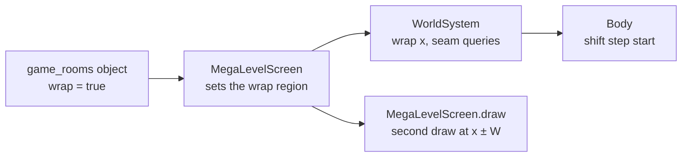

# Notes: 109 PvP modes

Research for this item: scans, counts, options, X6 facts (name the file and section) and
reviews. Give the date and the `master` commit that each finding is based on.

## Horizontal screen wrap for a test PvP room (2026-11-19, `master` at `4cba41ae4`)

The owner's target: one room, one view wide, like the 2-player battle mode of Super Mario Bros. 3. A player who
walks off the left edge comes in on the right on the same floor. While a player straddles the edge, the other half of
the sprite draws on the far side, and the body there touches blocks and can be hit. No other level changes.

Paths: `engine/` = `engine/src/main/kotlin/com/maverick/game/engine/`, `core/` =
`core/src/main/kotlin/com/megaman/maverick/game/`. "(inference)" marks a judgment that the code does not show.

### Prior art

| Game or source | Drawing | Level collision | Hits | Shots |
|---|---|---|---|---|
| SMB3 Vs mode | 8-bit sprite x wraps, so both halves draw (`prg009.asm` `Vs_PlayerDraw` L2106) | probes wrap mod 256 (`Vs_CollideAgainstWorld` L1720) | box test wraps (`Vs_CheckBoxCollision` L2384) | removed at an x limit |
| TowerFall | `DoWrapRender()` | `WrapHitbox` | `WrapHitbox` on player, shield, attack boxes | arrows wrap |
| Unity / Godot tutorials | ghost copies | ghost colliders send hits to the owner | same | — |

- Common practice: one body; every test also tries the shape at ±W; an entity draws a second time only while it
  straddles the edge; AI and aim use the shortest wrapped delta (if `d > W/2`, `d = W - d`); on the wrap step,
  shift or reset the stored previous position so interpolation does not streak.
- TowerFall names (`WrapHitbox`, `DoWrapRender`, `WrapMath.Shortest`, `ShortestOpen`) are seen through the TF.EX mod;
  the game source is closed, so their behavior is inferred from the names and calls.
- No primary source was found for Mario Bros. (1983), Joust, Asteroids, Spelunky, Duck Game, Super Crate Box or
  Celeste.

Sources:

- SMB3 disassembly: https://github.com/captainsouthbird/smb3 (`PRG/prg009.asm` L1720, L2106, L2321, L2384, L2435;
  `smb3.asm` L2238)
- TF.EX: https://github.com/Fcornaire/TF.EX ; Monocle: https://github.com/JamesMcMahon/monocle-engine
- Ghost copies: https://code.tutsplus.com/create-an-asteroids-like-screen-wrapping-effect-with-unity--gamedev-15055a ,
  https://steemit.com/utopian-io/@sp33dy/tutorial-godot-engine-v3-gdscript-generic-screen-wrapping-sprite
- Teleport only: https://kidscancode.org/godot_recipes/3.x/2d/screen_wrap/
- Wrapped distance: https://blog.demofox.org/2017/10/01/calculating-the-distance-between-points-in-wrap-around-toroidal-space/ ,
  https://www.ronjeffries.com/articles/-y023/python/-n120/128/
- Interpolation reset: https://docs.godotengine.org/en/stable/tutorials/physics/interpolation/using_physics_interpolation.html

### Physics (`WorldSystem`)

- One step (`engine/world/WorldSystem.kt:233-278`): `beginStep`, `preProcess`, container clear, `Body.process`
  (the only physics position write, `Body.kt:145`), container rebuild, `collectContacts`, `processContacts`,
  `resolveCollisions`, `postProcess`, `endStep`.
- A contact is the fixture pair by identity (`world/contacts/Contact.kt:12-16`), in an OrderedSet.
- The default container `SimpleGridWorldContainer` has no bounds (signed `LongMap` keys), so a body at x < 0 or
  past the room works. The `quadtree` option finds out-of-root items only within about 25% of the map past an edge.
- Options for the far half:

| Option | Change | Main risk |
|---|---|---|
| (a) ghost entity with copied fixtures | new entity, shape sync of 10 player fixtures | 2 contacts with one floor: `FEET_ON_GROUND` drops for a step (`FeetBlockRule.kt:31,85-86`), double stick and damage |
| (b) proxy fixtures in the container | wrapper `IFixture`, body proxies | same as (a) unless mapped to the real fixture, then it is (c) |
| (c) second query with the shape shifted by ∓W (recommended, inference) | `WorldSystem.kt`, a flag in `PhysicsData.kt` or `Body`, a step-start shift in `Body.kt` / `IBody.kt` | see below |

- (c) keeps `Contact(realFixture, candidate)`, so there are no duplicate events and a contact stays continuous over
  the wrap. The second query runs for every active fixture of a wrap body, without the `shouldProceedFiltering`
  gate, so a non-key fixture (a projectile `DAMAGER`) is found on the far side. `resolveCollisions` shifts a
  crossing body by ∓W, resolves, and shifts it back.
- Risks of (c):
  - 25 `getShape()` reads in 7 rule files see the real side while straddling: `FeetLadderRule.kt:28-40`,
    `HeadLadderRule`, `BlockSideRule.kt:72-76`, `ProjectileRules.kt:38-39` (hit position on the real side),
    `LaserRules`, `FeetSandRule`, `BodyGravityChangeRule`.
  - A full-width floor reaches the handler twice; on `COLLIDE_DOWN_ONLY` the friction add in
    `MegaCollisionHandler.kt:76-79` runs twice.
  - Queries outside `WorldSystem` do not see the seam: `GroundProbe.kt:100-120`, `MegamanXMoves.kt:83`,
    pathfinding, direct `fixture.overlaps(bounds)` checks. 137 `getShape()` call sites in `core`.
  - `PlayerClimb.kt:138,162` snaps `centerX` to a ladder, so a ladder on the far side moves the body there.
  - The step must not allocate: `WorldAllocationMeasureTest`, `WorldSystemTest`, `WorldDrawOffsetsTest` cover it.
- Wrap point: in `cycle()` after `resolveCollisions`, before `postProcess` / `endStep`, with `stepStartX += dx`
  so interpolation stays smooth. Without the shift, `getDrawOffset` (`WorldSystem.kt:208-215`) zeroes the offset for
  a move over 1 tile: one frame without interpolation, no streak. `ConstKeys.PRIOR` (34 references) is not affected
  when the wrap runs after `processContacts`.

### Drawing

- `GameSprite.draw` already shifts by `drawOffsetX/Y` (`GameSprite.kt:68-83`).
- Recommended (inference): in the 3 section loops of `MegaLevelScreen.draw` (`MegaLevelScreen.kt:930-948`), only in
  a wrap room, draw a `GameSprite` again with `drawOffsetX ± W` when its bounding box crosses an edge. It keeps the
  priority order and needs no new queue entries, matrix or scissor. Use the sprite box, not the body: the 3-tile
  Megaman sprite is wider than the body.
- The slot-1 tint (`setColor`) and the damage blink (`setAlpha`, `hidden`) are vertex colors, so a redraw keeps them.
  No shaders exist.
- Rejected: duplicate sprites in each component; draw the whole layer 3 times (consumed queue, map `setView`, shows
  anything placed outside the room).
- `--debugShapes` shows only the real fixtures.

### Camera and room flow

- A room exactly one view wide pins the camera through `CameraRoomClamp` (`CameraLimits.kt:52-57`); a jump of W in
  the focus cannot move the view.
- A transition starts only from `scanForNextRoom` (another room overlaps), `CameraRoomExits` (a neighbor within
  0.5 px) or `NEXT_ROOM_REQ` (Gate). A lone room starts none. A guard in both on the wrap flag is optional.
- The room goes `null` only when the whole subject body leaves it (`CameraRoomBounds.kt:92-97`). A wrap at center
  crossing never leaves it, so `SET_TO_ROOM_NO_TRANS` does not fire (inference).
- `CameraViewEdges` places no wall in a one-view room (`viewEdgeInsideRoom` is null, `CameraViewEdges.kt:37-45`).

### Where the wrap flag lives

- Recommended (inference): a bool property `wrap` on the `game_rooms` object, read from
  `currentGameRoom.properties` like `fade_out_music` (`LevelRoomHandler.kt:58`). `GameRoomsLayerBuilder` passes raw
  objects, so the builder does not change.
- Not `SessionRules`: it would wrap every map under `--mode pvp`, including `REFACTOR_TEST_047`.
- Not `camera_sections`: any section turns the view edge rules off (`MegaLevelScreen.kt:357-360`).

### Shots

- Today a shot dies 0.05 s after it leaves the camera (`AbstractProjectile.kt:42-50`, `IProjectileEntity.kt:32`).
  70 classes extend `AbstractProjectile`; 72 spawn sites set `CULL_OUT_OF_BOUNDS`.
- For wrapping shots: set the wrap flag once in `AbstractProjectile.onSpawn` when the room wraps, and add a
  lifetime cap, because the camera cull no longer fires (inference). An ABSTRACT body updates only while it overlaps
  the camera or moves (`IBodyExtensions.kt:28`).

### Test level

- New `LevelDefinition` entry (for example `REFACTOR_TEST_109`), its line in `LevelCompletionScreensTest.kt:27-53`
  (the test fails without it), and a TMX with one 16x14 room at an x offset of at least 1 tile.
- Slot 1 spawn: the `player_2` property (`spawns/PlayerSlotSpawns.kt:11-31`).

### Other gaps for PvP play (not wrap)

- `targetFor` / `nearestLiveTo` use raw distance (`MegaPlayers.kt:43-62`): a target across the seam looks far.
- Death under `--mode pvp` (`slotRespawn=false`): a slot 1 death has no respawn and no life cost; a slot 0 death
  resets the whole level (`MegaLevelScreen.kt:600-659`).
