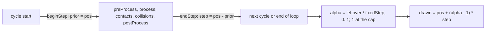

# Notes: 134 render interpolation

The full scope of 2026-11-06, made by a read-only subagent on `master`. Line numbers are from that date.

# Render interpolation: scope and recommendation

Read-only research on `master` at `63bc3d3d0` (2026-11-06). No build, no launch, no tracked file changed.
Paths: `E` = `engine/src/main/kotlin/com/maverick/game/engine/`, `C` = `core/src/main/kotlin/com/megaman/maverick/game/`.
Counts are `git grep` results on `master`, so they can include a few comments or false hits.
Marked "(inference)" where the text is not read from code.

## 1. The problem in numbers

```mermaid
sequenceDiagram
    participant G as MegamanMaverickGame.render
    participant L as MegaLevelScreen.render
    participant W as WorldSystem
    participant S as SpritesSystem
    participant K as CameraController
    participant D as MegaLevelScreen.draw
    G->>L: delta = Gdx.graphics.deltaTime (raw, no clamp)
    L->>W: engine.update(delta): Controller, Behaviors, World ...
    W->>W: accumulator += delta; 2 or 3 cycles of 1/150 s
    L->>S: ... Sprites: preProcess puts each sprite on its body
    L->>K: cameraController.update(delta) after the engine
    G->>D: screen.draw(batch): backgrounds, tiles, sprites
```

- `Performance.kt:3-8`: every tier has `fixedStep * fps = 0.4`, so 2.5 cycles per frame on average.
- `WorldSystem.kt:100-148`: whole cycles only. The leftover (`accumulator`) is not used for drawing.
  At the `maxIterations` cap (`:131`) the leftover is set to 0.
- `MegaLevelScreen.kt:825` (`engine.update`), `:831` (`cameraController.update`), `:857` (`draw`).
- `CameraFollow.kt:50-61`: the camera goes to the focus each frame (no smooth), so the view moves by the
  same uneven amount as the player.
- `DesktopLauncher.kt:50` `DEFAULT_VSYNC = false`; `:132-133` sleep-based FPS cap; `:138` `useVsync(appArgs.vsync)`.

At `MEDIUM` (60 fps, step 1/150 s), with exact 1/60 s frames (frames alternate 2 and 3 cycles):

| Motion | Speed (tiles/s) | Per cycle (world px) | Per frame (world px) | Max error vs an even line (world px) |
|---|---|---|---|---|
| X walk (`MegamanXValues.kt:12`) | 3.75 | 0.80 | 1.60 / 2.40 | 0.40 |
| Megaman slide (`MegamanValues.kt:74`) | 10 | 2.13 | 4.27 / 6.40 | 1.07 |
| Megaman `CLAMP_X` (`:13`) | 16 | 3.41 | 6.83 / 10.24 | 1.71 |
| Fall at `CLAMP_Y` (`:14`) | 40 | 8.53 | 17.07 / 25.60 | 4.27 |

At a 1920 px wide window, 1 world px = 3.75 screen px (view 16 tiles x 32 px = 512 world px). So the walk
error is about 1.5 screen px and the fall error about 16 screen px. Frame-time jitter from the sleep cap adds
irregular 1-cycle or 4-cycle frames (inference; no frame-time capture exists).

## 2. Related items

- `010` (idea): one fixed tick for gameplay and a separate present phase. Owner decisions: `MEDIUM` is the feel
  reference (2026-10-25); one fixed tick in all play, `O2-R3` (2026-11-01). Its NOTES say that interpolation is
  optional for pixel art, and that it removes repeated frames on 90 Hz and 144 Hz screens under a 60 Hz tick
  ("Step 3" table, `010/NOTES.md`). It also owns "the camera moves on the tick, not in the render path".
- Interpolation is the "present" half of `010`. It does not add frame-rate dependent gameplay, so it does not
  conflict with `O2-R3`. If it is built now, `010` step 3 moves the snapshot point from the world cycle to the
  tick, and keeps the rest (see 6.4).
- `017` (world-step hooks), `020` (broad phase): they change the cycle loop; the snapshot is 2 writes inside the
  existing loops, so it does not block them.
- `026` (render layers, draw queue): it replaces `InsertionOrderPriorityQueue`; the sprite draw offset (6.3)
  lives on `GameSprite`, so it survives `026`.
- `046` (backgrounds as functions of the camera): makes the background part of 6.5 simpler.
- `067` (PPM 16): changes the size of a world px; the rounding question (D4) belongs with it.
- `094` (split screen): two views; the draw camera offset is per view.
- No item exists for interpolation. The next free ID is `134`.

## 3. Where positions live and who moves them

| Mover | Where | Runs | Even per frame today? | Needs interpolation? |
|---|---|---|---|---|
| Velocity and gravity | `Body.process`, `E/world/body/Body.kt:103-118` | each cycle | no (2 or 3 cycles) | yes |
| Collision push-out | `MegaCollisionHandler.kt:78,111,150` | each cycle | no | yes (part of the cycle move) |
| Carry by a block | `FeetBlockRule.kt:35,65`, `BlockSideRule.kt:43` (`translate(getPositionDelta())`) | each cycle | no | yes (in the cycle) |
| Body `preProcess` hooks | 233 `preProcess.put` sites in `C` | each cycle, before `process` | no | yes, if the snapshot is before `preProcess` |
| Body `postProcess` hooks | 13 `postProcess.put` sites | each cycle | no | yes (in the cycle) |
| `MotionSystem` | `E/motion/MotionSystem.kt:15-39`; 12 files use `MotionDefinition` | once per frame, after World | it sets velocity (`PropellerPlatform.kt:94`, `RocketPlatform.kt:97`), so the move is in the cycles | through the body |
| Behaviors, updatables, `setCenter` | 485 body position writes in 349 files (`body.setX/Y/setCenter/setPosition/...`) | once per frame, before or after World | yes (moves by `v * delta`) | no, but see attachments |
| Camera follow | `CameraFollow.kt:50-61` | once per frame, after the engine | no (copies the focus) | yes |
| Camera transition, scroll, zone ease, shake, rotation | `CameraRoomTransition`, `CameraScroll`, `CameraLimitStage.kt:80-86`, `CameraShake.kt:31-51`, `CameraRotation` | once per frame, on `delta` | yes | no |
| Backgrounds | `MegaLevelScreen.kt:837-840` (`move` by the camera delta), `Background.kt:108-111` | once per frame | follows the camera | yes, through the camera |

Note: core already saves a per-cycle prior position: `BodyComponentCreator.kt:47` puts `ConstKeys.PRIOR`
(a pooled `Vector2`) in the body properties in a `preProcess` hook, and `IBodyExtensions.kt:69`
`getPositionDelta()` reads it (14 callers, mostly contact rules). It is saved after the entity's own
`preProcess` hooks (insertion order). An engine field can replace it (no property write and no pool fetch per
body per cycle, `O5-R1`), but that is optional.

### Snap cases (the drawn position must jump, not slide)

| Case | Where | Why it is safe or not with the rule in 6.1 |
|---|---|---|
| Spawn | `GameEngine.spawnNow` | `Body.reset()` at destroy clears the step state; the first cycle starts from the spawn point. Safe. |
| Body not in the last cycle (`doUpdate` false, world off for this body) | `WorldSystem.kt:111-116` | The serial test gives offset 0. Safe. |
| Teleport outside a cycle (behaviors, updatables) | `Teleports.kt`, `TeleportableComponent.kt`, `PipePortal.kt`, `CapsuleTeleporter.kt`, `PortalHopper.kt`, respawn | Not in the step move; offset stays at most one cycle move, for one frame. Acceptable; an explicit snap removes it. |
| Teleport inside a cycle (`preProcess` or `postProcess` `setCenter`) | part of the 233 + 13 hooks | Interpolated across the jump for 1 frame (a streak). Needs the distance guard or an explicit snap. |
| Room transition | systems off at `MegaLevelScreen.kt:665-672` (World, Motion, Behaviors, pathfinding) | No cycles run, so alpha and the offsets freeze; the player is moved per frame by the transition. The drawn player keeps a constant offset of at most one cycle move. No jitter. |
| Pause, freeze | `GameSystem.on`, `clock.paused` | Same as above: frozen. Safe. |
| Camera snap (`setFocus`, room start, respawn) | `CameraFollow.kt:34-40`, `MegaLevelScreen.kt:455-456, 556, 992` | The camera offset is computed from the focus offset each frame, not from a camera history. Safe. |

## 4. How sprites get their positions

- `SpritesSystem.process` (`E/drawables/sprites/SpritesSystem.kt:14-33`) calls `component.preProcess(delta)`,
  which runs each `putPreProcess` function, then hands each sprite to the collector. The draw is later, in
  `MegaLevelScreen.draw` (`:857-917`).
- 385 `putPreProcess` / `.preProcess {` sites in 353 files. 333 files have both a body and sprites.
  373 `sprite.setPosition` / `sprite.setCenter` calls; 310 of them pass `body.` directly; 95 do not
  (own `Vector2` fields, other bounds, anchors).
- So there is one place to substitute: the engine applies a draw offset per sprite after `preProcess`, from the
  entity's own body. No entity file needs a change for the common case.
- The offset must not change the sprite position persistently. A sprite that is placed once and not every frame
  would drift. So the offset goes in a `GameSprite` field that `SpritesSystem` overwrites each frame and that
  `GameSprite.draw` applies around `super.draw` (translate, draw, translate back).
  One subclass overrides `GameSprite`: `DarknessV2.kt:137`.

Cases that the generic rule does not cover:

| Case | Count | What it needs |
|---|---|---|
| A body that follows another entity's body outside the cycles (riders, boss parts, weapons, shields) | 10 files by a name search (`WilyFinalBoss`, `SpiderWeb`, `ElecDevilBodyPiece(s)`, `BigAssMaverickRobotHand`, `RotationAnchor`, `HeliMet`, `GutsTankFist`, `TestEnemy`, `CameraViewEdges`); more are likely, because many sites compute the position first | A link "draw offset from this body" (`drawOffsetSource`). Without it, the child is drawn up to one cycle move away from the parent, and the gap changes each frame (new relative jitter). |
| Sprites drawn outside `SpritesSystem` | 3 `addDrawable` callers: `MegamanMaverickGame.kt`, `EndLevelEventHandler.kt:185,210`, `BeamInView.kt:165` (beam sprites placed on `player.body`) | Read the player's draw offset. |
| Fonts | 3 `FontsComponent(` sites | Optional; same offset if attached to a moving body. |
| Debug shapes | `DrawableShapesSystem`; 304 files name `DrawableShapesComponent`, almost all for `--debugShapes` | None. They show the real (stepped) shapes, which is correct for debugging. |
| Trail and after-image sprites | `MegamanTrailSprite(V2)`, `KoopaShellTrailSprite`, `StarknerTrailSprite` | They copy a position at a time; at most one cycle of offset. None, or copy the drawn position. |
| Backgrounds and parallax | 13 files in `C/drawables/backgrounds/` | Move by the drawn camera, see 6.5. |
| Tiled map layers | `tiledMapLevelRenderer.render(gameCamera)`, `MegaLevelScreen.kt:873` | Uses the drawn camera with no change. |
| Particles | no particle system in `C` | None. |

## 5. The camera

- Movers run first, then effects (`CameraController.kt:35-40`); `settledPosition` is the position after the
  movers. The order in the level screen: `CameraRoomBounds`, `CameraRoomTransition`, `CameraFollow`,
  `CameraScroll`, `CameraLimitStage`, `CameraRoomClamp`, `CameraRoomScan`; effects `CameraRotation`,
  `CameraShake`, follow stop rule, then `PlayersFocus`, `CameraViewEdges`, `CameraRoomExits` in co-op
  (`MegaLevelScreen.kt:297-366`).
- Gameplay reads the camera: culling, spawns (`spawnCameraBounds`, `:815`), `CameraEdgeBlocks` (from the stage
  limits, `CameraEdgeBlocks.kt:60-98`), scroll kill edges, `ICameraView.overlaps`, co-op view edges. So the
  gameplay camera must stay where it is (`O2-R7`, and `010` owns the camera as simulation).
- Proposal: a draw camera = the gameplay camera plus an offset that is used only in `draw`.
  - Per axis: offset = `clamp(settled + focusDrawOffset) - settled`, with the same `stage.limits` and the
    blended view size as `CameraRoomClamp.kt:9-15`. So the clamp applies to the drawn position too, and at a
    room edge the offset is 0.
  - Only on an axis where `CameraFollow` put the camera on the focus this frame. Offset 0 when a mover before it
    held the camera (transition, `CameraRoomBounds`), when `CameraScroll` owns the axis, when the follow mode is
    `X_ONLY` (y) or `OFF`, and during smooth follow (inference: smooth follow lerps per frame, so it is even).
  - `focusDrawOffset`: a new `IFocusable` read with a default of zero. `FocusComponent` reads its body's offset;
    `PlayersFocus` (`PlayersFocus.kt:56-67`) averages the offsets of the players it averages.
  - Shake and rotation stay as they are; the offset is added in world space after them.
- `MegaLevelScreen.draw` adds the offset to `gameCamera.position`, applies the viewport (which updates the
  matrix), draws, and puts the position back. Backgrounds get `offset * parallax` on their own cameras for the
  draw (`Background.kt:104-111, 133-135`).
- Side finding: `MegaLevelScreen.kt:843-847` "reduce floating point rounding errors" multiplies by `PPM` and
  divides by `PPM`. It does not round. It is a no-op.

## 6. Engine API

### 6.1 Body and world state

```kotlin
// Body (engine): 4 floats + 1 int per body, no allocation
fun beginStep(serial: Int)      // prior = position
fun endStep()                   // stepDx/stepDy = position - prior
fun snapDraw()                  // stepDx = stepDy = 0
fun getDrawOffset(world: WorldSystem, out: Vector2): Vector2
//   if (stepSerial != world.stepSerial || |step| > guard) out = 0
//   else out = (world.alpha - 1) * step
```



- Snapshot point: in `WorldSystem.cycle`, in the existing `preProcess` loop (`:166`) before `body.preProcess()`
  and in the existing `postProcess` loop (`:204`) after `body.postProcess()`. No new loop.
  Before `preProcess`, so that a body that a hook puts on its parent at the cycle start stays at a constant
  one-cycle lag behind it, not a lag that changes with alpha.
- `WorldSystem.alpha` and `WorldSystem.stepSerial`: set in `process` (`:100-148`). `alpha = accumulator /
  fixedStep`, clamped to 0..1; at the `maxIterations` cap (`:131`) alpha = 1, not 0 (else the frame is drawn one
  cycle behind). A frame with 0 cycles keeps the serial, and alpha grows. World off: nothing changes (frozen).
- Distance guard: if the cycle move is larger than a set limit (for example 1 tile), the offset is 0.
  This catches teleports inside a cycle without an audit of all 246 hooks.
- `Body.reset()` clears the step state.

### 6.2 What stays the same

Collisions, contacts, body senses, `getPositionDelta`, the world container, culling, spawns, AI targeting,
the gameplay camera, edge blocks, scroll kill edges, timers. All of them keep the stepped positions. The drawn
position is read only by draw code (a review check under `O2-R7`).

### 6.3 Sprites

- `SpritesSystem`: after `component.preProcess`, get the body (the entity's `BodyComponent`, or the
  `drawOffsetSource` link) and write the offset into each sprite's draw offset field.
- `GameSprite.draw`: translate by the field, `super.draw`, translate back.
- The system needs the world alpha and serial: pass the `WorldSystem` (or a small read interface) to its
  constructor in `createGameEngine()` (`MegamanMaverickGame.kt:956-1010`).

### 6.4 With `010` later

With a fixed tick, the tick runner calls `beginStep` and `endStep` once per tick (not per cycle), and alpha
comes from the tick accumulator. The draw side (sprites, camera, backgrounds) does not change (inference).

### 6.5 Cost per frame

- Memory: 20 bytes of fields per body (4 floats, 1 int), one `Vector2` field in `GameSprite` or 2 floats.
- CPU per cycle: 2 extra field writes per body inside loops that already run (150 cycles per s at `MEDIUM`).
- CPU per frame: one component lookup and 2 float multiplies per sprite-owning entity; 2 translates per drawn
  sprite; one clamp for the camera. No allocation. Measure `WorldSystem` and `SpritesSystem` before and after
  with `--diagnostics` (`O5-R2`).
- Drawn positions lag the simulation by `(1 - alpha)` cycles: at most 6.7 ms, mean 3.3 ms at `MEDIUM`.

## 7. Alternatives on the same facts

| Option | What changes | Gameplay effect | Cost | Risks | Play test |
|---|---|---|---|---|---|
| I. Render interpolation (this scope) | Draw only | None (draw reads only) | 20 B per body, a few float ops | Attachment jitter, teleport streaks, +3.3 ms mean latency, more sub-pixel positions | 9. below |
| A1. Integer steps, per tier (2 per frame): 1/60, 1/90, 1/120, 1/180 | `Performance.kt` | Physics changes in every tier. Jump apex loss is `12.5 * dt` tiles for `JUMP_VEL = 25` (`010` NOTES): `MEDIUM` 2.67 px to 3.33 px. Tunneling at `CLAMP_Y`: 8.5 to 10.7 px per cycle | `MEDIUM` 150 to 120 cycles per s; `VERY_LOW` 75 to 60 | Even only if frame deltas are steady: needs vsync at the tier rate, or delta snapping. A 144 Hz or 59.94 Hz screen breaks it. Keeps tier-dependent physics, against `010` step 2 | jump heights, gaps, fast falls, projectiles through thin blocks, each tier |
| A2. One shared step 1/180 (integer in all tiers: 6, 4, 3, 2 per frame) | `Performance.kt`, `setPerformance` (`MegamanMaverickGame.kt:1116-1124`) | Apex loss 2.22 px (`MEDIUM` +0.44 px higher); tunneling 7.1 px | 180 cycles per s on every tier: `VERY_LOW` 2.4x, `LOW` 1.6x, `MEDIUM` 1.2x, `HIGH` 0.8x of today | Against `O5` on weak machines; same frame-delta problem as A1 | same as A1 |
| B. Fixed 1/60 update for the whole engine (X6) | `010` step 3 | All timers, input, events, spawns per tick; 1 cycle of 1/60: apex about 4 px lower, tunneling 21 px per cycle | Lower physics cost at `MEDIUM` | The largest change (`010` NOTES "Size and risk", "High"); 90 Hz and 144 Hz screens repeat frames without interpolation | everything |
| C. Vsync on by default | `DesktopLauncher.kt:50` | None | None | Does not fix the 2 or 3 cycle pattern (still 2.5 per frame); a screen that is not 60 Hz with the 60 cap can pace unevenly (inference) | frame pacing on the owner's screen |
| D. Do nothing | none | none | none | Judder stays | none |

Notes:
- 1/180 is the only shared step that gives an integer count in all 4 tiers (LCM of 30, 45, 60, 90 = 180).
- Only option I is even on any refresh rate and any frame-time jitter, because it draws by the real leftover time.
- C is a companion to every other option (tearing and sleep jitter), not a fix alone. The owner can check it now
  with `--vsync true` and no code change.

## 8. Tests

Automated (engine, Kotest):
- `BodyTest`: `beginStep`/`endStep` save the move; `getDrawOffset` = `(alpha - 1) * step`; 0 when the serial
  does not match; 0 above the guard; `snapDraw` and `reset` clear it.
- `WorldSystemTest`: alpha = leftover / step, in 0..1; alpha = 1 at the cap; serial counts cycles; world off
  changes nothing.
- An evenness test: a body at a constant velocity, step 1/150, frames of exactly 1/60 s. Without the offset, the
  per-frame move alternates 2 and 3 cycle moves; with it, every drawn per-frame move equals `v / 60` (to a float
  epsilon). A second run with ±1 ms jitter: the drawn move equals `v * delta` of the frame (one-cycle lag).
- `SpriteSystemTest` and `GameSpriteTest`: the offset is applied at draw and removed after; a sprite placed once
  does not drift over 100 frames.
- `CameraPartsTest`: the draw offset equals the focus offset in an open room; 0 at a room edge (clamped);
  0 during a transition; 0 on the axis that a scroll owns; the clamp applies to the drawn position.

Play checks (owner): see 9.

## 9. Play checks

- Walk, slide, dash and fall in an open room: the level scrolls evenly; the player does not shake on screen.
- Camera pinned at a room edge: the player moves evenly, the view does not move.
- Room transition start and end, gate rooms, boss room entry: no jump of the player or the view.
- Camera scroll sections, zones with ease, edge blocks, crush surfaces, shake, turned rooms (`058`).
- Riders and attachments: moving platforms with the player on top, `ElecDevil` pieces, `BigAssMaverickRobotHand`,
  `WilyFinalBoss` parts, `SpiderWeb` on the player, weapons and charge effects.
- Teleports and warps: `PipePortal`, `CapsuleTeleporter`, `PortalHopper`, respawn, beam in and beam out
  (`BeamInView`, `EndLevelEventHandler`).
- Co-op (`--players 2`): the shared view (`PlayersFocus`).
- Each tier (`--performance`), with vsync on and off, and `--pixelPerfect` on and off.
- A/B with the flag: `--interpolation false` against `true` in the same room.

## 10. Proposed item and branches

Item `134`: "Render interpolation: draw bodies and the camera between the last two world steps".
Type: feature. Objectives: `O9` (main), `O5`. Related: `010`, `026`, `046`, `051`, `058`, `067`, `094`.
Depends on: none.

| Branch | Content | Files (count) |
|---|---|---|
| `mega-refactor-134a-draw-interpolation` | Engine step state and alpha; sprite draw offset; draw camera offset and its clamp; level screen draw; backgrounds; launch flag `--interpolation` (default off); engine tests; `--diagnostics` before and after | engine: `Body.kt`, `IBody.kt`, `WorldSystem.kt`, `SpritesSystem.kt`, `GameSprite.kt`, `CameraFollow.kt`, `IFocusable.kt`, one new camera part (8). core: `MegaLevelScreen.kt`, `Background.kt`, `FocusComponent.kt`, `PlayersFocus.kt`, `MegamanMaverickGame.kt`, `DesktopLauncher.kt` (6). Tests: 5 engine test files |
| `mega-refactor-134b-interpolation-audit` | `drawOffsetSource` links for attached bodies; explicit snaps at teleports and respawn; the 3 direct drawables; trails; flag default on after the play test | 10 attachment files found by name, plus the ones the audit finds; 5 teleport files; `EndLevelEventHandler.kt`, `BeamInView.kt`; respawn files |

Why not a branch for the engine API alone: it would have no production caller (`O1-R5`). Why the camera and
the sprites together: with only one of them, the player shakes on screen against the view (inference).

## 11. Open decisions for the owner

- D1. Which option (7.)? Recommendation: I (interpolation), with C as a separate small change.
- D2. Vsync on by default? Recommendation: check `--vsync true` on the owner's screen first; then decide. Vsync
  is not saved today (`O9-R3`, `034`).
- D3. Snap rule: distance guard plus explicit snaps (recommended), or explicit snaps only (needs an audit of the
  246 body hooks).
- D4. Round drawn positions to whole world px? Recommendation: not in `134`; decide with `067`.
- D5. Default of the flag at the end of `134b`: on (recommended) or off.
