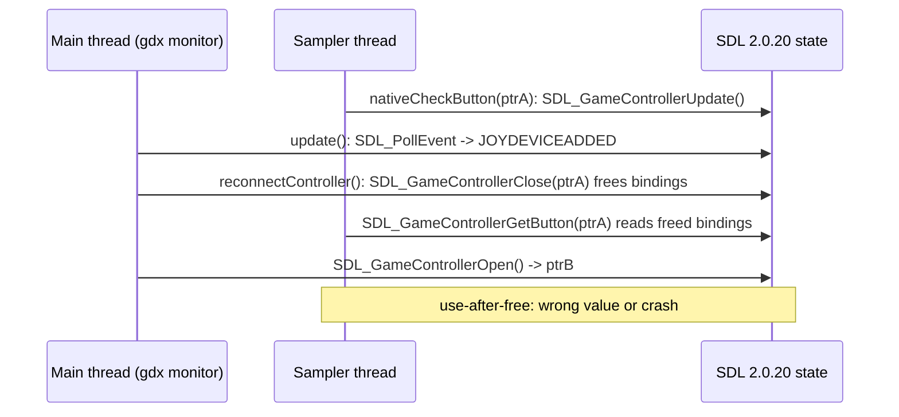

# Notes: mega-refactor-184a-sub-frame-taps

## Decisions

- 2026-11-23: D1 check failed (SDL2 2.0.20 and Jamepad are not safe from a second thread next to the gdx-controllers monitor). By D1, all Jamepad calls move to one sampler thread.

- 2026-11-23: research of other Java pad libraries (`temp/184-input-sampling/input4j.md`, `sdl2gdx.md`, not committed): input4j (MIT, JDK 22+) and sdl2gdx (GPL with Classpath Exception, last release 2020) both compare state once per poll and lose sub-frame taps as Jamepad does. Only LWJGL 3.4 `lwjgl-sdl` (SDL 3, BSD) gives timestamped gamepad button events; it needs LWJGL 3.3.3 to 3.4 for all modules and a custom gdx `ControllerManager`.
- 2026-11-23, owner: 184a is keyboard only (builder change and `isKeyJustPressed` latch). The pad stays on Jamepad, one read per frame, and the game targets at least 60 FPS. D4 to D6 are void.

## Overlap with other branches

Read 2026-11-23: `060k`, `078e`, `078f`, `183b`, `compactor-level`, `fix/projectiles-ignore-death`: no input files. No overlap.

## SDL2 thread safety

Research of 2026-11-23 by a subagent (sources read, nothing run). [F] = read in source or docs, [I] = inference.

### Short answers

| # | Question | Answer |
|---|---|---|
| 1 | SDL version, init flags | SDL **2.0.20** exactly. `SDL_Init(SDL_INIT_EVENTS \| SDL_INIT_JOYSTICK \| SDL_INIT_GAMECONTROLLER)`. No video. |
| 2 | Concurrent calls safe? | **No.** 2.0.20 reads state with no lock, and the driver update loop runs unlocked. Normal reads race benignly; hot-plug frees structs that the other thread still reads (use-after-free). |
| 3 | Thread affinity per backend | Reads are thread-free on all backends. **Hot-plug** is thread-bound on Windows (message window) and macOS IOKit (CFRunLoop of the init thread). |
| 4 | `SDL_PollEvent` off the main thread | Not a problem here: no SDL video, so the pump touches no window. The rule in the SDL docs is about the video thread. |
| 5 | Jamepad Java state | Not thread-safe. `controllerPtr` is a plain field that `reconnectController()` closes and replaces on every hot-plug. No public way to bypass it. |
| 6 | Recommendation | **(a2)**: one thread owns all Jamepad/SDL calls, behind a custom gdx `ControllerManager` (`Controllers.preferredManager`). Not (a). (b) cannot read during the swap wait. |

### 1. Bundled SDL version and init flags

- [F] Jamepad tag `2.0.20.0` has the git submodule `SDL` at commit `b424665e0899769b200231ba943353a5fee1b6b6`. That commit is the tag `release-2.0.20` (2022-01-10). `SDL_PATCHLEVEL` is `20`.
  - https://github.com/libgdx/Jamepad/tree/2.0.20.0 (submodule `SDL`)
  - https://github.com/libsdl-org/SDL/releases/tag/release-2.0.20
- [F] The project resolves Jamepad `2.0.20.0`, although `gradle.properties` sets `jamepadVersion=2.0.14.2`. Gradle takes the higher version that `gdx-controllers-desktop:2.2.3` asks for. Only `2.0.20.0` is in `~/.gradle/caches/modules-2/files-2.1/com.badlogicgames.jamepad/jamepad/`.
- [F] Init in JNI (`ControllerManager.nativeInitSDLGamepad`):
  ```c
  if (disableRawInput) SDL_SetHint(SDL_HINT_JOYSTICK_RAWINPUT, "0");
  SDL_Init(SDL_INIT_EVENTS | SDL_INIT_JOYSTICK | SDL_INIT_GAMECONTROLLER);
  while (SDL_PollEvent(&event));
  ```
  https://github.com/libgdx/Jamepad/blob/2.0.20.0/src/main/java/com/studiohartman/jamepad/ControllerManager.java#L105-L120
- [F] `Configuration.useRawInput` defaults to `false`, so the RawInput driver is off on Windows. gdx-controllers does not change it.
- [F] `SDL_INIT_GAMECONTROLLER` implies `SDL_INIT_JOYSTICK`, which implies `SDL_INIT_EVENTS`. SDL video is **not** initialized. https://github.com/libsdl-org/SDL/blob/release-2.0.20/src/SDL.c#L151-L202
- [F] Drivers in the shipped natives (from `strings` on the files in `jp/`):

| Platform | Compiled joystick drivers | Notes |
|---|---|---|
| Linux (`libjamepad64.so`) | evdev (`linux/SDL_sysjoystick.c`), HIDAPI | udev monitor or inotify for hot-plug |
| Windows (`jamepad64.dll`) | XInput, DirectInput, RawInput | RawInput off by hint. [I] No HIDAPI joystick driver and no WGI: their hint strings are absent. |
| macOS (`libjamepad64.dylib`) | IOKit (`darwin`), HIDAPI, MFi/GCController | IOKit skips devices that MFi supports |

### 2. Is the SDL 2.0.20 joystick API safe from 2 threads?

### What the docs require

- [F] Header and wiki: "If you are using the joystick API or handling events from multiple threads you should use these locking functions to protect access to the joysticks." https://github.com/libsdl-org/SDL/blob/release-2.0.20/include/SDL_joystick.h#L117-L145 , https://wiki.libsdl.org/SDL2/SDL_LockJoysticks
- [F] Jamepad never calls `SDL_LockJoysticks` and has no Java method for it.

### What the 2.0.20 code does

| Function | Lock | Source |
|---|---|---|
| `SDL_JoystickUpdate` | Takes the lock only to set the flag `SDL_updating_joystick`, then **unlocks** and runs `HIDAPI_UpdateDevices()` and each `driver->Update()` with no lock. Locks again for deferred frees and `Detect()`. | [L1562-L1643](https://github.com/libsdl-org/SDL/blob/release-2.0.20/src/joystick/SDL_joystick.c#L1562-L1643) (comment at L1581: "Make sure the list is unlocked while dispatching events to prevent application deadlocks") |
| `SDL_JoystickGetButton` / `GetAxis` / `GetHat` | None. Plain read of `joystick->buttons[]`, `axes[].value`. | [L656](https://github.com/libsdl-org/SDL/blob/release-2.0.20/src/joystick/SDL_joystick.c#L656), [L743](https://github.com/libsdl-org/SDL/blob/release-2.0.20/src/joystick/SDL_joystick.c#L743) |
| `SDL_GameControllerUpdate` | Only calls `SDL_JoystickUpdate()` | [L1965](https://github.com/libsdl-org/SDL/blob/release-2.0.20/src/joystick/SDL_gamecontroller.c#L1965) |
| `SDL_GameControllerGetButton` / `GetAxis` | None. Walks `gamecontroller->bindings`, then calls the joystick getters. | [L1985](https://github.com/libsdl-org/SDL/blob/release-2.0.20/src/joystick/SDL_gamecontroller.c#L1985), [L2054](https://github.com/libsdl-org/SDL/blob/release-2.0.20/src/joystick/SDL_gamecontroller.c#L2054) |
| `SDL_GameControllerOpen` / `Close` | Lock held. `Close` frees `bindings` and the struct **at once** when `ref_count` reaches 0. | [L1881](https://github.com/libsdl-org/SDL/blob/release-2.0.20/src/joystick/SDL_gamecontroller.c#L1881), [L2509-L2550](https://github.com/libsdl-org/SDL/blob/release-2.0.20/src/joystick/SDL_gamecontroller.c#L2509-L2550) |
| `SDL_JoystickClose` | Lock held. Defers the free if `SDL_updating_joystick` is set. | [L1051-L1117](https://github.com/libsdl-org/SDL/blob/release-2.0.20/src/joystick/SDL_joystick.c#L1051-L1117) |
| Game controller event watcher | Runs inside `SDL_PushEvent` on the **pushing** thread, under `SDL_event_watchers_lock` but not the joystick lock. Walks `SDL_gamecontrollers`. | [L388](https://github.com/libsdl-org/SDL/blob/release-2.0.20/src/joystick/SDL_gamecontroller.c#L388), [SDL_events.c L1072-L1112](https://github.com/libsdl-org/SDL/blob/release-2.0.20/src/events/SDL_events.c#L1072-L1112) |
| SDL event queue | Own mutex `SDL_EventQ.lock`. Thread-safe. | [SDL_events.c L675](https://github.com/libsdl-org/SDL/blob/release-2.0.20/src/events/SDL_events.c#L675) |

- [F] The SDL code itself says the watcher is not thread-safe: "Not really threadsafe. Should this lock access within SDL_GameControllerEventWatcher?" https://github.com/libsdl-org/SDL/blob/release-2.0.20/src/joystick/SDL_gamecontroller.c#L1082
- [F] SDL issue #6063 "Review joystick locking": "There are some potential issues where joystick data structures aren't locked while delivering events." https://github.com/libsdl-org/SDL/issues/6063
- [F] The fix is commit `40bd4feedcca` "Revamped joystick locking" (2022-08-30, first in SDL 2.26.0): "The lock should be held when calling any SDL joystick function on a different thread than the one calling SDL_PumpEvents() and SDL_JoystickUpdate()." https://github.com/libsdl-org/SDL/commit/40bd4feedcca779a4600743c27a786b436edc8f7 . In `release-2.30.0` every getter takes the lock. https://github.com/libsdl-org/SDL/blob/release-2.30.0/src/joystick/SDL_joystick.c

### Consequences for option (a)

- [F] Two concurrent `SDL_JoystickUpdate` calls do not run the drivers twice: the second caller sees `SDL_updating_joystick` and returns at once.
- [I] Normal play: the reader thread can read `buttons[]` (`Uint8`) and `axes[].value` (`Sint16`) while the other thread writes them. This is a C data race, but on x86-64 and arm64 an aligned 1- or 2-byte load does not tear. The value is the old one or the new one. Benign in practice.
- [F] Hot-plug in Jamepad: any `SDL_JOYDEVICEADDED` or `SDL_JOYDEVICEREMOVED` makes `ControllerManager.update()` call `reconnectController()` on **all** indices (4 by default). That calls `SDL_GameControllerClose` and then `SDL_GameControllerOpen` for each pad, also for pads that stay connected. https://github.com/libgdx/Jamepad/blob/2.0.20.0/src/main/java/com/studiohartman/jamepad/ControllerManager.java#L254-L270 , https://github.com/libgdx/Jamepad/blob/2.0.20.0/src/main/java/com/studiohartman/jamepad/ControllerIndex.java#L56-L82
- [I] So a sampler thread inside `nativeCheckButton(oldPtr, …)` can read `gamecontroller->bindings` after the main thread freed them. That is a use-after-free: wrong values or a JVM crash (`SIGSEGV` in `libjamepad`). The window is short but it occurs on each plug, unplug, Bluetooth reconnect or pad sleep.
- [I] The same race exists for the event watcher. Button and axis changes found by the sampler's `driver->Update()` push events, and the watcher walks `SDL_gamecontrollers` on the sampler thread while the main thread unlinks and frees nodes.



### 3. Thread affinity per platform backend

The question has 2 parts: (1) is a read of the state fresh from any thread, (2) does device detection (hot-plug) need a given thread.

| Backend | State update | Thread-bound? | Hot-plug detection | Thread-bound? |
|---|---|---|---|---|
| Linux evdev | `read()` on a non-blocking evdev fd, events applied in order ([HandleInputEvents L1350](https://github.com/libsdl-org/SDL/blob/release-2.0.20/src/joystick/linux/SDL_sysjoystick.c#L1350)) | No [F] | udev monitor fd (`SDL_UDEV_Poll`) or inotify ([L656](https://github.com/libsdl-org/SDL/blob/release-2.0.20/src/joystick/linux/SDL_sysjoystick.c#L656)) | No [F] |
| Linux/macOS HIDAPI | hidraw `read()` on Linux; on macOS the hidapi backend fills a report queue from its own thread | No [I] | Linux udev/inotify; macOS `mach_msg` with timeout 0 on a notification port ([SDL_hidapi.c L387-L393](https://github.com/libsdl-org/SDL/blob/release-2.0.20/src/hidapi/SDL_hidapi.c#L387-L393)) | No [F] |
| Windows XInput | `XInputGetState()` poll ([L522](https://github.com/libsdl-org/SDL/blob/release-2.0.20/src/joystick/windows/SDL_xinputjoystick.c#L522)) | No [I] | Flag `s_bWindowsDeviceChanged`, set only by `WM_DEVICECHANGE`/`WM_TIMER` on a message-only window | **Yes** [F] |
| Windows DirectInput | `Poll` + `GetDeviceData` (buffered) or `GetDeviceState` ([L1056](https://github.com/libsdl-org/SDL/blob/release-2.0.20/src/joystick/windows/SDL_dinputjoystick.c#L1056)) | [I] Probably no; COM objects made in the init thread's apartment, no documented rule found | Same message window | **Yes** [F] |
| Windows RawInput | `WM_INPUT` to the message window | Yes [F] | Same | Yes. Off by Jamepad's hint. |
| macOS IOKit | `IOHIDDeviceGetValue()` poll per element ([L187](https://github.com/libsdl-org/SDL/blob/release-2.0.20/src/joystick/darwin/SDL_iokitjoystick.c#L187), [Update L978](https://github.com/libsdl-org/SDL/blob/release-2.0.20/src/joystick/darwin/SDL_iokitjoystick.c#L978)) | No [F] | `IOHIDManager` and each device scheduled on `CFRunLoopGetCurrent()` **of the init thread**, in mode `"SDLJoystick"`; `Detect()` runs `CFRunLoopRunInMode` on the **calling** thread ([L617-L633](https://github.com/libsdl-org/SDL/blob/release-2.0.20/src/joystick/darwin/SDL_iokitjoystick.c#L617-L633), [L729-L745](https://github.com/libsdl-org/SDL/blob/release-2.0.20/src/joystick/darwin/SDL_iokitjoystick.c#L729-L745)) | **Yes** [F] |
| macOS MFi (GCController) | Reads `GCExtendedGamepad` element values ([L827](https://github.com/libsdl-org/SDL/blob/release-2.0.20/src/joystick/iphoneos/SDL_mfijoystick.m#L827)) | [I] No SDL thread needed; the framework updates values | `NSNotificationCenter` observers with `queue:nil` ([L588-L610](https://github.com/libsdl-org/SDL/blob/release-2.0.20/src/joystick/iphoneos/SDL_mfijoystick.m#L588-L610)); the block runs on the posting thread, with no SDL lock | [I] Main thread (Apple posts there); unlocked in all options |

### Windows details

- [F] With `SDL_HINT_JOYSTICK_THREAD` at its default `"0"`, `WINDOWS_JoystickInit` creates the message-only window on the **init thread** and SDL never pumps it. https://github.com/libsdl-org/SDL/blob/release-2.0.20/src/joystick/windows/SDL_windowsjoystick.c#L440-L475 , window proc at [L211](https://github.com/libsdl-org/SDL/blob/release-2.0.20/src/joystick/windows/SDL_windowsjoystick.c#L211)
- [F] The HIDAPI discovery code also leaves the pump to "the usual SDL_PumpEvents loop" (`#if 0` around its own `PeekMessage`). https://github.com/libsdl-org/SDL/blob/release-2.0.20/src/hidapi/SDL_hidapi.c#L372-L385
- [F] Win32 delivers a window's messages only to the thread that created it. Here no SDL video exists, so `SDL_PumpEvents` pumps no Win32 messages. Today GLFW pumps them: `glfwPollEvents()` runs `PeekMessageW(&msg, NULL, 0, 0, PM_REMOVE)` (all windows of the thread) on the main thread. https://github.com/glfw/glfw/blob/3.3.8/src/win32_window.c#L2035
- [I] So today Windows hot-plug works only because SDL was initialized on the GLFW thread. If SDL is initialized on a sampler thread, Windows hot-plug stops unless one of these is done:
  - The sampler pumps its own messages each tick with LWJGL's `org.lwjgl.system.windows.User32.PeekMessage` / `TranslateMessage` / `DispatchMessage` (present in `lwjgl-3.3.3.jar`), or
  - `SDL_JOYSTICK_THREAD=1` is set in the environment before init. `SDL_GetHint` reads the environment ([SDL_hints.c L59](https://github.com/libsdl-org/SDL/blob/release-2.0.20/src/SDL_hints.c#L59)). SDL then starts its own `SDL_joystick` thread with a `GetMessage` loop and an XInput poll fallback. https://wiki.libsdl.org/SDL2/SDL_HINT_JOYSTICK_THREAD . Java cannot set its own environment, so the launcher must set it.
- [I] Side note, not verified: DirectInput calls `SetCooperativeLevel(SDL_HelperWindow, DISCL_EXCLUSIVE | DISCL_BACKGROUND)` ([L756](https://github.com/libsdl-org/SDL/blob/release-2.0.20/src/joystick/windows/SDL_dinputjoystick.c#L756)). Only SDL video or SDL haptic init creates `SDL_HelperWindow`, and Jamepad inits neither. So DirectInput-only pads can fail to open in Jamepad today, on any thread. XInput pads are not affected.

### macOS details

- [I] In option (a), a sampler thread that calls `SDL_JoystickUpdate` also runs `DARWIN_JoystickDetect`. The removal callback runs on the main thread's run loop and sets `device->removed`. The next `Detect()` frees the device; at 500 Hz that is most often the sampler thread. `FreeDevice` then calls `IOHIDDeviceUnscheduleFromRunLoop(…, CFRunLoopGetCurrent(), …)` with the **sampler's** run loop, not the one where the device was scheduled. The SDL comment says an unpaired unschedule "can lead to crashes in MacOS 10.14.x and earlier" (Bug 5034). https://github.com/libsdl-org/SDL/blob/release-2.0.20/src/joystick/darwin/SDL_iokitjoystick.c#L125-L137
- [I] In option (a2), init, hot-plug callbacks and frees all run on the sampler thread's run loop. That is consistent. New devices are seen because the sampler runs `CFRunLoopRunInMode` on the same thread that scheduled the manager.

### Freshness

- [F] For polled backends (XInput, IOKit, MFi), each `driver->Update()` reads the current device state, so a read from any thread after its own `SDL_GameControllerUpdate()` is fresh.
- [F] For event backends (evdev, DirectInput buffered, HIDAPI), `Update()` applies every queued input event in order and pushes `SDL_JOYBUTTONDOWN`/`UP` (and the controller events through the watcher). The polled state shows only the last value. [I] A press and release that both land between 2 updates leave the state "released"; at 500 Hz that needs a tap shorter than 2 ms. Jamepad discards these SDL events, so the edge in the queue is not reachable from Java.

### 4. `SDL_PumpEvents` / `SDL_PollEvent` from a non-main thread

- [F] Docs: `SDL_PumpEvents` "should only be run in the thread that initialized the video subsystem"; `SDL_PollEvent` "you can only call this function in the thread that set the video mode". https://wiki.libsdl.org/SDL2/SDL_PumpEvents , https://github.com/libsdl-org/SDL/blob/release-2.0.20/include/SDL_events.h#L650-L660
- [F] With no video, `SDL_PumpEventsInternal` skips the video pump (`_this` is `NULL`) and only calls `SDL_JoystickUpdate()`, `SDL_SensorUpdate()` and the signal check. https://github.com/libsdl-org/SDL/blob/release-2.0.20/src/events/SDL_events.c#L812-L848
- [I] So the rule does not apply to Jamepad's SDL. Calling `SDL_PollEvent` from the sampler thread is safe if that same thread does all other SDL calls (option a2). The Windows message-pump point in section 3 is a separate, real thread binding.
- [F] macOS: GLFW must stay on the first thread (`-XstartOnFirstThread`). SDL with no video does not use Cocoa, so it has no such rule here.
- [I] In option (a), the sampler's updates push joystick events into the shared queue. The main thread drains it each frame in `ControllerManager.update()`. The queue is thread-safe and holds up to 65535 events, so a long main-thread stall (level load) does not overflow it with normal pad noise.

### 5. Jamepad Java side

- [F] `ControllerIndex` has plain (not `volatile`) fields: `controllerPtr`, `heldDownButtons[]`, `justPressedButtons[]`. `updateButton()` is a read-modify-write with no lock. https://github.com/libgdx/Jamepad/blob/2.0.20.0/src/main/java/com/studiohartman/jamepad/ControllerIndex.java#L20-L45 , [L182-L194](https://github.com/libgdx/Jamepad/blob/2.0.20.0/src/main/java/com/studiohartman/jamepad/ControllerIndex.java#L182-L194)
- [F] `isButtonPressed()` returns `heldDownButtons[i]` right after it writes it, so the value is from a fresh native read (by this thread or a racing one). `isButtonJustPressed()` is broken with 2 readers: each thread uses up the other's edges. gdx-controllers does not call it.
- [F] `ControllerManager` keeps a static native `SDL_Event event` that `update()` writes. Only one thread may call `update()`.
- [F] All native methods are `private`. The public API always goes through `controllerPtr` and `ensureConnected()`. There is no public lock and no public `SDL_LockJoysticks`.
- [I] A bypass by reflection to the private natives still uses the same pointer, so it does not remove the use-after-free. A real bypass needs a custom JNI library (own SDL handles, own locks), which is out of the listed options.
- [I] A Java lock shared by both threads makes all Jamepad calls safe from each other, because SDL has no other caller (except the MFi notification block on macOS, which is unlocked in every option). But gdx-controllers' `JamepadControllerMonitor` calls `controllerManager.update()` and the per-button reads itself, with no hook for a lock. The monitor is posted with `Gdx.app.postRunnable` and runs after `glfwPollEvents()` in `Lwjgl3Application.loop()` (local copy: `/home/johnlavender/IdeaProjects/Megaman-Maverick/temp/184-input-sampling/src/lw/com/badlogic/gdx/backends/lwjgl3/Lwjgl3Application.java:165-199`). To put it under a lock, the game must replace the manager, which is most of option (a2).
- [F] gdx-controllers lets the game replace the manager: `Controllers.preferredManager` (a class name) wins over `com.badlogic.gdx.controllers.desktop.JamepadControllerManager` (`gdx-controllers-core-2.2.3-sources.jar`, `Controllers.java:41`, `:98-116`).

### 6. Recommendation

| Option | Safe in normal play | Safe at hot-plug | Thread-bound hot-plug | Catches a tap shorter than a frame |
|---|---|---|---|---|
| (a) sampler + gdx monitor on main | [I] Yes (benign races) | **No**: use-after-free in `bindings` and in the watcher list | Windows OK (init on GLFW thread); macOS frees on the wrong run loop | Yes, at the sampler rate |
| (a) + Java lock | Yes | Yes, only if the game replaces the gdx monitor to take the lock | macOS wrong-run-loop free remains | Yes |
| **(a2)** one owner thread for all SDL calls | Yes | Yes | Windows needs a message pump on the owner thread or `SDL_JOYSTICK_THREAD=1`; macOS and Linux consistent | Yes |
| (b) extra reads on the main thread | Yes | Yes | No change | [I] No guarantee: no reads during `glfwSwapBuffers`/vsync wait or the frame-limit sleep, which can be most of the frame |

**Recommendation: (a2).** [I] Reasons:

1. It is the only listed option with no use-after-free at hot-plug and no wrong-thread `Detect()` on macOS.
2. It obeys the SDL rule as written in the 2.26 fix commit: one thread calls `SDL_JoystickUpdate`/`SDL_PumpEvents`, and no other thread calls SDL joystick functions.
3. Game code can keep the gdx `Controller` API (`GamepadInput.kt` calls `pad.getButton` and `pad.getAxis`). The custom manager returns values from a snapshot that the sampler publishes, and posts `connected`/`disconnected` to the main thread with `Gdx.app.postRunnable`.

Steps and risks of (a2):

- Set `Controllers.preferredManager` to the new class on desktop before the first `Controllers` call.
- The sampler thread does `new ControllerManager(config)`, `initSDLGamepad()`, then each tick `update()` (hot-plug) and the button/axis reads, and `quitSDLGamepad()` at dispose.
- Windows: pump the sampler thread's Win32 messages each tick (`User32.PeekMessage`/`DispatchMessage`), or have the Windows launcher set `SDL_JOYSTICK_THREAD=1`. Without one of them, Windows hot-plug after start does not work. This is the main risk and needs a test on Windows with a plug and an unplug.
- Vibration (`doVibration`) and name/player-index calls must also go to the sampler thread (a command queue), because they are SDL calls too.
- Each Jamepad read runs a full `SDL_JoystickUpdate()` (one per button and per axis). [I] A 500 Hz tick that reads all 21 `ControllerButton` values and 6 `ControllerAxis` values of up to 2 pads runs that update many times per tick. Read only the mapped inputs, or measure the cost on the weak-hardware target.
- macOS MFi connect/disconnect blocks stay unlocked on the main thread. This is the same as today and is not made worse.
- An upgrade to Jamepad `2.26.x`/`2.30.0.0` (SDL 2.26+ locking) does **not** make option (a) safe by itself: the Jamepad JNI still calls no lock and still frees and replaces `controllerPtr` on hot-plug (checked in `2.30.0.0` `ControllerIndex.java` and `ControllerManager.java`).

Out of the listed options, for the record [I]: a custom JNI that keeps the SDL `SDL_CONTROLLERBUTTONDOWN`/`UP` events (which Jamepad discards) would give exact edges on the event backends at any poll rate. GLFW's own gamepad API cannot replace the sampler: GLFW joystick functions must be called from the main thread.
