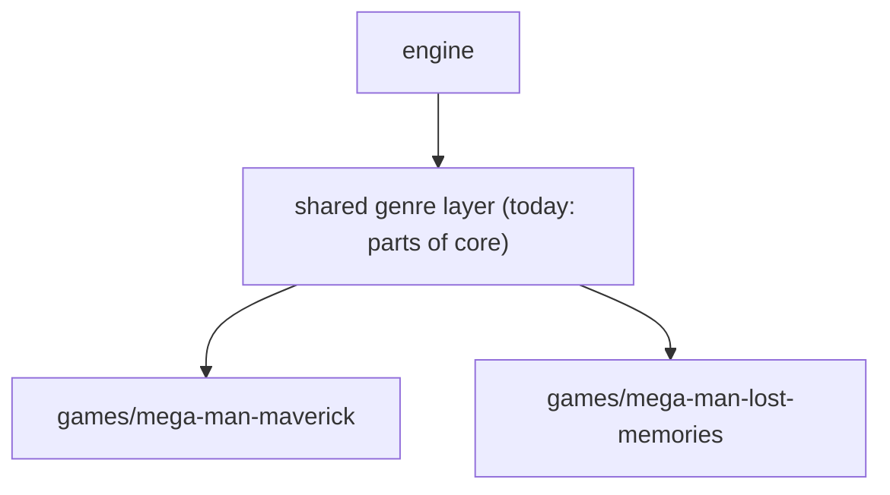

# 185: A second game title on the same engine and shared code

- Status: idea
- Type: refactor
- Objectives: `O1`, `O7`, `O8`
- Depends on: none
- Related: `001` (`001b` host contract), `021`, `032`, `072`, `081`, `181`
- Branches: none yet

## Goal

Make a second game title, an X game (working name "Mega Man Lost Memories"), in this repo. It reuses
`engine` and the genre code of `core` with no copy of the repo. Maverick content (its entities,
levels, screens, assets) stays out of the second game.

## Proposed scope

Not approved. The branch `SCOPE.md` decides the final scope.

Target layout:

Order (option C in `NOTES.md`): no tree-wide move first. Add the new game as a module on top of
`core`, then move code out of `core` only when the new game needs it.

1. `games/<new>/`: game class, desktop launcher, assets root; depends on `:engine` and `:core`.
   A `desktop-common` module holds the shared launcher part; each game has its own small
   launcher module. `lwjgl3` stays the Maverick launcher until step 6. The build and run scripts
   take the game (module, main class, assets folder, name) as a parameter. See `NOTES.md`,
   "Desktop launcher and builds".
2. A spawn-name registry per game in place of `EntityType.PACKAGE_PREFIX` (with `021`, `O7-R1`).
3. A scan root and resource files per module for the smoke test and `EntityConstructorsTest`.
4. An asset list per game in place of "queue every entry of the asset enums".
5. One item each, as the new game needs it: a damage table that each game supplies (out of
   `PlayerDamageNegotiator`), `CharacterDef` (`081` open question 6), the progression types out of
   `entities/megaman/constants`, a level registry, the host contract `001b`.
6. Last: move what is left of the Maverick content into `games/mega-man-maverick/`, in one
   mechanical commit while no other branch is active (as `001a`).

## Owner's input

- 2026-11-23: "Right now, it's just WIP in the Maverick title, but ultimately I'd like it to be a
  separate title." The owner asked whether a `games/` module split or a new repo copy is better.

## Decisions

- 2026-11-23 (owner accepted the recommendation): same repo, option C (new game module on top of
  `core`, extract per need). Not a repo copy, and not a full lift and shift up front. Recorded as
  an item with status `idea`.
- 2026-11-23 (owner accepted the recommendation): one desktop launcher module per game, on a
  shared `desktop-common` module (JVM restart, window config, generic flags, window listener,
  dispose on crash). The game launcher keeps the title, icon, game class and the game's own
  options. `lwjgl3` stays the Maverick launcher at first; the rename to
  `games/mega-man-maverick/desktop` comes with step 6. `build-game.sh` and the run scripts take the
  game as a parameter; the packr step, the JRE bundles and the zip step do not change.

## Bugs folded in

- `build-game.sh:66` runs `unzip -q "$JDK_PATH/jdk.zip"` after the platform `case`, for every
  platform. On Linux the download is `jdk.tar.gz` (`:53-55`), so a Linux build on a machine with no
  `game-builds/jdk/linux64/` fails at that line. Found 2026-11-23 by the launcher research
  (`NOTES.md`); this item rewrites `build-game.sh` anyway.
- `build.gradle:85` sets `version = '$projectVersion'` with single quotes, so Groovy does not
  fill in the value and `project.version` is the text `$projectVersion`. The jar name reads
  `projectVersion` directly, so no output shows it today. Found 2026-11-23 by the build research;
  this item sets the version per game anyway.

## Open questions

1. When does the work start: before or after `081` moves X out of the Maverick extra levels?
2. Does the new game ship the mixed atlases (`Enemies1`, `Projectiles1`, and others) until they are
   re-packed, or must step 4 re-pack them first?
3. Does `core` keep its package name `com.megaman.maverick.game` for the shared layer, or does the
   shared layer get a neutral package?

## Sources

- `NOTES.md` in this folder.
