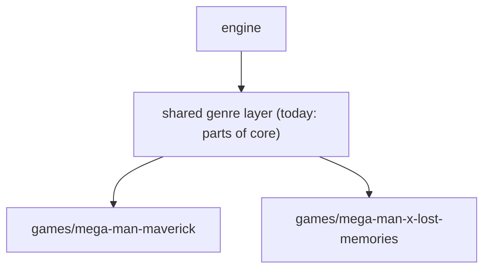

# 185: A second game title on the same engine and shared code

- Status: active
- Type: refactor
- Objectives: `O1`, `O7`, `O8`
- Depends on: none
- Related: `001` (`001b` host contract), `021`, `032`, `072`, `081`, `181`
- Branches: `mega-refactor-185a-lost-memories-launcher` (merged 2026-11-23), `mega-refactor-185b-game-builds` (merged 2026-11-23), `mega-refactor-185c-games-layout` (active, 2026-11-24)

## Goal

Make a second game title, an X game (final title "Mega Man X: Lost Memories"), in this repo. It reuses
`engine` and the genre code of `core` with no copy of the repo. Maverick content (its entities,
levels, screens, assets) stays out of the second game.

## Proposed scope

Not approved. The branch `SCOPE.md` decides the final scope.

Target layout:

Order (option C in `NOTES.md`): no tree-wide move first. Add the new game as a module on top of
`core`, then move code out of `core` only when the new game needs it.

1. `games/<new>/`: game class, desktop launcher, assets root; depends on `:engine` and `:core`.
   A `desktop-common` module holds the shared launcher part; each game has its own small
   launcher module. `lwjgl3` stays the Maverick launcher until step 6. The build and run scripts
   take the game (module, main class, assets folder, name) as a parameter. See `NOTES.md`,
   "Desktop launcher and builds".
2. A spawn-name registry per game in place of `EntityType.PACKAGE_PREFIX` (with `021`, `O7-R1`).
3. A scan root and resource files per module for the smoke test and `EntityConstructorsTest`.
4. An asset list per game in place of "queue every entry of the asset enums".
5. One item each, as the new game needs it: a damage table that each game supplies (out of
   `PlayerDamageNegotiator`), `CharacterDef` (`081` open question 6), the progression types out of
   `entities/megaman/constants`, a level registry, the host contract `001b`.
6. Last: move what is left of the Maverick content into `games/mega-man-maverick/`, in one
   mechanical commit while no other branch is active (as `001a`).
7. Proposed 2026-11-24, not decided (open question 4): give each module its own package root
   (`core` out of `com.megaman.maverick.game`), in its own branch after `185c` merges and while no
   other branch changes `core`. Research in `NOTES.md`, "Package roots per module".

## Owner's input

- 2026-11-23: "Right now, it's just WIP in the Maverick title, but ultimately I'd like it to be a
  separate title." The owner asked whether a `games/` module split or a new repo copy is better.

## Decisions

- 2026-11-23 (owner accepted the recommendation): same repo, option C (new game module on top of
  `core`, extract per need). Not a repo copy, and not a full lift and shift up front. Recorded as
  an item with status `idea`.
- 2026-11-23 (owner accepted the recommendation): one desktop launcher module per game, on a
  shared `desktop-common` module (JVM restart, window config, generic flags, window listener,
  dispose on crash). The game launcher keeps the title, icon, game class and the game's own
  options. `lwjgl3` stays the Maverick launcher at first; the rename to
  `games/mega-man-maverick/desktop` comes with step 6. `build-game.sh` and the run scripts take the
  game as a parameter; the packr step, the JRE bundles and the zip step do not change.

- 2026-11-23: the owner asked for a full first pass: two playable games, Maverick as today and
  "Mega Man X: Lost Memories" (the final title; a splash screen that starts the X6 intro level),
  run scripts that tell the two games apart, builds as a TODO. Sonnet agents for the small tasks.
- 2026-11-23 (owner accepted the recommendation): merge target directly into `master`. Open
  question 1: start now. Open question 2: the first pass runs from the root `assets/`, no re-pack.
  Open question 3: `core` keeps its package name. Details in the `185a` branch `docs/NOTES.md`.

- 2026-11-23 (owner, at the `185a` play test): one run script set per game, named
  `run-<game>-<mode>.sh`, each with its own flags, because the flags of the games can drift
  apart. This replaces the game argument of the decision above.
- 2026-11-23 (owner): the next branch `185b` makes platform builds for each game. The builds go
  to `game-builds/<game>/`. `game-builds/` becomes git-ignored. At least one build of each game.

- 2026-11-24 (owner): the folder names are `games/mega-man-x-lost-memories/` and
  `games/mega-man-maverick/`. Docs that said `games/mega-man-lost-memories/` are corrected.
- 2026-11-24 (owner accepted the recommendation): keep 3 layers (`engine`, `core`, `games/*`). Do not merge
  `engine` and `core`: the module split is the compile-time guard of decision P (item `001`), `engine:test`
  stays fast, and item `032` needs a platform-neutral engine. `core` sinks into `engine` piece by piece later,
  when its services and closed enums open per game (research of 2026-11-24 in `NOTES.md`).
- 2026-11-24 (owner): branch `185c` goes for the target layout and a fully playable Lost Memories mock game:
  splash screen, title menu, level picker, 3 levels (the X6 intro unchanged, plus 2 mock levels with temporary
  enemies, hazards, gimmicks and bosses). Maverick keeps all its behavior. Docs are brought up to date, and a doc
  says how to add a third game.
- 2026-11-24 (owner accepted the recommendation): `185c` opens all 6 blockers of the research (level registry,
  screen exits, spawn names, fight plans, audio keys, test scan roots).
- 2026-11-24 (Claude, under `/go-with-recs`): the X content (`MegamanX`, the X6 entities, `X6_INTRO`) stays in
  `core` while Maverick's extras list `X6_INTRO`; both titles list the level. The mock content reuses existing
  sprites and tilesets (art has its own items, `art.md`). Step 6 (Maverick content into `games/mega-man-maverick/`)
  runs in `185c` although other branches are active, because the owner asked for the layout; the merge risk with
  `178b` and the other worktrees is in the branch `docs/NOTES.md`.

## Follow-ups from `185a`

- Lost Memories has no window icon and no assets folder of its own (open question 2).
- `generateAssetList` (root `build.gradle`) runs its body in every subproject: part of step 4
  (asset list per game).
- `--screen` with a Maverick menu opens it in Lost Memories (no redirect): ends with the host
  contract `001b`.
- The Graal native image setup stays in `lwjgl3` only.

## Bugs folded in

Both fixed: `build.gradle:85` in `185a`, `build-game.sh` in `185b`.

- `build-game.sh:66` runs `unzip -q "$JDK_PATH/jdk.zip"` after the platform `case`, for every
  platform. On Linux the download is `jdk.tar.gz` (`:53-55`), so a Linux build on a machine with no
  `game-builds/jdk/linux64/` fails at that line. Found 2026-11-23 by the launcher research
  (`NOTES.md`); this item rewrites `build-game.sh` anyway.
- `build.gradle:85` sets `version = '$projectVersion'` with single quotes, so Groovy does not
  fill in the value and `project.version` is the text `$projectVersion`. The jar name reads
  `projectVersion` directly, so no output shows it today. Found 2026-11-23 by the build research;
  this item sets the version per game anyway.

## Open questions

1. Answered 2026-11-23 (`185a`): start now.
2. First pass answered 2026-11-23 (`185a`): run from the root `assets/`, no re-pack. Open for a real asset split: Does the new game ship the mixed atlases (`Enemies1`, `Projectiles1`, and others) until they are
   re-packed, or must step 4 re-pack them first?
3. Answered 2026-11-23 (`185a` D4): yes. Was: does `core` keep its package name `com.megaman.maverick.game` for the shared layer, or does the
   shared layer get a neutral package?
4. Opened 2026-11-24 (owner asked after the `185c` layout move): now that the games have their own
   modules, does `core` get its own package root? The reason of item `001` (`ITEM.md`, "Do not rename
   the `core` package": `EntityType.PACKAGE_PREFIX`) is gone since `185c` (`EntityClassResolver`
   with package roots per title). Options (`NOTES.md`, "Package roots per module"):
   - A. Keep `com.megaman.maverick.game` (answer 3 stays).
   - B. `com.megaman.core` (or `com.mega.core`) for `core`, `com.megaman.maverick` for Maverick.
   - C. `com.maverick.game.core` for `core`, next to `com.maverick.game.engine`; games under
     `com.megaman.<game>`.
   Recommendation: C, as a new branch of this item after `185c` merges, run alone like `001a`.

## Sources

- `NOTES.md` in this folder.
