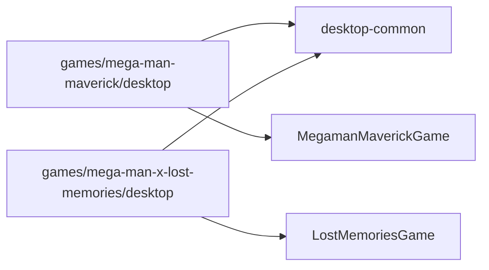

# Notes: 185 A second game title on the same engine and shared code

## Research of 2026-11-23 (`master` `7c936e935`)

Read-only research by 6 agents (packages, X closure, reflection coupling, build and assets, roadmap,
web). The main thread checked `EntityType.kt:19`, the content imports of `PlayerDamageNegotiator.kt`
(31) and `MegamanX.kt:49-52`.

### Why not a copy

- The X closure reaches 381 of 904 `core` files (292 when the expansion stops at
  `PlayerDamageNegotiator` and `CharacterLoadout`). A copy takes most of `core` anyway.
- Then every engine, physics, camera and player fix must be made twice. Published studies of
  clone-and-own name this as the main cost (Krüger & Berger, ESEC/FSE 2020).
- Item `001` decision P: one repo, `engine`/`core` split. Decision L: the engine is not published.

### Why not a full split up front

- `O1-R5`: a new API needs a production caller. Practice (rule of three, "frameworks are
  extractions") says the same: let the second game show what is shared.
- 6 worktrees and 14 active items. A tree-wide move conflicts with all of them. Precedent: `001a`
  (about 760 files) ran alone.

### How `core` splits today (file counts)

| Class | Files | Share |
|---|---|---|
| Reusable as-is | 168 | 19% |
| Mixed (genre logic + Maverick imports) | 346 | 38% |
| Maverick content only | 388 | 43% |

Reusable: `utils`, `world`, `spawns`, `events`, `locks`, `input`, `audio`, `animations`,
`behaviors`, `difficulty`, `pathfinding`, `entities/state`, `entities/utils`.
Content: `enemies` (131), `bosses` (65), `projectiles` (75), `megaman` (32), `protoman` (8), menus,
backgrounds.

### Blockers, ordered by risk

| Blocker | Where | Count | Fix |
|---|---|---|---|
| Spawn names built from a package string | `EntityType.kt:19`, `SpawnersLayerBuilder.kt:58-64` | 5 `forName` sites | Name registry per game (`O7-R1`, item `021`) |
| Entity tests scan one package in one module | `EntityInitSmokeTest.kt:19-37`, `EntityConstructorsTest.kt:18-28` | 2 tests, 460-line tags file | Scan root and resource files per module; silent skip otherwise |
| Content in shared player code | `PlayerDamageNegotiator.kt:12-45` | 30 content imports | Damage table that each game supplies |
| Closed character list | `PlayerCharacter.kt:3`, `CharacterLoadout.kt:75-78` | 3 entries | `CharacterDef` (item `081` open question 6) |
| X edges into Megaman/content | `MegamanX.kt:49-52`, `MegamanXBuster.kt:6-8` | 5 content, 2 Megaman files | Move `MegaChargeStatus`, stun values; inject shot classes |
| Base classes test content | `AbstractEnemy.kt:53,55`, `AbstractBoss.kt:35-39`, `StandardDamageNegotiator.kt:11-16` | | Hooks or tables |
| `LevelDefinition` used outside levels | 22 files; 56 lines name a level | 39 entries | Per-game level registry |
| Progression types in `megaman/constants` | `MegaHeartTank`, `MegaEnhancement` | 22 outside users | Move to shared |
| Closed enums | `TextureAsset` 78, `SoundAsset` 87, `MusicAsset` 84, `ScreenEnum` 17, `EventType` 44, `FixtureType` 29 | | Engine side is open (`IAsset`, `Event(key: Any)`, `IFixtureType`); split enums per game |
| Concrete game type | 33 `screens/` files, 13 `drawables` | | Host contract `001b` |
| Save file names | `Constants.kt:5-8`, `GameState.kt` | 2 names, 4 `valueOf` | `GameState` per game; settings file name as parameter |

### Build and assets

- One launcher, one `assets/`, one `appName`: fixed in `build.gradle:86`, `lwjgl3/build.gradle:22,23,53,61,92-125`,
  `DesktopLauncher.kt:25,26,195`, `build-game.sh:88-91`, `build-game-*.sh:5-8`, `ci.yml:30`.
- All 95 atlases, sounds and music queue at startup (`MegamanMaverickGame.kt:928`).
- Mixed atlases: `Enemies1` 77 entity folders, `Enemies2` 54, `Projectiles1` 25. The new game ships
  Maverick sprites unless these are re-packed.
- `MegamanX.txt` is its own atlas. X borrows Mega's buster sounds.
- TMX maps use relative tileset paths (289 `../tsx` refs): shared tilesets must keep their relative place.
- Assets: 272M (music 210M). `generateAssetList` output is read by no code.
- Side finding: `build.gradle:85` `version = '$projectVersion'` (single quotes, no interpolation).

### Options

| Option | Shared fixes | Upfront change | Risk |
|---|---|---|---|
| A. New repo copy | No | None | Drift; every fix twice |
| B. Full lift and shift now | Yes | Tree-wide move | Conflicts with 6 worktrees; wrong abstractions |
| C. New game module on top of `core`, extract per need | Yes | Small: launcher + registry + asset roots | Maverick content on the new game's classpath until extracted |

Recommendation: C. Steps in order:

1. Add `games/<new>/` (game class, launcher, assets root) that depends on `:core` and `:engine`.
2. Spawn-name registry per game (removes the `PACKAGE_PREFIX` break).
3. Per-module scan roots for the smoke and constructor tests.
4. Asset list per game in place of "queue every enum entry".
5. Then extract, one item each, what the new game needs: damage table, `CharacterDef`, progression
   types, level registry, host contract `001b`.
6. When most content is out of `core`, move what is left into `games/mega-man-maverick/` (one
   mechanical commit, no other branch active, like `001a`).

### Gaps

- Closure counts come from a regex resolver, not the compiler; wildcard imports inflate them.
- Content files in blocks/hazards/special were classified by name; 43 is a lower bound.
- Not counted: TMX objects that a registry must map; raw-string asset loads outside the enums.
- No published case of a solo developer comparing the two options for 2 games.
- Owner decision open: is the X game a separate title, or X modes inside Maverick (all of `081`
  assumes inside)?

### Sources (web)

- https://www.cse.chalmers.se/~bergert/paper/2020-fse-reusecosts.pdf
- https://www.kolibrigames.com/blog/the-benefits-of-code-sharing/
- https://docs.gradle.org/current/userguide/composite_builds.html
- https://sandimetz.com/blog/2016/1/20/the-wrong-abstraction
- https://en.wikipedia.org/wiki/Rule_of_three_(computer_programming)
- https://geometrian.com/projects/blog/write_games_not_engines.html

## Desktop launcher and builds (2026-11-23, `master` `379a5d883`)

Read-only research in the main thread.



### What `DesktopLauncher.kt` holds today (527 lines, 45 flags)

| Part | Where | Game-specific? |
|---|---|---|
| JVM restart, window config, window listener, dispose on crash | `:62`, `:141-153`, `:197-225` | No |
| Most flags (window, performance, debug, logs, volume, interpolation) | `:229-521` | No |
| Title, icon | `:25-26` | Yes |
| Game class and params | `:157`, `:195` | Yes |
| Level, screen, weapons, tanks, difficulty, save options | `:80-99`, through `LaunchOptionsResolver.kt:4-12` | Yes: `LevelDefinition`, `ScreenEnum`, `MegaHeartTank`, `WeaponDef` |

`--players`, `--mode` and `--bot` are genre features, but `LaunchOptionsResolver.kt:93` reads
`PlayerCharacter` and `LevelDefinition.characters`.

### Shape of the split (sketch)

JCommander parses several argument objects in one pass (`addObject` per object), so the common
flags and the game flags can be two classes.

```kotlin
// desktop-common
fun runDesktop(args: Array<String>, title: String, icon: String,
               gameArgs: Any, makeGame: (CommonArgs) -> ApplicationListener)

// games/mega-man-x-lost-memories/desktop
fun main(args: Array<String>) =
    runDesktop(args, "Mega Man Lost Memories", "LostMemories.png", LmArgs()) { LostMemoriesGame(it) }
```

### Effect on builds and runs

| Today | Fixed in | After the split |
|---|---|---|
| `./gradlew lwjgl3:run` in each `run-game-*.sh` | run scripts | `:games:<g>:desktop:run`; the Maverick scripts keep their names |
| `run.workingDir` = root `assets/` | `lwjgl3/build.gradle:53` | assets folder per game, or a merged folder of shared + game assets |
| Jar `${appName}-${projectVersion}.jar` | `build.gradle:86`, `lwjgl3/build.gradle:61` | name and version per game |
| Jar path, main class, `--resources assets/*` | `build-game.sh:88-91` | arguments of `build-game.sh` |
| `"Megaman-Maverick-$VERSION"` | `build-game-{linux,mac,windows}.sh:5-8` | one wrapper per game, or a game argument |
| One `construo` block, one macOS identifier and icon | `lwjgl3/build.gradle:92-125` | one block per launcher module |
| `lwjgl3:jar` in CI | `ci.yml:30` | one jar task per game |

No change: the packr call itself, the JRE bundles in `game-builds/jdk/`, the zip step. Output
folders are named after the executable, so the builds of two games do not collide in
`game-builds/`.

### Risks

- A game run has one working folder. Shared and game assets must be merged into one folder (for
  example a Gradle `Sync` task into `build/`) before `run` and before packr `--resources`. This
  depends on open question 2.
- Two bugs found here are folded into this item (`ITEM.md`, "Bugs folded in").

## Research of 2026-11-24 (`master` `5d6ded9ca`): next steps, layout, mock game

Read-only research by 6 agents (185 state, screens and levels, entities and assets, engine and core, X6 intro closure, web). The main thread checked the prefix, the fight-plan throw, the screen registration order, the audio map keys and the engine import count.

### 1. State of item 185

| Step (`ITEM.md`) | State |
|---|---|
| 1 game module, launcher, builds | Done (`185a`, `185b`), except: no LM assets root, Maverick icon (`LostMemoriesLauncher.kt:11` TODO) |
| 2 spawn-name registry | Not started. `EntityType.kt:20` prefix; 5 resolve sites: `MegaEntityFactory.kt:50`, `SensorsLayerBuilder.kt:30`, `BossSpawnEventHandler.kt:16`, `HeartTank.kt:142` (+ `GauntletMaster.kt:146` through `getEntityClass`) |
| 3 test scan roots | Not started. `EntityInitSmokeTest.kt:19,27`, `EntityConstructorsTest.kt:21-22`; LM entities skipped silently |
| 4 asset list per game | Not started. `MegamanMaverickGame.kt:926-933` queues all enum entries + all `LevelDefinition` maps |
| 5 per-need extractions | Not started. `001b` blocked (waits on `010`, `032`) |
| 6 Maverick content into `games/` | Not started; needs no other active branch |

Naming: live folder `games/mega-man-x-lost-memories/`; docs say `games/mega-man-lost-memories/`; owner says
`games/megaman-lost-memories/`. Maverick target in docs: `games/mega-man-maverick/`. Run/build scripts and
`game-builds/` use the `mega-man-x-lost-memories` slug.

Conflict landscape for step 6 (files changed vs master): `178b` 51 (high overlap), `183d` 19, `compactor-level` 8,
`fix/projectiles-ignore-death` 7, `fix/auto-perf-freeze` 3, two art branches 2 each. Steps 2-4 overlap only
`fix/auto-perf-freeze` (`MegamanMaverickGame.kt`).

### 2. Blockers for the mock LM game

| Need | Blocker | Where | Smallest change |
|---|---|---|---|
| Own title menu, level picker | None: screen keys are `String`; `registerScreens` runs after Maverick's | `MegamanMaverickGame.kt:222,520` | Build on `MegaMenuScreen` in LM module |
| Own levels | Closed `enum LevelDefinition`; typed into `startLevel`, `LevelState.currentLevel`, `GameState.levelsCompleted` (`valueOf` at `GameState.kt:387`), `--level`, asset queue | `LevelDefinition.kt:21`, `MegamanMaverickGame.kt:1094-1106,933` | `ILevelDef` interface; `LevelDefinition` implements it; `IGameTitle.levels` |
| Level exits | `screenOnCompletion` returns `ScreenEnum`; hard-coded `ENDING` (`MegaLevelScreen.kt:813`), `GAME_OVER` (`RespawnSteps.kt:88`), `SAVE_GAME` (`GameOverScreen.kt:86`, `LevelPauseScreen.kt:462`) | | String keys + title hooks; removes `redirectScreen` stopgap (`:1053`) |
| LM entities from TMX | Package prefix | `EntityType.kt:20-24` | Accept a fully qualified name, or package roots per title |
| LM boss | `FightPlans.find` closed `when`, throws | `FightPlans.kt:31-41` | `register(tag, plan)` or default plan |
| LM sounds/music | Audio maps keyed by closed enums, hard casts; `AbstractBoss.kt:279` `MusicAsset.valueOf` | `MegaAudioManager.kt:17,62,128,173,179` | Key by `IAsset`; `IGameTitle` asset list |
| LM atlases | Not blocked (`getTextureAtlas(String)`) | `engine/.../AssetManagerExtensions.kt:8` | Title asset list for clean queue |
| `--level`/`--screen` for LM | Parsed against the two enums | `LaunchOptionsResolver.kt:64-102` | Resolve against `title.levels` and `game.screens` keys |
| Tests of LM entities | Scan core only; harness in core `smokeTest` | see step 3 | Parameterize scan root; LM `smokeTest` suite |

Not blockers: `MegaEntityFactory` (any `KClass`), `AbstractEnemy`/`AbstractBoss` content checks (overridable),
`PlayerDamageNegotiator` (unknown damager falls back by size / `IHazard`), `EventType` (`Event.key: Any`),
`FixtureType`/`EntityType` (LM reuses values). `StandardDamageNegotiator` gives 0 damage for an unknown
damager (`:164,178,180`): LM projectiles that hurt enemies need overrides on LM enemies.

Reusable for mock levels (concrete classes): blocks 45, hazards 53, special 39, items 7, sensors 6,
decorations 51. Avoid `ConveyorBelt` (known failure).

Reusable screens: `MegaMenuScreen`, `screens/utils/` (`BlinkingArrow`, `MenuScrollPane`, `Fade`, `ScreenSlide`),
`MegaFontHandle`, `ControllerSettingsScreen` (2 enum refs), `MegaLevelScreen` and `GameOverScreen` once exits
are configurable. Maverick content: `MainMenuScreen`, `LevelSelectScreenV2` (8-boss grid), `ExtrasScreen`,
save/difficulty/intro/weapon/logo/opening/ending/credits screens.

Counts outside `levels/` and `screens/`: `ScreenEnum` 28 lines; `LevelDefinition` 43 lines in 15 files
(13 are `== LevelDefinition.X` checks in Maverick entities).

### 3. X6 intro closure

- 12 spawned classes. X6-only: `Junkroid`, `HoverGunner`, `MetaWheelF`, `MetaDridler`, `D1000`, `SabreBlock`.
  Shared: `Block`, `AbstractBlock`, `LadderTop`, `GroundSlope`, `Ladder`, `Gate`, (`MapSprite`).
- Movable to LM: 41 files, 9,097 lines (32 X6 entity files / 7,651 lines; 9 `megamanx` files / 1,446 lines),
  plus `MMX6_*` music entries, `MEGAMAN_X` atlas entry, `X6_INTRO` definition, TMX/TSX.
- Edges to cut first: 9 entries in `PlayerDamageNegotiator.kt:76-84`; `FightPlans.kt:33`;
  `EnemyShot` uses `Junkroid.HURL_GRAVITY` (`:41,108,118`); `MegamanX` → `MegamanValues.STUN_*`,
  `MegaChargeStatus`, `SpringHead`; 3 core refs to `MegamanX` (`TextureAsset.kt:46`,
  `MegamanMaverickGame.kt:488`, `MegaLevelScreen.kt:871`); the package prefix.
- Shared atlases: D1000 regions in `BOSSES_3` (shared with Maverick bosses); X6 enemies in `ENEMIES_2`
  (about 50 Maverick enemies). No X6-only sounds.
- No worktree touches these files.

### 4. Engine vs core: merge or keep

| Module | main files | tests | suite time (last local run) |
|---|---|---|---|
| `engine` | 301 | 782 | 11.3 s |
| `core` | 906 | 3071 | 308.6 s |

- `engine` has 0 imports of game code; Gradle enforces it (decision P, item `001`).
- Merge costs: loses compile-time guard (decision P), conflicts with item `032` (platform-neutral engine;
  `core` has desktop/Graal deps), pulls closed enums and `MegaServices` into the engine, engine tests
  get core's test time.
- Merge gains: one package root (settles open question 3), no "wrong side" for mechanisms (item `084`).
- Even the "clean" core packages depend on `MegaServices`, `ConstKeys`, `FixtureType`. That is what keeps
  them out of `engine` today.
- Engine candidates (0 content, 0 service imports): `animations`, `behaviors`, `difficulty`, `locks`,
  most of `entities/state`, `input`, `assets` (generic part).
- After step 6, `core` = shared genre layer. Once services/enums open per game and `001b` lands, most of it
  can sink into `engine`; two layers then suffice.

### 5. Web

- Extraction over invention: DHH "frameworks are extractions"; Roberts & Johnson "Three Examples";
  Muratori "semantic compression"; "write games, not engines".
- Three-layer practice: Chocolate Doom (shared code + per-game subfolders for Doom/Heretic/Hexen/Strife);
  Unreal Engine → Gameplay Framework → game/plugins; Monocle extracted from TowerFall, reused for Celeste;
  Now in Android `core`/`feature`/`app` one-way deps.
- Rule of three: a mock second game is user #2. Treat the boundary as provisional; promote to `core` only
  what both games use.
- Make the mock differ from Maverick (other character, other rules, own screens), or the boundary overfits.

Sources: https://www.doomwiki.org/wiki/Chocolate_Doom ; https://research.tedneward.com/patterns/evolving-frameworks.html ;
https://caseymuratori.com/blog_0015 ; https://dev.epicgames.com/documentation/en-us/unreal-engine/gameplay-framework-in-unreal-engine ;
https://github.com/android/nowinandroid/blob/main/docs/ModularizationLearningJourney.md ;
https://geometrian.com/projects/blog/write_games_not_engines.html

### Gaps

- Classloader behaviour of `Class.forName` for an LM class from core: not run.
- Test files that use `X6_INTRO` / X6 classes (6+, e.g. `D1000Rig`) not traced.
- Indirect asset loads (child `TickFrames`) not traced.
- Overlap with planned (not active) branches not checked.
