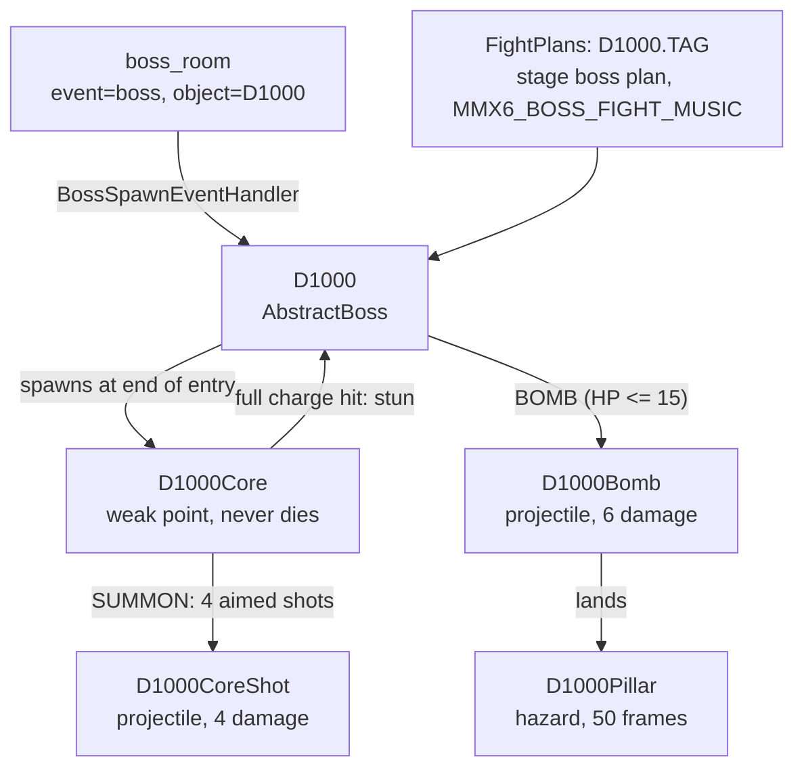
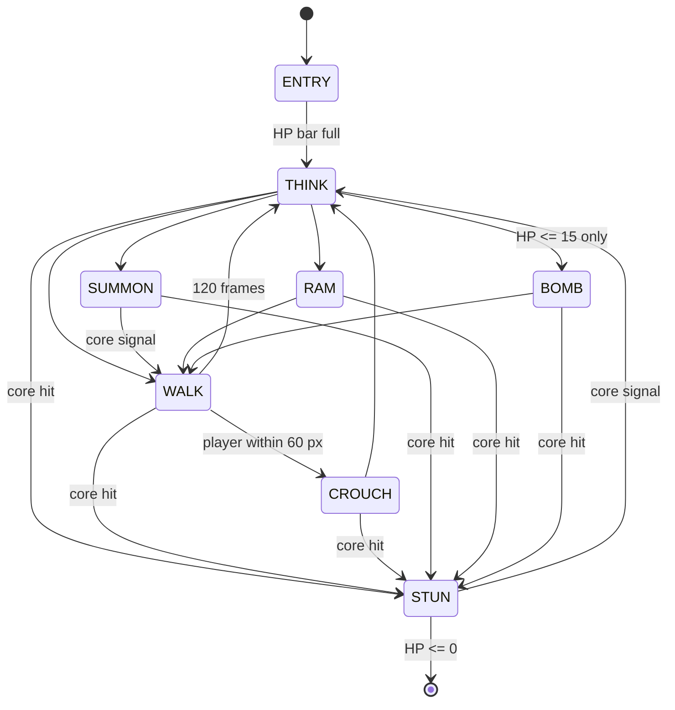

# Plan: the D-1000 boss in `X6_INTRO`

Status: first version built (2026-11-03), not play-tested. The frames are the raw conversion; the
cleanup (step 1) is still open.

Deviations from the plan in the first version:

- Buster shots and half charges do not bounce. They disintegrate on the body, as on other bosses
  that a weapon cannot hurt. A real bounce needs a shield that lets a full charge through.
- The entry flash, the energy particles from the core to the body, and the core hit animation
  (`core_hit`) are left out.
- `ram` and `throw` play their intro frames once, then loop from the X6 loop frame.
- The X6 numbers are converted to seconds and tiles (× `ConstVals.PPM`), rounded; the code does not
  count X6 frames (`intro-objects-plan.md`, "What the first version changed").
- The core shot is `X6Shot` (type `CORE`), shared with Junkroid and Hover Gunner. Its frame is in
  the `Enemies2` atlas, `X6Shot/core`.

## Decisions

| # | Question | Decision |
|---|---|---|
| 1 | Sprite ratio of the boss | Ratio 2, the same as the map. The boss keeps its X6 size against the room, and the X6 distances and boxes carry over with no scale |
| 2 | Buster shots and half charges | They bounce off the body, as in X6. The core is the main way to win |
| 3 | End of the fight | The standard Maverick defeat and victory. No wreck, Zero or High Max scene |
| 4 | Dented wall and rock fall | Not in the first version |

## Sources

| What | Where |
|---|---|
| X6 behavior (all numbers below) | `~/IdeaProjects/mmx-demake-tools/docs/enemies/d-1000.md` |
| X6 pseudocode | `~/mmx-data/x6/re/d-1000/pseudocode.md` |
| X6 frames (both sprite sets) | `~/mmx-data/x6/sprites/enemies/d-1000-sets/` |
| NES frames (raw, not cleaned) | `~/mmx-data/x6/nesart/d-1000/raw-ratio2/` (24 strips, `animations.json`, `preview.png`). The ratio 1.67 trial stays in `raw/` |
| Converter | `python3 -m mmxdemake.nessprite --export ... --catalog catalog/nessprite-d1000.json --out ...` |
| Model boss in Maverick | `BigAssMaverickRobot` (also on the new fight flow, `fights/README.md`) |

## Units

The map and the boss sprites both use ratio 2, so 1 TMX px = 1 X6 px for positions, boxes and
art.

| X6 | Maverick |
|---|---|
| 1 px | 1 TMX px = 1/32 tile |
| 1 px/frame (60 fps) | 1.875 tiles/s (`1.875f * ConstVals.PPM`) |
| 1 px/frame² | 112.5 tiles/s² |
| 1 frame | 1/60 s |
| HP 32 | 30 (`ConstVals.MAX_HEALTH`) |

The body sprite is 100 x 74 NES px (6.25 x 4.6 tiles). The hurt and contact box is the X6 box:
112 x 92 px (3.5 x 2.9 tiles), from 56 px left to 56 px right of the origin, and from 64 px above
to 28 px below it.

## Parts

| New file | Package | Job |
|---|---|---|
| `D1000.kt` | `entities/bosses` | The body: entry, THINK, WALK, CROUCH, BOMB, SUMMON, RAM, STUN |
| `D1000Core.kt` | `entities/bosses` | The core: shots, stun signal, side swap |
| `D1000CoreShot.kt` | `entities/projectiles` | The aimed core shot. First check if an existing aimed projectile can take the sprite |
| `D1000Bomb.kt` | `entities/projectiles` | The lobbed bomb |
| `D1000Pillar.kt` | `entities/hazards` | The energy pillar where the bomb lands |

## Body state machine

THINK waits 60 frames, then picks with `r` in 0–15:

| situation | HP > 15 | HP <= 15 |
|---|---|---|
| after CROUCH | r < 8: WALK, else SUMMON | r < 6: SUMMON, else BOMB |
| other | r < 8: RAM, else SUMMON | r < 6: RAM, else BOMB |

Put this table in a pure function, so that a unit test can check it without the engine.

Animations per state (strip names from the converter):

| State | Strips |
|---|---|
| ENTRY | `fall`, `land`, `stand_up`, `entry_flash`, then `stand` |
| THINK, SUMMON | `stand` |
| WALK | `walk` |
| CROUCH | `crouch_drop`, `crouch_shake`, `walk` on the rise |
| RAM | `walk` (wind-up), `ram` |
| BOMB | `throw` |
| STUN | `stagger`, `fall`, `land`, `stand_up` |
| Defeat | `stand` with the usual boss blink and explosions (`wreck` is not used) |
| Core | `core`, `core_appear`, `core_vanish`, `core_glow`, `energy` |
| Shots | `core_shot`, `bomb`, `pillar_start`, `pillar`, `pillar_end`, `pillar_base` |

## Implementation steps

Work in the worktree `.worktrees/x6-intro-extra-level` (branch `x6-intro-extra-level`).

1. **Frames.** Clean the raw strips by hand (artist or subagents, as for the tiles). Then reduce
   repeated frames: `stand_up` has 16 frames but only 4 sprites, and `core_appear` has 21 frames
   but 5 sprites. Write each animation as its unique frames, and keep the frame order and the
   times in code.
2. **Atlas.** Copy the strips to `assets/sprites/frames/Bosses3/D1000/` and repack
   `Bosses3.txt` with its TexturePacker project. Keep the page within 2048 px (item `033`).
3. **Body, entry and THINK.** `D1000` on `AbstractBoss`: fall from above the room, land (camera
   shake), stand up, rise to the stand height, `isReady` true. Then THINK, WALK and CROUCH.
4. **Fight plan.** Add `D1000.TAG -> stageBossPlan(MusicAsset.MMX6_BOSS_FIGHT_MUSIC)` to
   `FightPlans.find`. The outro `LevelVictory` ends the level, and `X6_INTRO` goes to the extras
   screen.
5. **Map.** Add the boss object and the room properties `event=boss` and `object=<boss id>` to
   `boss_room` through `catalog/nesmap-intro.json` and `nesmap`, so that the map stays generated.
   Remove the TODO marker for the D-1000 spawn.
6. **Core, SUMMON and STUN.** `D1000Core` on the side away from the player; 4 aimed shots
   8 frames apart, signal at frame 124; a full `ChargedShot` stuns the body; the body takes 8
   damage 65 frames after it lands; the core moves to the other side.
7. **RAM.** 180-frame wind-up, charge to 4 px/frame, hit the wall (shake), 180 frames stuck.
   The wall tiles do not change.
8. **BOMB.** Bomb at frame 24 (Hard mode: also at frame 84), aimed to reach the player's x in
   32 frames. On landing, the pillar: 32 x 255 px, 50 frames, 6 damage.
9. **Damage.** Body: contact 6; buster shots and half charges bounce off (decision 2); full charge
   5. Core shot 4, bomb and pillar 6. Tune after a play test.
10. **Checks.** `./gradlew core:test core:smokeTest` (the smoke test needs every region in the
    atlas), the THINK table test, then a `timeout 12` launch with
    `--level X6_INTRO --room boss_room`, and a play test by the owner.

## Risks and dependencies

- Branch `mega-refactor-118b-batch-1` also edits `FightPlans.kt`. A merge conflict there is
  likely but small (one line in `find`).
- `AbstractBoss` and the old flow in `MegaLevelScreen.onEvent` are in change under item `118`.
  Use only the new fight flow for `D1000`.
- The X6 entry has a WARNING screen and player-walk events. Maverick has no WARNING step. The
  plan uses the standard Maverick entry.
- With ratio 2 the boss is smaller on the screen than with ratio 1.67, and the cleanup has fewer
  pixels for detail (the eyes and the vents are 1–2 px).
- The raw frames have 20 colors. A Maverick boss such as `GutsTank` has about 10. The cleanup
  must cut colors.
- The behavior sheet has open questions (the RAM height tracking, where the bomb lands). Decide
  them in the play test.

