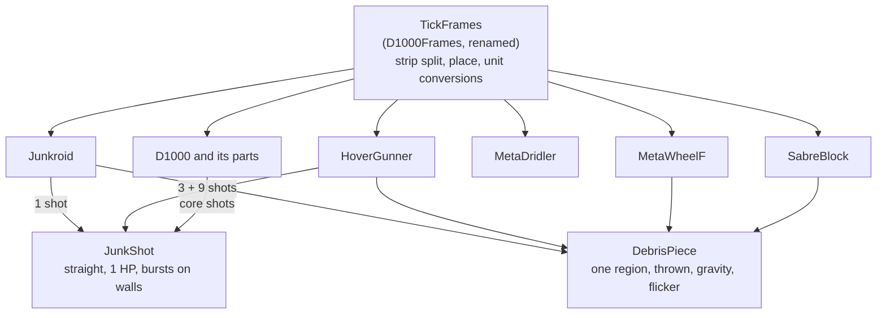
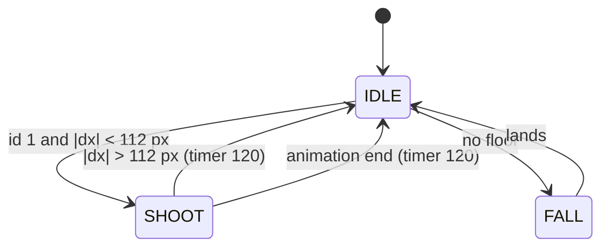
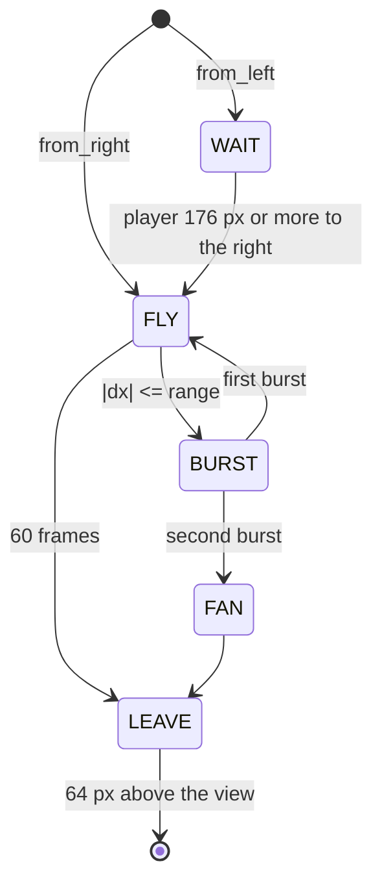
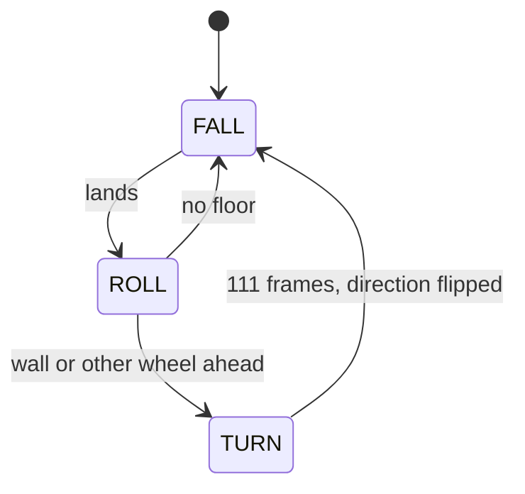
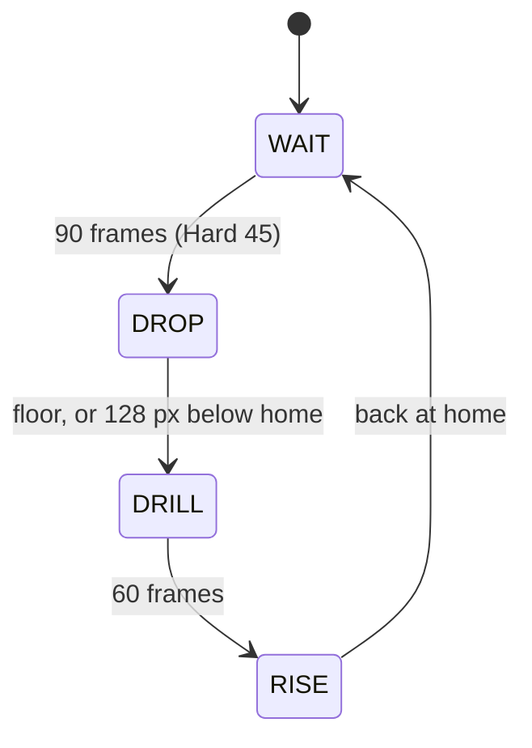

# Plan: the enemies and objects of `X6_INTRO`

Status: first version built (2026-11-03), not play-tested. The frames are cleaned
(`~/mmx-data/x6/nesart/<name>/clean/`, with `notes.md` and all versions). The D-1000 has its own
plan: `d-1000-plan.md`.

What the first version changed from this plan:

- **Timing and units are Maverick's.** Each X6 number is converted once to seconds and to tiles
  (× `ConstVals.PPM`), rounded, and the code uses `Timer`s that run on `delta`. No code counts X6
  frames. The values do not need to match X6 exactly (the owner, 2026-11-03). Only the animation
  frame data (`TickFrameDef` ticks) stays in X6 frames.
- **Damage taken** keeps the X6 hit counts: each target hard-codes its damage for the buster, the half
  charge and the full charge (`081e` removed `X6Damage`, which scaled the X6 values to 30 HP). Other
  weapons use the standard size table.
- **Death explosions do no damage** (`DAMAGER` false), as in X6.
- **Meta Wheel F**: no stud overlay; the studs are in the roll frames, and `turn_flash` blinks
  with the roll frame in the last 0.35 s of a turn. Wheels turn when they meet; the X6 squeeze
  (a wheel that lands on another one) is a `TODO`.
- **Meta Dridler** effects are extra sprites on the drill. It has no rock block.
- **Sabre block** has `respawnable` false and no cull, so a broken block stays broken until the
  level restarts, and a damaged one keeps its damage when it leaves the view (X6 restores it).
- **Hover Gunner poses**: forward, up, down, up diagonal, down diagonal. A direction 22.5° off a
  diagonal uses the diagonal pose (my call; the X6 pose table was not read).
- **Map**: `nesmap` has an `objects` list. Each entry is centered on the X6 record point; the
  sabre block is moved 8 px up (`dy`). The `record` field is the X6 record number, for reading.
- **Shared code**: `entities/utils/TickFrames` (frame tables, strip split, placement),
  `projectiles/JunkShot` (also the D-1000 core shot),
  `decorations/DebrisPiece`, `decorations/Wreck`. All regions are in the `Enemies2` atlas (page
  936 × 1998).

## Scope

All objects of the X6 intro stage list (`~/IdeaProjects/mmx-demake-tools/docs/stages/intro.md`,
"Objects"), except the parts that the boss room and the map already cover:

| X6 object | Records | In this plan | Maverick class |
|---|---|---|---|
| Junkroid | 25–30 | yes | `enemies/Junkroid` + `projectiles/JunkShot` |
| Hover Gunner | 20–24 | yes | `enemies/HoverGunner` + `projectiles/JunkShot` + `decorations/MuzzleFlash` sprite |
| Meta Wheel F | 31–39 | yes | `enemies/MetaWheelF` |
| Meta Dridler | 45–53 | yes | `enemies/MetaDridler` |
| Sabre block | 40–44 | yes | `blocks/SabreBlock` |
| Wrecks (scenery) | 54, 55 | yes | a sprite decoration |
| Debris of all the above | – | yes | `decorations/DebrisPiece` |
| Boss gates | 18, 19 | no: the map already has Maverick `Gate`s | – |
| D-1000 | 56 | no: `d-1000-plan.md` | – |
| The Hunters' scene, Zero, High Max | 17, misc | no: no scenes in the first version (D-1000 decision 3) | – |
| Talk zones, checkpoints, camera zones | 0–16 | no: the map has player spawns and camera zones | – |
| Meta Dridler rock block | 46–48 | no: X6 likely never shows it (open question 1 of the sheet) | – |

## Decisions

| # | Question | Decision |
|---|---|---|
| 1 | Sprite ratio | Ratio 2, the same as the map and the D-1000. 1 X6 px = 1 world unit. Exception (owner, 2026-11-03): Junkroid and Hover Gunner use ratio 1.6, so they are 1.25× the X6 size. At ratio 2 they looked squished. Their bodies, offsets and shots are 1.25× too. The Junkroid map point stays the X6 origin, 0.75 tile above the floor |
| 2 | Sabre-only objects (sabre block, Meta Wheel F) | Any Mega Man weapon hurts them. A `TODO` at the damage rule: when X is the player, only a sabre slash hurts them. Mega Man keeps all weapons. The owner decided this for the sabre block (2026-11-03). Meta Wheel F gets the same rule (my call, by analogy) |
| 3 | Difficulty | X6 record kind 0 and 1: every difficulty. Kind 2 (X6 Hard only): `ConstKeys.HARD_MODE_ONLY`. X6 code that reads the difficulty (Junkroid `id`, Meta Dridler wait, the Junkroid Hard shot) reads Maverick hard mode |
| 4 | Item drops | The standard `AbstractEnemy` drop, not the X6 drop tables |
| 5 | Explosions | The standard Maverick `Explosion`, at the X6 positions and counts |

## Sources

| What | Where |
|---|---|
| Behavior sheets (all numbers below) | `~/IdeaProjects/mmx-demake-tools/docs/enemies/{junkroid,hover-gunner,meta-wheel-f,meta-dridler,sabre-block}.md` |
| X6 frames | `~/mmx-data/x6/sprites/enemies/<name>/`. Sabre block and wrecks: `~/mmx-data/x6/sprites/bank-exports/intro/<name>/` (cut from sprite banks 1, 7 and 8 of `intro-1_start`) |
| NES frames (raw) | `~/mmx-data/x6/nesart/<name>/raw-ratio2/`: one strip per animation, `animations.json`, `preview.png` |
| Color maps | `~/IdeaProjects/mmx-demake-tools/catalog/nessprite-<name>.json` |
| Record positions | `docs/stages/intro.md`, "Objects". TMX x = X6 x (no widen before x 5984); TMX y = X6 y |

## Units

The same as `d-1000-plan.md`: 1 px/frame = `1.875f * ConstVals.PPM` per second, 1 px/frame² =
`112.5f * ConstVals.PPM` per second², 1 frame = 1/60 s. X6 HP is kept as it is (all are 32 or less).

## Converted frames

| Object | Animations (NES size, unique sprites) | Colors |
|---|---|---|
| Junkroid (ratio 1.6, cleaned) | `idle` 41×38 (1), `shoot` (3), `shot` 10×10 (1), `shot_hard` (3), `debris_1`–`debris_4` | 8 |
| Hover Gunner (ratio 1.6, cleaned) | `fly` 28×16 (2), `aim_1`–`aim_5` 16×25 (2 each), `shot` 8×8 (4), `muzzle_flash` 14×14 (7), `debris_1`–`debris_5` | 9 |
| Meta Wheel F | `roll_left` 36×34 (8), `roll_right` (8, the same sprites in reverse), `studs`, `studs_alt` (16), `stud_flash_0`–`3` (4 each), `debris_1`–`3` | 13 |
| Meta Dridler | `wait` 32×63 (4), `drill` (4), `rise` (4), `flame`, `flame_drop` (6 each), `warn_drop`, `warn_rise` (4 each), `debris_1`–`3` | 12 |
| Sabre block | `block` 32×32, `debris_large`, `debris_medium`, `debris_small` | 8 |
| Wreck A (claw) | `wreck` 48×36 | 6 |
| Wreck B (small) | `wreck` 18×14 | 5 |

Notes on the raw frames:

- Junkroid has much gray noise in the body. The cleanup must cut it.
- The Meta Wheel F studs are 1-px dots after the shrink. My call: leave out the stud overlay
  object. The cleanup paints the studs into the roll frames, and the turn flash uses
  `stud_flash_*` as a second sprite on the wheel.
- Wreck A loses most of its shape at ratio 2. It needs a hand redraw, or it stays out.
- The Hover Gunner aim poses are not mapped to the 16 directions yet. Read the pose table from
  the code (`rekit`, Hover Gunner, the aim routine) before step 4.

## Shared parts

- **`TickFrames`.** Rename `D1000Frames` and keep one frame table per entity next to it (or in the
  entity companion). Callers: the 5 D-1000 classes and the 5 new classes.
- **`JunkShot`.** `D1000CoreShot` becomes `JunkShot` with a spawn prop for the sprite set (`core`,
  `junkroid`, `junkroid_hard`, `hover_gunner`) and the velocity from the caller. Rules from the
  sheets: 1 HP, any player shot destroys it (not `junkroid_hard`, which disintegrates player shots),
  it bursts on blocks and on the player. Damage per set in `MegamanDamageNegotiator`.
- **`DebrisPiece`.** A decoration with one region (a spawn prop), the X6 throw speeds
  (`junk_speed_x` −3.5 … 3.0 px/frame, `junk_speed_y` 2.5 … 6.0 px/frame up, both from the sabre
  block sheet), gravity 0.3125 px/frame², drawn on every second frame, no collision, destroyed off
  screen.

## Per object

### 1. Junkroid (`enemies/Junkroid`)

- `AbstractEnemy`. HP 12, contact damage 4. Box 24 × 40, origin 24 px above the feet. Gravity
  0.258 px/frame², fall limit 6.5 px/frame.
- Spawn prop `active` (X6 `id`): records 25, 26, 28, 29, 30 true; record 27 false. Hard mode forces
  true.
- Faces the player only in the `idle` pose and only when active.
- SHOOT: the timer starts at 1; at 0, play `shoot` (ticks 6, 4, 1, 15, 6, 6). Fire at the end of
  frame 2: `JunkShot` at (±16, +12 above the origin), 2 px/frame forward, no gravity. Interval 153
  frames while the player stays in range.
- Change from X6 (owner, 2026-11-05): the attack range is 7 tiles, and the interval is 1 s, not
  2 s. The Junkroid hurls the junk from its mouth (the eye slit, frame pixel (21.5, 8.5) of
  `shoot`, so 1.5 px behind and 9.5 px above the origin), as `DuoBallCanon` launches its balls: a
  fixed throw of 12 tiles/s forward and 3 tiles/s up, gravity −20 tiles/s². The junk lands about
  7.1 tiles in front, at the edge of the attack range. It bursts on the first block that it
  touches.
- Shot: 8 × 8, damage 1. Hard: `shot_hard`, it cannot be shot down.
- Death: explosion, 4 `DebrisPiece` (`debris_1`–`4`).
- Damage taken: the standard enemy table (the X6 table: 4 lemons, 2 half charges, 1 full charge).

### 2. Hover Gunner (`enemies/HoverGunner`)

- `AbstractEnemy`, no gravity, no block collision. HP 5, contact damage 3. Hurt box 23 × 18,
  contact box 11 × 11 (the X6 data; check in the play test).
- Spawn prop `from_left` (X6 `id` 1): records 20, 21. The others enter from the right at once.
- `range` = 64, 80, 96 or 112 px, chosen at random once per spawn.
- FLY 4 px/frame. BURST: stop; frame 20 aim (16 directions); shots at 22, 31, 40; done at 62.
  FAN: aim at frame 0; 9 shots every 10 frames from frame 21 in the order aim, A, aim, B, … (the
  side rule is in the sheet). LEAVE: 2 px/frame up.
- Shot: `JunkShot` 2 px/frame, damage 3, muzzle offsets from the sheet table. A muzzle flash
  (`muzzle_flash`, ticks 1, 1, 1, 2, 3, 4, 5) at the same offset.
- Death: explosion, 5 `DebrisPiece`.
- Record 24 flies left at once when it spawns, so in X6 it is never seen at its marker. Place it at
  its marker; it behaves the same.

### 3. Meta Wheel F (`enemies/MetaWheelF`)

- `AbstractEnemy`. HP 32, contact damage 4. Block box 60 × 60, contact box 40 × 40, hurt box
  46 × 46. Gravity 0.125 px/frame².
- Spawn prop `left` (X6 `id` ≠ 0): all records true, except record 38 false.
- ROLL: acceleration 0.047 px/frame² to 0.75 px/frame. `roll_left` or `roll_right`, 4 ticks per
  frame. At a wall: sound, stop, TURN (90 frames still, then 20 frames with `stud_flash_*`), then
  roll back. The roll animation goes on from the current frame.
- Two wheels that touch both turn. A wheel that lands on another one destroys the lower one (X6
  squeeze rule; likely, not seen in play). My call: first version has the turn only, with a `TODO`
  for the squeeze.
- Damage: decision 2. `// TODO` at the negotiator: only a sabre slash when X is the player.
- Death: 5 explosions within ±16 px, 3 `DebrisPiece`.

### 4. Meta Dridler (`enemies/MetaDridler`)

- `AbstractEnemy` that takes no damage: player shots disintegrate on it, as on the D-1000 body.
  No item drop. Contact damage 8. Contact box 28 × 80, block box 22 × 64 (centre 6 px below the
  origin).
- `home` = the spawn point (the top of its path). DROP: start speed 1/16 px/frame up, gravity
  0.125 px/frame², until the drill tip touches a floor or 128 px below `home`. DRILL 60 frames.
  RISE 0.5 px/frame. Sounds at the drop, the drill and every 60 frames of the rise.
- Effects as extra sprites on the same entity (no extra objects): `flame` while waiting and rising,
  `flame_drop` while dropping; `warn_drop` from 30 frames (Hard 15) before the drop until it lands,
  `warn_rise` from 30 frames before the rise until it is home.
- No rock block (see "Scope").
- Change from X6 (owner, 2026-11-05): the drill bit turns in every state. `wait`, `drill` and
  `rise` have 4 frames each, and on screen the thread moves down 1 row per frame (clean `v8`).

### 5. Sabre block (`blocks/SabreBlock`)

- A solid 64 × 64 block on all four sides, model `PinkBlock` (`BreakableBlock` with
  `IDamageableEntity`). The player can stand on it and wall-slide on it.
- The block centre is 8 px above the X6 record point (the X6 floor push). The record y is the centre
  before that push.
- HP 32. Damage: decision 2, with the `TODO` at the damage rule. Hit flash 1 frame, no knock-back.
- Break: 5 explosions at 0 or ±16 px, 1 at the centre, 3 `DebrisPiece` (`debris_large`, `_medium`,
  `_small`). No item.
- A broken block stays broken until the player dies. A damaged block that leaves the view comes back
  with full HP (the normal Maverick spawner cull does this).
- Record 40 is on the ladder top. The map has `LadderTop` blocks there; check that the player can
  still climb down under it.

### 6. Wrecks (scenery)

- Record 54 (claw, x 40, y 1105) and record 55 (small, x 1880, y 1026): a decoration that draws one
  region, no collision. Check if `MockSpriteEntity` can take an atlas region by key; if not, a small
  `Wreck` decoration.
- Wreck A needs a redraw first (see "Converted frames"). If there is no redraw, leave both out.

## Map

Add the objects to the map through `nesmap`, so the map stays generated:

1. A new `enemies` list in `catalog/nesmap-intro.json`: per record the class name, the X6 x and y,
   the X6 kind and the spawn props from this plan (`active`, `from_left`, `left`).
2. `nesmap` writes them with the same `shift` as the spawns. Enemies go in the `enemies` layer,
   the sabre blocks in `blocks`, the wrecks in `decorations`. Kind 2 adds `hard_mode_only=true`.
3. The X6 point is the object origin. Each class gets its spawn point from its own rule (Junkroid
   feet 24 px below, sabre block centre 8 px above). Use the X6 point as the Tiled object centre,
   and convert in the class.

## Implementation steps

Work in `.worktrees/x6-intro-extra-level`.

1. **Frames.** Clean the raw strips (artist or subagents). First the Junkroid gray, the Meta Wheel F
   studs and Wreck A.
2. **Atlas.** Copy the strips to `assets/sprites/frames/Enemies2/<Tag>/` (enemies),
   `Decorations1/` (debris, wrecks) and `Platforms1/` or `Specials1/` (sabre block), and repack
   each one. All four pages are well under 2048 px.
3. **Shared parts.** Rename `D1000Frames` to `TickFrames`, `D1000CoreShot` to `JunkShot`; add
   `DebrisPiece`. The D-1000 must still pass the smoke test.
4. **Junkroid**, then **Hover Gunner**, **Meta Wheel F**, **Meta Dridler**, **Sabre block**,
   **wrecks**: one class at a time, each with its frame table, damage values in
   `MegamanDamageNegotiator` and a smoke-test pass.
5. **Pure-function tests**, as for the D-1000 `chooseAction`: the Hover Gunner fan order and side
   directions, the Junkroid range hysteresis, the Meta Dridler cycle times.
6. **Map.** `nesmap` `enemies` list (see "Map"), then rebuild and copy the TMX.
7. **Checks.** `./gradlew core:test core:smokeTest`, a `timeout 12` launch per room, then a play
   test by the owner.

## Risks and dependencies

- The 8 Meta Dridler records sit in ceiling cavities of the X6 map. Check that the cavities exist in
  the TMX blocks (the collision conversion can fill or open them).
- Meta Wheel F records (31, 32, 34, 35) are on 64-px corridors with sabre blocks. A wheel that is
  stuck between a block and a wall turns for ever, as in X6.
- Each object adds lines to `MegamanDamageNegotiator`. If a 118 branch also changes that file, a
  merge conflict there is likely but small.
- Maverick has no player character other than Mega Man yet, so the `TODO`s of decision 2 have no
  code to call.
