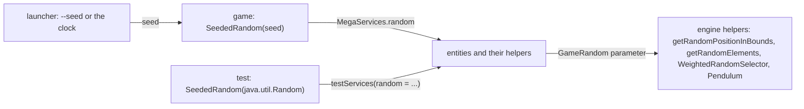

# Random source

Every random value in `engine/` and `core/` comes from one `GameRandom` per session. A test or a later replay can
then fix the seed, or give its own source, and get the same values again.

## Parts

- `GameRandom`: the interface that all code calls. It names the inclusive bound in `nextInt(min, maxInclusive)`;
  `nextFloat(min, max)` gives a value in `[min, max)`.
- `SeededRandom`: the one implementation, on `java.util.Random`. A test that must change the seed in the middle of a
  run keeps its own `java.util.Random` and calls `setSeed` on it.
- The session holds one source, `MegaServices.random`. The launcher prints the seed at start.

## Rules for a change

- Do not call `MathUtils.random*`, `java.util.Random`, `kotlin.random.Random`, a collection `.random()`,
  `.shuffle()` or `.shuffled()` outside this package. The detekt rule `ForbiddenMethodCall` fails `detektMain` on
  them. It resolves types, so it also sees a call with no receiver (`shuffle()` in an `Array` subclass or in
  `with(array)`) and a call with an argument (`list.shuffle(rng)`). `config/detekt/detekt.yml` holds the list.
- A new way to make a random value (a new library call) goes into that list, with a line in the fixture
  `core/src/detektFixture/`. `core:verifyRandomRule` checks the rule against the fixture; after a deliberate change,
  run it once with `-PupdateRandomRuleFixture` and read the diff of `expected-findings.txt`.
- Only the game makes the session source: `SeededRandom(...)` is also on the list, and its one call in
  `MegamanMaverickGame` has `@Suppress("ForbiddenMethodCall")`.
- Limits of the check: it reads only `.kt` files (not Java), and it skips a call that it cannot resolve (for
  example when a library is not on the classpath of `detektMain`).
- A helper with no `services` takes a `GameRandom` parameter; it does not reach for a global.
- One stream: a cosmetic draw (debris, leaves) also moves the values that gameplay draws after it. A split into
  streams is a later decision.
- A seed alone does not repeat a run until the game runs on a fixed tick (item `010`), because the frame delta
  changes the number of draws.

## History

Item `011`, branch `011a`: `docs/mega-refactor/items/011-game-random/`.
