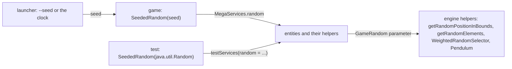

# Random source

Every random value in `engine/` and `core/` comes from one `GameRandom` per session. A test or a later replay can
then fix the seed, or give its own source, and get the same values again.

## Parts

- `GameRandom`: the interface that all code calls. It names the inclusive bound in `nextInt(min, maxInclusive)`;
  `nextFloat(min, max)` gives a value in `[min, max)`.
- `SeededRandom`: the one implementation, on `java.util.Random`. A test that must change the seed in the middle of a
  run keeps its own `java.util.Random` and calls `setSeed` on it.
- The session holds one source, `MegaServices.random`. The launcher prints the seed at start.

## Rules for a change

- Do not call `MathUtils.random*`, `java.util.Random`, `kotlin.random.Random`, a collection `.random()`,
  `.shuffle()` or `.shuffled()` outside this package. `RandomSourceGuardTest` (`core/src/test`) fails on them.
- A helper with no `services` takes a `GameRandom` parameter; it does not reach for a global.
- One stream: a cosmetic draw (debris, leaves) also moves the values that gameplay draws after it. A split into
  streams is a later decision.
- A seed alone does not repeat a run until the game runs on a fixed tick (item `010`), because the frame delta
  changes the number of draws.

## History

Item `011`, branch `011a`: `docs/mega-refactor/items/011-game-random/`.
